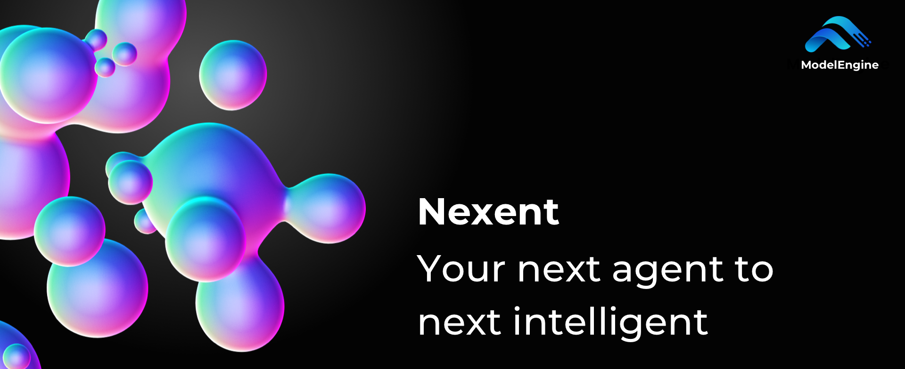

# Nexent

Nexent is an enterprise-grade platform for building and managing AI agents. Users drive agent creation, debugging, and continuous optimization through natural language, while the platform automatically configures tools, Skills, and knowledge bases and connects to existing business systems via MCP and open APIs. Across the full agent lifecycle, Nexent provides access control, version management, runtime monitoring, and end-to-end tracing—helping organizations turn AI pilots into governed, reliable, and sustainably operated production applications.

## 🎬 Demo Video

<video controls width="100%" style="max-width: 800px;">
  <source src="https://github.com/user-attachments/assets/b844e05d-5277-4509-9463-1c5b3516f11e" type="video/mp4" />
  
Your browser does not support the video tag. <a href="https://github.com/user-attachments/assets/b844e05d-5277-4509-9463-1c5b3516f11e">View the demo video</a>

</video>

## 🤝 Join Our Community

> *If you want to go fast, go alone; if you want to go far, go together.*

Our vision for Nexent is that anyone can build agents and organizations can govern them wherever they run. We want people who know their work best to be able to turn their ideas and experience into agents using natural language, even if they have never written code. They can start with a specific problem, refine their agents through everyday use, and share what works with other teams.

We also want organizations to be able to govern agents at every stage, from creation and publication to day-to-day operation. They should be able to define who can create, publish, and use agents, see which tools each run called and what results it produced, and trace the cause when something goes wrong. That way, ideas from frontline teams can grow from small pilots into dependable parts of everyday work that teams can keep improving.

- **🗺️ Check our [Feature Map](https://github.com/orgs/ModelEngine-Group/projects/6)** to explore current and upcoming features.
- **🔍 Try the current build** and leave ideas or bugs in the [Issues](https://github.com/ModelEngine-Group/nexent/issues) tab.

> *Rome wasn't built in a day.*

If our vision speaks to you, jump in via the **[Contribution Guide](../contributing)** and shape Nexent with us.

Early contributors won't go unnoticed: from special badges and swag to other tangible rewards, we're committed to thanking the pioneers who help bring Nexent to life.

Most of all, we need visibility. Star ⭐ and watch the [GitHub repository](https://github.com/ModelEngine-Group/nexent), share it with friends, and help more developers discover Nexent — your click brings new hands to the project and keeps the momentum growing.

## ✨ Key Features

### 🛠️ Easier agent development

- **Interactive agent creation and refinement** — Business users can describe the agent they want to build in natural language in the workbench. Nexent asks for key details and generates a complete agent configuration that users can debug and continue to refine.
- **Asset repository** — Users can copy agents, MCP services, and Skills listed in the repository and reuse them in similar scenarios. They can also publish their own assets to the repository to share them within their organization.
- **Official agent assets** — Organizations can deploy official agents for domains such as government services and healthcare with one click. Teams can use a concrete scenario to see whether the platform meets their business needs, speeding up initial trials and platform selection.

### 📊 Centralized management and operations

- **Agent version management** — Teams can keep testing changes in a draft while users continue working with the published version. If answer quality drops after a release, teams can roll back to an earlier version to recover faster.
- **Monitoring dashboard** — Operations teams can review metrics such as active users and average response time in one place to understand platform usage and spot changes in responsiveness worth investigating.
- **Observability center** — When users report an unexpected result or a slow response, operators can inspect the tool calls, inputs, outputs, and timings for that run to pinpoint the step behind the problem.

### 🔗 A more open integration ecosystem

- **Multi-model integration** — Teams can connect leading large language models and import in-house models with one click. This lets them choose models for each use case and reuse their organization's existing model services.
- **MCP tool ecosystem** — Teams can connect remote services through MCP and verify tool inputs and outputs before binding a tool to an agent. They can also convert existing APIs into MCP services to reuse them in agent applications.
- **A2A protocol** — Agents can collaborate with external third-party agents through the A2A protocol and consolidate the results.

### 🛡️ Enterprise-grade governance

- **Delegated administration and user management** — Organizations can use multi-tenant isolation, role-based access, and user group permissions to give each team access to agents, knowledge bases, and tools according to its responsibilities.
- **Agent evaluation** — Before release, teams can evaluate an agent against a batch of business test cases. Individual scores help identify scenarios where the agent underperforms, and the overall assessment helps determine whether it meets release criteria.
- **Secure sandbox** — Model-generated code and Skill scripts run in a secure, isolated sandbox, protecting core platform services and business data from the effects of agent execution.

For detailed feature information and examples, see our **[Features Guide](./features)**.

## 🏗️ Software Architecture

Nexent separates configuration management, agent runtime, MCP, northbound APIs, data processing, and the web frontend into independent services that can be deployed with Docker Compose or Kubernetes. PostgreSQL, Elasticsearch, Redis, and MinIO respectively provide business-data storage, retrieval indexes, caching and task queues, and object storage.

### 🌐 Layered Architecture Design

- **Frontend Layer** — Modern user interface built with Next.js + React + TypeScript
- **API Service Layer** — FastAPI-based configuration, runtime, MCP, northbound, and data-processing APIs
- **Business Logic Layer** — Manages agents, conversations, knowledge bases, models, memory, permissions, and the asset repository
- **Data Layer** — PostgreSQL, Elasticsearch, Redis, and MinIO store different types of data

### 🚀 Core Service Architecture

- **Agent Services** — Generate and run agents with SmolAgents and stream results through the Runtime service
- **Sandbox and File Workspace** — Run model-generated code and Skill scripts in isolation and synchronize generated files to object storage
- **Data Processing Services** — Parse, chunk, and vectorize documents to build indexes for knowledge-base retrieval
- **MCP Ecosystem** — Provide unified access to remote, containerized, and custom API tools

### ⚡ Distributed Features

- **Asynchronous and Streaming Processing** — Use asynchronous tasks and SSE to continuously return agent execution results
- **Service Decomposition** — Deploy and scale configuration, runtime, and data-processing services independently
- **Containerized Deployment** — Provide both Docker Compose and Helm deployment options

For detailed architectural design and technical implementation, see our **[Software Architecture](./software-architecture)**.

## ⚡ Quick Start

Ready to get started? Here are your next steps:

1. **📋 [Installation & Deployment](../quick-start/installation)** — System requirements and deployment guide
2. **🔧 [Developer Guide](../developer-guide/overview)** — Build from source and customize
3. **❓ [FAQ](../quick-start/faq)** — Common questions and troubleshooting

## 💬 Community & contact

Join our [Discord community](https://discord.gg/tb5H3S3wyv) to chat with other developers and get help!

## 📄 License

Nexent is licensed under the [MIT License](../license).
