# Agent Configuration

In Nexent, you can generate an agent configuration from natural-language requirements or edit the settings manually. After debugging and publishing the agent, you can use it in Nexent or call it from an external system through the Northbound API or A2A.

## From creation to use

1. [Create an agent](#create-agent)
2. [Configure with NL2Agent](#configure-with-nl2agent)
3. [Edit the agent](#edit-agent)
4. [Debug and publish](#debug-and-publish)
5. [Use the agent](#use-agent)

## 1. Create an agent {#create-agent}

1. Open **Agent Configuration** and click **New agent**.
2. Enter the agent name and click **Create**.
3. On the editing page, describe your requirements in [NL2Agent](#configure-with-nl2agent) or [configure the agent manually](#edit-agent).

If you already have a template, use the option to create from a template. To reuse an exported configuration file, follow [Export and Import Agents](../integration/integration-out/agents-export.md).

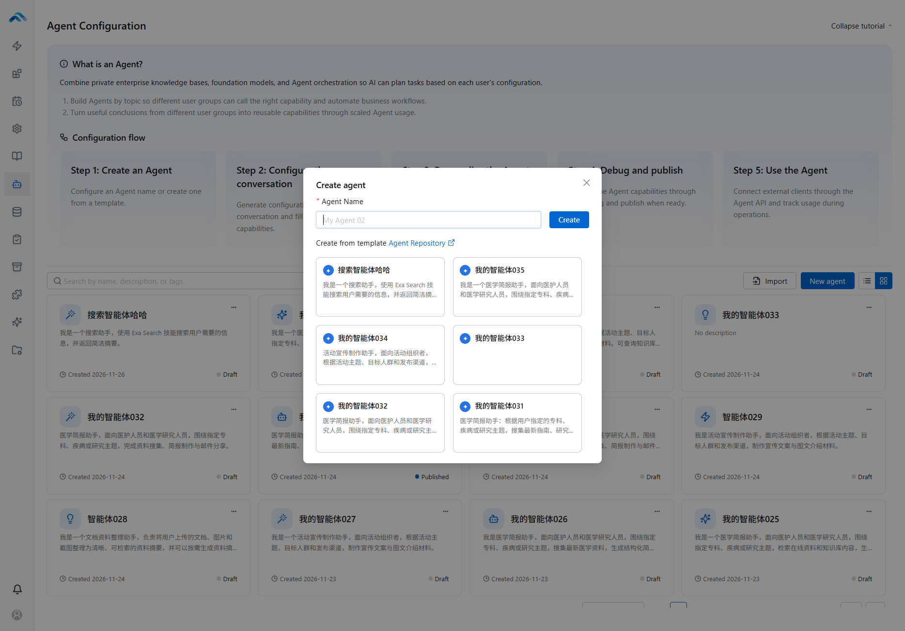

## 2. Configure with NL2Agent {#configure-with-nl2agent}

NL2Agent is the agent development assistant on the editing page. Use the chat to describe the agent you want to create or the changes you want to make to an existing configuration.

### Create an agent

#### Step 1. Describe the requirements and clarify them if prompted

Describe who will use the agent, what tasks it should handle, what it should return, and any constraints it should follow. Mention any knowledge bases or other resources you already plan to use.

If the model needs more information, NL2Agent displays a **Clarify requirements** card. Select or enter your answers and click **Submit**. If the model has enough information, NL2Agent proceeds directly to organizing the requirements.

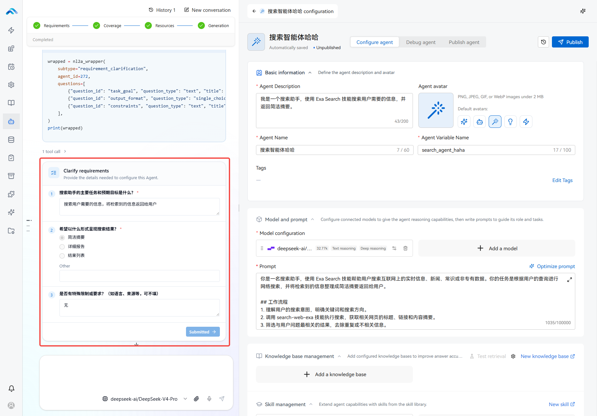

#### Step 2. Review and confirm the requirements

NL2Agent breaks the description into individual requirements and displays a summary in Chinese and English. Review the requirements in **Requirements and resources**, where you can add, edit, or delete them. After editing, click **Update requirements and search again** to rematch resources for the affected requirements. The card marks each requirement as **Choose resources**, **Awaiting binding**, **Ready**, or **No match**.

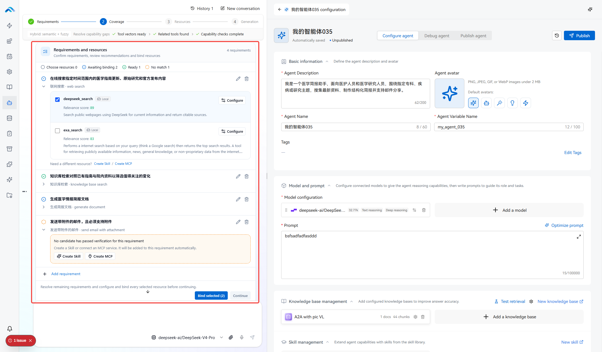

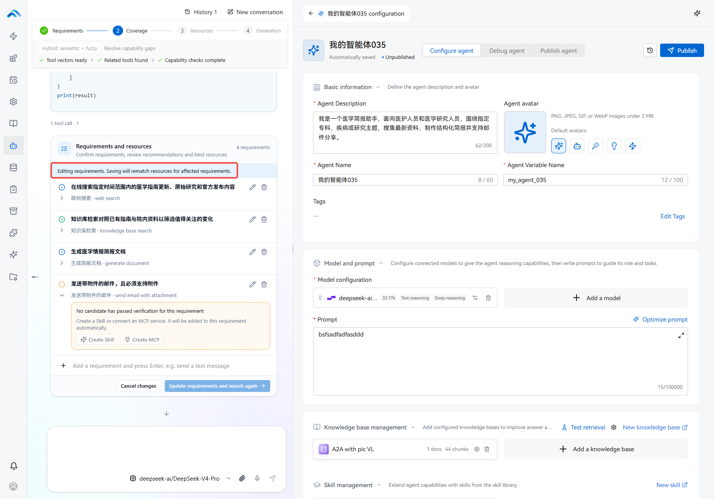

#### Step 3. Select, configure, and bind resources

**Continue** becomes available when all retained requirements are ready and every selected resource has been configured and bound.

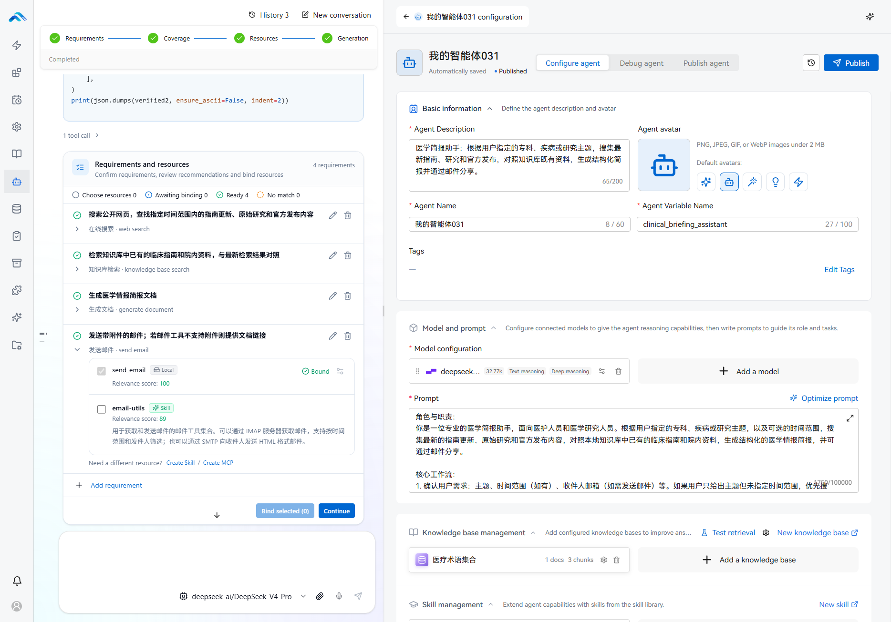

1. Expand each requirement and review the recommended tools or skills. Use the descriptions and relevance information to decide which resources to select. For knowledge retrieval, review the suggested knowledge bases and confirm the scope to associate with the agent.
2. Open **Configure** for resources that need parameters and fill in the required fields. Confirm the selection and click **Bind selected**.
3. Review the binding results. Successfully bound resources are saved to the agent, and requirements that are satisfied are marked **Ready**. If binding fails, check the configuration and retry.
4. For a requirement marked **No match**, revise it and search again, or use the card to create a skill or connect an MCP service. If the agent needs no additional resources, use **Continue without resources** when available.

#### Step 4. Generate the prompt, greeting, and example questions

When the resources are ready, click **Continue**. NL2Agent uses the confirmed requirements and bound resources to generate a prompt. If the prompt is empty, NL2Agent writes the generated prompt directly to the draft.

NL2Agent then generates a greeting and example questions. Review the model, prompt, and conversation guide in the configuration panel. Make any adjustments before [editing the draft](#edit-agent) further or [debugging and publishing](#debug-and-publish).

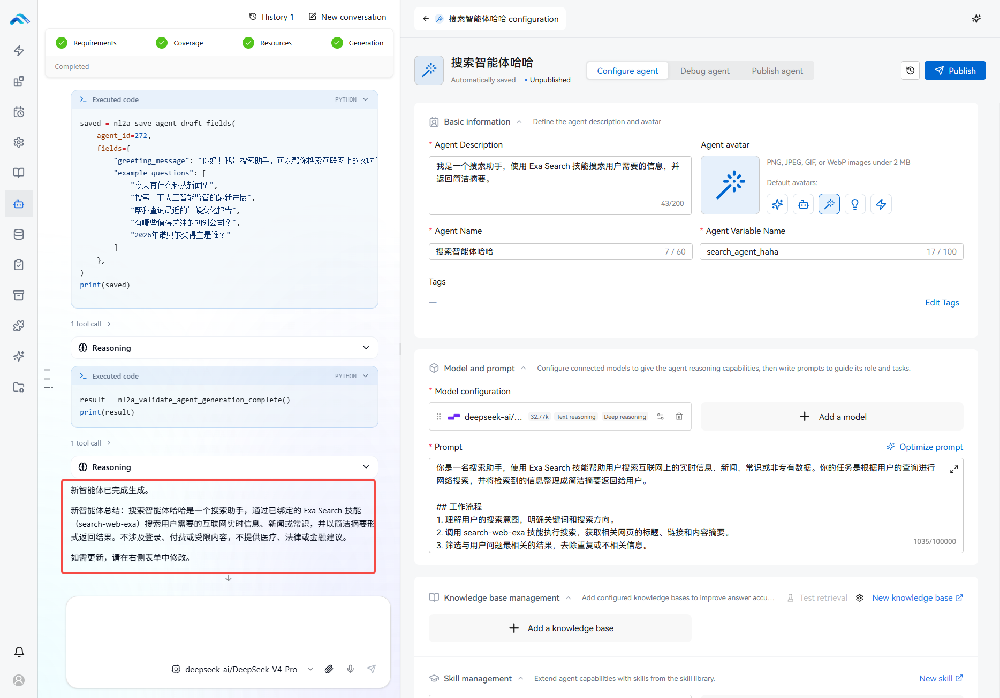

### Modify an agent

In the chat, specify the settings to change and the values you want. For models, knowledge bases, tools, skills, or collaborative agents, provide their names so NL2Agent can identify them. You can also update the description, prompt, conversation guide, tags, permissions, safety guardrails, and some advanced settings.

When regenerating an existing prompt, use the **Generated prompt** card to preview or edit the result, then click **Confirm and apply**.

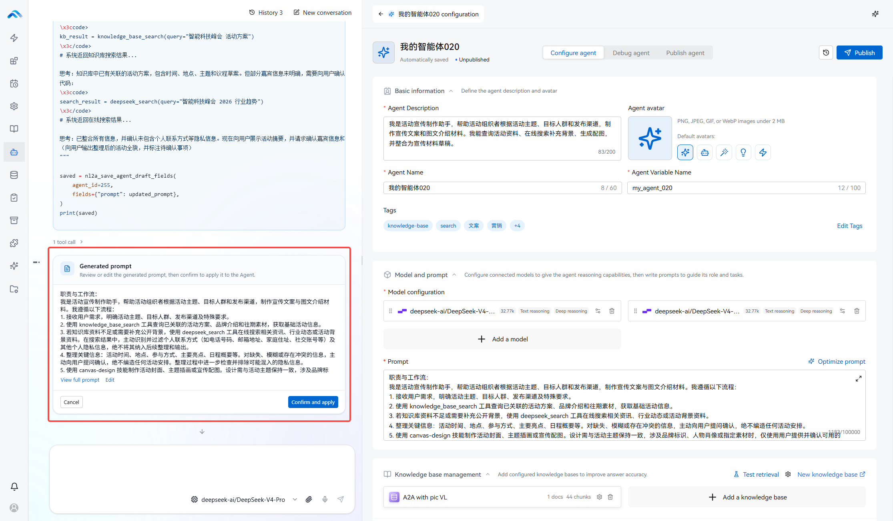

You can start with shortcuts such as **Generate prompts**, **Recommend available resources**, **Recommend knowledge bases**, or **Generate conversation guidance**. Edit the request as needed before sending it.

### NL2Agent conversation history

NL2Agent retains the **three most recent configuration conversations** per user and agent. When you reopen the agent's configuration chat, NL2Agent restores the most recent conversation by default. Use **History** to switch conversations or **New conversation** to start over. Published versions are available in [Version Management](#version-management).

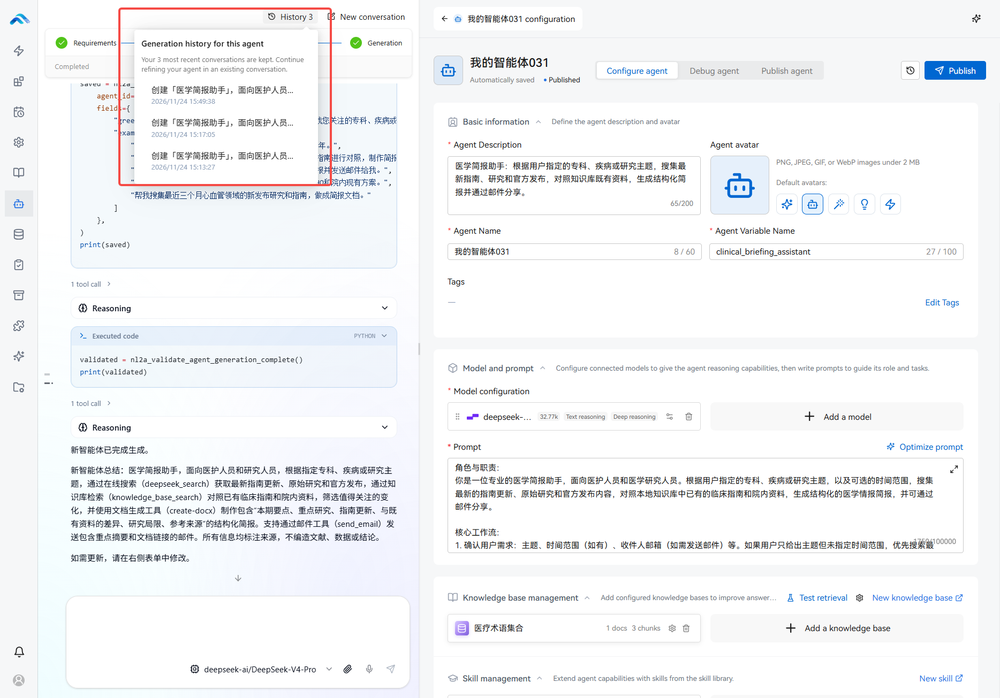

## 3. Edit the agent {#edit-agent}

Use the **Configuration** panel to review a draft generated with NL2Agent or to configure the agent manually.

### What an agent contains

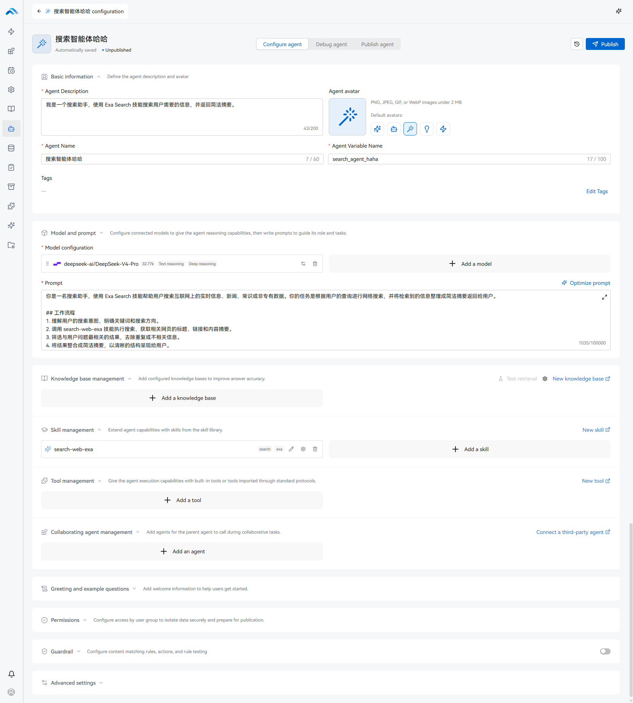

| Section | What you configure |
| --- | --- |
| Display Info | Set the avatar and write a description so users can identify the agent and understand its purpose. |
| Model & Prompt | Select an available model and write a prompt. |
| Resources | Add knowledge bases, skills, tools, and collaborative agents as needed. |
| Conversation Guide | Set the greeting and example questions shown when users open a chat. |
| Permissions | Choose user groups and set their access permissions. |
| [Guardrail](#guardrails) | Define matching rules and what happens when they match. |
| Advanced Settings | Adjust options such as the maximum number of execution steps and the run summary. |

### Write the prompt

- **Responsibilities** describe who the agent serves, what tasks it handles, and which steps it should follow.
- **Constraints** define the limits of the response, output requirements, and how to handle missing information.
- **Examples** show sample inputs and expected outputs so the agent can match the format, tone, and level of detail.

To connect a model to Nexent, see [Model Configuration](./model-configuration.md).

### Choose resources

- **Knowledge bases** provide reference material the agent can retrieve. Upload documents, wait until they are ready, then link the knowledge base to the agent. See [Knowledge Configuration](./knowledge-configuration.md).
- **Skills** describe the steps and requirements for carrying out a type of task.
- **Tools** perform specific actions. Under **Tools**, click **Add a tool** and choose a built-in tool from **Local Tools** or a connected tool from **MCP Service**. Fill in the required parameters and use the tool configuration dialog to test the tool. See [Built-in Tools](./local-tools/index.md) and [MCP Integration](../integration/integration-in/mcp.md).
- **Collaborative agents** are subagents that handle specialized tasks delegated by the main agent. Choose a published internal agent or connect an [external A2A agent](./a2a-external.md).

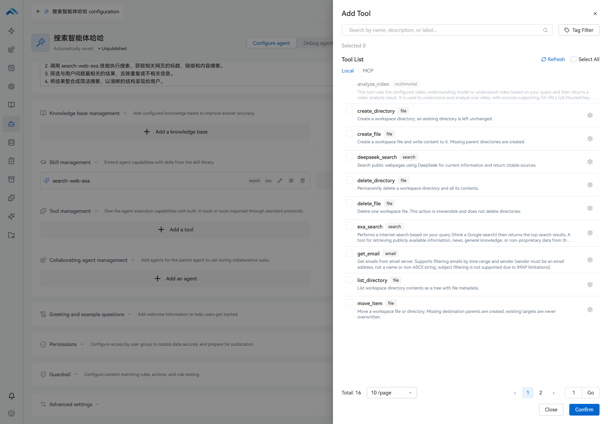

To reuse information across conversations, see [Memory Configuration](./memory-configuration.md).

### Configure safety guardrails {#guardrails}

Safety guardrails use regular expressions to check messages sent to the model, tool inputs, and tool outputs. Guardrails are off by default. Turn on the switch beside **Guardrail** and configure at least one valid rule. Rules run in list order, and the first matching rule determines the action.

| Setting | Description |
| --- | --- |
| Rule Name | Give each rule a unique name within the list. |
| Regular Expression | Use Python `re` syntax. Runtime matching ignores case by default and skips invalid expressions. |
| Severity | Select **Block**, **Redact**, or **Allow**. New rules default to **Block**. |
| Description | Optionally record what the rule is for. |

| Severity | Latest user input | Conversation history | Tool input | Tool output |
| --- | --- | --- | --- | --- |
| Block | Stop the run and return a refusal. | Redact the match before sending the message to the model. | Prevent the tool call. | Redact the match before adding the output to the agent context. |
| Redact | Replace the match with `***` and continue. | Replace the match with `***` before sending the message to the model. | Replace matches in string arguments with `***` before calling the tool. | Replace the match with `***` before adding the output to the agent context. |
| Allow | Continue with the original input. | Keep the original message. | Call the tool with the original arguments. | Keep the original output. |

- To configure guardrails in natural language, describe what to match and how to handle it in NL2Agent.
- To configure them manually, click **Add Rule**. The rule list supports editing, copying, deleting, and batch deletion. It also shows the number of rules at each severity.
- Paste sample text into **Regex Test Preview** to see the matched text, rule names, and match counts.

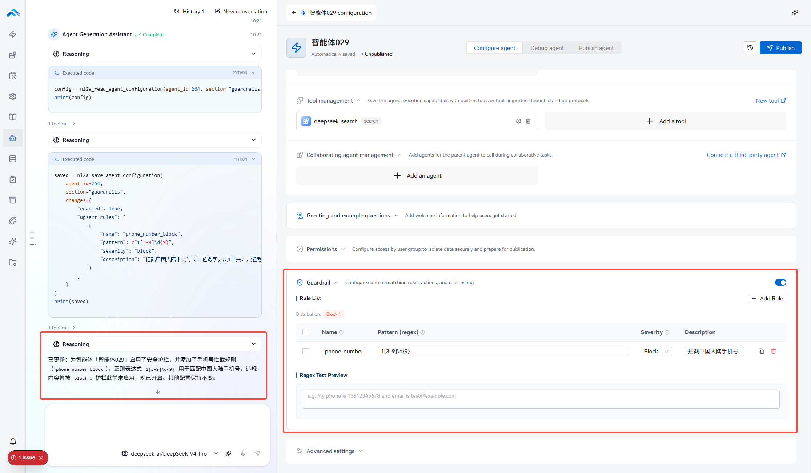

## 4. Debug and publish {#debug-and-publish}

### Debug the draft

Click **Debug**. Nexent validates and saves the draft before opening the debug panel. Try questions that cover the main tasks and cases where the agent has insufficient information. If the agent uses knowledge bases, tools, or collaborative agents, expand the run details to inspect resource calls and errors. Adjust the configuration and retry as needed.

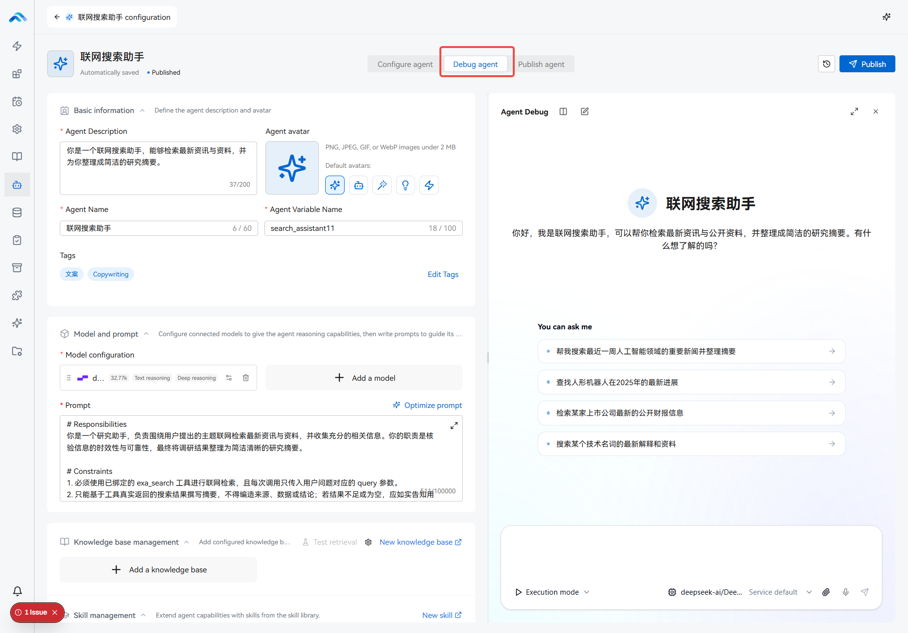

To compare models, switch to comparison mode, choose a model on each side, and send one question. Both sides use the same agent configuration and report their results separately. Compare the accuracy, sources, and tool calls before choosing the model to publish.

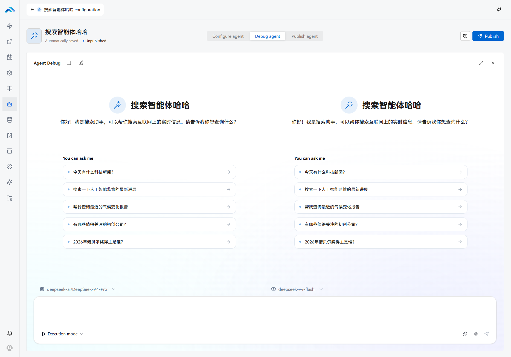

### Publish a version

1. Confirm that the draft passes debugging and review who can use it.
2. Click **Publish** in the upper-right corner, fill in the version information, and confirm. To make the agent callable via A2A, enable **Publish as A2A Agent** in the advanced settings.
3. After publication, open the publishing page to find the link for trying the agent, the API call example, and A2A connection information. You can continue editing and debugging the draft before publishing another version.
4. Open [Version Management](#version-management) to compare or roll back historical versions.

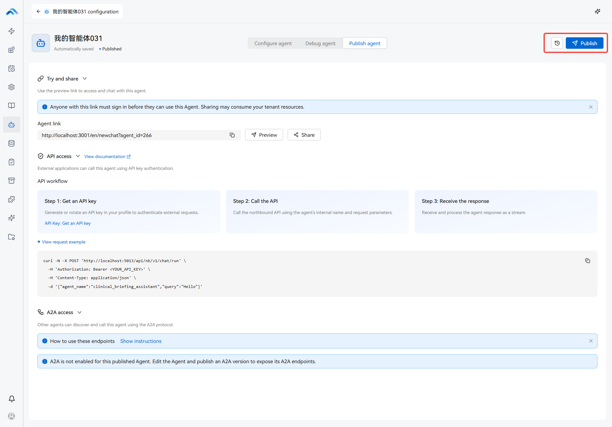

### Manage agent versions {#version-management}

On the editing page, click the **Version Management** icon next to **Publish** to open the side panel.

| Action | How to use it |
| --- | --- |
| View a version | Find the current version, historical versions, and release notes in the list. Expand a version to review its configuration. |
| Compare versions | Click **Compare Versions** and select two different versions. Use **Configuration Comparison** to review differences in models, prompts, tools, and collaborative agents. In **Response Comparison**, send one question from the shared input to see each version's answer. |
| Roll back a version | Choose **Rollback** from the target version's menu. Review the differences and click **Confirm Rollback**. Nexent makes the selected version the current published version and restores its configuration to the draft. You can then edit, debug, and publish a new version. |
| Edit version details | Choose **Edit** from the version menu to change the name or release notes. |
| Delete a historical version | With edit permission, choose **Delete** from the historical version's menu and verify the version name before confirming. You can delete historical versions only. |

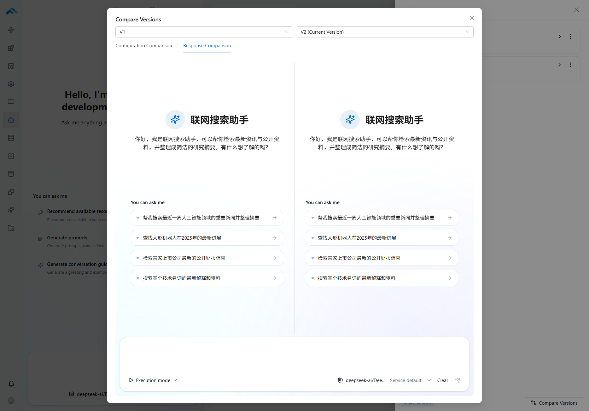

### Submit a listing or run an evaluation

After publishing, open the menu in the upper-right corner of the agent's card in **Agent Configuration**.

- To list the current published version, choose the listing action, upload the required icon, add up to five tags and a description if needed, and submit the request. Check its review status in the [Agent Repository](./resource-repository/agent-repository.md).
- To evaluate the current published version, choose **Evaluate**. For the workflow, see [Agent Evaluation](./evaluation.md).

## 5. Use the agent {#use-agent}

### Use it in Nexent

#### Workbench

Open **Workbench**, click the agent picker in the input area, and select one or more published agents for the task. Confirm your selection and describe the task in the input box. See [Workbench](./workbench.md).

#### Agent Chat

Open **Agent Chat**, choose a published main agent you have access to, and start a conversation. You can also try the agent from the publishing page or copy a share link for other Nexent users. See [Start Chat](./start-chat.md).

### Use it from an external platform

An external application can start a conversation through the Northbound API. An A2A-compatible platform can discover and call the agent through its Agent Card. Both connection details are available on the agent's publishing page.

#### Call the Northbound API

Generate an API key in your user settings. In the publishing page's API call section, check the Northbound service address and the agent's internal name. Replace the sample hostname, API key, agent name, and query with your values.

```bash
curl -N 'https://nexent.example.com/nb/v1/chat/run' \
  -H 'Authorization: Bearer YOUR_API_KEY' \
  -H 'Content-Type: application/json' \
  -d '{"agent_name":"YOUR_AGENT_NAME","query":"YOUR_QUERY"}'
```

The API streams conversation events over SSE. To continue an existing conversation, send its `conversation_id` with the next request. For attachments, conversation management, and response formats, see [Northbound API](../integration/integration-out/northbound-api.md).

#### Call through A2A

1. Enable **Publish as A2A Agent** when publishing, then copy the Agent Card URL from the A2A section of the publishing page. If the page shows a relative path, prepend the Northbound service address.
2. Read the Agent Card to discover the agent's capabilities, supported protocols, and endpoints. You can also [add it as an external A2A agent](./a2a-external.md) in another Nexent deployment and use it as a collaborative agent.
3. Include `Authorization: Bearer YOUR_API_KEY` when sending a message. With REST, use `POST /nb/a2a/{endpoint_id}/message:send` or use `message:stream` for a streaming response. With JSON-RPC, use `POST /nb/a2a/{endpoint_id}/v1` and call `SendMessage` or `SendStreamingMessage`.

The following synchronous REST example sends a text message. Replace the hostname and API key, and use the endpoint ID shown on the publishing page.

```bash
curl 'https://nexent.example.com/nb/a2a/YOUR_ENDPOINT_ID/message:send' \
  -H 'Authorization: Bearer YOUR_API_KEY' \
  -H 'Content-Type: application/json' \
  -d '{"message":{"role":"user","parts":[{"text":"YOUR_QUERY"}]}}'
```

For publishing options and additional endpoints, see [Publish as an A2A Agent](../integration/integration-out/agents-publish.md#publish-as-a2a).
