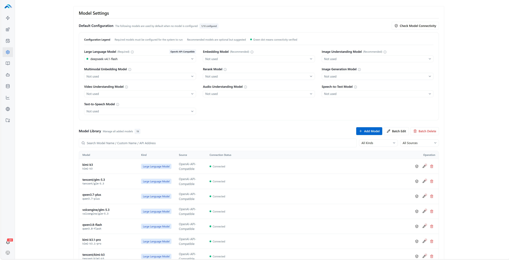
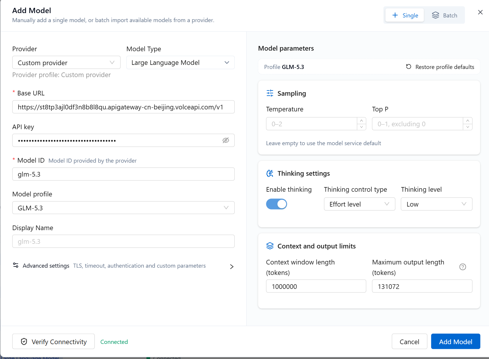
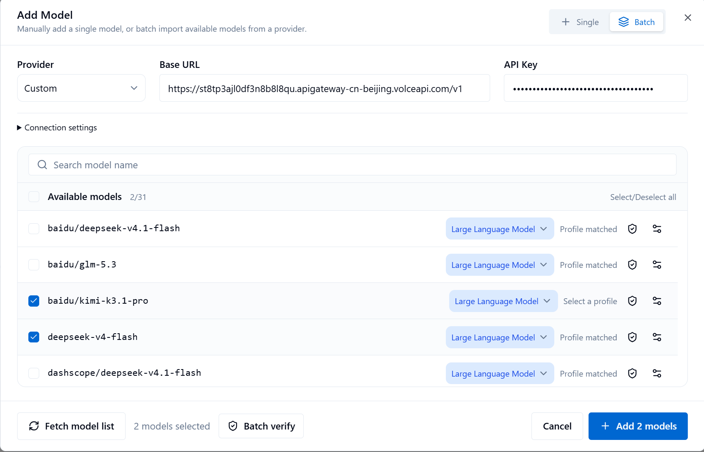
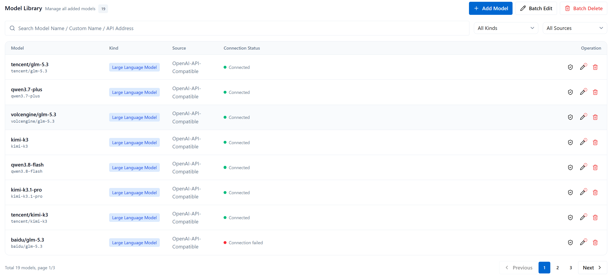
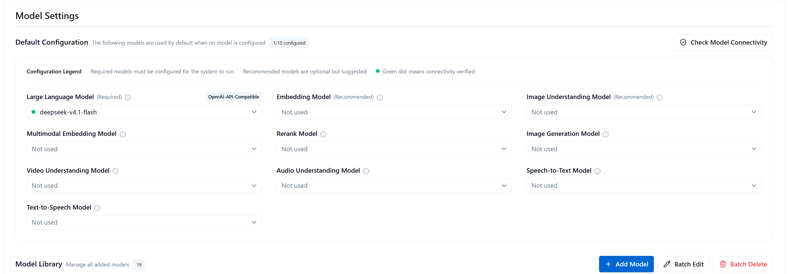

# Model Configuration

In the Nexent sidebar, select **Agent Development → Model Configuration**. On the **Model Settings** page, use **Default Configuration** to choose the models Nexent uses when no model is explicitly configured. Use **Model Library** to add and manage models. When setting up Nexent for the first time, add a model to the library, then select it in Default Configuration.

## 🤖 Model Configuration

### Add a single model

1. In **Model Library**, select **Add Model → Single**.
2. Select a **Provider** and **Model Type**. Nexent fills in the service address for preset providers. You can edit it to match your deployment. For a custom service, enter its **Base URL**.
3. Enter the provider's **Model ID** or **Model Name**, such as `Qwen/Qwen3-8B`. The optional **Display Name** identifies the model in Nexent and defaults to the model name. Enter the **API Key** or other credentials shown in the form as required by your provider.
4. For a large language model, Nexent tries to match a **Model profile**. Review the match and select a profile manually if needed. A profile can prefill model settings. Review the values against what your service supports before saving. For other model types, use **Advanced Settings** where available, such as to configure chunking for an embedding model.
5. Select **Verify Connectivity** to test the connection. Review your settings, then select **Add Model**. The new model appears in Model Library.

### Add models in batches

1. In **Model Library**, select **Add Model → Batch**.
2. Select a **Provider**, confirm or enter the **Base URL**, and enter the **API Key** if the provider requires one. Select **Fetch model list**. The endpoint must support model listing.
3. Search for and select the models to import. Use the controls on individual rows to change the model type or configure a model.
4. Verify models individually or select **Batch verify** to check the selected models. When ready, select **Add N models**.

When the ModelEngine integration is enabled, **Sync ModelEngine Models** opens the **Batch** tab directly.

### Set default models

In **Default Configuration**, open a dropdown and choose a model of the corresponding type from the library. Nexent saves your selection automatically. If the model you need is missing, add it to Model Library first.

| Priority | Models | Purpose |
| --- | --- | --- |
| Required | Large language model | Provides default chat, reasoning, and question answering. |
| Recommended | Text embedding and image understanding | Text embedding supports knowledge base indexing, semantic search, and memory. Image understanding supports questions about images. |
| Optional | Multimodal embedding, rerank, image generation, video understanding, audio understanding, speech recognition, and speech synthesis | Configure these for multimodal retrieval, reranking, multimodal processing, or voice input and output. |

Read the confirmation prompt before changing an active embedding model. This may affect existing files, knowledge bases, or memory.

### Manage the model library

- Search by model name or filter by **Type** and **Provider**. Each row shows the connection status. Models selected in Default Configuration carry a default badge.
- To change or remove a model, select **Edit** or **Delete** in its **Actions** column. Editable fields vary by model type. To change the model or profile used by a saved LLM outlet, add a new outlet.
- Select **Batch Edit**, then choose a connection group to update its **API Key** or **Base URL**. Use **Batch Delete** to select and remove one or more models in a single operation.

Accounts with view-only access cannot change defaults or manage models.

### Check model connectivity

- **Check the default models**. Select **Check Model Connectivity** at the top right of **Default Configuration** to verify the selected defaults. When the check completes, a green dot next to the model name indicates a successful connection. You can view failure details and retry a failed check.
- **Check one model**. Find the model in **Model Library** and select **Verify Connectivity** on its row. If the check fails, review the **Base URL**, model ID or name, credentials, and provider permissions, then retry.

### 🤖 Supported Providers

#### Large Language Models

When adding a single large language model in the current tenant, the **Provider** dropdown offers profiles for SiliconFlow, Alibaba Cloud Model Studio (China), TokenPony, DeepSeek, Volcengine Ark, and Volcengine Ark Coding Plan. Ark pay-as-you-go and Coding Plan use different base URLs.

Batch import uses the built-in model catalog, which also lists OpenAI, Z.AI, Anthropic Claude, Google Gemini, Mistral AI, xAI (Grok), and ModelEngine. Batch import requires an endpoint that can return a model list. Use the connectivity check to confirm that a specific model is callable.

For other providers such as Moonshot, select **Custom provider** and enter an **OpenAI Chat Completions**-compatible Base URL, the model ID, and any required credentials.

Getting started:

1. Sign up at the provider's portal.
2. Create and copy an API key.
3. Find the Base URL for the API protocol in the provider's documentation.
4. In Nexent, go to **Model Library → Add Model** and enter the connection details from the provider.

#### Multimodal Models

Use the same API key and URL as LLMs but specify a multimodal model name, for example **Qwen/Qwen2.5-VL-32B-Instruct** on SiliconFlow.

#### Embedding Models

Use the same API key as LLMs but typically a different endpoint (often `/v1/embeddings`), for example **BAAI/bge-m3** from SiliconFlow.

#### Rerank Models

Use the same API key as LLMs but typically a different endpoint (often `/v1/rerank`).

### Speech Models

**Speech recognition (STT)** transcribes microphone input into chat text. **Speech synthesis (TTS)** reads assistant replies aloud. You can configure each model separately.

#### Alibaba Cloud Model Studio (DashScope)

1. Create an **API Key** in your Model Studio workspace. Use an endpoint in the same region as the key. [Model Studio API key guide](https://help.aliyun.com/en/model-studio/get-api-key)
2. In Nexent, go to **Model Library → Add Model → Single** and select **Custom** as the provider. Enter the model type and name from the table, then enter the **API Key** in the main form.

   | Model Type | Model Name | Base URL (China, Beijing) |
   | --- | --- | --- |
   | Speech-to-Text Model | `qwen3-asr-flash-realtime` | `wss://dashscope.aliyuncs.com/api-ws/v1/realtime` |
   | Text-to-Speech Model | `qwen3-tts-flash-realtime` | `wss://dashscope.aliyuncs.com/api-ws/v1/realtime` |

3. To set the speech provider explicitly, open **Advanced Settings**, select `dashscope` under **STT Provider** or **TTS Provider**, then save the settings and verify connectivity.

Use a `wss://` address for speech models. For speech recognition on a dedicated Beijing workspace domain, use `wss://{WorkspaceId}.cn-beijing.maas.aliyuncs.com/api-ws/v1/realtime` and replace `{WorkspaceId}` with your workspace ID. Enter the Base URL through `/realtime`. Nexent appends `?model=...` automatically. [Real-time speech recognition](https://help.aliyun.com/en/model-studio/qwen-asr-realtime-interaction-process) · [Real-time speech synthesis](https://help.aliyun.com/en/model-studio/interactive-process-of-qwen-tts-realtime-synthesis)

#### Volcengine (Doubao Voice)

1. Open the [Doubao Voice console](https://console.volcengine.com/speech/app) and switch to the legacy console using the dropdown in the upper left. In **API Service Center**, select an application with the required service enabled and copy its **App ID** and **Access Token** from the service authentication section. Nexent uses these credentials for Volcengine voice. [Volcengine console guide](https://docs.volcengine.com/docs/doubao-voice/console-guidance?lang=en)
2. In Nexent, go to **Model Library → Add Model → Single** and select **Custom** as the provider. Use the row that matches the service enabled for your application.

   | Model Type | Volcengine Service | Nexent Model Name | Base URL |
   | --- | --- | --- | --- |
   | Speech-to-Text Model | Doubao Streaming ASR 1.0 (hourly) | `speech_istreaming` | `wss://openspeech.bytedance.com/api/v3/sauc/bigmodel` |
   | Speech-to-Text Model | Doubao Streaming ASR 2.0 (hourly) | `volc.seedasr.sauc.duration` | `wss://openspeech.bytedance.com/api/v3/sauc/bigmodel_async` |
   | Text-to-Speech Model | Volcengine speech synthesis (built-in configuration) | `speech_tts` | `wss://openspeech.bytedance.com/api/v1/tts/ws_binary` |

3. Open **Advanced Settings** and set **STT Provider** or **TTS Provider** to `volcengine`. Enter the **App ID** and **Access Token**, then select **Save**. Leave **API Key** in the main form blank.

For speech recognition, **1.0** and **2.0** are service versions. **Hourly** refers to billing by the duration of recognized audio. Choose the model name that matches the version enabled for your application. Nexent sends the corresponding resource ID. [Volcengine real-time speech recognition API](https://docs.volcengine.com/docs/doubao-voice/bidirectional-streaming-automatic-speech-recognition-websocket?lang=en)

The built-in `speech_tts` configuration uses resource ID `seed-tts-2.0` and the legacy WebSocket address in the table. Run the connectivity check to confirm that your application can access this endpoint. [Legacy Volcengine speech synthesis API](https://docs.volcengine.com/docs/doubao-voice/websocket-interface?lang=en)

#### Verify and use speech models in chat

1. Select **Verify Connectivity**, then **Add Model** once the check passes. If a Volcengine check fails, confirm that you saved Advanced Settings and that the enabled service version, model name, and Base URL match.
2. Under **Default Configuration**, select the model in the **Speech-to-Text Model** or **Text-to-Speech Model** dropdown. This activates the model for chat after you add it to the library.
3. For **voice input**, click the microphone by the chat input and grant microphone access if prompted. Click again when you finish speaking. You can edit the transcribed text before sending it.
4. To **read a reply aloud**, select the speaker icon on the assistant reply. Select it again to stop. The button appears after you select a default speech synthesis model.

## 💡 Need Help

If you run into provider issues:

1. Review the provider's documentation.
2. Check API key permissions and quotas.
3. Test with the provider's official samples.
4. Ask the community in our [Discord server](https://discord.gg/tb5H3S3wyv).

## 🚀 Next Steps

After closing the Model Configuration flow, continue with:

1. **[Knowledge Base](./knowledge-configuration)** – Create and manage knowledge bases.
2. **[Agent Configuration](./agent-configuration)** – Build and configure agents.

Need help? Check the **[FAQ](../../quick-start/faq)** or open a thread in [GitHub Discussions](https://github.com/ModelEngine-Group/nexent/discussions).
