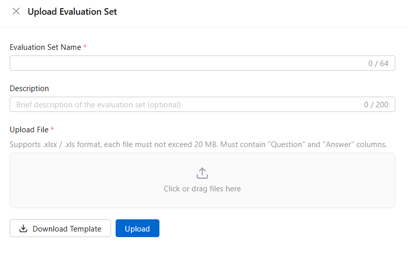
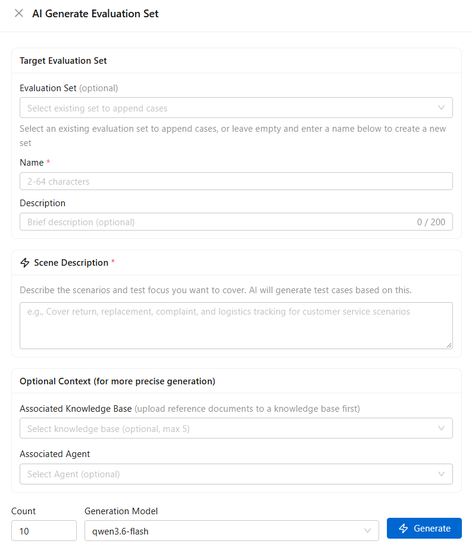

# Manage Evaluation Sets

An evaluation set is a collection of test cases used to drive an evaluation. Every case must contain a question. A reference answer is optional at the data level but is important for Answer Accuracy, Answer Completeness, and Factual Accuracy.

## Import an Excel file

1. In **Agent Evaluation**, open the **Sets** tab.
2. Select **Upload**, and fill in the set name (up to 64 characters) and an optional description (up to 200 characters) in the drawer.
3. Choose an `.xlsx` or `.xls` file in the drag-and-drop area and upload it (the file must contain "Question" and "Answer" columns). You can also select **Download Template** first and fill in the data with it.

Example of the upload dialog:

  

The following column names are supported. Chinese and English headers are accepted:

| Field | Chinese header | Required | Description |
|-------|----------------|:--------:|-------------|
| `session_id` | 会话ID | No | Same ID groups turns in one conversation |
| `request_id` | 请求顺序 | No | Turn order within a conversation, starting at 1 |
| `query` | 问题 | **Yes** | User input sent to the agent |
| `answer` | 答案 | No | Reference answer; `reference_output` and `expected_output` are also accepted |

Leave session fields empty for single-turn cases. For multi-turn cases, keep turn numbers consecutive. One evaluation run processes at most 10 turns per session.

## Generate a set with AI

1. In the **Sets** tab, select **AI Generate Evaluation Set**.
2. Under **Target evaluation set**, select an existing set to append cases to (its name and description become locked), or leave it empty and fill in a name and description to create a new set.
3. Enter a scene description (required, up to 1,000 characters) and select a generation model.
4. Add optional context as needed.
5. Set the generation count (1–200, 10 by default) and select **Generate**.

Example of the AI generation dialog:

  

Optional context includes:

- **Linked knowledge bases**: select up to 5 knowledge bases, so the system can retrieve relevant content first;
- **Linked agent**: select one agent whose configuration, tools, skills, and sub-agents provide context.

Generation runs asynchronously. The set shows **Generating** (with a progress percentage), **Ready**, or **Failed**. Open the set after generation to review and edit the cases.

> Review AI-generated questions and reference answers before using them as a formal benchmark.

## Review and maintain cases

Open **View** for a set to open the case drawer, where you can:

- search cases by question;
- add a case with **Add Case** in the top-right corner;
- edit the question, answer, session ID, or turn order inline in the table;
- delete selected cases in bulk, or delete a single case;
- export the set as Excel.

The system restricts changes that could invalidate a set while it is referenced by an active evaluation task. Export the set as Excel before maintaining a long-lived benchmark if necessary.

## Data limits

| Area | Current limit |
|------|---------------|
| File format | `.xlsx` and `.xls` only |
| Upload size | 20 MB per file by default; the exact limit is deployment-configured |
| Evaluation sets | 50 per tenant |
| Cases | 2,000 per set |
| Question length | 2,000 characters |
| Reference-answer length | 5,000 characters |
| Set name | 2–64 characters |
| Multi-turn | Up to 10 turns per session during one run |
