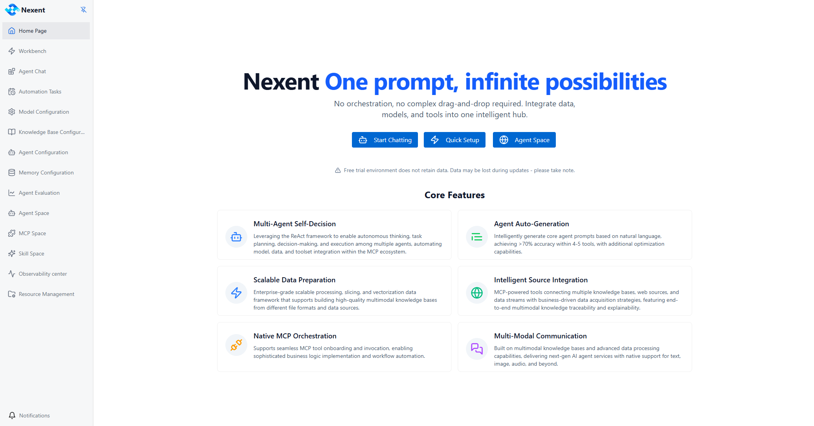

# Home Page

Welcome to Nexent. This page introduces the homepage and main navigation, and helps you choose where to start.

If your administrator has already prepared models and agents, you can start chatting right away. To build your own agent, begin with agent configuration or browse reusable resources.

## Explore the homepage

The homepage provides shortcuts to common tasks. Use the left sidebar to switch between pages. Expand it to see entry names, or pin it to keep it open.

### Homepage shortcuts

| Entry | What it opens | Use it to |
| --- | --- | --- |
| **Start Chatting** | The agent chat page, where you can select an available agent and send a message | Complete tasks with an existing agent |
| **Quick Setup** | The agent configuration page, where you can create or configure an agent | Build your own agent |
| **Agent Space** | Shared agents and agents you are authorized to manage | Find, reuse, or manage agents |

Shortcuts are displayed according to your permissions. **Quick Setup** currently opens agent configuration. Model connections and knowledge bases can be prepared through the sidebar.

### Left sidebar

The following table groups the main entries by purpose. Available entries depend on your account permissions and deployment settings.

| Goal | Main entries | Purpose |
| --- | --- | --- |
| Daily use | **Workbench**, **Agent Chat**, **Automation Tasks** | Work on tasks, chat with existing agents, or manage scheduled tasks |
| Agent development | **Model Configuration**, **Knowledge Base Configuration**, **Agent Configuration**, **Memory Configuration**, **Agent Evaluation** | Prepare resources, then create, debug, and evaluate agents |
| Resource reuse | **Agent Space**, **MCP Space**, **Skill Space** under **Resource Space** | Find and reuse agents, external tools, and skills |
| Resource and permission management | **Resource Management**, **Asset Administrator Resource Management** | Manage resources and access within your authorized scope |
| Observability and operations | **Observability center**, **Operations dashboard**, **System configuration** | Inspect runtime information or perform authorized operations and configuration tasks |

The **Agent Space** homepage shortcut and the sidebar entry under **Resource Space** open the same page. See the relevant guides for detailed instructions.

## Choose where to start

### Use an existing agent

1. Click **Start Chatting** on the homepage, or select **Agent Chat** in the sidebar.
2. Select an agent you can use, enter your question, and send it.
3. Add files or ask follow-up questions as needed.

If no agents are available, ask your administrator or agent developer to check publishing status and access permissions. See [Agent Chat](./start-chat) for details.

### Build your own agent

1. Confirm that a suitable model is available. To connect another model, see [Model Configuration](./agent-development/model-configuration).
2. Click **Quick Setup**, or open **Agent Development → Agent Configuration**, to create and configure an agent. You can also browse [Agent Space](./resource-repository/agent-repository) for reusable resources.
3. Configure tools, skills, knowledge bases, and memory as needed. **A knowledge base is optional**: prepare one when your agent needs to retrieve information from your own materials.
4. Debug the agent and check its results before publishing. Then verify the experience on the chat page.

See [Agent Configuration](./agent-development) for detailed instructions, or [Knowledge Base Configuration](./agent-development/knowledge-configuration) to prepare your own reference materials.

### Initialize or administer the platform

Follow the [Installation Guide](../quick-start/installation) to initialize accounts and tenants after the first deployment. Users with an existing account can sign in directly without creating another tenant administrator.

Administrators can prepare models and configure users and resource permissions before developers create and publish agents. See [Resource Management](./resource-management) for roles and access control.

## Why an entry or resource may be missing

- **Account permissions**: Your roles and grants determine which navigation entries, shortcuts, and actions are available. Contact your administrator if you need additional access.
- **Deployment settings**: Some deployments hide the homepage and open the workbench, agent chat, or another authorized page after sign-in. The workbench may also be disabled.
- **Resource permissions**: Access to a page does not grant access to every resource on it. Models, agents, and knowledge bases have their own visibility and usage permissions.

Use the entries available in your environment. You do not need to switch to an administrator account to match the examples in this guide.

## Next steps and help

- [Agent Chat](./start-chat): Select an agent, send questions, and view results.
- [Auto Tasks](./auto-tasks): Manage scheduled tasks.
- [Agent Configuration](./agent-development): Create, configure, debug, and publish agents.
- [Agent Space](./resource-repository/agent-repository): Find and reuse existing agents.
- [FAQ](../quick-start/faq): Troubleshoot usage and deployment issues.

You can also ask questions in [GitHub Discussions](https://github.com/ModelEngine-Group/nexent/discussions). Include your version, reproduction steps, and error messages, and hide account details, keys, and business data.
