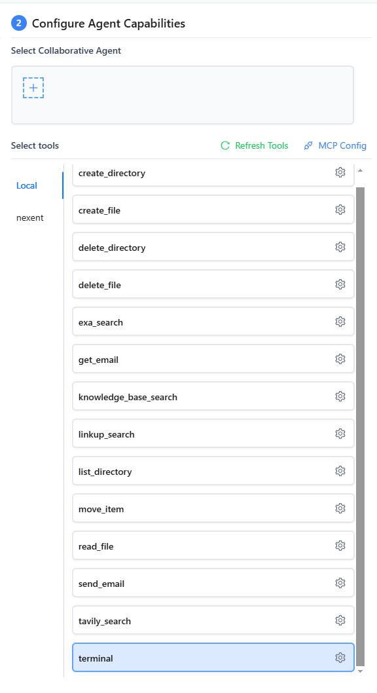
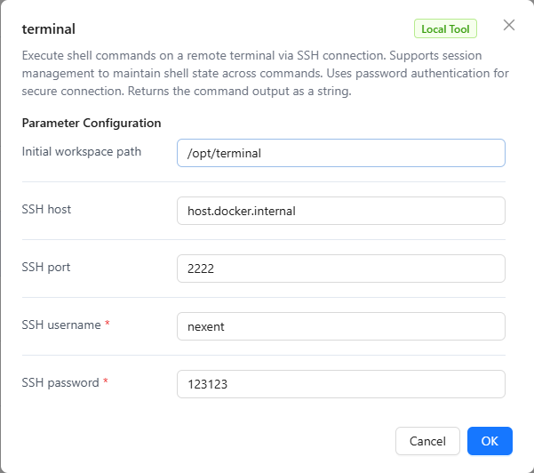

# Terminal Tool

The Terminal tool allows agents to execute shell commands on remote servers through SSH connections. It supports session management to maintain shell state between commands, uses password authentication for secure connections, and returns command output results.

## 🧭 Tool List

- `terminal`: Execute shell commands on a remote terminal over SSH, with multi-session state, password authentication, and output cleanup

## 🧰 Example Use Cases

- Run remote operations commands, check logs, processes, and system status
- Run scripts and manage files or directories on remote hosts
- Maintain shell state across multi-step operations (e.g., change directory first, then run commands)

## 🧾 Parameters & Behavior

### Runtime parameters

- `command`: The shell command to execute, required
- `session_name`: Session name for connection reuse, default `default`
- `timeout`: Command timeout in seconds, default 30

### Connection configuration parameters

- `ssh_host`: IP address or hostname of the SSH server (default `nexent-openssh-server` for the Nexent Terminal container)
- `ssh_port`: SSH service port, default 22
- `ssh_user`: SSH login username
- `password`: SSH login password
- `init_path`: Initial working directory, default `~`

### Port notes

- The tool's `ssh_port` defaults to 22; the SSH service inside the Nexent Terminal container also listens on 22, so the default configuration works directly within the platform container network
- The development Compose file maps host port 2222 to container port 22 (use `ssh -p 2222` when testing from the host); the production Compose file does not publish a host port
- For third-party SSH servers, fill in the actual port

### Output format

The tool returns a JSON result containing:

- **command**: The executed command
- **session_name**: The session name used
- **output**: Command output (control characters and prompts are cleaned automatically)
- **timestamp**: Execution timestamp
- **error**: Error message (when execution fails)

## 🛠️ How to Use

### Option 1: Use the Nexent Terminal container (recommended)

Nexent ships a pre-configured Terminal container `nexent-openssh-server` with a complete SSH environment and common tools, ready out of the box:

- Enable it through the deployment script: `bash deploy.sh docker --components infrastructure,application,data-process,terminal`; choose to enable the terminal container when prompted, and configure SSH credentials and the mounted directory as instructed
- The container working directory is `/opt/terminal`, preloaded with curl, wget, vim, git, and a Python 3 environment (pip, virtualenv, conda); SSH sessions time out after 60 minutes
- You can also build the image locally: `docker build --progress=plain -t nexent/nexent-ubuntu-terminal -f deploy/images/dockerfiles/terminal/Dockerfile .`; see the [Docker build guide](/en/deployment/docker-build) for the full build and push workflow

Verify the container is running:

```bash
# Check container status
docker ps | grep nexent-openssh-server

# Test SSH from the host in development (2222 maps to container 22)
ssh -p 2222 root@localhost

# Check container logs
docker logs nexent-openssh-server
```

### Option 2: Use a third-party SSH server

To set up SSH on an existing server or a self-built container:

**Container-based (good for development testing and temporary use)**: build an Ubuntu image with `openssh-server` installed, create a user, and allow password login:

```dockerfile
FROM ubuntu:24.04
ENV DEBIAN_FRONTEND=noninteractive
RUN apt-get update && apt-get install -y openssh-server sudo vim bash \
    && rm -rf /var/lib/apt/lists/*
RUN useradd -ms /bin/bash test \
    && echo 'test:test@123' | chpasswd \
    && usermod -aG sudo test
RUN mkdir /var/run/sshd \
    && sed -i 's/#PermitRootLogin prohibit-password/PermitRootLogin yes/' /etc/ssh/sshd_config \
    && sed -i 's/#PasswordAuthentication yes/PasswordAuthentication yes/' /etc/ssh/sshd_config
CMD ["/usr/sbin/sshd", "-D"]
```

```bash
docker build -t nexent-terminal .
docker run -d --name nexent-terminal -p 2222:22 nexent-terminal
```

**Server installation (good for production)**: install and enable `openssh-server` on the Linux server, ensure `PasswordAuthentication yes` in `/etc/ssh/sshd_config`, set the port as needed, and restart the SSH service. Native performance with full control over SSH configuration.

### Configure the Terminal tool in an agent

1. Open the **[Agent Configuration](../agent-development/agent-configuration)** page and select the target agent
2. Find the Terminal tool in the tool list and add it
3. Select Configure on the tool row and fill in the connection parameters

<div style="display: flex; justify-content: center;">
  
</div>

**Example configuration (Nexent Terminal container, inside the platform container network)**:

```json
{
  "ssh_host": "nexent-openssh-server",
  "ssh_port": 22,
  "ssh_user": "root",
  "password": "your-container-password",
  "init_path": "/opt/terminal"
}
```

**Example configuration (third-party SSH server)**:

```json
{
  "ssh_host": "192.168.1.100",
  "ssh_port": 22,
  "ssh_user": "nexent-user",
  "password": "your-secure-password",
  "init_path": "~"
}
```

<div style="display: flex; justify-content: center;">
  
</div>

## 🛡️ Safety & Best Practices

- Use strong passwords and never expose SSH credentials in conversations
- Nexent Terminal container: keep the image updated, restrict access to the mounted directory, monitor resource usage, and back up important data regularly
- Third-party servers: change the default SSH port, configure IP allowlists, and enable fail2ban protection

```bash
# Install and configure fail2ban against brute-force attacks
sudo apt install fail2ban -y
sudo nano /etc/fail2ban/jail.local
# [sshd]
# enabled = true
# port = ssh
# filter = sshd
# logpath = /var/log/auth.log
# maxretry = 3
# bantime = 3600
```

## 🔧 FAQ

**Q1: SSH connection times out**

Check the following:

- **Nexent Terminal container**: whether the container is running, whether the port mapping is correct (development host 2222 → container 22), and whether the container logs show errors
- **Third-party SSH server**: network connectivity, SSH service status, firewall rules, and the port

```bash
# Check container status and port usage
docker ps | grep nexent-openssh-server
netstat -tlnp | grep :2222

# Check SSH status on a third-party server
sudo systemctl status ssh
sudo netstat -tlnp | grep :22
```

**Q2: Authentication fails**

- Confirm the username and password are correct (case-sensitive)
- Confirm password login is allowed (`PasswordAuthentication yes`)
- Use `ssh -v username@server-ip` to inspect the authentication process

**Q3: Insufficient permission to run commands**

- Confirm the user has execute permission (`groups username`)
- Check the sudo configuration (`sudo -l`)
- Verify the target file permissions (`ls -la /path/to/command`)

**Q4: Commands run slowly**

- Check server load and disk usage (`top`, `df -h`)
- Adjust the `timeout` parameter and optimize how commands are executed

**Q5: The Nexent Terminal container fails to start**

```bash
sudo systemctl status docker
docker-compose config
docker-compose logs nexent-openssh-server
docker-compose restart nexent-openssh-server
cat .env | grep -E "(SSH_USERNAME|SSH_PASSWORD|TERMINAL_MOUNT_DIR)"
```

Common causes: Docker not running, port already in use, incorrect environment variables, or insufficient permissions on the mounted directory.

If you run into any problem, ask in [GitHub Discussions](https://github.com/ModelEngine-Group/nexent/discussions) for support.
