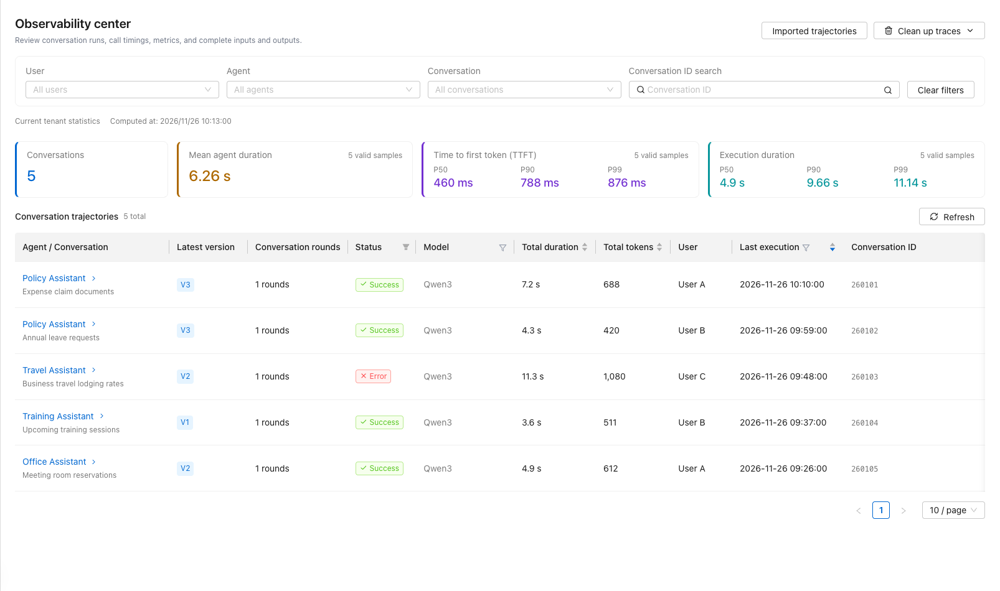
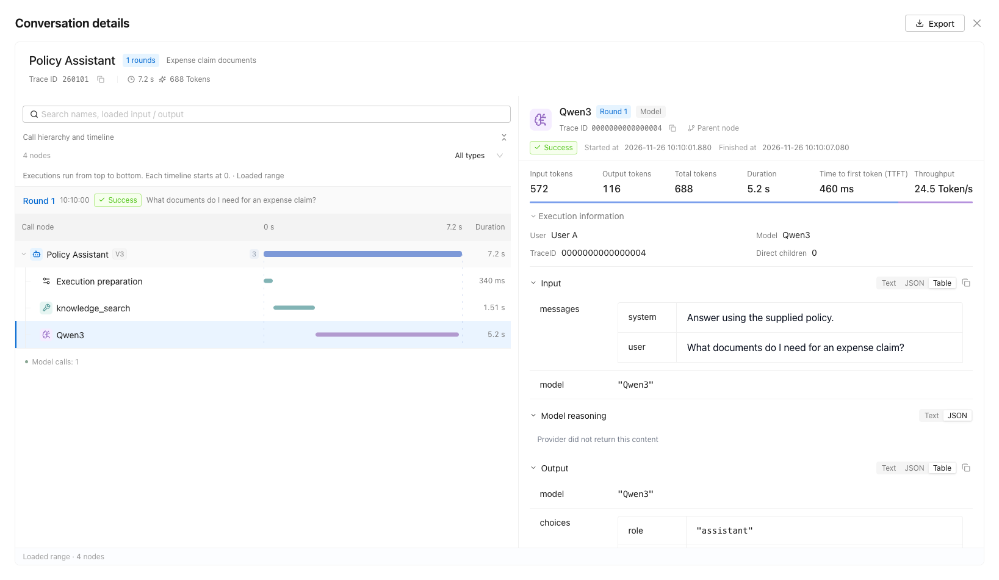

# Observability Center

When a user reports a slow response, a tool error, or an unexpected answer, find the conversation in the Observability Center. For each round, you can see which models and tools the agent called, how long each step took, and the inputs and outputs that were captured. To see call trends and error rates over time, open the [Operations Dashboard](./operations/dashboard).

## Find a conversation

Open **Observability center** in the sidebar. Your account needs access to this page. Operations administrators (OPS) can view conversations in their tenant. Super administrators (SU) can also search across tenants.

- **If you have the conversation ID**, paste it into **Conversation ID search** and press Enter. A partial number also works. The full ID makes it easier to find a specific conversation. Users can copy the ID from the top of a saved conversation in [Agent Chat](./start-chat) or the [Workbench](./workbench).
- **If you do not have the ID**, filter by user, agent, or conversation name. Super administrators can select a tenant first. The **Status**, **Model**, and **Last execution** column headers offer additional filters. Enter the time range in Beijing time (UTC+8). A conversation matches if any round started within that range.

Click a row under **Conversation trajectories** to open **Conversation details**. If a conversation has just finished, click **Refresh** above the list to check for its record. Use **Clear filters** to start another search.

Each row represents one conversation. **Latest version** and **Status** describe the most recent round. **Total duration** and **Total tokens** cover all rounds. Click either total's column header to sort. For example, if the first round failed and the second succeeded, the row shows **Success**. Search by conversation ID and open the details to inspect the failed round.

## Locate a slow or failed step

The header shows the conversation title, number of rounds, total duration, and token usage. The **Trace ID** in this header is the conversation ID. Click the copy button beside it to copy the value.

1. In **Call hierarchy and timeline** on the left, use the round number, time, and user input to find the round you want. Each round's timeline starts at zero. Expand the agent node to see when model calls, tool calls, and preparation steps started and how long they took.
2. Filter by node type or search node names and the inputs and outputs already loaded. To include more records in a search, select **Load more** or **Load earlier rounds** first.
3. Select a node to see its status, start and finish times, and captured content on the right. From a child call, select **Parent node** to return to the step that initiated it.

The expense claim question in the example took 7.2 seconds. The knowledge search took 1.51 seconds, and the Qwen3 model call took 5.2 seconds. Selecting Qwen3 shows that 460 milliseconds of the model call elapsed before the first output.

| Question | What to inspect |
| --- | --- |
| Why was the response slow? | Look for long calls in the affected round. For a model, compare **Time to first token (TTFT)** with **Duration** to distinguish the initial wait from the rest of generation. Then check **Throughput** in tokens per second. For a tool, check the duration of the tool call itself. |
| Why did a call fail? | Select the failed model or tool, read **Failure reason**, and check **Input** and **Output**. For a failed search, for example, the input shows the query the agent actually sent. |
| What did the model receive? | Select the model node and inspect **Input**. When **Table** is available, use it to read each message's role and content in order. You can also switch to text or JSON. Scroll down to load more of a long request. |
| Which step used the most tokens? | Check the model call count and total tokens on the agent node, then compare **Input tokens** and **Output tokens** on individual model nodes. If the page indicates partial token usage, only the recorded amounts are known. |

## Read the summary statistics

The label above the list shows **Global statistics** or **Current tenant statistics**. Within the same tenant scope, user, agent, model, and time filters affect only the list. When a super administrator selects a user, agent, or conversation from across all tenants, the statistics switch to that tenant. Check **Computed at** and the number of valid samples before comparing durations. A dash indicates that no value is available.

| Card | What it measures |
| --- | --- |
| Conversations | The number of conversations in scope. A multi-round conversation counts once. |
| Mean agent duration | The average duration of agent executions with recorded timings. |
| Time to first token (TTFT) | The time from the start of a model call to its first nonempty output. P50 is the median. P90 and P99 help identify the slower calls. |
| Execution duration | The card shows P50, P90, and P99 for the cumulative duration of each conversation across all its rounds. To inspect a single round, open its timeline in the conversation details. |

## Export or import a trajectory

1. To save a conversation's trajectory, click **Export** in the upper-right corner of **Conversation details**. The ZIP contains the conversation's readable archived executions, including rounds you have not expanded. The archive can contain user questions, model inputs, and business data returned by tools. Check who should receive it before sharing.
2. To open an archive you received, select **Imported trajectories** in the upper-right corner of the Observability Center, click **Import**, and select a trajectory ZIP exported by Nexent. The details open after the import. To reopen it later, sign in to the same tenant with the same account and click **View** in the import list.
3. Imported copies stay in your personal import list until you delete them. Statistics and cleanup for original trajectories exclude those copies. Use **Delete** for one copy, or select records across pages and click **Delete selected**.

## Clean up original trajectories

The default retention period for original trajectories is 30 days. Cleanup skips active executions and preserves chat records and saved execution summaries. Durations and token counts can still appear in the list after the underlying nodes and their content have been removed. Export a trajectory before cleanup if you need its call details.

### Manual cleanup

1. Select **Clean up traces → Manual cleanup**. Operations administrators clean up their own tenant. Super administrators must choose a tenant in the dialog.
2. Enter the age in days, from 1 to 30. For example, entering 7 removes original trajectories older than seven days. **Cleanup covers all users, agents, and conversations in the selected tenant**, even if the current list is filtered to one record.
3. Check the tenant and number of days, then click **Confirm cleanup**. If the results include pending or failed items, run cleanup again.

### Scheduled cleanup

Select **Clean up traces → Scheduled cleanup**, turn on **Enable scheduled cleanup**, choose an age from 1 to 30 days, and click **Save settings**. Changes take effect within 30 seconds. The task runs daily at midnight Beijing time (UTC+8).

Operations administrators set the schedule for their own tenant. When a super administrator clicks **Confirm and sync**, the settings replace the scheduled cleanup settings for **all existing tenants**, even if only one tenant is selected in the conversation list.

## Troubleshoot missing records or content

| Message | What to do |
| --- | --- |
| No matching executions | Check the conversation ID and tenant. Clear model, status, and time filters, then refresh. If the query is too large, select a tenant or narrow the time range. |
| Unarchived | The round has not finished archiving. Refresh the list later and reopen its details. |
| Not captured, Partial capture, or Cleaned up | Inspect the rounds and nodes that remain available. Refreshing cannot recover content that was never captured. If you exported a ZIP before cleanup, import it to view the archived copy. |
| Local trace queries are disabled | Ask the deployment administrator to check the historical read setting, `TRAJECTORY_READ_ENABLED`. If new conversations also have no trajectories, check `LOCAL_FILE_MONITORING_ENABLED` and confirm that capture and queries use the same persistent directory. |
