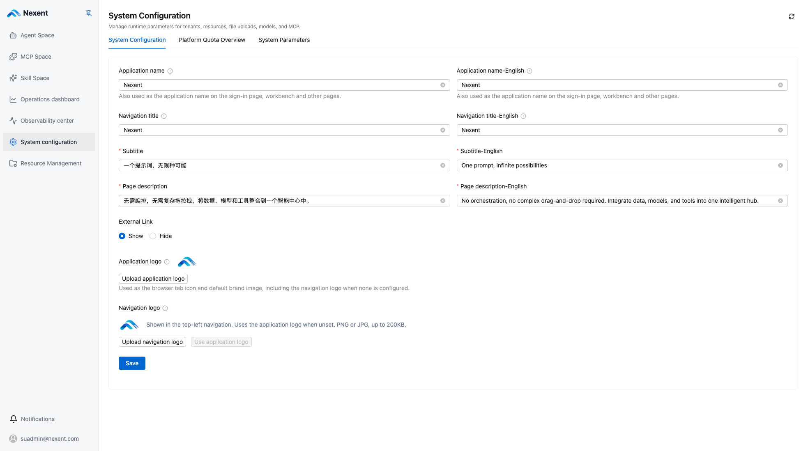
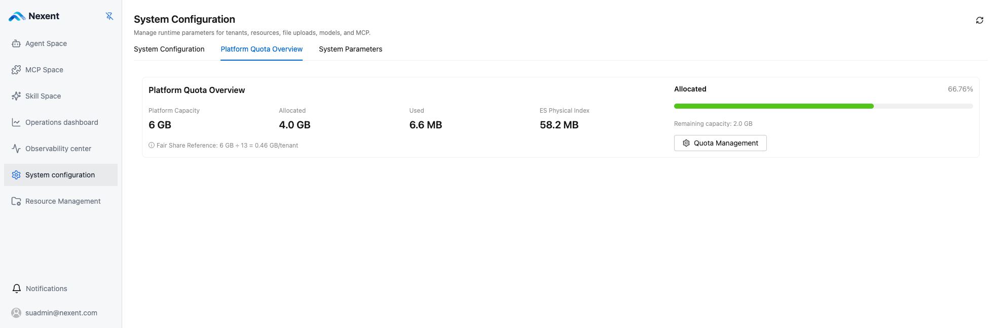
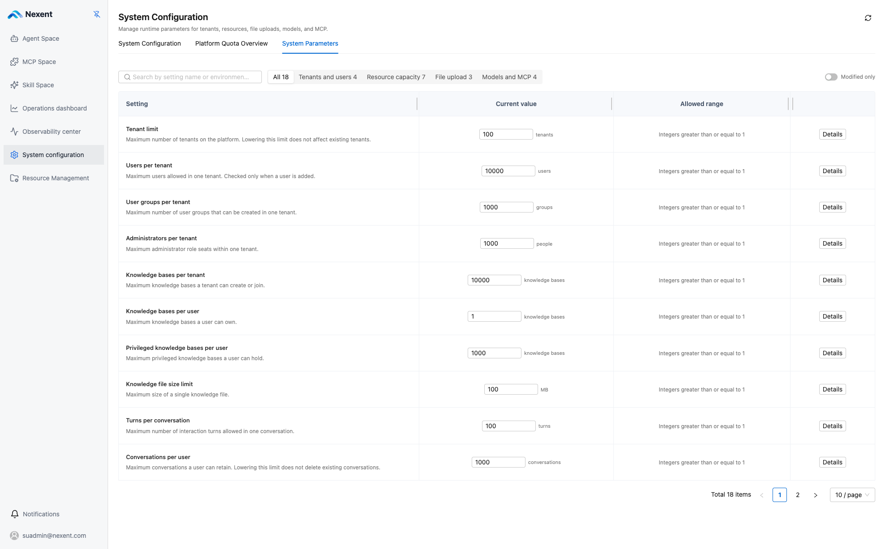
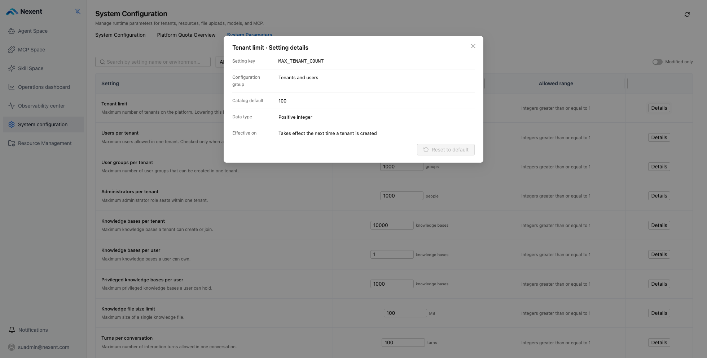

# System Configuration

System Configuration is a unified workspace for super administrators (SU). It manages branding, platform storage quota, and runtime parameters. Runtime parameters are stored in PostgreSQL, and consumers load new values through Redis notifications and periodic refresh, so saving a parameter does not require a service restart.

## Entry and permissions

After signing in to Nexent, select **System Configuration** in the operations area of the left navigation.

- The page is available only to accounts with the **SU** role. OPS and other roles cannot use historical configuration grants to access it.
- Reading system parameters requires the `ops.configuration:read` permission. Saving them requires `ops.configuration:update`.
- If the entry is hidden or an access-denied message appears, ask an administrator to check the account role, menu grant, and configuration permissions.

## Workspace tabs

| Tab | Purpose |
| --- | --- |
| **System Configuration** | Maintain localized branding text, external links, and page logos. |
| **Platform Quota Overview** | View platform capacity, allocated capacity, usage, Elasticsearch physical index size, and remaining allocatable capacity; adjust total platform capacity. |
| **System Parameters** | View and edit 18 non-secret runtime settings for resource counts, file sizes, timeouts, and model output. |

Each tab uses its own data and save operation. Saving branding or platform quota does not submit drafts on the **System Parameters** tab, and saving system parameters does not change branding or storage quota.

### Branding

On the **System Configuration** tab, you can maintain the application name, navigation title, subtitle, and page description in Chinese and English, show or hide external links, and upload application, navigation, and home page logos as needed.

1. Edit the text or images you want to update. Subtitle and page description are required.
2. Logos must be PNG or JPG files no larger than 200 KB each.
3. Click **Save**. The page reloads with the new configuration after a successful save.

### Platform Quota Overview

The **Platform Quota Overview** tab displays total platform capacity, allocated capacity, actual usage, Elasticsearch physical index usage, and remaining allocatable capacity. Click **Quota Management** to adjust total platform capacity.

Storage quota is separate from the resource-count limits under **System Parameters**: storage quota manages disk space, while system parameters control resource counts and runtime constraints.

## System Parameters

Open the **System Parameters** tab to view each parameter's saved value, allowed range, and description. Current values can differ between environments and are not necessarily the built-in defaults.

### Search and inspect

- Search by parameter name, key, or description.
- Filter by **All, Tenants and users, Resource capacity, File upload, or Models and MCP**. The count beside each filter is the total number of parameters in that category.
- Enable **Modified only** to show only parameters with unsaved drafts.
- Click **Details** to view the parameter key, category, catalog default, data type, and effective timing.
- Use 10, 20, or 50 rows per page. Searching or changing a filter returns the table to the first page.
- Click the refresh button in the upper-right corner to reread saved database values. Filtering, pagination, and background refresh do not proactively clear drafts. If refresh fails, the loaded configuration and drafts remain editable, and you can retry.

Clicking **Reset to default** in the detail dialog only changes the draft to the catalog default. It does not write to the database until you click **Save changes** and confirm.

### Edit and save

1. Enter a new value in the **Current value** column or toggle a Boolean parameter.
2. The parameter displays a **Modified** marker and its original value. The bar at the bottom shows the number of unsaved changes.
3. Click **Save changes**. To clear all unsaved drafts instead, click **Discard**.
4. Review the parameter keys, original values, and new values in the confirmation dialog, then click **Confirm save**.
5. After the success message appears, the new values have been committed to PostgreSQL, and consumers will refresh automatically.

Integer parameters must be greater than or equal to 1. Timeout parameters must be finite numbers greater than 0, in seconds. Boolean parameters can only be on or off. Invalid values block submission, and a batch is never partially saved.

Drafts are retained after a failed save so you can correct the problem and retry. Edits made while another save is in progress also remain as new unsaved drafts and require a separate save. When unsaved changes exist, leaving the page, using browser Back or Forward, reloading, or closing the page triggers a confirmation prompt.

### How changes take effect

- Each save submits only changed parameters. After the database transaction commits, consumers obtain a new snapshot through Redis notifications and periodic refresh without a restart.
- **A successful save confirms the database commit, not an application acknowledgement from every service.** If Redis notification is unavailable, the page displays a degraded-notification warning. The saved values are not rolled back; consumers rely on periodic refresh instead.
- Operations already in progress continue using the values captured when they started. New operations use the updated values at the effective timing shown in each parameter's details.
- Lowering a count limit does not retroactively delete existing tenants, conversations, or other resources, but subsequent create operations are checked against the new limit.

## Parameter catalog

The defaults below come from the current system parameter catalog. The **Current value** column always reflects the saved database value.

### Tenants and users

| Parameter key | Description | Default | Effective timing |
| --- | --- | --- | --- |
| `MAX_TENANT_COUNT` | Maximum tenants that can be created on the platform; lowering it does not affect existing tenants | 100 tenants | Next tenant creation |
| `MAX_USERS_PER_TENANT` | Maximum users allowed in one tenant | 10,000 users | Next user addition |
| `MAX_GROUPS_PER_TENANT` | Maximum user groups that can be created in one tenant | 1,000 groups | Next user group creation |
| `MAX_ADMINS_PER_TENANT` | Maximum administrator role seats in one tenant | 1,000 people | Next role change |

### Resource capacity

| Parameter key | Description | Default | Effective timing |
| --- | --- | --- | --- |
| `MAX_KNOWLEDGE_BASES_PER_TENANT` | Maximum knowledge bases a tenant can create or join | 10,000 knowledge bases | Next knowledge base creation |
| `MAX_KNOWLEDGE_BASES_PER_USER` | Maximum knowledge bases a user can own | 10 knowledge bases | Next knowledge base creation |
| `MAX_PRIVILEGED_KNOWLEDGE_BASES_PER_USER` | Maximum privileged knowledge bases a user can hold | 1,000 knowledge bases | Next knowledge base creation |
| `MAX_CONVERSATION_TURNS` | Maximum interaction turns allowed in one conversation | 100 turns | Next conversation turn |
| `MAX_CONVERSATIONS_PER_USER` | Maximum conversations a user can retain; lowering it does not delete existing conversations | 1,000 conversations | Next conversation creation |
| `MAX_MCP_SERVICES_PER_TENANT` | Maximum MCP services a tenant can connect | 1,000 services | Next MCP service connection |
| `MAX_SKILLS_PER_TENANT` | Maximum Skills a tenant can own | 1,000 Skills | Next Skill creation |

### File upload

| Parameter key | Description | Default | Effective timing |
| --- | --- | --- | --- |
| `MAX_KNOWLEDGE_FILE_SIZE_MB` | Maximum size of a single knowledge file | 100 MB | Next upload |
| `MAX_EVALUATION_SET_FILE_SIZE_MB` | Maximum size of a single evaluation set file | 20 MB | Next upload |
| `MAX_SKILL_UPLOAD_SIZE_MB` | Maximum size of a single Skill upload package | 10 MB | Next upload |

Increasing an application file-size limit does not automatically raise external limits in the gateway, reverse proxy, or storage service. Check the request-size limits of those components during deployment.

### Models and MCP

| Parameter key | Description | Default | Effective timing |
| --- | --- | --- | --- |
| `MCP_REQUEST_TIMEOUT_SECONDS` | Timeout for establishing an MCP connection and completing the initialization handshake | 10 seconds | Next MCP connection |
| `RUNTIME_MCP_TOOL_TIMEOUT_SECONDS` | Maximum execution time for a single MCP tool call | 60 seconds | Next tool call |
| `RUNTIME_PARALLEL_EXECUTOR_TIMEOUT_SECONDS` | Maximum execution time for parallel tool orchestration | 120 seconds | Next orchestration run |
| `LLM_INCLUDE_LOGPROBS` | Return log probabilities for each token in model responses for evaluation and debugging | Off | Next model binding |

## Change considerations

- The System Parameters tab manages only the 18 non-secret settings listed above. It does not manage passwords, keys, or other deployment environment variables.
- Versioned database migrations seed built-in defaults for missing parameters without overwriting saved values or importing existing `.env` customizations. After an upgrade, review important parameters on this page.
- Before changing resource limits, file sizes, or timeouts, assess current resource counts, upstream gateway limits, downstream service capacity, and network conditions. Avoid unnecessarily large changes.
- The page currently provides neither automatic parameter recommendations nor per-service application acknowledgements. Use relevant service logs and subsequent operation results to verify actual runtime behavior.

[Back to Operations Management](../monitor)
