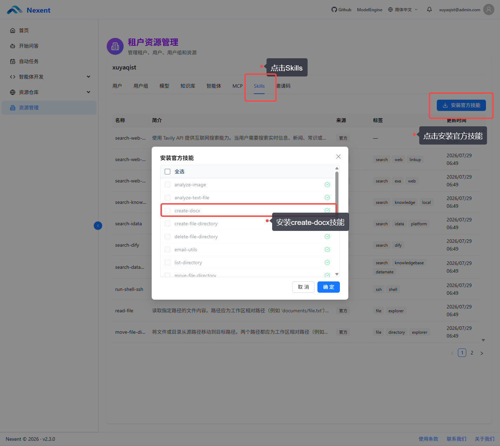
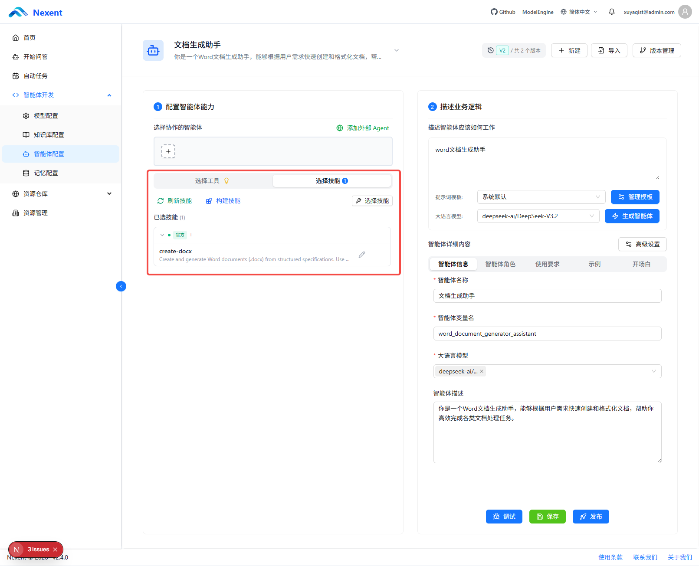
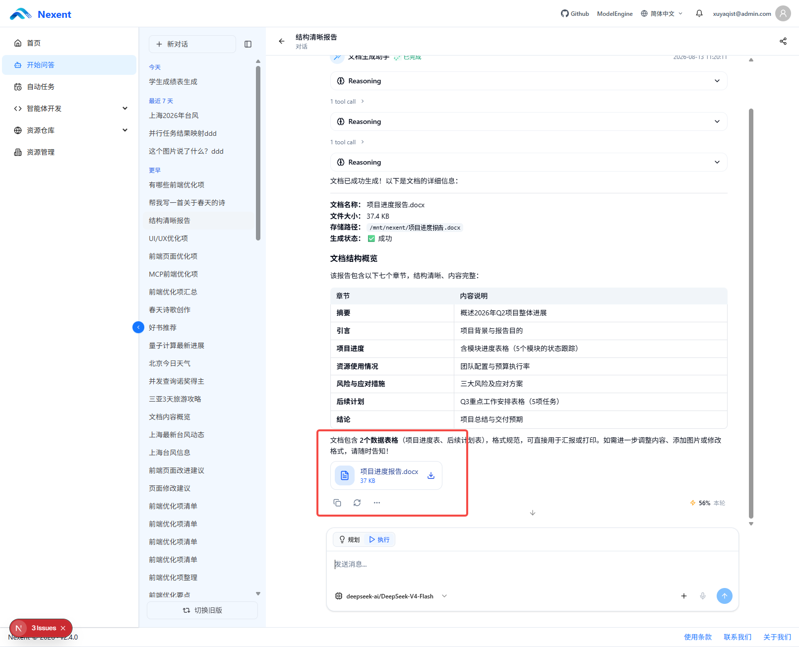

# create-docx Official Skill

`create-docx` is an official file-generation skill provided in the official skills package. It creates or edits Word documents from structured requirements. An agent can invoke the skill based on the topic, content, and formatting requirements provided by the user, generate a `.docx` file, and push the result to the conversation frontend as a Nexent artifact while saving it to the conversation history.

## Using create-docx

Before using `create-docx`, install the official skill in Resource Management, then add it to the target agent's configuration.

### 1. Install the skill in Resource Management

1. As a super administrator or tenant administrator, open the **Resource Management** page and go to the "Skills" tab.
2. Select **Install official skills** and find `create-docx` in the dialog.
3. Choose the skill and complete the installation.

<!-- TODO(screenshot): Install official skills dialog on the Resource Management → Skills tab -->

### 2. Enable the skill in the agent configuration

1. Open the configuration of the agent that needs document generation.
2. In the **Skills** section, select the installed `create-docx`.
3. Save the agent configuration so the agent can invoke the skill.

### 3. Generate and download the Word document

Once configured, describe the Word document you want to create or edit in the conversation with the agent — for example a report, a proposal, a notice, or meeting minutes. Provide the topic, body content, section structure, and formatting requirements.

After the skill succeeds, the `.docx` file appears as a conversation attachment. Download it from the attachment area; the file is also saved to the conversation history.

For script parameters, supported document capabilities, and runtime constraints, refer to the `SKILL.md` inside the `create-docx` skill package.

## Extending the create-docx Skill

`create-docx` provides base scripts for building Word documents, including full document generation, blank document creation, adding headings, paragraphs, tables, and images, plus text replacement, heading renaming, and table cell updates. If the existing capabilities do not meet your business needs, you can develop and extend scripts based on the `create-docx.zip` skill package — for example, adding corporate templates, headers and footers, complex layouts, charts, or domain-specific content generation.

When extending, put new scripts in the skill package's `scripts/` directory and describe their use cases, parameters, and invocation in `SKILL.md`. If a new script needs to publish the final file as a conversation attachment, see the [Custom File Generation Skill Guide](./custom-file-generation-skill.md).

## Custom file generation Skill

To develop custom skills that generate or export other file types (Markdown, PPT, etc.), see the [Custom File Generation Skill Guide](./custom-file-generation-skill.md).

## Related documents

- [Official Skills](./official-skills.md)
- [Skills System Overview](/en/backend/skills/overview)
- [Skill Space](./skill-repository.md)
