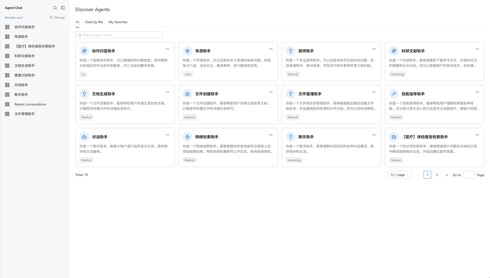
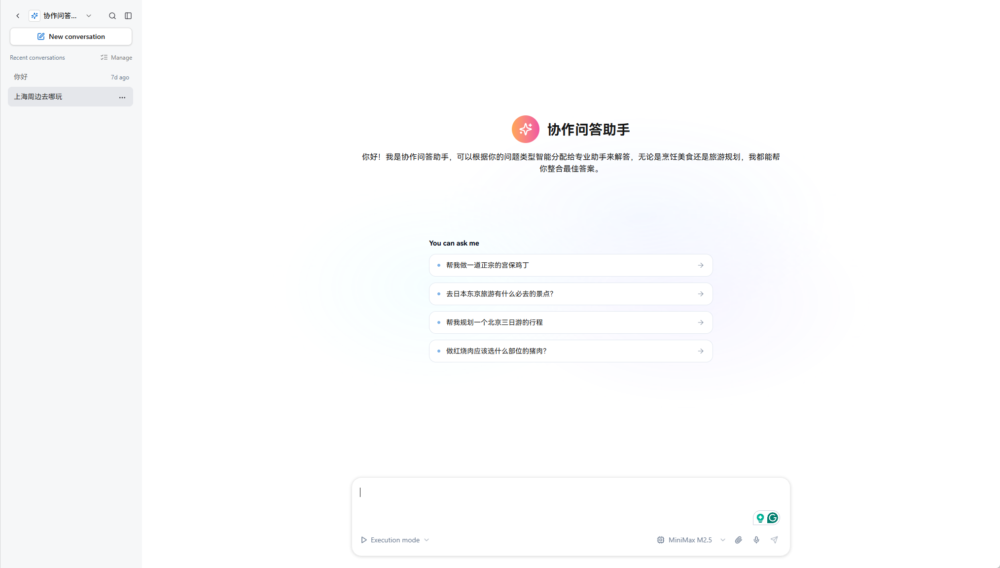
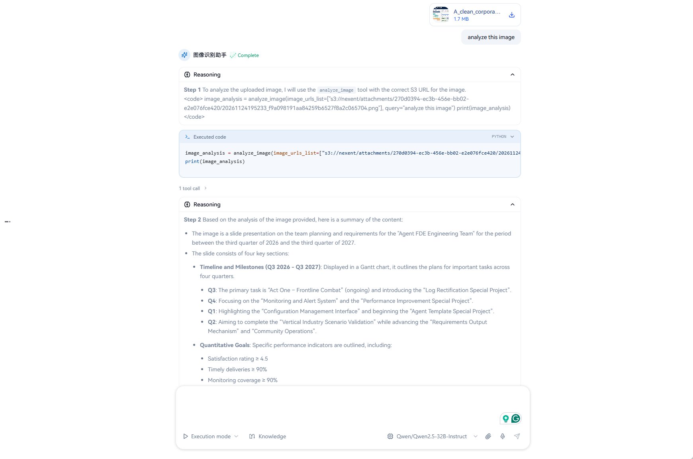
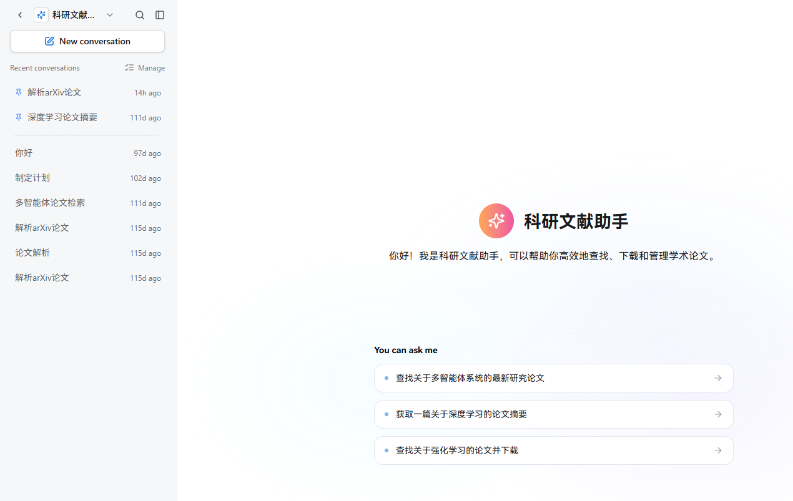

# Agent Chat

Use Agent Chat to complete tasks with published agents. Select an agent, send questions and attachments, inspect results and sources, and manage or share conversations.

This page covers chatting with agents. To create or adjust an agent using natural language, see [Workbench](./workbench) or [Agent Configuration](./agent-configuration). Models, tools, knowledge bases, and available controls depend on the agent configuration, your permissions, and deployment settings.

## Start your first conversation

1. Select **Agent Chat** in the sidebar, or **Start Chatting** on the homepage.
2. Choose an agent suited to your task.
3. Describe your goal, relevant context, and expected output. Add attachments if needed.
4. Click Send or press **Enter**, then follow progress and read the response. Use **Shift + Enter** for a new line.
5. Ask follow-up questions about the result. Start a new conversation for an unrelated task.

For example: “Summarize this project report, identify three main risks, and give next-step recommendations in a table.” A clear goal and output format are more useful than “Analyze this.”

Reopening or refreshing the page may restore the last agent or conversation you viewed. A link to a specific conversation or a shared page may also open directly, so you will not always see the agent list first.

## Find and favorite agents

### Find an available agent

The agent list provides tabs for all agents, agents you have used, and your favorites, along with search and pagination. Search by keywords such as an agent's name, description, or developer.

Cards display the agent's name, icon, and description. Select a card to open its chat page. The card menu also provides actions such as starting a new conversation, adding a favorite, or removing a favorite.



### If an agent is missing

The list shows published, available primary agents that you are allowed to use. If the list is empty or an agent is missing, check the search and active tab first. Then ask an administrator or developer to verify publication, primary-agent settings, and resource access.

Favorites provide shortcuts; they do not grant additional access or bypass an agent's availability or publication status.

## Enter questions and attachments

After selecting an agent, the welcome area shows its introduction and example questions. Choose an example or enter your own task. The history panel opens previous conversations, while the composer sends questions and configures available options.



### Model and conversation mode

If a model selector is available, choose from its available options. Follow any notice about unavailable models, insufficient permissions, or controls locked during execution.

| Mode | Suitable tasks | What to expect |
| --- | --- | --- |
| **Execution** | Clear tasks that can be handled directly | The agent uses the necessary capabilities and produces a result |
| **Planning** | Complex tasks with multiple stages | When a plan is needed, a plan card and step statuses help track progress |

Planning mode does not mean every question produces the same number of steps, or that every task can be completed. Stop the run before changing the goal if necessary.

### Knowledge scope for the current conversation

When the agent supports conversation knowledge selection, open the knowledge settings in the composer to:

- **Follow agent defaults**: Use the agent's default knowledge scope.
- **Select knowledge bases**: Choose a retrieval scope from resources you can access that are compatible with the agent.
- **Disable for this conversation**: Do not use the corresponding knowledge source in this conversation.

Local knowledge and AIDP options depend on deployment and agent capabilities. Scope cannot be changed during execution; configure subsequent turns after completion or stopping. Check the effective scope and notices after saving. Unavailable, unauthorized, or incompatible selections may not take effect. These settings do not change the agent's defaults or grant additional access.

### Upload images, documents, and other attachments

Use the attachment button, or drag files into an upload-enabled area. Wait for uploads to finish before sending the task. Remove unnecessary attachments before sending.

| Content | Examples and uses |
| --- | --- |
| Images | Upload JPG, PNG, or similar images and explain what to identify, compare, or interpret |
| Documents | Upload PDFs, Word documents, spreadsheets, or presentations to summarize, extract, or compare |
| Text and data | Upload TXT, Markdown, CSV, or JSON files and describe the analysis goal |
| Other attachments | Parsing depends on the agent's models, tools, and skills |

The current Agent Chat frontend allows up to **50 attachments per message**, with a **10 MB limit per file**. Follow the page notice if your environment imposes stricter limits.

A successful upload does not guarantee that the agent can interpret the file. Image and document analysis require suitable models or tools. Convert unsupported formats or choose a suitable agent. Uploading a chat attachment does not automatically add it to a long-term knowledge base.

### Voice input

When speech recognition is configured and a microphone control is available, click it and grant browser microphone access. Check and edit the recognized text before sending. If the control is absent or recording fails, check feature configuration and browser permissions.

### Optional: conversation Metadata

**Metadata** is displayed only when enabled for the agent. It supplies conversation-level information, usually with fields agreed by an integration or business workflow.

```json
{
  "channel": "customer-service",
  "request_id": "REQ-2026-001"
}
```

The value must be a JSON object of at most **64 KiB**. Save `{}` to clear the conversation Metadata. Saved values apply to subsequent runs. Do not include passwords, access tokens, or personal sensitive information. Leave it empty if your workflow does not require it.

## Follow execution and results

### Understand execution cards

Responses appear progressively after sending. Depending on the agent and task, the page may show:

| Content | How to use it |
| --- | --- |
| Memory retrieval | Check whether relevant historical information was loaded |
| Execution descriptions and code | Understand the current activity and expand code details when needed |
| Tool calls | Inspect tool names, arguments, status, and returned results |
| Collaborating agents | Inspect delegated tasks and their results |
| Plans | Follow task steps and their status |
| Self-checks | Read check results, failed criteria, and correction notices |

Independent tools or collaborating agents may run in parallel. After an error, the agent may adjust arguments, gather evidence, or retry, depending on policy and the failure.

Self-checks appear only when enabled. They help identify problems but do not guarantee correctness. Verify important conclusions, data, and generated files yourself. Execution time and Token usage may be shown when returned by the run.



### Stop, failure, and retry

During execution, Send changes to Stop. Click it to request cancellation and wait for the page to confirm the status. Completed tool operations and external effects are not automatically undone.

If execution fails, times out, reaches a limit, or stops, inspect the notice and completed results before adding information, asking again, or contacting an administrator. Output in an execution card does not mean the whole task has completed.

## Inspect sources and generated files

### Citations and sources

Hover over citation numbers to inspect source summaries. You can also use source entries in responses or tool cards to view retrieved content. The source panel may contain knowledge documents, web pages, and images. Open original web links, or preview and download supported knowledge files.

Automatic navigation to a highlighted source fragment after clicking a citation may be disabled in your deployment. Use the source panel if it is unavailable. A citation associates the answer with a source; check that the original text actually supports the conclusion.

### Analyze, generate, and revise files

Ask the agent to summarize documents, compare files, organize tables, or generate reports. Supported formats depend on models, tools, and skills. For example, Word generation can use the [create-docx Skill](./resource-repository/create-docx).

- **Preview**: Open a returned file card or link to inspect a supported format.
- **Download**: Use the download action on the file card or preview panel.
- **Revise**: Identify the file and requested changes in the same conversation.
- **Preview unavailable**: Download the file and open it in a suitable application. Contact an administrator for link or access problems.

A text response is not a generated file. Look for an actual file card or download link.

### Diagrams

Supported Mermaid content can render as diagrams. Use available controls to enlarge, zoom, or reset the view. If rendering fails, inspect the original code or ask the agent to simplify and correct it.

## Manage and share conversations

### Find and organize history

Expand the history panel to search and reopen conversations. History is grouped according to the current layout and loaded progressively. After selecting an agent, the panel may show only conversations associated with that agent.

| Action | Purpose |
| --- | --- |
| New conversation | Start an independent task without continuing the previous context |
| Search | Find historical conversations by keyword |
| Pin / Unpin | Keep frequently used conversations easy to find |
| Rename | Organize conversations with recognizable titles |
| Delete | Remove a single conversation and its messages |
| Manage | Select multiple conversations for deletion |

Check the selection count before batch deletion. Select All applies to currently loaded or selectable records; do not assume it selects your entire history.

::: warning Confirm before deleting
Deletion cannot be undone. Automation tasks bound to the selected conversations are also canceled and removed. Confirm that both the records and associated tasks are no longer needed.
:::



### Copy, regenerate, and export

- **Copy**: Use the copy button below a response.
- **Regenerate**: Use the refresh button below a response to rerun its question. This consumes model and tool resources. Check whether repeating writes, sends, or other external actions is appropriate first.
- **Export Markdown**: Choose the export action from the response's More menu to save the conversation as Markdown.
- **Branch to a new chat**: When available in More, create a conversation from the selected response to explore another direction using the preceding content.

### Follow up on a response excerpt

When text annotations are supported, select text in a response and use **Add to conversation** to attach it to the composer with your question or revision request. Edit or remove annotations before sending. Annotations identify what the next turn should address; they do not directly edit the original response.

### Share a conversation

Use the page's sharing entry or the Share action in a response's More menu. Review the selected question-and-answer range, then generate and copy the link.

Shared pages are read-only and cannot continue the original conversation. Check selected messages, attachments, and sources for sensitive content before generating a link, and confirm recipient access under your environment's sharing rules.

## Leave and return

Submitted tasks can continue on the server. Leaving the page is not the same as clicking Stop. Reopen the original conversation to inspect saved progress, results, and current status. Refreshing may also restore your last viewing position.

Network loss, service restarts, run timeouts, or other errors can still interrupt execution. If the status is unclear, inspect existing results and notices before retrying to avoid repeating external actions.

Use available back or agent-selection controls to switch agents. Collapse history to enlarge the conversation area, or open it with the expand control on mobile.
