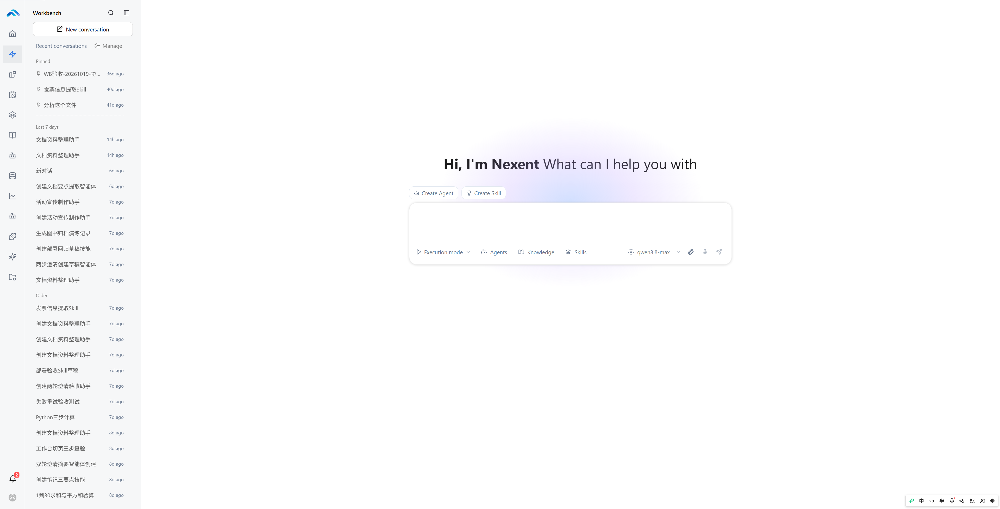
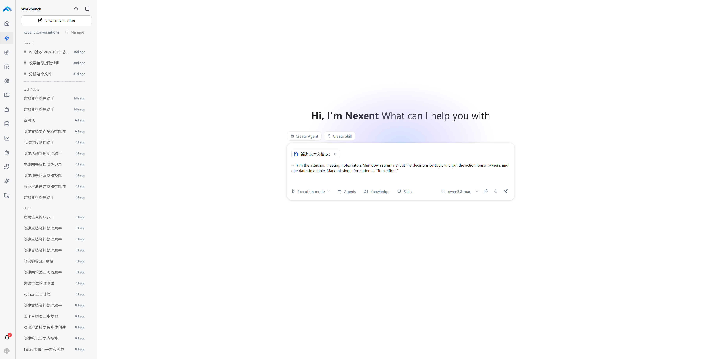

# Workbench

Use the Nexent Workbench to run tasks and create resources. You can describe a task directly or select agents, knowledge bases, and skills for the current conversation. With creation permissions, you can also draft an agent or a skill through conversation.

## Open the Workbench

1. Sign in to Nexent and select **Workbench** in the left navigation. If your deployment uses the Workbench as its default landing page, it opens after you sign in.
2. Click **New conversation** in the Workbench sidebar. Use the composer in the center to enter a task and the sidebar to reopen earlier Workbench conversations.

If **Workbench** is missing from the navigation, ask your administrator to check whether it is enabled for your deployment and accessible to your account.

<!-- Screenshot pending. Capture the Workbench landing page with the navigation entry, New conversation, and the composer.

-->

## Describe the task

In the composer, describe your goal, the materials to use, and the result you want. Include any scope, format, or other constraints. Use **Upload attachment** to add files for the current request.

> Turn the attached meeting notes into a Markdown summary. List the decisions by topic and put the action items, owners, and due dates in a table. Mark missing information as “To confirm.”

<!-- Screenshot pending. Capture the composer before sending, with the example request and an attached file.

-->

## Choose conversation resources

Before sending, use the composer controls to add resources as needed. Availability depends on your deployment and permissions.

| Control | What to do |
| --- | --- |
| **Agents** | Search for available agents, select them, and click **Confirm selection**. You can select multiple agents if your deployment supports multi-agent mode. If general chat is enabled, you can also send a task directly. |
| **Knowledge** | Open **Knowledge bases for this conversation** and choose what to search. Sources may include **Local knowledge bases** and **AIDP knowledge bases**. |
| **Skills** | Select the skills you need, fill in any required configuration, and click **Confirm selection**. |
| **Model** | Switch to a model you have permission to use. The selector shows the available models and settings. |

To remove a resource, use its label in the composer.

<!-- Screenshot pending. Capture the Agents picker with a selected agent and the Confirm selection button.

-->

<!-- Screenshot pending. Capture the conversation knowledge base panel with the available sources and the current selection.

-->

<!-- Screenshot pending. Capture the Skills picker with a selected skill and the Confirm selection button.

-->

## Run the task and review the result

1. Choose **Execution mode** or **Planning mode** in the composer. Execution mode starts the task directly. Planning mode breaks the task into steps and lets you track their status.
2. Send the task. During the run, expand any step or tool call cards that appear to check progress. To interrupt the run, click the stop button in the composer.
3. Review the final response. When the response includes sources or generated files, open sources to verify the information, or preview and download available files. Send a follow-up in the same conversation to refine the result.

<!-- Screenshot pending. Capture the plan and final response for the same task, with one completed step or tool call expanded.

-->

## Create an agent or skill through conversation

Creation controls appear according to your account permissions. The Workbench opens a separate conversation for each creation workflow.

### Create an agent

1. Click **Create Agent**. Describe the intended users, the tasks the agent should perform, its inputs and outputs, and any constraints. You can also start from an example in the interface.
2. Review the extracted requirements in the **Requirements and resources** card. To make changes, edit the requirements and click **Update requirements and search again**. Select recommended tools, skills, or knowledge bases as needed, and finish configuring and binding your selections. If you need no resources, click **Continue without resources**.
3. In the **Generated prompt** card, review or edit the prompt and click **Confirm and apply**. Once the draft is ready, use **Edit current draft** to open its configuration or click **Go to Agent Development** in the result card to review, debug, and publish it. See [Agent Configuration](./agent-development) for publishing steps.

<!-- Screenshot pending. Capture the Requirements and resources card with one resource ready and the control for continuing.

-->

<!-- Screenshot pending. Capture the Generated prompt card with its edit control and the Confirm and apply button.

-->

### Create a skill

1. Click **Create Skill** and describe the skill's name, when to use it, and its inputs and outputs. Include the steps if it should follow a specific procedure.
2. After the draft is generated, review the skill files shown in the conversation. Send a follow-up in the same conversation to request changes.
3. Click **Save Skill** in the result card. Once saved, click **View My Skills** to open your list. See [Skill Space](./resource-repository/skill-repository) for managing and reusing skills.

<!-- Screenshot pending. Capture the generated skill files and the result card with its Save Skill button.

-->

## Reopen a conversation

1. Select an existing conversation in the Workbench sidebar to view its saved messages and run status. If you switch pages, use the same history entry to return to the task.
2. If the run is still active, check its progress when you return. If it is complete, review the result and ask follow-up questions. In a reopened creation conversation, you can view saved steps and results and continue when the page offers an action.
3. Use the menu next to a conversation to **Pin to top**, **Unpin**, **Rename**, or **Delete** it. Click **New conversation** to start a separate task.

<!-- Screenshot pending. Capture an open conversation from history with its sidebar entry and action menu visible.

-->

See also [Home Page](./home-page) and [Agent Chat](./start-chat).
