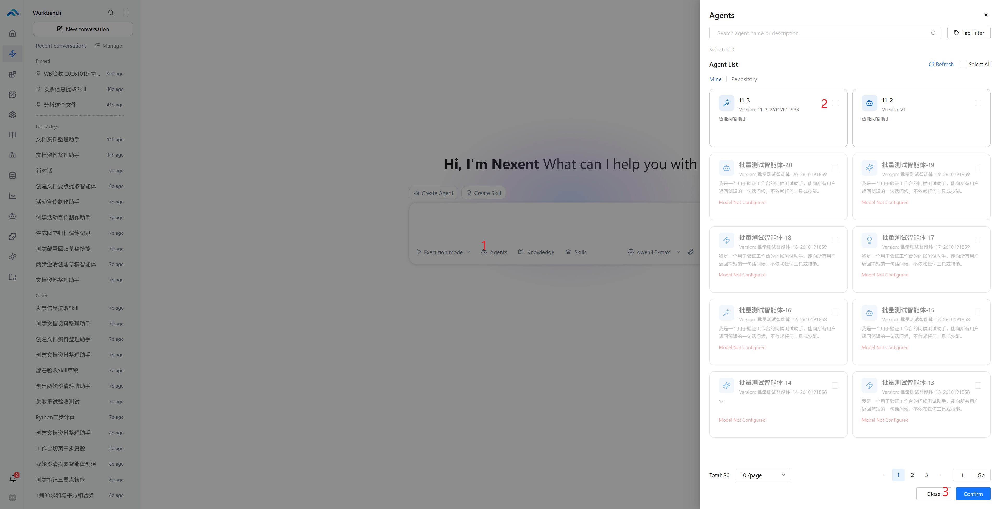
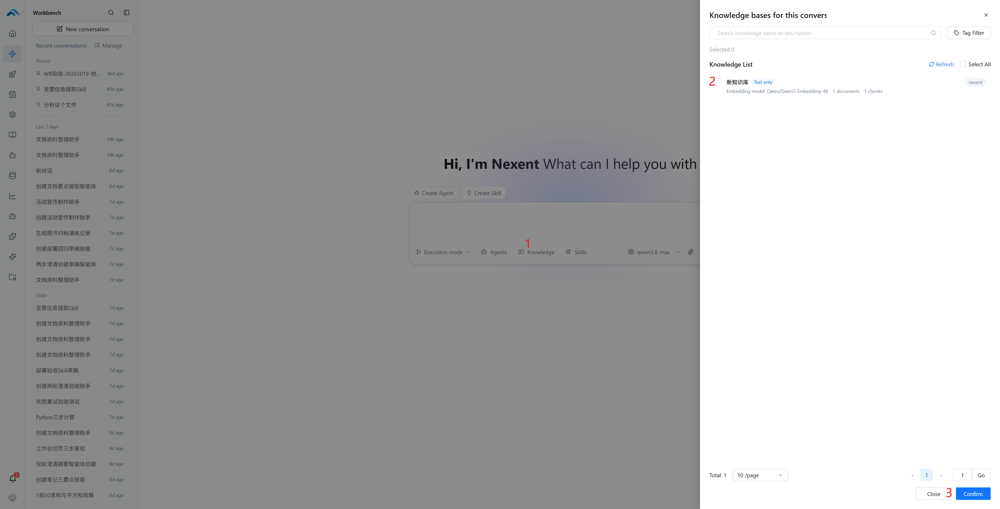
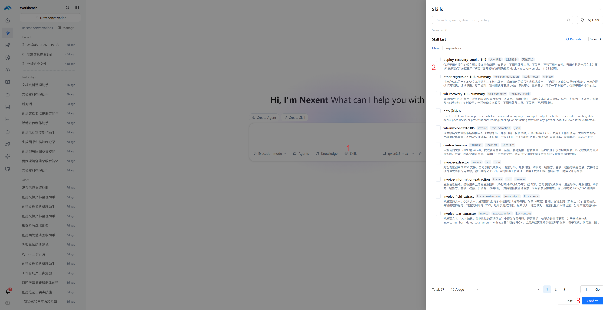
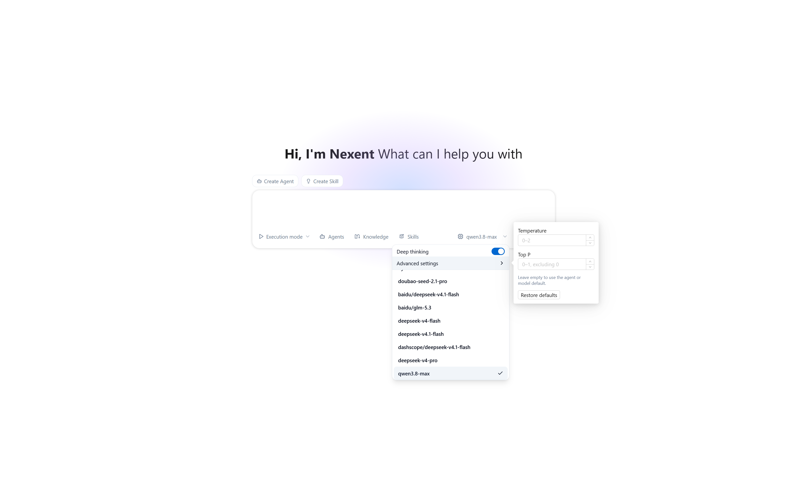
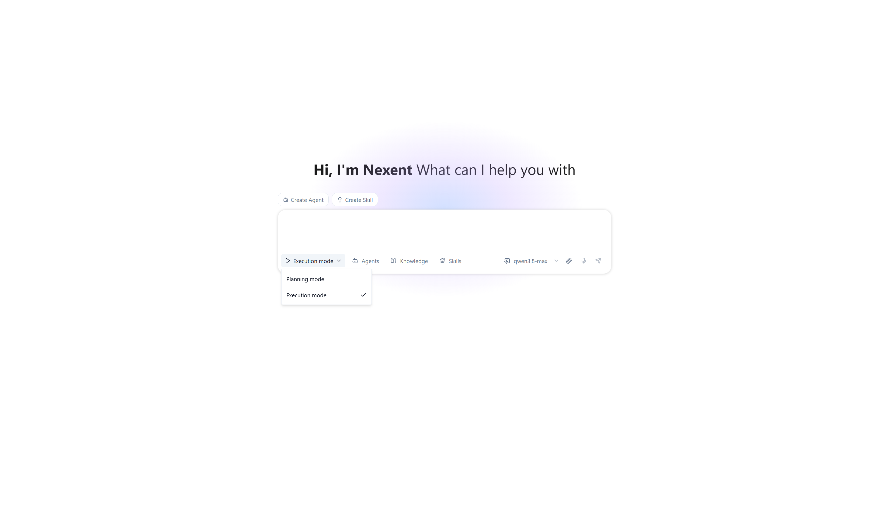
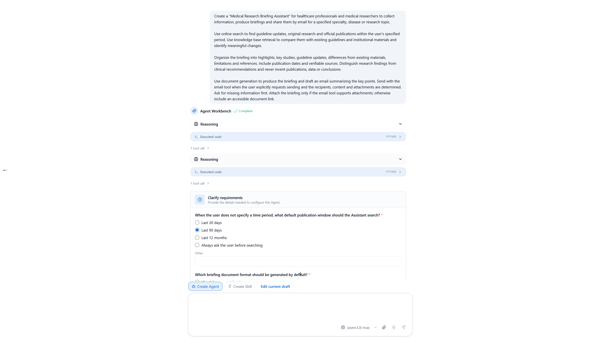
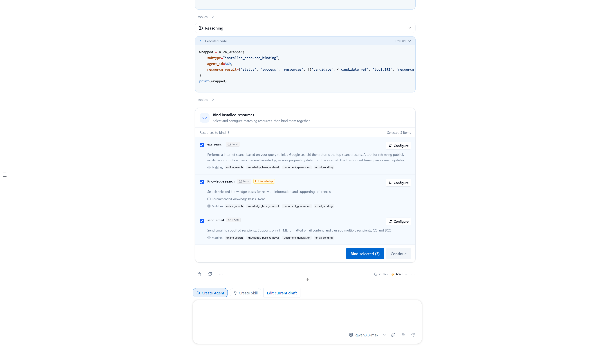
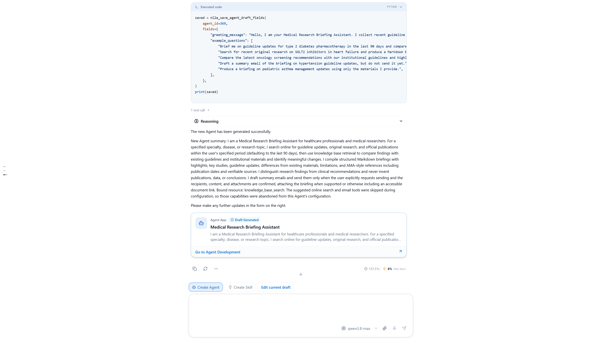
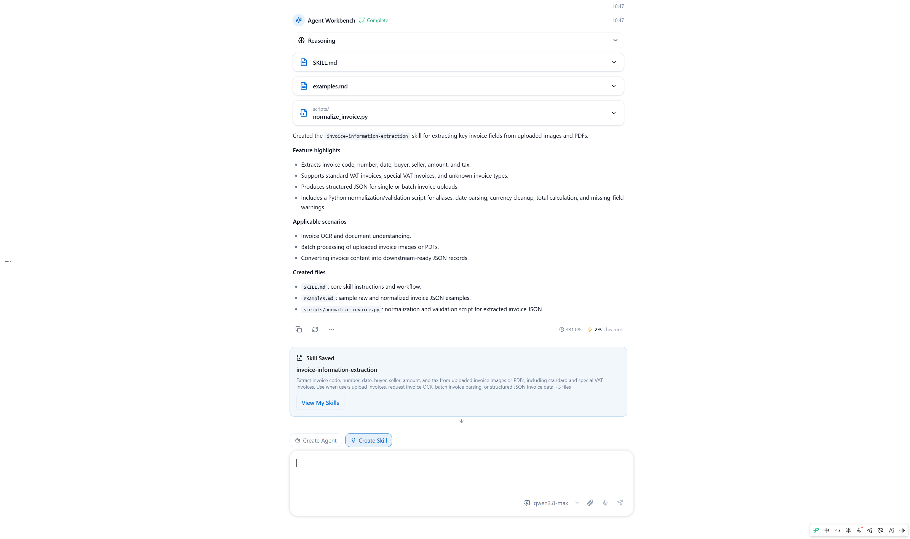

# Workbench

Use the Nexent Workbench to run tasks and create resources. You can describe a task directly or select agents, knowledge bases, and skills for the current conversation. With creation permissions, you can also draft an agent or a skill through conversation.

## Open the Workbench

1. Sign in to Nexent and select **Workbench** in the left navigation. If your deployment uses the Workbench as its default landing page, it opens after you sign in.
2. Click **New conversation** in the Workbench sidebar. Use the composer in the center to enter a task and the sidebar to reopen earlier Workbench conversations.

If **Workbench** is missing from the navigation, ask your administrator to check whether it is enabled for your deployment and accessible to your account.

## Describe the task

In the composer, describe your goal, the materials to use, and the result you want. Include any scope, format, or other constraints. Use **Upload attachment** to add files for the current request.

> Turn the attached meeting notes into a Markdown summary. List the decisions by topic and put the action items, owners, and due dates in a table. Mark missing information as “To confirm.”

## Choose conversation resources

Before sending, use the composer controls to add resources as needed. Availability depends on your deployment and permissions.

| Control | What to do |
| --- | --- |
| **Agents** | Search for available agents, select them, and click **Confirm**. You can select up to eight agents if your deployment supports multi-agent mode. If general chat is enabled, you can also send a task directly. |
| **Knowledge** | Open **Knowledge bases for this conversation**, choose what to search from the available **Local knowledge bases** or **AIDP knowledge bases**, and click **Confirm**. |
| **Skills** | Select the skills you need, fill in any required configuration, and click **Confirm**. |

To remove a resource, use its label in the composer.

### Select a model

1. Before sending a message, click the model name next to the send button in the composer, or click **Select model**.
2. Choose a model for the current conversation. The composer displays the selected model and uses it for subsequent messages. If a response is in progress, wait for it to finish before switching.
3. To adjust parameters, reopen the model selector. Depending on the model, you can use **Deep thinking**, adjust **Thinking intensity**, or change Temperature and Top P under **Advanced settings**. Use **Restore defaults** to clear custom sampling values.

The list depends on your tenant's model configuration. If the model you need is missing, ask your administrator to check that it is connected and available. See [Model Configuration](./agent-development/model-configuration).

## Run the task and review the result

1. Choose **Execution mode** or **Planning mode** in the composer. Execution mode starts the task directly. Planning mode breaks the task into steps and lets you track their status.

   

2. Send the task. During the run, expand any step or tool call cards that appear to check progress. To interrupt the run, click the stop button in the composer.
3. Review the final response. When the response includes sources or generated files, open sources to verify the information, or preview and download available files. Send a follow-up in the same conversation to refine the result.

## Create an agent or skill through conversation

Creation controls appear according to your account permissions. The Workbench opens a separate conversation for each creation workflow.

### Create an agent

1. Click **Create Agent**. Describe the intended users, the tasks the agent should perform, its inputs and outputs, and any constraints. You can also start from an example in the interface. If the **Clarify requirements** card appears, answer its questions.

   

2. When the **Requirements and resources** card appears, review the extracted requirements. To make changes, edit the requirements and click **Update requirements and search again**. Select any recommended tools, skills, or knowledge bases you need. Configure any unbound selections and click **Bind selected**. When the resources are ready, click **Continue**. If the task needs no resources, use **Continue without resources** when the option is available.

   

3. When the result card shows **Draft Generated**, click **Edit current draft** above the composer or **Go to Agent Development** in the result card. In the configuration, review or edit the prompts under **Model and prompt**, then follow the [Agent Configuration](./agent-development) guide to debug and publish the agent.

   

If the draft has no prompt yet, Workbench saves the first generated prompt directly. When a conversation generates a replacement for an existing prompt, review the changes in the **Generated prompt** card and click **Confirm and apply** to save.

### Create a skill

1. Click **Create Skill** and describe the skill's name, when to use it, and its inputs and outputs. Include the steps if it should follow a specific procedure.
2. After the draft is generated, review the skill files shown in the conversation. Send a follow-up in the same conversation to request changes.
3. Click **Save Skill** in the result card. Once saved, click **View My Skills** to open your list. See [Skill Space](./resource-repository/skill-repository) for managing and reusing skills.

See also [Home Page](./home-page) and [Agent Chat](./start-chat).
