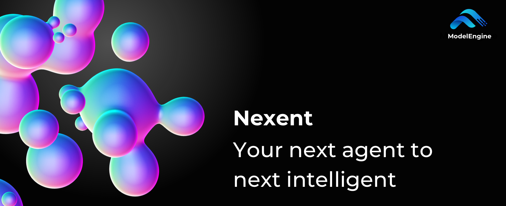

# Nexent

Nexent 是一个企业级智能体开发与管理平台。用户以自然语言驱动智能体的创建、调试和持续优化，平台自动完成工具、Skill 与知识库等配置，并通过 MCP 及开放 API 对接现有业务系统。围绕智能体全生命周期，Nexent 提供权限管控、版本管理、运行监控与链路追踪，帮助企业将 AI 试点转化为规范、可靠、可持续运营的生产应用。

## 🎬 Demo 视频

<video controls width="100%" style="max-width: 800px;">
  <source src="https://github.com/user-attachments/assets/b844e05d-5277-4509-9463-1c5b3516f11e" type="video/mp4" />
  
您的浏览器不支持视频标签。<a href="https://github.com/user-attachments/assets/b844e05d-5277-4509-9463-1c5b3516f11e">查看演示视频</a>

</video>

## 🤝 加入我们的社区

> *If you want to go fast, go alone; if you want to go far, go together.*

Nexent 的愿景是「人人能造，处处可管」。我们希望，每一位熟悉业务的人，即使没有编程经验，也能用自然语言把自己的想法和经验变成智能体，从解决一个具体问题开始，在实际使用中不断改进，并把行之有效的做法分享给更多团队。

我们也希望，企业能把治理贯穿智能体的创建、发布和运行全过程，明确谁可以创建、发布和使用智能体，知道每次运行调用了什么、产生了什么结果，并在出现问题时追溯原因。这样，来自一线的好点子就能从小范围试点走向日常业务，成为团队可以信赖、持续改进的工作能力。

- **🗺️ 查看我们的 [功能地图](https://github.com/orgs/ModelEngine-Group/projects/6)** 探索当前和即将推出的功能。
- **🔍 试用当前版本** 并在 [问题反馈](https://github.com/ModelEngine-Group/nexent/issues) 中留下想法或报告错误。

> *Rome wasn't built in a day.*

如果我们的愿景与您产生共鸣，请通过 **[贡献指南](../contributing)** 加入我们，共同塑造 Nexent。

早期贡献者不会被忽视：从特殊徽章和纪念品到其他实质性奖励，我们致力于感谢那些帮助 Nexent 诞生的先驱者。

最重要的是，我们需要关注度。请 [前往 GitHub](https://github.com/ModelEngine-Group/nexent) 为我们点星 ⭐ 并关注，与朋友分享，帮助更多开发者发现 Nexent —— 您的每一次点击都能为项目带来新的参与者，保持发展势头。

## ✨ 核心特性

### 🛠️ 更便捷的智能体开发

- **交互式智能体生成与优化**：业务人员可以在工作台用自然语言对目标智能体进行描述，Nexent 会追问关键细节并生成完整智能体配置，支持调试与持续优化。
- **资产仓库**：用户可复制仓库已上架的智能体、MCP 服务与 Skill，将已有成果用于相似场景，也可将自有资产上架至仓库，在企业内部进行共享。
- **官方智能体资产**：企业可以一键部署政务、医疗等领域的官方智能体，用具体场景验证平台是否适合本团队的业务需求，缩短早期试用和选型的时间。

### 📊 一站式管理与运维

- **智能体版本管理**：团队可以在草稿中继续调试，同时让用户使用已发布的版本。发布后如果问答效果下降，可以回滚到历史版本，缩短恢复时间。
- **监控面板**：运营团队可以集中查看活跃用户数和平均响应时延等指标，了解平台的使用情况，并识别需要进一步排查的响应速度变化。
- **可观测中心**：当用户反馈结果异常或响应缓慢时，运维人员可查看单次运行的工具调用、入参、出参和耗时，缩小排查范围，定位产生异常结果或耗时过长的步骤。

### 🔗 更开放的集成生态

- **多模型集成**：支持接入主流大模型与自建模型一键导入，团队可以按场景选用模型，并复用企业已有的模型服务。
- **MCP 工具生态**：团队可通过 MCP 协议接入远程服务，并在绑定到智能体前验证参数和返回结果。同时支持 API 转 MCP 服务，激活企业存量资产。
- **A2A 协议**：支持通过 A2A 协议与外部第三方智能体协作，汇总执行结果。

### 🛡️ 企业级管控

- **分权分域与用户管理**：企业可通过多租户隔离、角色权限和用户组授权，让不同团队按职责访问智能体、知识库和工具等资产。
- **智能体评估**:上线前可用业务用例集批量评估智能体，通过逐条评分定位薄弱场景，并结合汇总结论判断是否达到上线要求。
- **安全沙箱**：模型生成的代码和 Skill 脚本在安全隔离沙箱中执行，隔绝智能体对平台主服务和业务数据的影响。

有关详细的功能信息和示例，请参阅我们的 **[核心特性](./features)**。

## 🏗️ 软件架构

Nexent 将配置管理、智能体运行、MCP、北向接口、数据处理和 Web 前端拆分为独立服务，并通过 Docker Compose 或 Kubernetes 部署。PostgreSQL、Elasticsearch、Redis 和 MinIO 分别承担业务数据、检索索引、缓存与任务队列、对象存储等职责。

### 🌐 分层架构设计

- **前端层** — Next.js + React + TypeScript 构建的现代化用户界面
- **API 服务层** — 基于 FastAPI 提供配置、运行时、MCP、北向接口和数据处理 API
- **业务逻辑层** — 负责智能体、会话、知识库、模型、记忆、权限和资源仓库管理
- **数据层** — 使用 PostgreSQL、Elasticsearch、Redis 和 MinIO 保存不同类型的数据

### 🚀 核心服务架构

- **智能体服务** — 基于 SmolAgents 生成和执行智能体，通过 Runtime 输出流式结果
- **沙箱与文件工作区** — 隔离执行模型生成的代码和 Skill 脚本，并将生成文件同步到对象存储
- **数据处理服务** — 解析、分块和向量化文档，为知识库检索建立索引
- **MCP 生态系统** — 统一接入远程、容器化和自定义 API 工具

### ⚡ 分布式特性

- **异步与流式处理** — 使用异步任务和 SSE 持续返回智能体执行结果
- **服务拆分** — 配置、运行和数据处理服务可独立部署和扩展
- **容器化部署** — 同时提供 Docker Compose 与 Helm 部署方案

有关详细的架构设计和技术实现，请参阅我们的 **[软件架构](./software-architecture)**。

## ⚡ 快速开始

准备好开始了吗？以下是您的下一步：

1. **📋 [安装部署](../quick-start/installation)** — 系统要求和部署指南
2. **🔧 [开发者指南](../developer-guide/overview)** — 从源码构建和自定义
3. **❓ [常见问题](../quick-start/faq)** — 常见问题和故障排除

## 💬 社区与联系方式

加入我们的 [Discord 社区](https://discord.gg/tb5H3S3wyv) 与其他开发者交流并获取帮助！

## 📄 许可证

Nexent 采用 [MIT 许可证](../license)。
