# 智能体配置

在 Nexent 中，您可以用自然语言生成智能体配置，也可以手动编辑各项设置。调试并发布后，用户可以在平台内发起对话，外部系统也可以通过北向 API 或 A2A 调用。

## 从创建到使用

1. [创建智能体](#create-agent)
2. [自然语言生成智能体](#configure-with-nl2agent)
3. [智能体编辑](#edit-agent)
4. [调试和发布](#debug-and-publish)
5. [智能体使用](#use-agent)

## 1. 创建智能体 {#create-agent}

1. 打开“智能体配置”，点击“新建智能体”。
2. 输入智能体名称，然后点击“创建”。
3. 进入编辑页面后，可以通过自然语言描述需求生成智能体（[NL2Agent](#configure-with-nl2agent)），也可以直接进入[智能体编辑](#edit-agent)查看和填写各项配置。

已有模板时，可以选择“从模板创建”。已有导出的智能体配置文件时，可按[智能体导出与导入](../integration/integration-out/agents-export.md)中的流程导入。
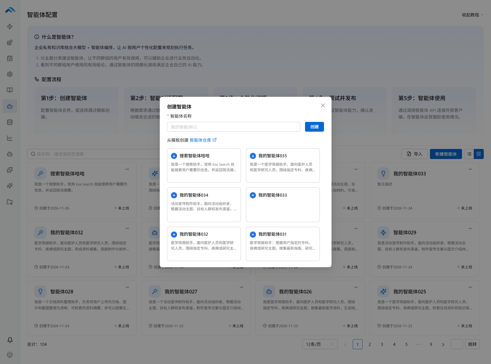

## 2. 自然语言生成智能体（NL2Agent） {#configure-with-nl2agent}

NL2Agent 是编辑页面中的智能体开发助手。您可以用自然语言说明要创建什么样的智能体，也可以指定要修改的现有配置。

### 创建智能体

#### 第 1 步 描述需求与按需澄清

在对话区描述智能体的使用对象、需要完成的任务、预期输出和约束条件。如果已经确定要使用的知识库或其他资源，也可以一并说明。

如果模型判断当前信息不足，页面会显示“澄清需求”卡片。根据问题选择选项或填写答案，然后点击“提交”。如果模型判断需求已经明确，会直接继续整理需求。

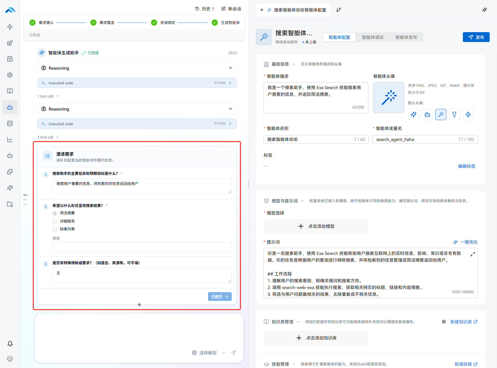

#### 第 2 步 查看并确认需求

NL2Agent 会将描述拆成可以逐项核对的需求query，以及中英文总结。这些需求将显示在“需求和资源”卡片中，并且支持对需求进行新增，修改和删除。如果涉及到需求修改，会进入到需求修改阶段，确认后会默认进入“更新需求并重新搜索”，阶段。系统会重新匹配受影响需求的资源。卡片会标出“待选择”“待绑定”“已就绪”和“暂无匹配”等状态。

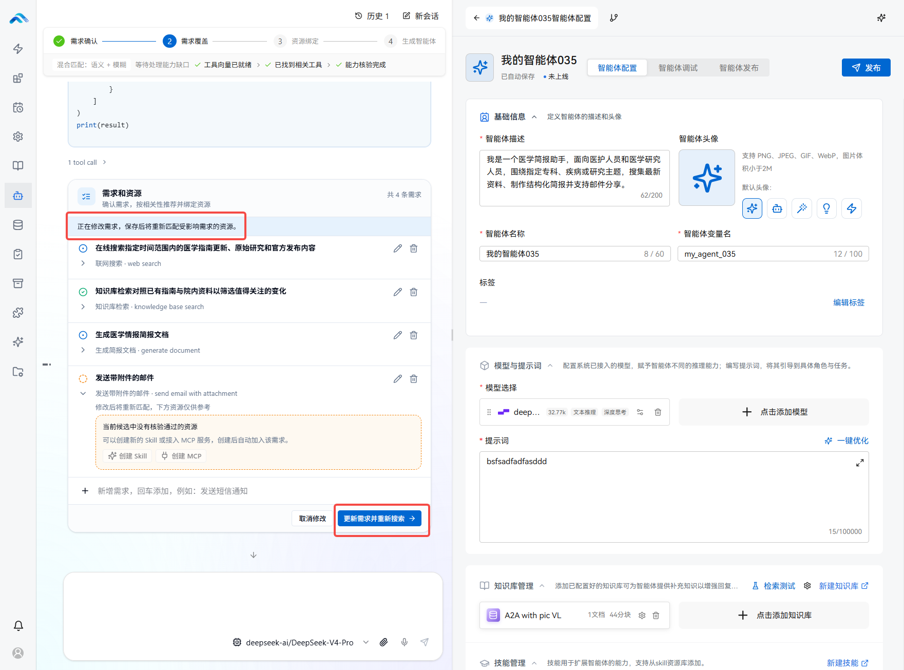

#### 第 3 步 选择、配置并绑定资源

只有保留的需求全部就绪，且所选资源都已配置并绑定，才能点击“继续”进入生成阶段。

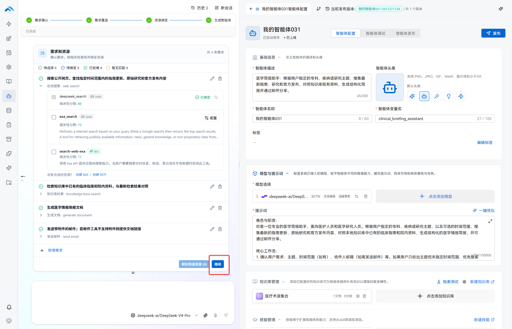

1. 展开各项需求，查看系统推荐的工具或技能。对照资源描述和相关性选择所需资源。如果需要检索知识库，按卡片提示核对推荐的知识库并确认要关联的范围。
2. 对需要填写参数的资源，点击“配置”，补齐必填项。确认选中的资源后，点击“绑定所选资源”。
3. 查看绑定结果。成功绑定的资源会记录到当前智能体，满足条件的需求会显示为“已就绪”。如有失败项，可以检查配置后重试。
4. 对“暂无匹配”的需求，可以调整需求后重新搜索，或通过卡片提供的入口创建 Skill、接入 MCP 服务。若整个智能体无需额外资源，可在出现“确认无需资源并继续”时直接确认。

#### 第 4 步 生成提示词、开场白和示例问题

资源准备就绪后，点击“继续”。NL2Agent 会根据确认的需求和已绑定的资源生成提示词。当前提示词为空时，生成结果会直接写入草稿。

提示词写入后，NL2Agent 会继续生成开场白和示例问题。生成结束后，在右侧“智能体配置”中检查“模型与提示词”和“开场白与示例问题”，按需要调整草稿，再进入[智能体编辑](#edit-agent)或[调试和发布](#debug-and-publish)。

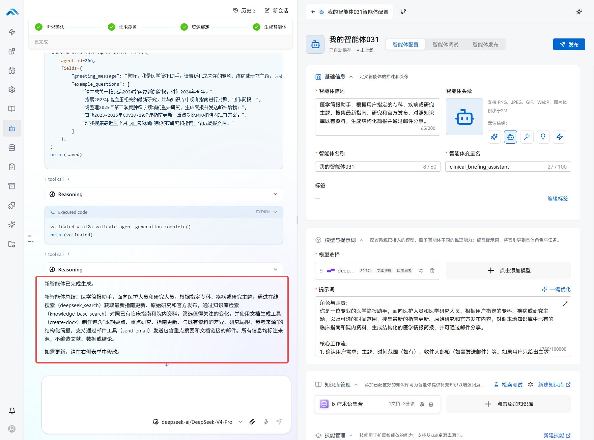

### 修改智能体

在对话区说明要修改的配置项和目标值。涉及模型、知识库、工具、技能或协作智能体时，可以提供名称，方便助手定位。除了简介、提示词和会话引导，也可以通过对话调整模型、资源、标签、权限、安全护栏和部分高级设置。特别地，如果已有提示词，页面会显示“提示词生成”卡片。可以先预览或编辑生成内容，再点击“确认应用”。

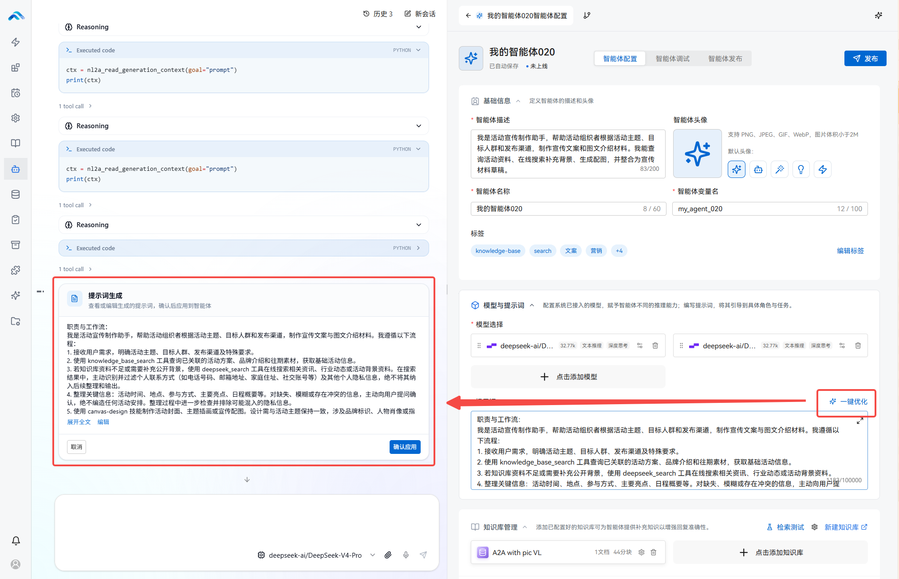

您也可以从“生成提示词”“推荐可用资源”“推荐知识库”或“生成会话引导”等快捷操作开始，发送前按需要补充要求。

### NL2Agent 会话历史策略

NL2Agent 按用户和智能体保留最近 **3 个配置会话**。再次进入该智能体的对话配置区时，默认恢复最近一个会话。点击“历史”可切换到其他保留的会话，点击“新会话”可重新开始对话。已发布的智能体版本可在版本管理中查看。

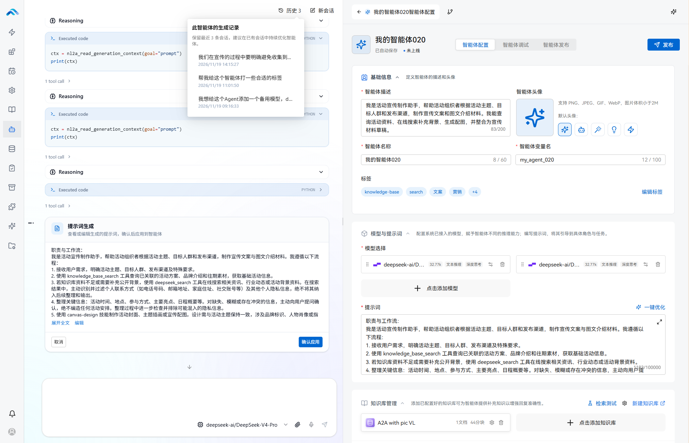

## 3. 智能体编辑 {#edit-agent}

应用 NL2Agent 生成的内容后，可以在“智能体配置”区检查和修改草稿。您也可以直接在这里手动配置智能体。

### 一个智能体由什么组成

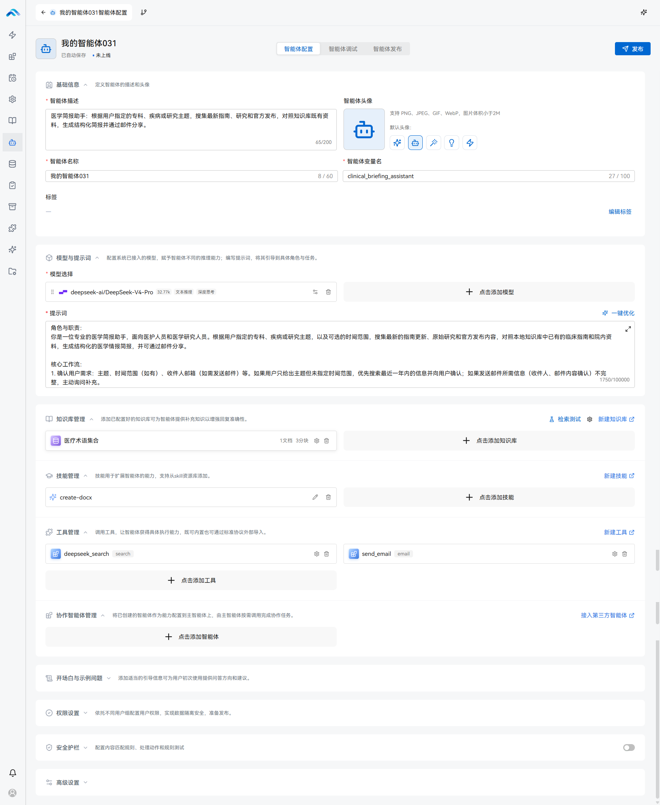

下表按页面从上到下列出各栏目。

| 配置栏目 | 配置内容 |
| --- | --- |
| 基础信息 | 设置头像并填写简介，帮助用户识别智能体和了解它的用途。 |
| 模型与提示词 | 选择一个平台可用模型，并编写提示词。 |
| 资源 | 按需在“知识库管理”“技能管理”“工具管理”和“协作智能体管理”中添加资源。 |
| 开场白与示例问题 | 设置用户进入对话时看到的欢迎语和可以直接尝试的问题。 |
| 权限设置 | 选择用户组并设置组内权限。 |
| [安全护栏](#guardrails) | 设置内容匹配规则及命中后的处理方式。 |
| 高级设置 | 按需设置最大运行步数、运行摘要等选项。 |

### 怎样编写提示词

提示词通常按三部分组织内容。

- **职责提示词**说明智能体为谁服务、负责哪些任务，以及处理任务时应遵循的步骤。
- **约束提示词**规定回答的边界、输出要求，以及信息不足时如何处理。
- **示例提示词**提供一组或多组输入和期望输出，展示回答的格式、语气和详略程度。

模型接入步骤见[模型配置](./model-configuration.md)。

### 怎样选择资源

- **知识库**提供可检索的业务资料。上传文档并等待就绪后，将知识库关联到智能体。具体步骤见[知识库配置](./knowledge-configuration.md)。
- **技能**为一类任务提供操作指南，说明完成任务需要遵循的流程和要求。
- **工具**负责执行具体操作。在“工具管理”中点击“点击添加工具”，可以从“本地工具”选择 Nexent 内置工具，也可以从“MCP 服务”选择已接入的工具。补齐工具的必填参数后，可在配置窗口运行“工具测试”。具体操作见[内置工具](./local-tools/index.md)和[MCP 服务接入](../integration/integration-in/mcp.md)。
- **协作智能体**也称子智能体，用于承接主智能体委派的专项任务。可选用已发布的内部智能体或已接入的[外部 A2A Agent](./a2a-external.md)。

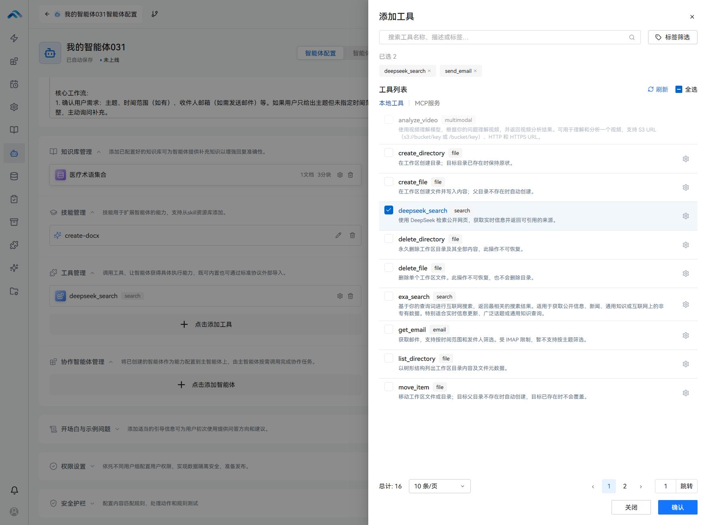

如需跨会话复用信息，请参阅[记忆配置](./memory-configuration.md)。

### 怎样配置安全护栏 {#guardrails}

安全护栏使用正则表达式检查发送给模型的消息、工具入参和工具输出。护栏默认关闭，通过“安全护栏”右侧的开关独立启用。启用后至少需要一条有效规则。规则按列表顺序执行，同一段内容由首个命中的规则决定处理方式。

| 配置项 | 说明 |
| --- | --- |
| 规则名称 | 用于识别规则，同一列表中的名称应唯一。 |
| 正则表达式 | 使用 Python `re` 语法描述匹配内容。运行时默认忽略大小写，并跳过无效的表达式。 |
| 严重级别 | 选择“阻断”“脱敏”或“放行”。新建规则默认选中“阻断”。 |
| 说明 | 可选，用于记录规则的用途。 |

同一个级别在不同检查位置的处理方式如下。

| 严重级别 | 最新用户输入 | 历史消息 | 工具入参 | 工具输出 |
| --- | --- | --- | --- | --- |
| 阻断 | 终止本次运行并返回拒绝说明。 | 脱敏后再发送给模型。 | 阻止本次工具调用。 | 工具已执行，对输出脱敏后再写入上下文。 |
| 脱敏 | 将命中内容替换为 `***` 后继续。 | 将命中内容替换为 `***` 后发送给模型。 | 将字符串参数中命中的内容替换为 `***` 后调用工具。 | 将命中内容替换为 `***` 后写入上下文。 |
| 放行 | 保留原始输入并继续。 | 保留原始消息并继续。 | 按原参数调用工具。 | 保留原始输出并继续。 |

- 在 NL2Agent 对话中描述要匹配的内容和命中后的处理方式，即可通过自然语言配置安全护栏。
- 点击“添加规则”可手动填写。规则列表支持编辑、复制、单条删除和批量删除，并显示各严重级别的规则数量。
- 在“正则测试预览”中粘贴样本文本，查看命中内容、规则名称和命中次数。预览仅展示匹配结果。

<!-- 截图占位：安全护栏的规则列表和正则测试预览。 -->

## 4. 调试和发布 {#debug-and-publish}

### 调试草稿

点击“调试”，系统校验并保存草稿后打开调试区。提交能覆盖主要任务和信息不足情况的问题，检查回答是否符合提示词要求。如果配置了知识库、工具或协作智能体，可以展开运行过程，查看资源调用和错误信息，再回到配置区修改并重试。

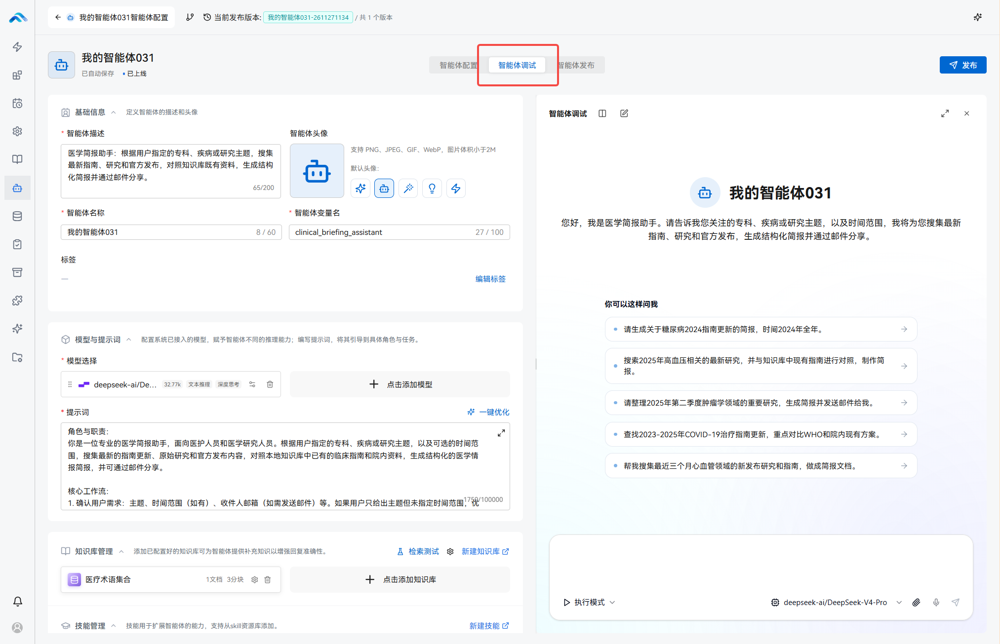

如需比较模型效果，切换到**对比模式**，在左右两侧选择两个可用模型，提交同一个问题。两侧使用同一智能体配置，分别展示各自的运行结果。可以对照回答准确性、引用情况和工具调用表现，再回到配置区选定要发布的模型。

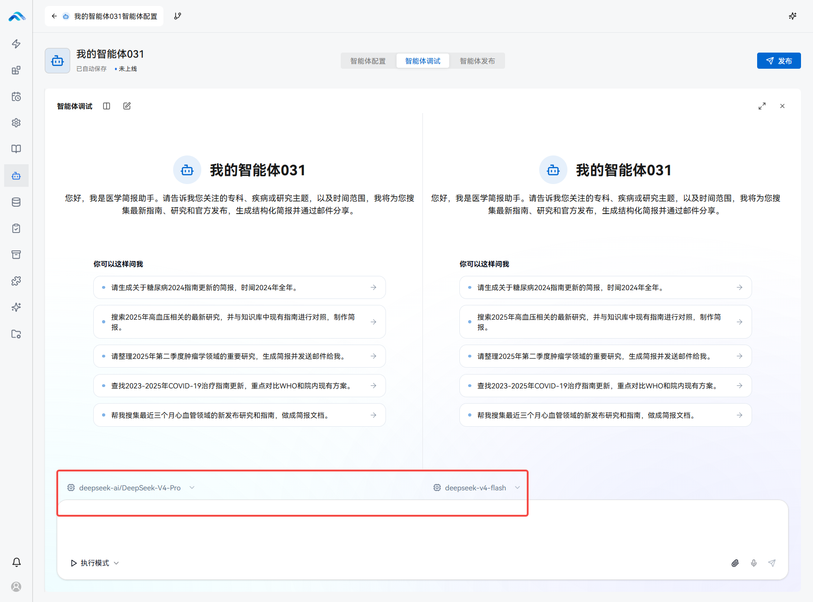

### 发布版本

1. 确认草稿通过调试，并检查使用权限。
2. 点击页面右上角的“发布”，在发布窗口填写本次版本信息并确认。需要让其他智能体通过 A2A 调用时，请启用高级设置中的“发布为 A2A Agent”。
3. 发布成功后，进入“智能体发布”查看体验链接、API 调用示例和 A2A 接入信息。后续修改可以继续在草稿中调试，验证后再发布新版本。
4. 需要比较或回滚历史版本时，打开[版本管理](#version-management)。

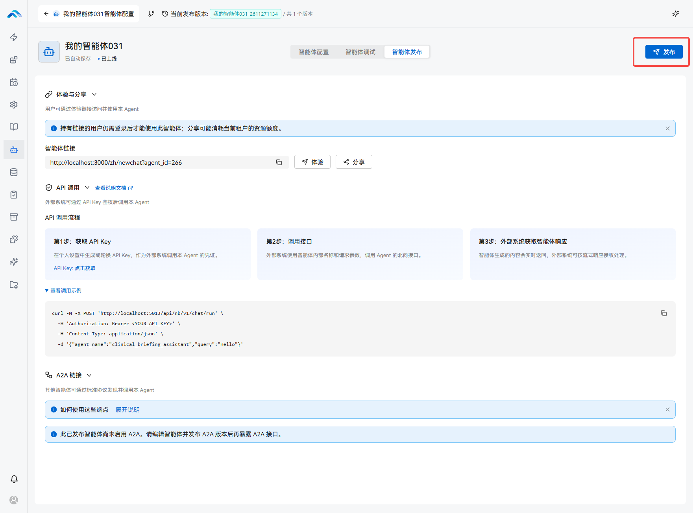

### 管理智能体版本 {#version-management}

在智能体编辑页顶部点击版本管理图标或当前发布版本标签，打开“版本管理”。这里可以查看历史发布记录，比较两个版本，或回滚到已有版本。

| 操作 | 操作方式 |
| --- | --- |
| 查看版本 | 在版本列表中查看当前版本、历史版本及其发布说明，展开版本卡片查看对应配置。 |
| 对比版本 | 点击“版本对比”，选择两个不同的版本，查看模型、提示词、工具和协作智能体等配置差异。在“问答对比”页签输入问题并发送，两个版本会分别回答。 |
| 回滚版本 | 在目标版本的菜单中选择“回滚”。查看差异后点击“确认回滚”。系统会将该历史版本设为当前发布版本，并将其配置恢复到草稿。后续可以继续编辑草稿，调试后再发布新版本。 |
| 编辑版本信息 | 在版本菜单中选择“编辑”，修改版本名称或发布说明。 |
| 删除历史版本 | 有编辑权限时，可在历史版本的菜单中选择“删除”。请在确认窗口核对版本名称。当前发布版本不提供删除操作。 |

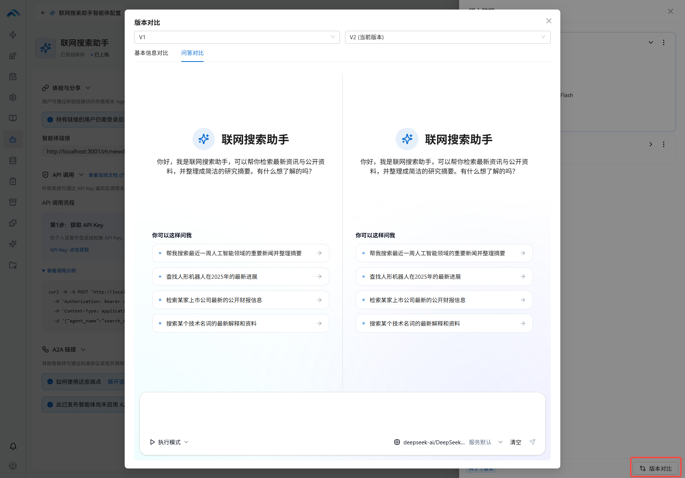

### 上架与评估

发布后，可在“智能体配置”列表的智能体卡片右上角打开“…”菜单。

- **上架**。当前发布版本尚未上架时，选择“上架”，上传必填的智能体图标，按需添加最多 5 个标签和上架说明，再点击“提交申请”。审核状态可在 [Agent 仓库](./resource-repository/agent-repository.md)查看。
- **评估**。选择“评估”进入评估页面，对当前已发布版本发起评测。操作步骤见[智能体评估](./evaluation.md)。

## 5. 智能体使用 {#use-agent}

### 在 Nexent 平台内使用

#### 在工作台使用

打开“工作台”，在输入区点击“智能体”，选择要用于当前任务的已发布智能体。可以选择多个智能体，确认后在输入框描述任务。详细步骤见[工作台](./workbench.md)。

#### 在智能体对话中使用

打开“智能体对话”，在列表中选择一个有权使用的已发布主智能体，然后发起对话。也可以在“智能体发布”页点击“体验”，或通过分享入口获取链接，提供给其他平台用户访问。对话和会话管理的详细步骤见[智能体对话](./start-chat.md)。

### 在外部平台使用

业务系统可以通过北向 API 发起对话，支持 A2A 的平台可以通过 Agent Card 发现并调用智能体。两种方式的接入信息都可在“智能体发布”页查看。

#### 通过北向 API 调用

先在个人设置中生成 API Key，再从“智能体发布”的“API 调用”区域查看调用示例，确认北向服务地址和智能体内部名称。将下方域名、API Key、`YOUR_AGENT_NAME` 和 `YOUR_QUERY` 替换为实际值。

```bash
curl -N 'https://nexent.example.com/nb/v1/chat/run' \
  -H 'Authorization: Bearer YOUR_API_KEY' \
  -H 'Content-Type: application/json' \
  -d '{"agent_name":"YOUR_AGENT_NAME","query":"YOUR_QUERY"}'
```

接口通过 SSE 返回对话事件。需要继续已有会话时，在下一次请求中传入该会话的 `conversation_id`。附件上传、会话管理和响应格式见[调用 Agent 北向 API](../integration/integration-out/northbound-api.md)。

#### 通过 A2A 调用

1. 发布时启用“发布为 A2A Agent”，然后在“智能体发布”的“A2A 链接”区域复制 Agent Card URL。如果页面展示的是相对路径，请将它与北向服务地址拼接成完整 URL。
2. 调用方通过该 URL 读取 Agent Card，获取智能体能力、支持的协议和对应地址。也可以在另一套 Nexent 环境中[通过 URL 添加外部 A2A Agent](./a2a-external.md)，再将它作为协作智能体使用。
3. 发送消息时，在请求头携带 `Authorization: Bearer YOUR_API_KEY`。REST 接入可以调用 `POST /nb/a2a/{endpoint_id}/message:send`，需要流式响应时使用 `message:stream`。JSON-RPC 接入使用 `POST /nb/a2a/{endpoint_id}/v1`，方法名为 `SendMessage` 或 `SendStreamingMessage`。

以下是 REST 同步调用示例。将域名和 API Key 替换为实际值，填入发布页显示的 Endpoint ID，并在消息的 `parts` 中传入文本。

```bash
curl 'https://nexent.example.com/nb/a2a/YOUR_ENDPOINT_ID/message:send' \
  -H 'Authorization: Bearer YOUR_API_KEY' \
  -H 'Content-Type: application/json' \
  -d '{"message":{"role":"user","parts":[{"text":"YOUR_QUERY"}]}}'
```

发布选项和协议端点见[《Agent 发布》的 A2A 小节](../integration/integration-out/agents-publish.md#publish-as-a2a)。
