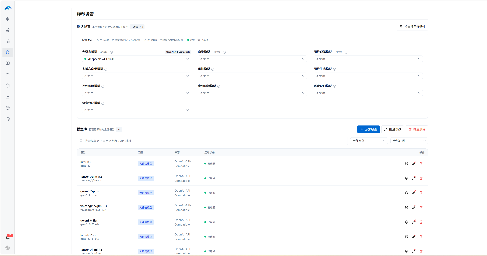
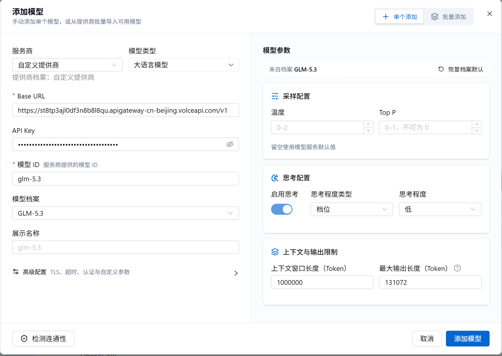
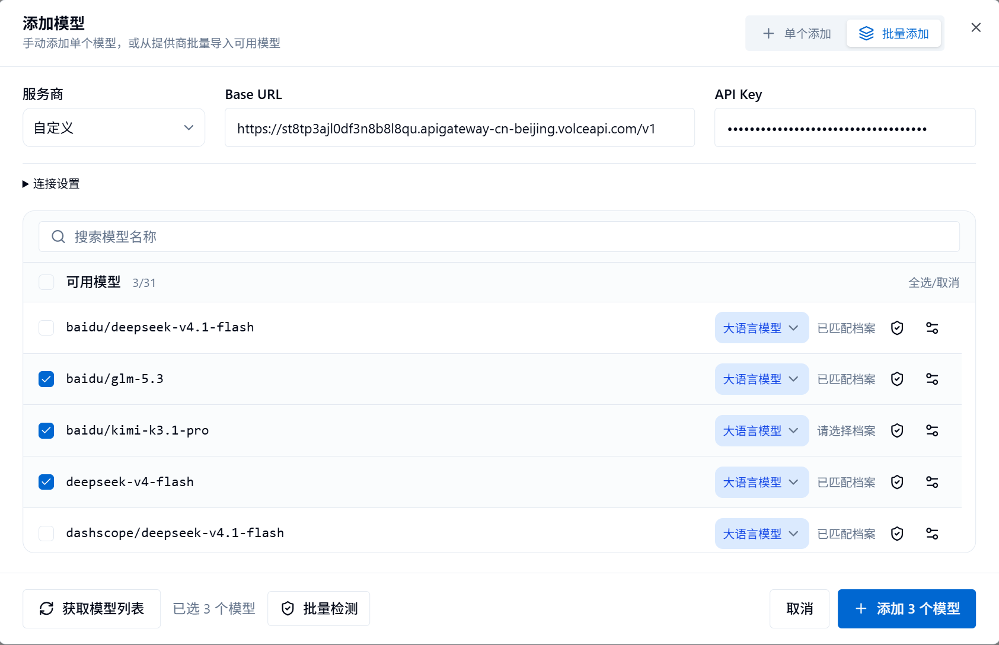
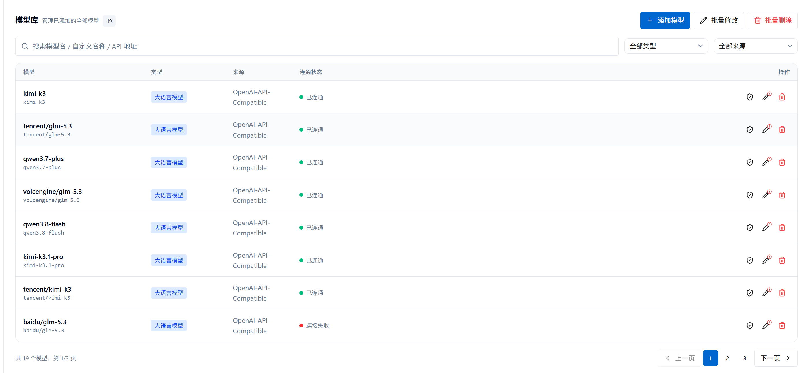
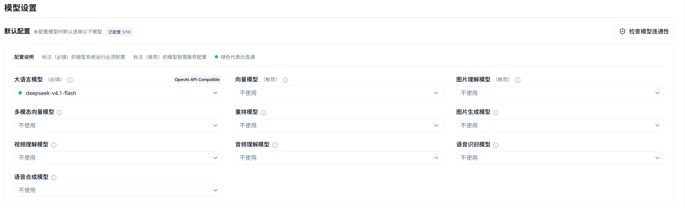

# 模型配置

在 Nexent 左侧导航选择 **智能体开发 → 模型配置**。进入「模型设置」后，上方的 **默认配置** 用于指定平台在未单独配置模型时使用的模型，下方的 **模型库** 用于添加和管理模型。首次配置时，先在模型库添加模型，再回到默认配置选择要使用的模型。

## 🤖 模型配置

### 添加单个模型

1. 在 **模型库** 点击 **添加模型**，选择 **单个添加**。
2. 选择 **服务商** 和 **模型类型**。选择预设服务商时，页面会预填服务地址，可根据部署环境修改。自行接入时，填写模型服务提供的 **Base URL**。
3. 填写服务商提供的 **模型 ID** 或 **模型名称**，例如 `Qwen/Qwen3-8B`。**展示名称**用于在 Nexent 中识别模型，留空时使用模型名称。根据服务商要求填写 **API Key** 或表单显示的其他凭据。
4. 添加大语言模型时，页面会尝试匹配 **模型档案**。核对匹配结果，必要时手动选择档案。档案可为模型参数预填参考值，保存前可按服务商的实际能力调整。其他类型的模型可按需使用表单提供的 **高级设置**，例如配置嵌入模型的切片参数。
5. 点击 **检测连通性**，查看模型能否访问。确认配置后，点击 **添加模型**，在模型库中查看新模型。

### 批量添加模型

1. 在 **模型库** 点击 **添加模型 → 批量添加**。
2. 选择 **服务商**，确认或填写 **Base URL**，按服务商要求填写 **API Key**，然后点击 **获取模型列表**。该操作需要服务端点支持返回模型列表。
3. 搜索并勾选要导入的模型。需要调整模型类型或单独配置时，使用对应模型行上的控件。
4. 可以逐个检测，也可以点击 **批量检测** 检查已选模型。确认后点击 **添加 N 个模型**。

启用 ModelEngine 集成后，可通过 **同步ModelEngine模型** 直接打开 **批量添加**。

### 设置默认模型

在 **默认配置** 中打开对应的下拉框，从模型库中选择该类型的模型。选项会自动保存。下拉框中没有所需模型时，先到模型库添加对应类型的模型。

| 标记 | 模型 | 用途 |
| --- | --- | --- |
| 必填 | 大语言模型 | 用于平台默认对话、推理和问答。 |
| 推荐 | 文本嵌入、图像理解 | 文本嵌入用于知识库向量化、语义检索和记忆。图像理解用于图文问答。 |
| 可选 | 多模态嵌入、重排、图像生成、视频理解、音频理解、语音识别、语音合成 | 按需启用图文检索、检索重排、多模态处理和语音输入输出。 |

更换已生效的嵌入模型时，先阅读确认弹窗。已有文件、知识库或记忆可能受影响。

### 管理模型库

- 用搜索框按模型名称查找，或按 **类型** 和 **服务商** 筛选。模型行会显示连接状态，已设为默认的模型会带有默认标记。
- 在模型行的 **操作** 区点击 **编辑** 或 **删除**。可编辑字段随模型类型而异。若要更换已保存的大语言模型出口所用的模型或档案，请重新添加。
- 点击 **批量修改**，选择一个连接分组，为组内模型统一更新 **API Key** 或 **Base URL**。点击 **批量删除** 可勾选单个或多个模型后确认删除。

如果账号只有查看权限，修改默认配置和管理模型的控件不可用。

### 检查模型连通性

- **检查默认模型**。在 **默认配置** 右上角点击 **检查模型连通性**，检查已选的默认模型。等待检测完成，模型名称旁的圆点变绿表示已连通。检测失败时，可查看失败详情并重试。
- **检查单个模型**。在 **模型库** 找到该模型，在对应行点击 **检测连通性**。如果检测失败，检查 **Base URL**、模型 ID 或名称、凭据及服务商权限，修改后重新检测。

### 🤖 支持的模型提供商

#### 🤖 大语言模型LLM

当前租户单个添加大语言模型时，**服务商** 下拉框提供硅基流动、阿里云百炼（中国站）、小马算力、DeepSeek、火山方舟和火山方舟 Coding Plan 的配置档案。火山方舟按量付费和 Coding Plan 使用各自的 Base URL。

批量添加使用内置模型目录，其中还收录了 OpenAI、智谱 Z.AI、Anthropic Claude、Google Gemini、Mistral AI、xAI（Grok）和 ModelEngine。批量导入取决于所填端点能否返回模型列表，模型能否调用可通过连通性检测确认。

对于月之暗面等其他服务商，选择 **自定义提供商**，填写兼容 **OpenAI Chat Completions** 的 Base URL、模型 ID 和所需凭据。

可参考以下步骤进行模型接入：

1. 访问模型供应商官网，注册账户；
2. 创建并复制API Key；
3. 在服务商文档中查看当前接入协议对应的 Base URL；
4. 在Nexent模型配置页面在模型库点击 **添加模型**，填写服务商提供的接入信息。

#### 🎭 多模态模型

使用与大语言模型相同的API Key和模型URL，但指定多模态模型名称，如硅基流动提供的**Qwen/Qwen2.5-VL-32B-Instruct**。

#### 🔤 向量模型

使用与大语言模型相同的API Key，但模型URL一般会有所差异，一般以`/v1/embeddings`为结尾，同时指定向量模型名称，如硅基流动提供的**BAAI/bge-m3**。

#### 🔃 重排模型
使用与大语言模型相同的API Key，但模型URL一般会有所差异，一般以`/v1/rerank`为结尾。
#### 🎤 语音模型

目前支持阿里灵积和火山引擎语音模型，阿里灵积需配置与大语言模型相同的apikey，火山引擎模型需配置appid与token

**火山引擎**
- **网站**: [volcengine.com/product/voice-tech](https://www.volcengine.com/product/voice-tech)
- **免费额度**: 个人使用可用
- **特色**: 高质量中英文语音合成
- 推荐使用**豆包语音合成模型2.0和大模型流式语音识别模型**
- **开始使用**:

   1. 注册火山引擎账户
   2. 访问语音技术服务
   3. 创建应用并获取appid和token
   4. 在添加模型页面中配置 TTS/STT 设置

**阿里灵积**
- **网站**: [aliyun.com/benefit/scene/voice](https://www.aliyun.com/benefit/scene/voice)
- 推荐使用**千问3-TTS-Instruct-Flash-Realtime/千问3-TTS-Flash-Realtime和千问3-ASR-Flash-Realtime**
- **开始使用**:

   1. 注册阿里云账户
   2. 访问阿里千问实时语音技术服务
   3. 创建应用并获取 API Key
   4. 在添加模型页面中配置 TTS/STT 设置

## 💡 需要帮助

如果您在模型提供商方面遇到问题：

1. 查看提供商特定文档
2. 验证 API 密钥权限和配额
3. 使用提供商官方示例进行测试
4. 加入我们的 [Discord 社区](https://discord.gg/tb5H3S3wyv) 获取支持

## 🚀 下一步

完成模型配置后，建议您继续配置：

1. **[知识库](./knowledge-configuration)** - 创建和管理知识库。
2. **[智能体配置](./agent-configuration)** - 创建和配置智能体。

如果您在使用过程中遇到任何问题，请参考我们的 **[常见问题](../../quick-start/faq)** 或在[GitHub Discussions](https://github.com/ModelEngine-Group/nexent/discussions)中进行提问获取支持。
