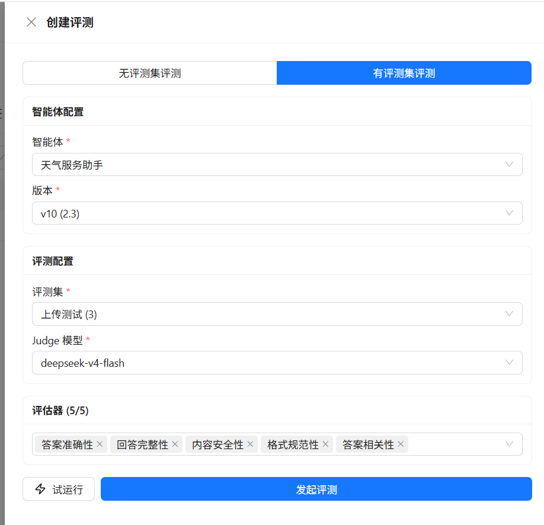
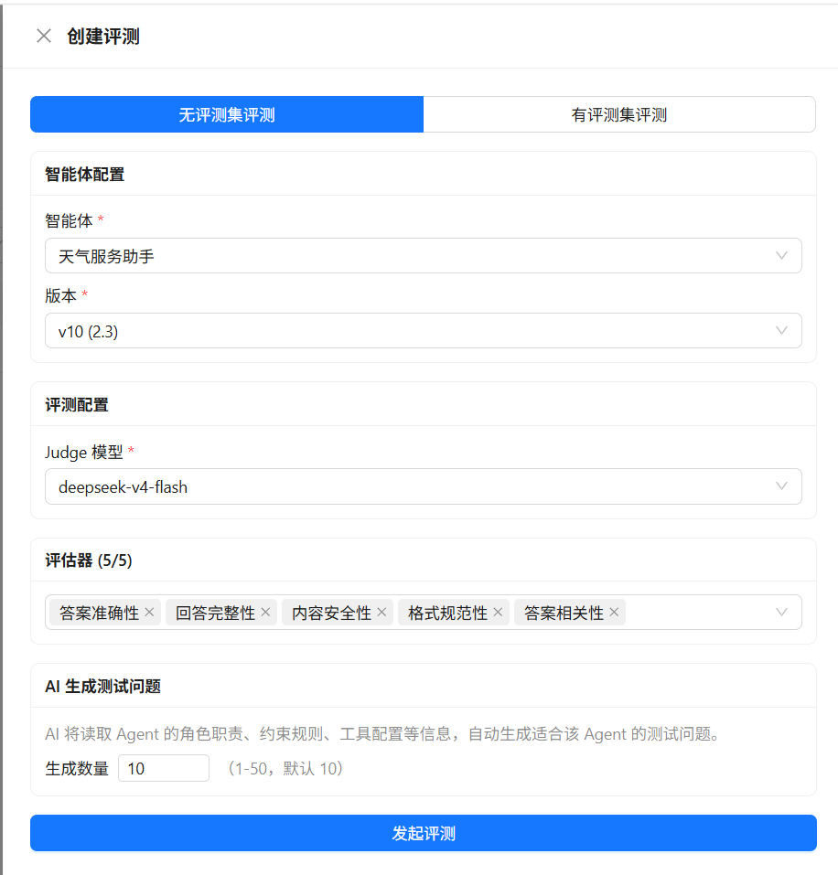

# 创建评估任务

评估任务用于运行指定版本的智能体，并使用评估器对运行结果进行评分。创建任务前，请先阅读[智能体评估概览](../evaluation)。

## 选择评估模式

在 **评测** 页签右上角单击 **创建评测**，右侧会滑出创建抽屉，顶部可切换评测模式（默认为 **无评测集评测**）：

| 模式 | 说明 |
|------|------|
| **有评测集评测** | 使用已有评测集中的问题运行智能体，适合回归测试和发布前验证 |
| **无评测集评测** | 由 AI 根据智能体配置生成测试问题后运行智能体，适合快速探索 |

以下为有评测集评测的创建界面示例：

  

以下为无评测集评测的创建界面示例。系统会根据智能体配置生成测试问题，并按设置的数量运行评估：

  

## 创建任务

1. 在左侧导航栏选择 **智能体评估**，打开 **评测** 页签。
2. 单击右上角 **创建评测**，在抽屉顶部选择评估模式。
3. 在 **智能体配置** 中选择要评估的智能体和版本。版本必须已发布；未指定版本时，系统默认使用该智能体最新的已发布版本。
4. 在 **评测配置** 中选择 **Judge 模型**。有评测集模式还需要选择评测集（选项格式为「名称 (用例数)」）；无评测集模式需要设置 AI 生成问题的数量（1～50 条，默认 10 条）。
5. 在 **评估器** 中选择 1～5 个已发布评估器。无评测集模式下，需要参考答案的评估器不可选择，并排列在列表末尾。
6. 有评测集模式下可先单击 **试运行** 验证配置；确认无误后单击 **发起评测**。

任务提交后返回 **评测任务** 列表并在后台执行。任务会保存创建时的智能体版本、Judge 模型和评估器配置，之后修改这些对象不会改变历史任务。

## 评估器输入

系统为评估器提供以下标准输入：

| 字段 | 数据来源 |
|------|----------|
| `query` | 评测集的 `问题` / `query` |
| `expected` | 评测集的 `答案` / `answer`；无评测集模式为空 |
| `actual` | 智能体本次运行的实际回答 |
| `runtime_stats` | 智能体本次运行的过程统计信息 |

字段映射由系统在创建任务时自动填充，无需手动配置。创建自定义评估器时，请使用这些字段名。

## 试运行

有评测集模式下，创建抽屉底部会显示 **试运行** 按钮。单击后系统自动取评测集中的第一条用例作为测试问题运行智能体，并在弹窗中展示测试问题、智能体输出和各评估器的分数（达到通过阈值的显示为绿色，未达到的显示为红色）。试运行不会创建评估历史记录。

<!-- TODO(截图): 10-试运行结果弹窗（含测试问题、智能体输出与各评估器分数标签） -->

建议先用一条代表性问题试运行，确认智能体版本、Judge 模型和评估器配置正确，再开始完整评估。

## 任务状态与管理

| 状态 | 含义 |
|------|------|
| **等待中** | 任务已创建，等待后台执行 |
| **运行中** | 正在运行智能体和评估器 |
| **已完成** | 任务已完成，可以查看评估结果 |
| **失败** | 任务或关键执行阶段失败，可以根据错误信息修正配置后重新创建 |

评测任务列表支持以下管理操作：

- **按智能体筛选**：列表顶部的智能体筛选器支持多选；从智能体配置页的 **评估** 菜单进入时，会自动带上该智能体的筛选条件。
- **列头筛选**：评测集列和状态列支持按值筛选。
- **删除任务**：单击操作列的删除图标并确认即可删除任务。删除入口仅对任务创建者以及超级管理员、租户管理员、资产管理员可见。
- 任务列表每页显示 10 条，运行中任务的状态会自动刷新。

<!-- TODO(截图): 09-评测任务列表（智能体多选筛选器展开，并展示操作列删除确认弹窗） -->

更多结果信息请参见[查看结果与标注](./results)。
