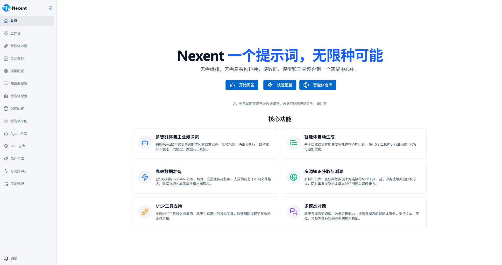

# 首页

欢迎使用 Nexent。本页帮助您认识平台首页和主要功能入口，并根据自己的使用目标开始操作。

如果管理员已经为您准备好模型和智能体，可以直接开始对话；如果您需要构建自己的智能体，可以从智能体配置或资源仓库开始。

## 认识首页

首页提供常用功能的快捷入口。左侧导航栏用于切换功能页面，展开后可以查看入口名称，并通过固定按钮保持展开。

### 首页快捷入口

| 入口 | 点击后可以做什么 | 适合的使用目标 |
| --- | --- | --- |
| **开始问答** | 进入智能体对话页面，选择可用智能体并发送问题 | 使用已有智能体完成任务 |
| **快速配置** | 进入智能体配置页面，创建或配置智能体 | 构建自己的智能体 |
| **智能体仓库** | 进入智能体仓库，浏览共享智能体及有权管理的智能体 | 查找、复用或管理智能体 |

快捷按钮会根据账号权限显示。**快速配置**当前进入智能体配置页面；模型接入、知识库准备等操作可通过左侧导航进入。

### 左侧导航栏

导航入口按用途分组。以下列出主要功能，实际可见内容取决于您的账号权限和部署配置。

| 使用目标 | 主要入口 | 用途 |
| --- | --- | --- |
| 日常使用 | **工作台**、**智能体对话**、**自动任务** | 进入工作台开展任务，与已有智能体对话，或管理定时执行的任务 |
| 智能体开发 | **模型配置**、**知识库配置**、**智能体配置**、**记忆配置**、**智能体评估** | 准备智能体所需资源，创建、调试和评估智能体 |
| 资源复用 | **资源仓库**下的 **Agent 仓库**、**MCP 仓库**、**Skill 仓库** | 查找和复用智能体、外部工具与技能资源 |
| 资源与权限管理 | **资源管理**、**资产管理员资源管理** | 在授权范围内管理资源及其访问权限 |
| 观察与运维 | **可观测中心**、**运维看板**、**系统配置** | 查看运行信息，或执行获授权的运维与配置操作 |

首页快捷按钮中的「智能体仓库」与「资源仓库」下的「Agent 仓库」指向同一页面。各功能的详细操作请参阅对应指南。

## 从哪里开始

### 我想使用已有智能体

1. 从首页点击 **开始问答**，或在左侧导航选择 **智能体对话**。
2. 选择您有权使用的智能体，输入问题并发送。
3. 根据任务需要添加文件或继续追问。

如果没有可选智能体，请联系管理员或智能体开发者确认发布状态与授权范围。详细操作参见 [智能体对话](./start-chat)。

### 我想构建自己的智能体

1. 确认可使用的模型；如需新增模型，参见 [模型配置](./agent-development/model-configuration)。
2. 点击首页的 **快速配置**，或进入 **智能体开发 → 智能体配置**，创建并配置智能体；也可以先到 [智能体仓库](./resource-repository/agent-repository) 查找可复用的资源。
3. 按任务需要配置工具、Skill、知识库和记忆。**知识库是可选能力**，仅在需要检索专属资料时准备。
4. 调试并确认效果后发布智能体，再进入对话页面验证使用体验。

详细操作参见 [智能体配置](./agent-development)。需要处理专属资料时，可参见 [知识库配置](./agent-development/knowledge-configuration)。

### 我负责平台初始化或管理

首次部署后的账号和租户初始化，请按照 [安装部署](../quick-start/installation) 完成。已有账号的用户可直接登录，无需重复创建租户管理员。

管理员可根据团队需要准备模型、配置用户与资源权限，再由开发者创建和发布智能体。角色与授权说明参见 [资源管理](./resource-management)。

## 为什么看不到某个入口或资源

- **账号权限不同**：不同角色和授权范围下，可见导航、首页按钮及可执行操作可能不同。需要额外权限时，请联系管理员。
- **部署配置不同**：部分部署会隐藏首页，登录后直接进入工作台、智能体对话或其他获授权页面；工作台也可能未启用。
- **资源授权不同**：能进入页面不代表能使用其中所有资源。模型、智能体、知识库等资源还需满足相应的可见性与使用权限。

请以当前环境中显示的入口为准，无需为了匹配本文示例而切换为管理员账号。

## 下一步与帮助

- [智能体对话](./start-chat)：选择智能体、发送问题并查看结果。
- [自动任务](./auto-tasks)：管理按计划执行的任务。
- [智能体配置](./agent-development)：创建、配置、调试与发布智能体。
- [资源仓库](./resource-repository/agent-repository)：查找和复用已有智能体。
- [常见问题](../quick-start/faq)：查找使用与部署问题的处理方法。

如需反馈问题，可在 [GitHub Discussions](https://github.com/ModelEngine-Group/nexent/discussions) 中交流。反馈时请提供使用的版本、操作步骤和错误提示，并隐藏账号、密钥及业务数据。
