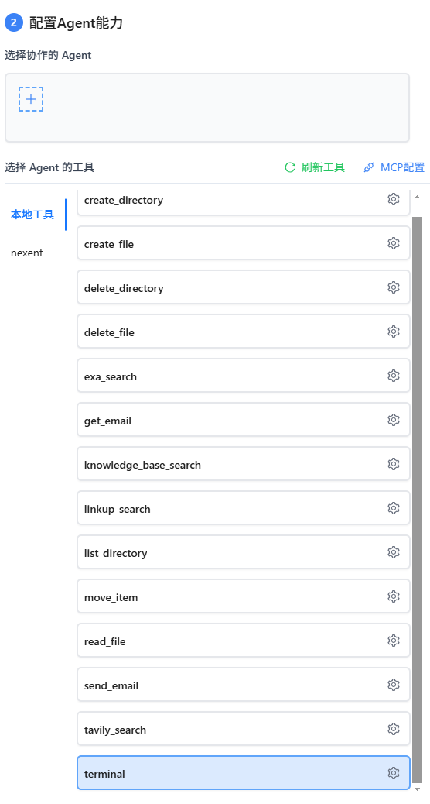
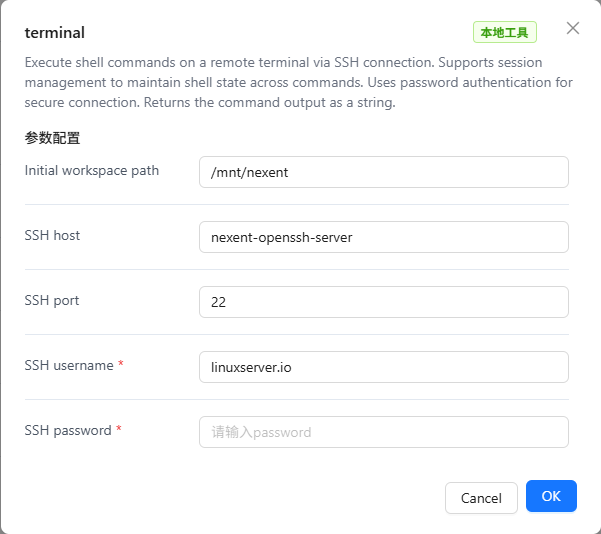

# 终端工具

终端工具允许智能体通过 SSH 连接远程服务器执行 shell 命令。该工具支持会话管理以在命令之间保持 shell 状态，使用密码认证进行安全连接，并返回命令输出结果。

## 🧭 工具清单

- `terminal`：通过 SSH 在远程终端执行 shell 命令，支持多会话状态保持、密码认证与输出清理

## 🧰 使用场景示例

- 远程执行运维命令，查看日志、进程与系统状态
- 在远程主机上运行脚本、管理文件与目录
- 多步操作间保持 shell 状态（如先切换目录再执行命令）

## 🧾 参数要求与行为

### 运行参数

- `command`：要执行的 shell 命令，必需
- `session_name`：会话名称，用于连接复用，默认 `default`
- `timeout`：命令超时时间（秒），默认 30

### 连接配置参数

- `ssh_host`：SSH 服务器的 IP 地址或域名（Nexent Terminal 容器默认为 `nexent-openssh-server`）
- `ssh_port`：SSH 服务端口，默认 22
- `ssh_user`：SSH 登录用户名
- `password`：SSH 登录密码
- `init_path`：初始工作目录，默认 `~`

### 端口说明

- 工具的 `ssh_port` 默认为 22；Nexent Terminal 容器内部的 SSH 服务端口也是 22，在平台容器网络内使用默认配置即可连通
- 开发环境的 Compose 会将宿主机 2222 端口映射到容器 22 端口（从宿主机直接测试时使用 `ssh -p 2222`）；生产环境的 Compose 不发布宿主机端口
- 第三方 SSH 服务器按其实际端口填写

### 输出格式

工具返回 JSON 格式的结果，包含：

- **command**：执行的命令
- **session_name**：使用的会话名称
- **output**：命令输出结果（自动清理控制字符与提示符）
- **timestamp**：执行时间戳
- **error**：错误信息（如果执行失败）

## 🛠️ 操作指引

### 方式一：使用 Nexent Terminal 容器（推荐）

Nexent 提供预配置的 Terminal 容器 `nexent-openssh-server`，包含完整的 SSH 服务器环境和常用工具，开箱即用：

- 通过部署脚本启用：`bash deploy.sh docker --components infrastructure,application,data-process,terminal`，脚本执行过程中选择启用终端工具容器，并按提示配置 SSH 凭据与挂载目录
- 容器工作目录为 `/opt/terminal`，预装 curl、wget、vim、git 与 Python3 环境（pip、virtualenv、conda），SSH 会话超时为 60 分钟
- 也可以本地构建镜像：`docker build --progress=plain -t nexent/nexent-ubuntu-terminal -f deploy/images/dockerfiles/terminal/Dockerfile .`，详细构建说明参考 [Docker 构建指南](/zh/deployment/docker-build)

验证容器运行：

```bash
# 检查容器状态
docker ps | grep nexent-openssh-server

# 开发环境从宿主机测试 SSH 连接（2222 映射到容器 22）
ssh -p 2222 root@localhost

# 查看容器日志
docker logs nexent-openssh-server
```

### 方式二：使用第三方 SSH 服务器

如需在现有服务器或自建容器上搭建 SSH 服务：

**容器自建（适合开发测试、临时使用）**：基于 Ubuntu 镜像安装 `openssh-server`、创建用户并允许密码登录后启动容器，例如：

```dockerfile
FROM ubuntu:24.04
ENV DEBIAN_FRONTEND=noninteractive
RUN apt-get update && apt-get install -y openssh-server sudo vim bash \
    && rm -rf /var/lib/apt/lists/*
RUN useradd -ms /bin/bash test \
    && echo 'test:test@123' | chpasswd \
    && usermod -aG sudo test
RUN mkdir /var/run/sshd \
    && sed -i 's/#PermitRootLogin prohibit-password/PermitRootLogin yes/' /etc/ssh/sshd_config \
    && sed -i 's/#PasswordAuthentication yes/PasswordAuthentication yes/' /etc/ssh/sshd_config
CMD ["/usr/sbin/sshd", "-D"]
```

```bash
docker build -t nexent-terminal .
docker run -d --name nexent-terminal -p 2222:22 nexent-terminal
```

**服务器直装（适合生产环境）**：在 Linux 服务器上安装并启用 `openssh-server`，确保 `/etc/ssh/sshd_config` 中 `PasswordAuthentication yes` 且按需设置端口后重启 SSH 服务。原生性能更好，可完全控制 SSH 配置。

### 在智能体中配置终端工具

1. 进入 **[智能体配置](../agent-development/agent-configuration)** 页面，打开目标智能体
2. 在工具列表中找到终端工具并添加
3. 点击配置按钮，填写连接参数

<div style="display: flex; justify-content: center;">
  
</div>

**配置示例（Nexent Terminal 容器，平台容器网络内）**：

```json
{
  "ssh_host": "nexent-openssh-server",
  "ssh_port": 22,
  "ssh_user": "root",
  "password": "your-container-password",
  "init_path": "/opt/terminal"
}
```

**配置示例（第三方 SSH 服务器）**：

```json
{
  "ssh_host": "192.168.1.100",
  "ssh_port": 22,
  "ssh_user": "nexent-user",
  "password": "your-secure-password",
  "init_path": "~"
}
```

<div style="display: flex; justify-content: center;">
  
</div>

## 🛡️ 安全与最佳实践

- 使用强密码，避免在对话中暴露 SSH 凭据
- Nexent Terminal 容器：定期更新容器镜像、限制挂载目录的访问权限、监控容器资源使用并定期备份重要数据
- 第三方服务器：修改默认 SSH 端口、配置 IP 白名单、启用 fail2ban 防护

```bash
# 安装并配置 fail2ban 防止暴力破解
sudo apt install fail2ban -y
sudo nano /etc/fail2ban/jail.local
# [sshd]
# enabled = true
# port = ssh
# filter = sshd
# logpath = /var/log/auth.log
# maxretry = 3
# bantime = 3600
```

## 🔧 常见问题

**Q1：SSH 连接超时怎么办？**

检查以下项目：

- **Nexent Terminal 容器**：容器是否正常运行、端口映射是否正确（开发环境宿主机 2222 → 容器 22）、容器日志是否有错误信息
- **第三方 SSH 服务器**：网络连通性、SSH 服务是否运行、防火墙是否放行、端口是否正确

```bash
# 检查容器状态与端口占用
docker ps | grep nexent-openssh-server
netstat -tlnp | grep :2222

# 检查第三方服务器 SSH 状态
sudo systemctl status ssh
sudo netstat -tlnp | grep :22
```

**Q2：认证失败怎么解决？**

- 确认用户名与密码正确（注意大小写）
- 确认 SSH 服务允许密码登录（`PasswordAuthentication yes`）
- 使用 `ssh -v username@server-ip` 查看详细认证过程

**Q3：命令执行权限不足怎么办？**

- 确认用户有执行命令的权限（`groups username`）
- 检查 sudo 配置（`sudo -l`）
- 验证目标文件权限（`ls -la /path/to/command`）

**Q4：命令执行很慢怎么办？**

- 检查服务器负载与磁盘使用（`top`、`df -h`）
- 调整 `timeout` 参数，优化命令执行方式

**Q5：Nexent Terminal 容器无法启动怎么办？**

```bash
sudo systemctl status docker
docker-compose config
docker-compose logs nexent-openssh-server
docker-compose restart nexent-openssh-server
cat .env | grep -E "(SSH_USERNAME|SSH_PASSWORD|TERMINAL_MOUNT_DIR)"
```

常见原因：Docker 服务未运行、端口被占用、环境变量配置错误、挂载目录权限不足。

如果您使用过程中遇到任何问题，请在[GitHub Discussions](https://github.com/ModelEngine-Group/nexent/discussions)中进行提问获取支持。
