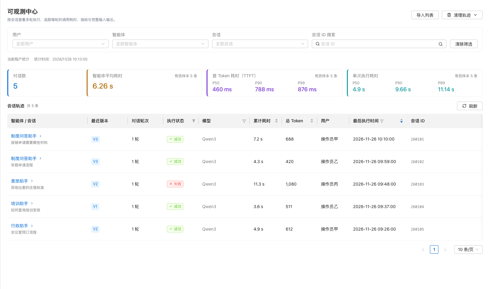
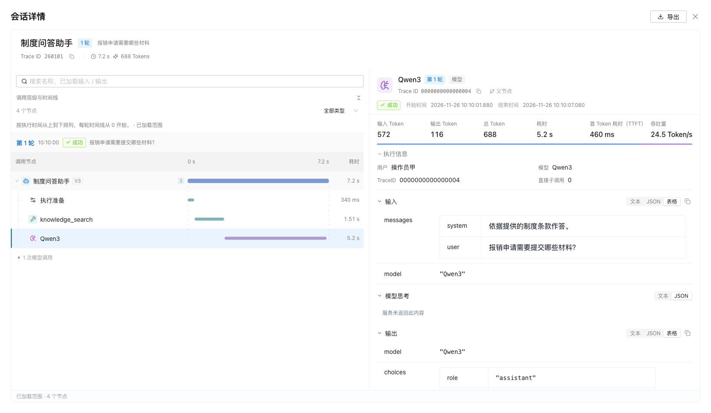

# 可观测中心

当用户反馈回答慢、工具报错或结果异常时，可以在可观测中心找到这段会话，逐轮查看智能体调用了哪些模型和工具、每一步用了多久，以及实际记录的输入和输出。要了解一段时间内的调用趋势和错误率，请查看[运维看板](./operations/dashboard)。

## 查找一段会话

在左侧导航打开 **可观测中心**。账号需要有该页面的访问权限。运维管理员（OPS）可以查看本租户的会话，超级管理员（SU）还可以跨租户查询。

- **已知会话 ID** 时，在 **会话 ID 搜索** 中粘贴编号并按回车。支持输入部分数字，使用完整编号更容易找到目标。用户可以在已保存的对话顶部复制会话 ID，入口见[智能体对话](./start-chat)和[工作台](./workbench)。
- **没有会话 ID** 时，可以按用户、智能体或会话名称筛选。超级管理员还可以先选租户。表头的 **执行状态**、**模型** 和 **最后执行时间** 支持进一步筛选。时间范围按北京时间填写，会话中任一轮的开始时间都可以匹配该条件。

在 **会话轨迹** 列表中点击目标行，打开 **会话详情**。刚结束的对话尚未出现时，点击列表右上角的 **刷新**。要重新查找，点击 **清除筛选**。

列表每行代表一段会话。**最近版本** 和 **执行状态** 取最近一轮，**累计耗时** 和 **总 Token** 汇总各轮数据，可以点击表头排序。例如，第一轮失败、第二轮成功的会话会显示成功。排查第一轮时，可直接搜索会话 ID，再进入详情查看。

## 定位耗时或失败的步骤

详情顶部显示会话标题、轮数、累计耗时和 Token 用量。此处的 **Trace ID** 就是会话 ID，可以点击旁边的复制按钮。

1. 在左侧 **调用层级与时间线** 中，根据轮次、时间和用户输入找到要检查的一轮。每轮时间线都从 0 开始。展开智能体节点，可以看到模型、工具和执行准备等步骤在这一轮中何时开始、持续多久。
2. 节点较多时，可以按节点类型筛选，也可以搜索节点名称或已加载的输入和输出。要搜索更多记录，先点击 **加载更多** 或 **加载较早轮次**。
3. 点击节点，在右侧查看执行状态、起止时间和已采集的正文。查看子调用后，点击 **父节点** 可以回到发起调用的步骤。

图中的报销问答共用时 7.2 秒，知识检索工具用时 1.51 秒，Qwen3 模型调用用时 5.2 秒。选中 Qwen3 后可以看到，在这 5.2 秒中，等待模型首次输出用了 460 毫秒。

| 想查什么 | 在详情中怎么看 |
| --- | --- |
| 为什么回答慢 | 在目标轮次中找出耗时较长的调用。若是模型，比较 **首 Token 耗时（TTFT）** 与总耗时，区分等待首次输出和后续生成所用的时间，再看 **吞吐量**（Token/秒）。若是工具，直接查看该工具的耗时。 |
| 为什么调用失败 | 选中失败的模型或工具，先读 **失败原因**，再核对 **输入** 和 **输出**。例如，检索工具报错时，可以从输入确认智能体实际传入了什么查询条件。 |
| 模型收到了什么 | 选中模型节点，在 **输入** 中查看实际请求。支持表格视图时，可以按消息顺序核对角色和正文，也可以切换到文本或 JSON。长正文可向下滚动继续加载。 |
| 哪一步消耗了较多 Token | 先看智能体节点的模型调用数和总 Token，再逐个查看模型节点的 **输入 Token** 和 **输出 Token**。显示 **Token 不完整** 时，只能确认已记录的用量。 |

## 如何理解顶部统计

会话列表上方标明了 **全局统计** 或 **当前租户统计**。租户范围不变时，用户、智能体、模型和时间筛选只影响列表。超级管理员在全部租户中选定某个用户、智能体或会话时，统计也会切换到对应租户。比较耗时前，可以先看 **统计时间** 和 **有效样本** 数量。指标显示为横线时，表示暂无可用数值。

| 卡片 | 统计含义 |
| --- | --- |
| 对话数 | 统计范围内的会话数量，一段多轮对话算一个会话。 |
| 智能体平均耗时 | 有耗时记录的智能体执行的平均时长。 |
| 首 Token 耗时（TTFT） | 从模型调用开始到首次返回有效内容的时间。P50 是中位数，P90 和 P99 可以用来观察较慢的调用。 |
| 单次执行耗时 | 当前按会话汇总各轮执行耗时，再显示 P50、P90 和 P99。定位某一轮的耗时，请打开会话详情查看时间线。 |

## 导出或导入轨迹

1. 要保存一段会话的轨迹，在 **会话详情** 右上角点击 **导出**。下载的 ZIP 包含该会话中已归档且可读取的执行，包括尚未在页面展开的轮次。文件可能包含用户提问、模型输入和工具返回的业务数据，分享前请核对接收对象。
2. 要查看收到的文件，在可观测中心右上角进入 **导入列表**，点击 **导入** 并选择 Nexent 导出的轨迹 ZIP。导入成功后会打开详情。以后可用同一账号登录同一租户，在导入列表中点击 **查看** 重新打开。
3. 导入的副本保存在个人导入列表中，独立于原始轨迹的统计和清理。用完后可以逐条 **删除**，也可以跨页勾选后点击 **删除所选**。副本会保留到手动删除为止。

## 清理原始轨迹

默认保留原始轨迹 30 天。清理会跳过仍在运行的执行，保留聊天记录和已保存的执行摘要。因此列表中仍可能看到耗时和 Token 用量，但已清理轮次的节点和正文无法再打开。需要保留调用细节时，请先导出。

### 手动清理

1. 点击 **清理轨迹 → 手动清理**。运维管理员清理本租户，超级管理员须在弹窗中选择一个租户。
2. 输入天数（1 至 30）。例如，输入 7 会清理 7 天以前的原始轨迹。**清理范围包括该租户的所有用户、智能体和会话**，即使列表只筛选了一条记录。
3. 核对租户和天数，点击 **确认清理**。若结果中仍有待处理或失败项，可以再次清理。

### 定时清理

点击 **清理轨迹 → 定时清理**，打开 **开启定时清理** 开关，设置天数（1 至 30）并点击 **保存设置**。设置在 30 秒内生效，清理任务每天北京时间 00:00 执行。

运维管理员只设置本租户。超级管理员点击 **确认并同步** 后，会覆盖**所有现有租户**的定时清理设置，即使会话列表中只选了一个租户。

## 找不到轨迹或正文时

| 页面提示 | 处理方法 |
| --- | --- |
| 没有匹配的执行记录 | 核对会话 ID 和租户，清除模型、状态、时间等筛选条件后刷新。若提示查询范围过大，可以指定租户或缩短时间范围。 |
| 未归档 | 本轮执行尚未完成归档，稍后刷新列表，再打开详情。 |
| 未采集、部分采集或已清理 | 只查看仍可读取的轮次和节点。历史未采集的正文无法通过刷新补回，已清理的内容如有事先导出的 ZIP，可从导入列表查看。 |
| 本地轨迹查询尚未启用 | 请部署管理员核对历史读取开关 `TRAJECTORY_READ_ENABLED`。若新对话也没有轨迹，再检查本地采集开关 `LOCAL_FILE_MONITORING_ENABLED`，并确认采集和读取使用同一持久化目录。 |
