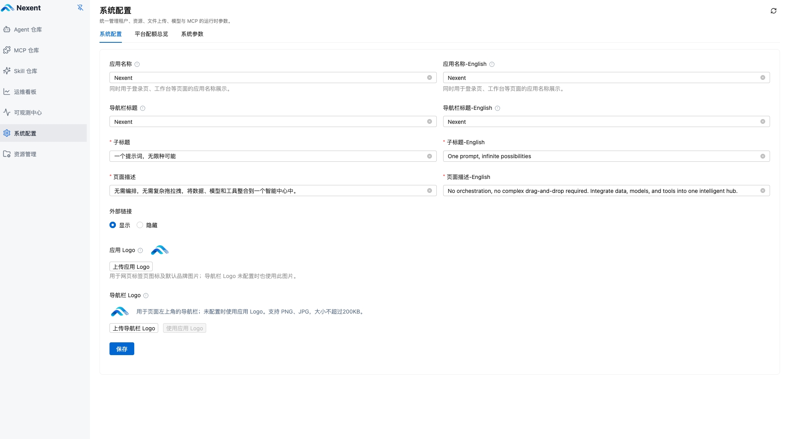
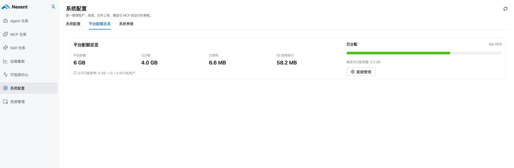
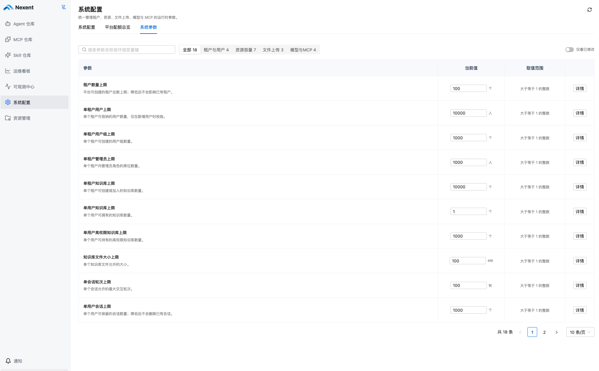
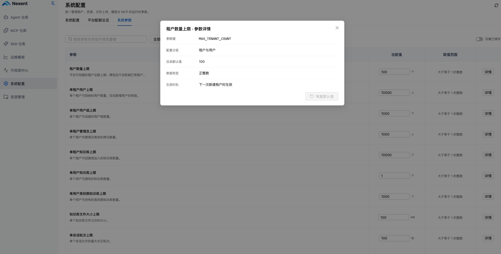

# 系统配置

系统配置是面向超级管理员（SU）的统一工作台，用于维护品牌信息、平台存储配额和系统运行参数。系统参数保存在 PostgreSQL 中，相关服务会通过 Redis 通知和定时刷新读取新值，保存参数后无需重启服务。

## 入口与权限

登录 Nexent 后，在左侧导航的运维管理区域选择 **系统配置**。

- 页面仅对具有 **SU** 角色的账号开放。OPS 或其他角色不能通过历史配置权限进入该页面。
- 查询系统参数需要 `ops.configuration:read` 权限，保存系统参数需要 `ops.configuration:update` 权限。
- 如果看不到页面入口或收到无权限提示，请联系管理员检查账号角色、菜单权限和上述配置权限。

## 工作台页签

| 页签 | 用途 |
| --- | --- |
| **系统配置** | 维护中英文品牌文案、外部链接和页面 Logo。 |
| **平台配额总览** | 查看平台存储容量、已分配量、已用量、ES 物理索引和剩余可分配容量，并调整平台总容量。 |
| **系统参数** | 查看和修改 18 个非敏感运行参数，包括资源数量、文件大小、超时和模型输出选项。 |

三个页签使用各自的数据和保存操作。品牌信息或平台配额的保存不会提交“系统参数”页签中的草稿，系统参数的保存也不会修改品牌信息或存储配额。

### 品牌信息

在 **系统配置** 页签中，可维护中英文应用名称、导航栏标题、子标题和页面描述，设置外部链接是否显示，并按需上传应用、导航栏和首页 Logo。

1. 修改需要更新的文案或图片。子标题和页面描述为必填项。
2. Logo 支持 PNG、JPG 格式，单个文件不超过 200 KB。
3. 点击 **保存**。保存成功后页面会重新加载并展示新配置。

### 平台配额总览

**平台配额总览** 页签展示平台总容量、已分配容量、实际已用量、ES 物理索引占用和剩余可分配容量。点击 **配额管理** 可调整平台总容量。

这里的容量配额与“系统参数”中的资源数量上限不同：前者管理存储空间，后者管理租户、知识库、会话等资源的数量或运行约束。

## 系统参数

进入 **系统参数** 页签后，表格会显示参数的当前保存值、取值范围和说明。当前值可能因环境而异，不等同于内置默认值。

### 查询与查看

- 使用搜索框按参数名称、参数键或说明搜索。
- 使用 **全部、租户与用户、资源容量、文件上传、模型与MCP** 筛选分类；分类后的数字表示该分类的参数总数。
- 开启 **仅看已修改**，只查看包含未保存草稿的参数。
- 点击 **详情**，查看参数键、配置分组、目录默认值、数据类型和生效时机。
- 表格支持每页 10、20 或 50 条。搜索、切换分类或切换“仅看已修改”后会回到第一页。
- 点击右上角刷新按钮可重新读取数据库保存值。筛选、分页和后台刷新不会主动清空草稿；刷新失败时，已加载的配置和草稿仍可编辑，可重试刷新。

在参数详情弹窗中点击 **恢复默认值**，只会把该参数的草稿改为目录默认值，不会立即写入数据库。仍需点击 **保存修改** 并确认，默认值才会真正保存。

### 修改与保存

1. 在 **当前值** 列输入新值，或切换布尔参数。
2. 修改后的参数会显示 **已修改** 标记和原值；页面底部会显示未保存修改数量。
3. 点击 **保存修改**。如需清除全部未保存草稿，点击 **放弃**。
4. 在确认弹窗中核对参数键、原值和新值，然后点击 **确认保存**。
5. 页面提示保存成功后，新值已提交到 PostgreSQL，相关消费者随后自动刷新。

整数参数必须大于等于 1；超时参数必须是大于 0 的有限数值，单位为秒；布尔参数只有开启和关闭两种状态。存在无效值时不能提交，整批修改也不会部分保存。

保存失败时草稿会保留，可修正问题后重试。保存期间继续修改的内容也会保留为新的未保存草稿，需要再次保存。存在未保存修改时，离开页面、使用浏览器前进或后退、刷新或关闭页面都会触发离开确认。

### 生效方式

- 每次保存只提交发生变化的参数。数据库提交成功后，相关服务通过 Redis 通知和定时刷新获取新快照，无需重启。
- **保存成功只确认数据库事务已提交，不表示所有服务都已完成应用确认。** 如果 Redis 通知不可用，页面会显示降级提示；已保存的数据不会回滚，消费者将依靠定时刷新获取新值。
- 已经开始的操作继续使用其启动时捕获的旧值。新操作按照参数详情中的生效时机使用新值。
- 降低数量上限不会追溯删除已有租户、会话等资源，但后续新增操作会按照新上限校验。

## 参数目录

以下默认值来自当前系统参数目录。页面“当前值”以数据库保存值为准。

### 租户与用户

| 参数键 | 说明 | 默认值 | 生效时机 |
| --- | --- | --- | --- |
| `MAX_TENANT_COUNT` | 平台可创建的租户总数；降低后不影响已有租户 | 100 个 | 下一次新建租户 |
| `MAX_USERS_PER_TENANT` | 单个租户可容纳的用户数量 | 10000 人 | 下一次新增用户 |
| `MAX_GROUPS_PER_TENANT` | 单个租户可创建的用户组数量 | 1000 个 | 下一次新建用户组 |
| `MAX_ADMINS_PER_TENANT` | 单个租户内管理员角色的席位数量 | 1000 人 | 下一次调整角色 |

### 资源容量

| 参数键 | 说明 | 默认值 | 生效时机 |
| --- | --- | --- | --- |
| `MAX_KNOWLEDGE_BASES_PER_TENANT` | 单个租户可创建或加入的知识库数量 | 10000 个 | 下一次创建知识库 |
| `MAX_KNOWLEDGE_BASES_PER_USER` | 单个用户可拥有的知识库数量 | 10 个 | 下一次创建知识库 |
| `MAX_PRIVILEGED_KNOWLEDGE_BASES_PER_USER` | 单个用户可持有的高权限知识库数量 | 1000 个 | 下一次创建知识库 |
| `MAX_CONVERSATION_TURNS` | 单个会话允许的最大交互轮次 | 100 轮 | 下一轮对话 |
| `MAX_CONVERSATIONS_PER_USER` | 单个用户可保留的会话数量；降低后不删除已有会话 | 1000 个 | 下一次新建会话 |
| `MAX_MCP_SERVICES_PER_TENANT` | 单个租户可接入的 MCP 服务数量 | 1000 个 | 下一次接入 MCP 服务 |
| `MAX_SKILLS_PER_TENANT` | 单个租户可拥有的 Skill 数量 | 1000 个 | 下一次创建 Skill |

### 文件上传

| 参数键 | 说明 | 默认值 | 生效时机 |
| --- | --- | --- | --- |
| `MAX_KNOWLEDGE_FILE_SIZE_MB` | 单个知识库文件的大小上限 | 100 MB | 下一次上传 |
| `MAX_EVALUATION_SET_FILE_SIZE_MB` | 单个评测集文件的大小上限 | 20 MB | 下一次上传 |
| `MAX_SKILL_UPLOAD_SIZE_MB` | 单个 Skill 上传包的大小上限 | 10 MB | 下一次上传 |

调大文件大小上限不会自动提高网关、反向代理或存储服务的外部限制；部署时仍需核对这些组件的请求大小限制。

### 模型与 MCP

| 参数键 | 说明 | 默认值 | 生效时机 |
| --- | --- | --- | --- |
| `MCP_REQUEST_TIMEOUT_SECONDS` | 建立 MCP 连接与初始化握手的超时时间 | 10 秒 | 下一次 MCP 连接 |
| `RUNTIME_MCP_TOOL_TIMEOUT_SECONDS` | 单次 MCP 工具调用的最长执行时间 | 60 秒 | 下一次工具调用 |
| `RUNTIME_PARALLEL_EXECUTOR_TIMEOUT_SECONDS` | 并行工具编排的最长执行时间 | 120 秒 | 下一次运行编排 |
| `LLM_INCLUDE_LOGPROBS` | 在模型响应中返回每个 token 的对数概率，供评测与调试使用 | 关闭 | 下一次模型绑定 |

## 变更注意事项

- 系统参数页只管理上述 18 个非敏感参数，不用于维护密码、密钥或其他部署环境变量。
- 版本化数据库迁移会为缺失参数写入内置默认值，不会覆盖已保存值，也不会自动导入既有 `.env` 自定义值。升级部署后请在此页面核对关键参数。
- 修改资源上限、文件大小或超时前，应评估现有资源数量、上游网关限制、下游服务能力和网络状况，避免一次性做过大的调整。
- 页面暂未提供参数自动推荐或逐服务应用确认功能。需要确认实际运行行为时，请结合相关服务日志和后续操作结果进行验证。

[返回运维管理](../monitor)
