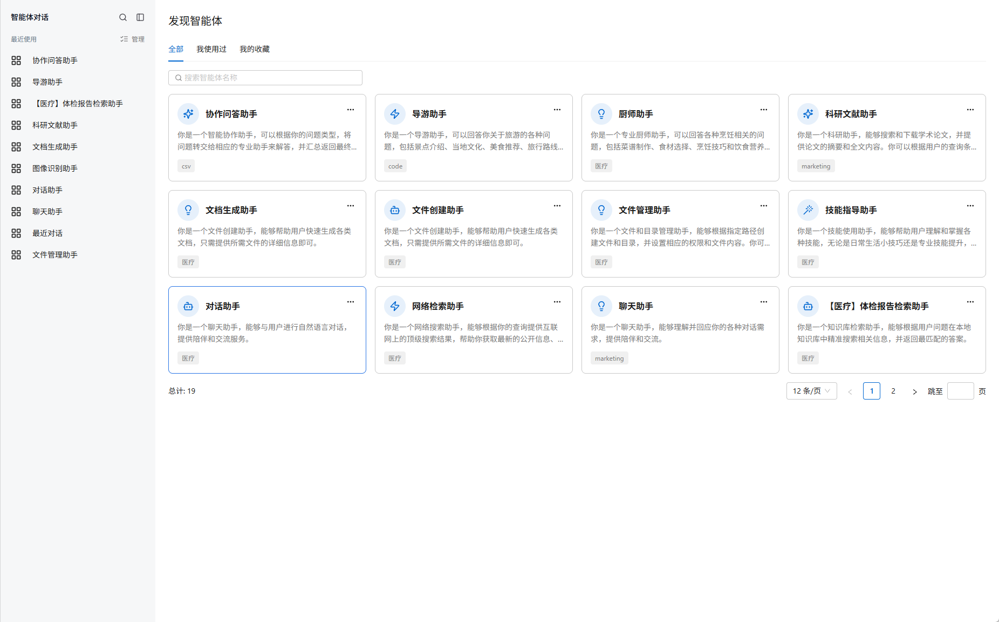
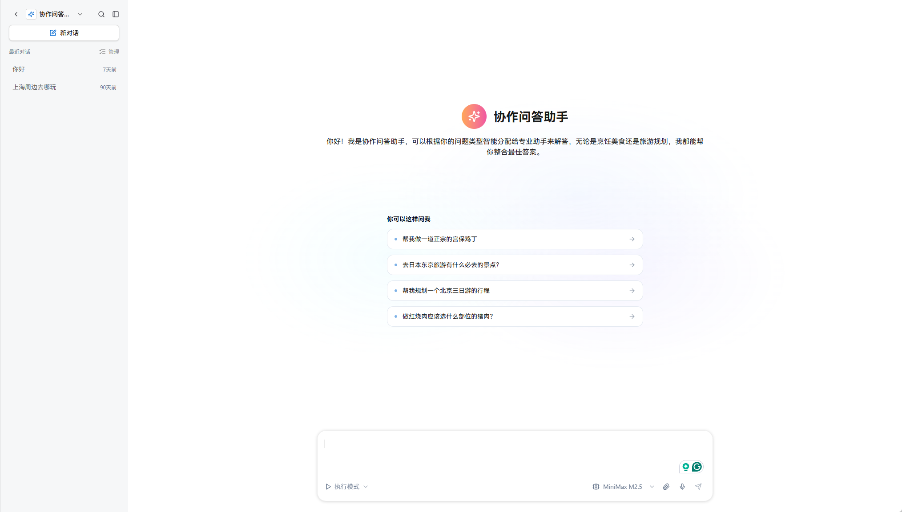
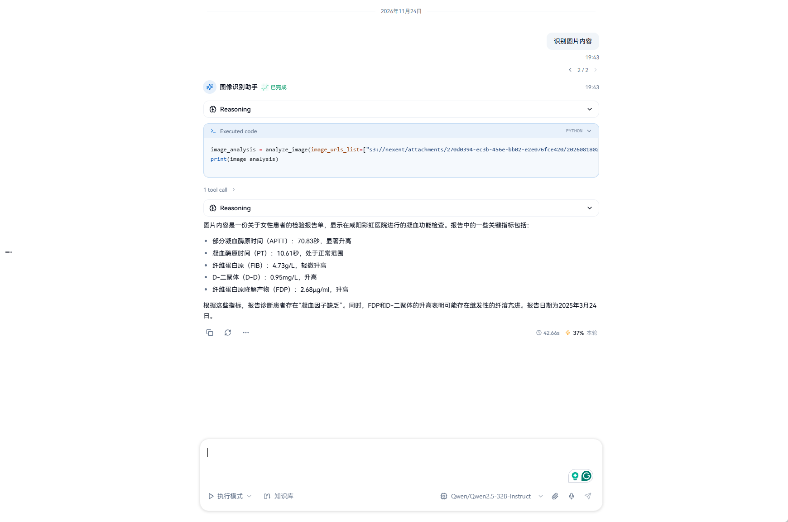
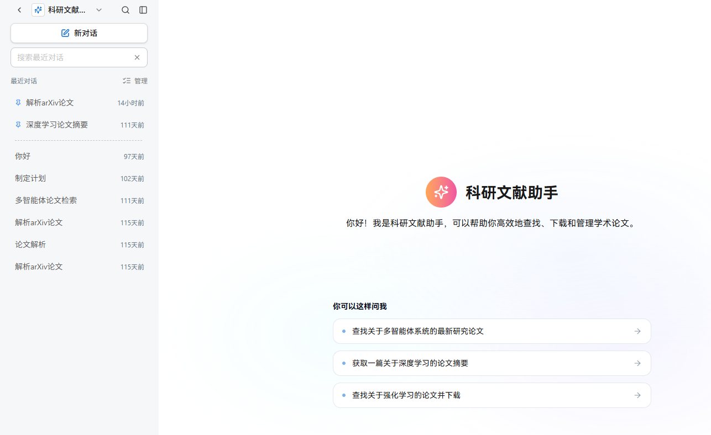

# 智能体对话

智能体对话用于使用已发布的智能体完成任务。您可以选择智能体、发送问题和附件、查看执行结果与引用来源，并管理或分享对话。

本页介绍智能体对话的操作。需要通过自然语言创建或调整智能体时，请参阅 [工作台](./workbench) 或 [智能体配置](./agent-development)。可用模型、工具、知识库和操作入口取决于智能体配置、账号权限及部署设置。

## 开始第一次对话

1. 在左侧导航选择 **智能体对话**，或点击首页的 **开始问答**。
2. 选择适合任务的智能体。
3. 输入目标、背景和希望得到的结果，按需添加附件。
4. 点击发送按钮或按 **Enter**，查看执行进度与回答。使用 **Shift + Enter** 换行。
5. 对结果继续追问；开始另一个独立任务时，新建对话。

例如：“请总结这份项目报告，列出三个主要风险，并用表格给出下一步建议。”相比仅输入“分析一下”，明确目标与输出要求更便于智能体完成任务。

再次进入页面或刷新时，系统可能恢复上次查看的智能体或对话；通过分享或指定对话链接进入时，显示内容也可能不同，不一定先出现智能体列表。

## 选择与收藏智能体

### 查找可用智能体

智能体列表提供 **全部**、**我使用过** 和 **我的收藏** 三个标签页，支持搜索和分页。可按名称、描述或开发者等关键词查找智能体。

卡片展示智能体名称、图标及说明。选择卡片即可进入对应对话页面；卡片菜单还提供新对话、收藏或取消收藏等操作。



### 找不到想用的智能体

列表展示已发布、可用且允许当前用户使用的主智能体。如果列表为空或缺少某个智能体，请先检查搜索条件和当前标签页，再联系管理员或开发者确认发布状态、主智能体设置及资源授权。

收藏用于快速找到智能体，不会授予额外权限；智能体不可用后，收藏也不能绕过权限或发布状态限制。

## 输入问题与附件

选择智能体后，欢迎区域会展示开场白和示例问题。可以选择示例问题开始，也可以直接输入自己的任务。左侧历史区域用于打开已有对话，底部输入区用于发送问题和设置本轮选项。



### 模型与对话模式

如页面提供模型选择器，可从可用选项中选择模型；模型不可用、权限不足或运行期间控件不可修改时，请先处理页面提示。

| 模式 | 适用任务 | 页面表现 |
| --- | --- | --- |
| **执行** | 目标清晰、可以直接处理的问题 | 智能体调用所需能力并生成结果 |
| **规划** | 需要分阶段完成的复杂任务 | 需要制定计划时显示计划卡片及步骤状态，便于跟踪进展 |

规划模式不代表每个问题都会生成相同步数的计划，也不保证所有任务都能完成。需要调整目标时，可以停止当前执行后补充要求。

### 当前对话的知识库范围

当智能体支持会话知识库选择时，可在输入区打开知识库设置，按需选择：

- **跟随智能体默认**：使用智能体配置中的默认范围。
- **指定知识库**：从当前有权使用且兼容的知识库中选择检索范围。
- **当前对话禁用**：本次对话不使用对应知识源。

本地知识库或 AIDP 的入口由部署与智能体能力决定。运行过程中不能修改范围，停止或完成后可设置后续轮次。保存后请查看生效范围和提示；不可用、无权限或不兼容的范围可能不会生效。会话设置不修改智能体的默认配置，也不会扩大访问权限。

### 上传图片、文档和其他附件

点击附件按钮选择文件，或将文件拖入支持上传的对话区域。等待上传完成后，再连同任务说明发送。发送前可移除不需要的附件。

| 内容 | 示例与使用方式 |
| --- | --- |
| 图片 | 上传 JPG、PNG 等图片，说明需要识别、比较或解读的内容 |
| 文档 | 上传 PDF、Word、表格或演示文稿，要求总结、提取或比较 |
| 文本与数据 | 上传 TXT、Markdown、CSV、JSON 等文件，说明分析目标 |
| 其他附件 | 是否能够解析，取决于智能体模型、工具和 Skill 的能力 |

当前智能体对话前端每条消息最多添加 **50 个附件**，单个文件不超过 **10 MB**。如环境另有更严格的限制，以页面提示为准。

上传成功不代表智能体一定能够理解文件。图片或文档分析需要相应模型或工具；遇到不支持的格式，可转换格式或选择具备对应能力的智能体。不要将上传到对话的附件误认为已加入长期知识库。

### 语音输入

部署已配置语音识别且页面提供麦克风入口时，可以点击麦克风并授权浏览器使用。说话后检查识别文字，必要时编辑，再发送。没有入口或无法录音时，请检查功能配置及浏览器麦克风权限。

### 可选：会话 Metadata

仅当智能体启用此能力时，输入区才显示 **Metadata**。它用于传递会话级补充信息，通常由平台集成或业务流程约定其字段。

```json
{
  "channel": "customer-service",
  "request_id": "REQ-2026-001"
}
```

内容必须是 JSON 对象，最多 **64 KiB**；保存 `{}` 可清除当前会话 Metadata。保存后用于后续运行，不应填写密码、访问令牌或个人敏感信息。没有业务约定时可留空。

## 查看执行进度与结果

### 理解执行卡片

发送后，回答会逐步显示。根据智能体配置和任务需要，页面可能出现以下内容：

| 内容 | 如何使用 |
| --- | --- |
| 记忆检索 | 查看本轮是否加载了相关历史信息 |
| 执行说明与代码 | 了解智能体正在处理什么；需要时展开代码详情 |
| 工具调用 | 查看工具名称、参数、执行状态及返回结果 |
| 协作智能体 | 查看分配的子任务和协作结果 |
| 计划 | 跟踪任务步骤及其状态 |
| 自检 | 查看检查结果、未通过项及修正提示 |

相互独立的工具或协作智能体可能并行执行。出现错误后，智能体也可能调整参数、补充证据或重试；是否继续取决于运行策略与错误情况。

自检仅在启用时显示，用于辅助发现问题，不保证结果完全正确。任务完成后，仍应核对重要结论、数据及生成文件。页面可能展示运行时长和 Token 用量，以实际返回的信息为准。



### 停止、失败与重试

运行时，发送按钮会切换为停止按钮。点击后请求停止当前执行，等待页面确认状态。已经完成的工具操作或产生的外部效果不会因此自动撤销。

出现失败、超时、达到执行限制或停止提示时，先查看错误说明和已完成结果，再决定补充信息、重新提问或联系管理员。执行卡片中有输出，不代表整个任务已完成。

## 查看来源与生成文件

### 引用与来源

回答包含引用编号时，可将鼠标移到编号上查看来源摘要，也可使用回复或工具卡片提供的来源入口查看检索内容。来源面板可能包含知识库文档、网页和图片；网页可打开原始链接，支持的知识库文件可预览或下载。

点击引用后自动定位并高亮命中片段的交互，在部分部署中可能未启用；未出现该效果时，可以从来源面板核对依据。引用仅说明回答关联了某个来源，仍需检查原文是否支持结论。

### 文件分析、生成与继续修改

可以要求智能体总结文档、比较文件、整理表格，或生成报告等文件。是否支持具体格式，取决于模型、工具和 Skill；例如 Word 文档生成可使用 [create-docx Skill](./resource-repository/create-docx)。

- **预览**：点击生成文件的卡片或链接，查看支持格式的内容。
- **下载**：使用文件卡片或预览面板中的下载操作。
- **继续修改**：在同一对话中明确指出要修改的文件和内容。
- **无法预览**：下载后用相应应用打开；链接或权限异常时，请联系管理员。

普通文字回复不等于已经生成文件，应以实际返回的文件卡片或下载链接为准。

### 图表

回答包含受支持的 Mermaid 图表时，可直接查看渲染结果，并使用界面提供的放大、缩放或重置操作。若渲染失败，可以查看原始代码，或要求智能体简化并修正图表。

## 管理与分享对话

### 查找和管理历史

展开历史栏后，可以搜索对话，并打开已有记录继续处理任务。历史会按页面布局分组并逐步加载，选择智能体后也可能仅显示该智能体相关记录。

| 操作 | 用途 |
| --- | --- |
| 新对话 | 开始独立任务，避免沿用原对话上下文 |
| 搜索 | 按关键词查找历史对话 |
| 置顶 / 取消置顶 | 将常用对话保留在容易找到的位置 |
| 重命名 | 用便于识别的标题整理对话 |
| 删除 | 删除单个对话及其消息记录 |
| 管理 | 进入批量选择，统一删除所选对话 |

批量选择时，请核对当前选中数量；“全选”针对当前已加载或可选择的记录，不应视为删除全部历史。

::: warning 删除前确认
删除不可撤销；与所选对话绑定的自动化任务也会被取消和清理。请确认记录和任务不再需要后再删除。
:::



### 复制、重新生成与导出

- **复制**：使用回复下方的复制按钮获取回复内容。
- **重新生成**：使用回复下方的刷新按钮重新执行对应问题。重新执行会消耗模型和工具资源；涉及写入、发送等操作时，先确认重复执行是否合适。
- **导出 Markdown**：在回复下方的更多菜单中选择导出，将对话保存为 Markdown。
- **分支到新聊天**：更多菜单中提供该入口时，可从选定回复处创建新对话，沿用此前内容探索另一种处理方向。

### 基于回复继续提问

支持文本批注时，可选中回复中的内容，通过 **添加到对话** 将其附到输入区，并补充修改或追问要求。发送前可编辑、移除批注；批注用于明确本轮关注的内容，不会直接修改原回复。

### 分享对话

使用对话页面的分享入口，或回复更多菜单中的分享操作，进入分享选择界面。检查要分享的问答范围，确认后生成并复制链接。

分享页面用于只读查看，不能继续原对话。生成链接前请检查所选消息、附件和来源中的敏感内容，并按当前环境的访问规则确认分享对象是否可以查看。

## 离开页面与返回

已提交的任务可在服务端继续执行，离开当前页面不等同于点击停止。返回原对话后，可查看已保存的过程、结果和当前运行状态；刷新页面时也可能恢复上次浏览的位置。

浏览器断网、服务重启、运行超时或其他异常仍可能导致执行中断。返回后若状态不明，请先检查已有结果和页面提示，再决定是否重试，避免重复触发外部操作。

可以使用页面提供的返回或智能体选择入口切换智能体，并折叠历史栏以扩大对话区域。移动端可通过展开按钮查看历史。
