# 工作台

工作台是 Nexent 中开始任务和创建资源的入口。您可以直接描述要完成的任务，也可以为当前对话选择智能体、知识库和 Skill。有创建权限时，还可以通过对话生成智能体或 Skill 草稿。

## 进入工作台

1. 登录 Nexent，在左侧导航选择 **工作台**。如果部署将工作台设为登录后的默认页面，登录后会直接进入。
2. 在工作台侧栏点击 **新对话**。页面中央是任务输入区，侧栏可用于打开之前的工作台对话。

如果导航中没有 **工作台**，请联系管理员确认当前部署是否启用了工作台，以及账号是否可以访问。

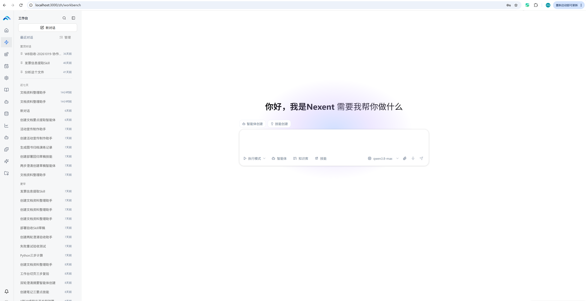

## 描述任务

在输入框中说明您要完成的目标、需要使用的材料和期望的输出。可以补充范围、格式或其他约束。点击 **上传附件** 可添加本轮需要处理的文件。

> 请根据我上传的会议记录整理一份 Markdown 纪要。按议题列出结论，并用表格整理待办事项、负责人和截止日期。记录中没有明确的信息请标为「待确认」。

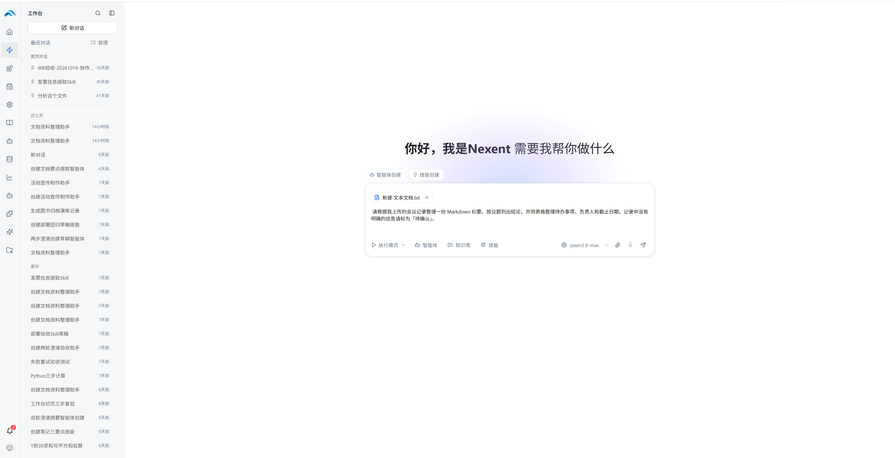

## 选择对话资源

发送前，可按任务需要从输入区添加资源。可选范围取决于部署配置和账号授权。

| 入口 | 操作 |
| --- | --- |
| **智能体** | 搜索并勾选可用智能体，点击 **确认**。如果环境支持多智能体模式，最多可选 8 个智能体。部署已启用通用对话时，也可以直接发送任务。 |
| **知识库** | 打开 **当前对话知识库**，从可用的 **本地知识库** 或 **AIDP 知识库** 中选择当前对话需要检索的范围，然后点击 **确认**。 |
| **技能** | 选择任务需要的 Skill，填写所选 Skill 的必填配置，再点击 **确认**。 |

需要撤下某个资源时，可在输入区移除对应的资源标签。

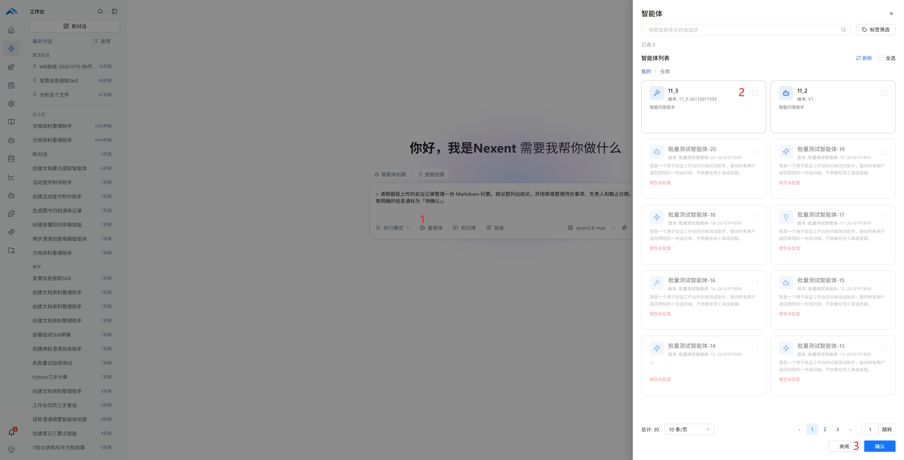

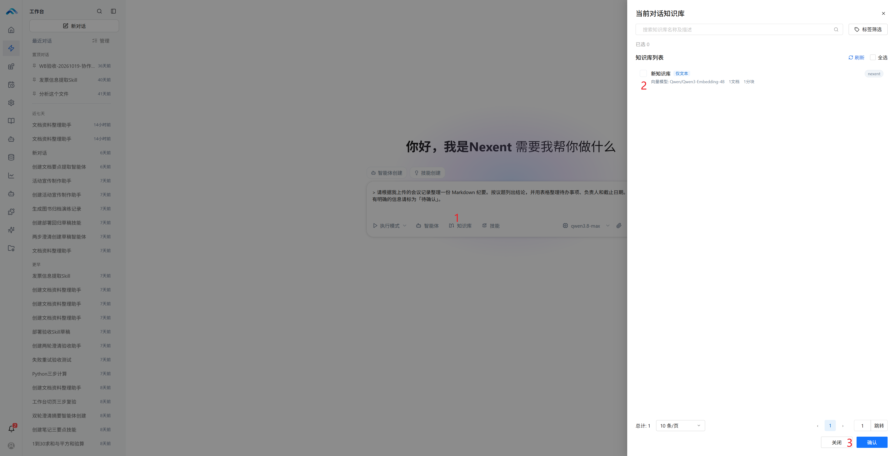

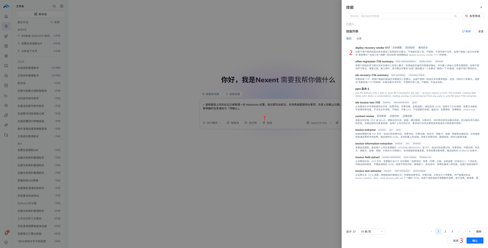

### 选择模型

1. 发送消息前，点击输入区右下方、发送按钮旁的模型名称，或点击 **选择模型**。
2. 从列表中选择当前对话要使用的模型。切换后，输入区会显示新选中的模型名称，后续消息会使用该模型。回复生成期间，请等待当前回复结束后再切换。
3. 如需调整参数，重新打开模型选择器。根据所选模型的能力，可以使用 **深度思考**、调整 **思考强度**，或在 **高级设置** 中修改温度和 Top P。需要撤销自定义采样参数时，可点击 **恢复默认**。

列表中的模型取决于当前租户的模型配置。如果找不到所需模型，请联系管理员确认该模型已接入且可用，详见 [模型配置](./agent-development/model-configuration)。

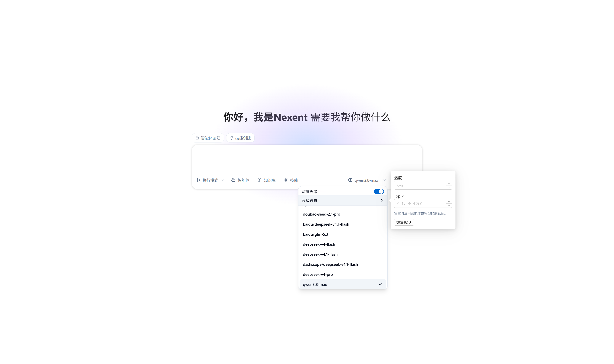

## 执行任务并查看结果

1. 在输入区选择 **执行模式** 或 **规划模式**。目标明确的任务可以直接执行。需要拆解的任务可选择规划，并在生成计划后查看各步骤的状态。

   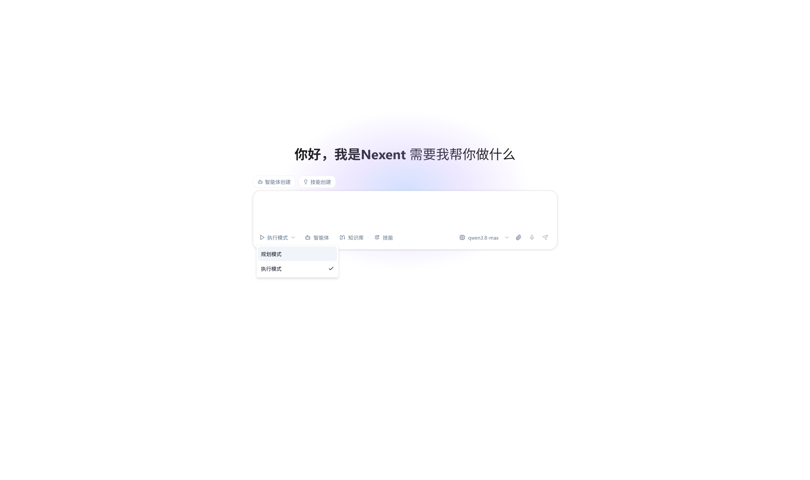

2. 发送任务。执行期间可以展开对话中出现的步骤或工具调用卡片，查看进度。需要中断时，点击输入区的停止按钮。
3. 查看最终回复。如果回复附带来源或生成的文件，可以打开来源核对内容，或预览、下载可用文件。需要修改结果时，在同一对话中继续补充要求。

## 通过对话创建智能体或 Skill

创建入口根据账号权限显示。工作台会为创建流程打开单独的对话。

### 创建智能体

1. 点击 **智能体创建**。描述目标用户、智能体要完成的任务、输入输出和关键约束。也可以从界面提供的示例开始修改。看到 **澄清需求** 卡片时，按提示补充信息。

   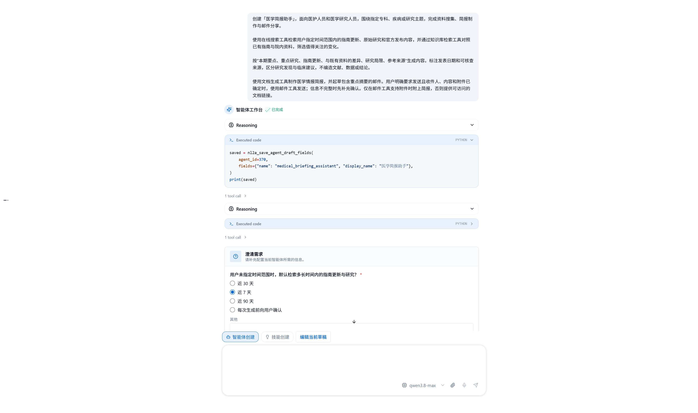

2. 出现 **需求和资源** 卡片时，检查系统提取的需求。需要修改时，编辑后点击 **更新需求并重新搜索**。按需选择推荐的工具、Skill 或知识库。有待绑定的资源时，完成配置并点击 **绑定所选资源**，资源就绪后点击 **继续**。如果没有资源需求，可在界面提供该选项时点击 **确认无需资源并继续**。

   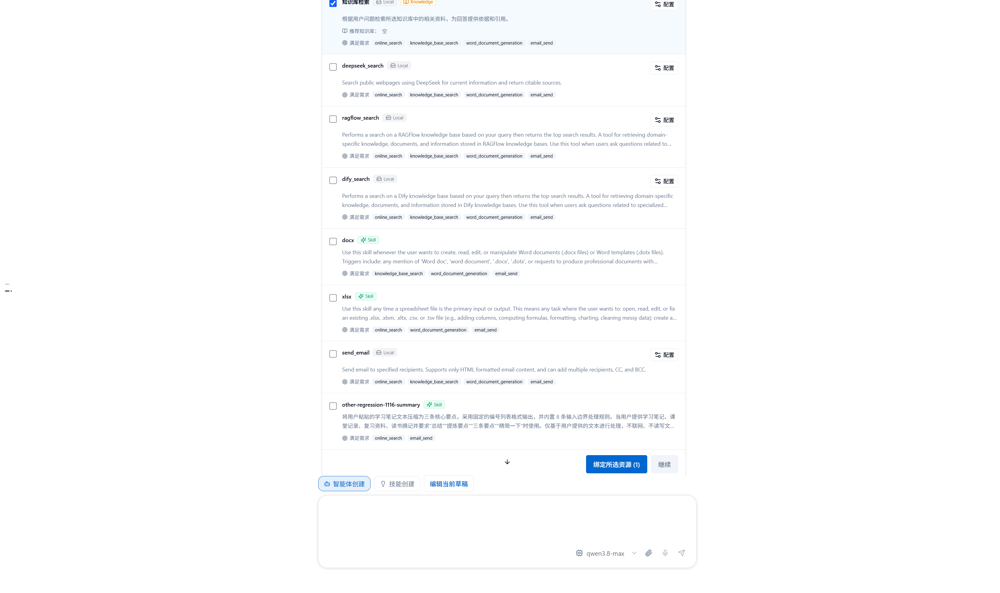

3. 看到结果卡片上的 **草稿已生成** 后，点击输入区上方的 **编辑当前草稿**，或点击卡片中的 **进入智能体开发**。打开配置后，可在 **模型与提示词** 中查看或修改提示词，再按 [智能体配置](./agent-development) 指南调试和发布。

   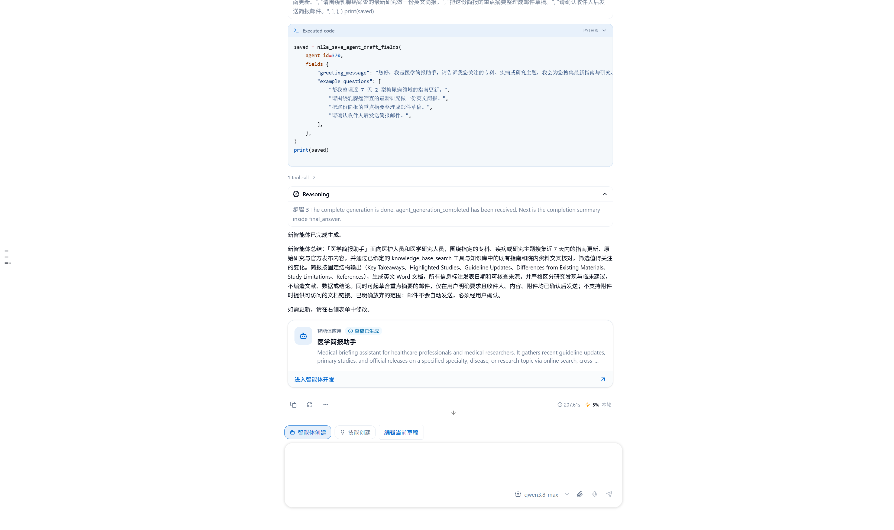

草稿中的提示词为空时，工作台会直接保存首次生成的提示词。如果在对话中生成新提示词来替换已有内容，请在出现的 **提示词生成** 卡片中检查修改，点击 **确认应用** 保存。

### 创建 Skill

1. 点击 **技能创建**，说明 Skill 的名称、适用场景、输入和输出。需要固定处理流程时，可同时列出执行步骤。
2. 草稿生成后，检查对话中展示的 Skill 文件。如有需要，在当前对话中补充要求，请系统修改草稿。
3. 在结果卡片点击 **保存 Skill**。保存后可通过 **查看我的 Skills** 打开列表。Skill 的管理和复用参见 [Skill 仓库](./resource-repository/skill-repository)。

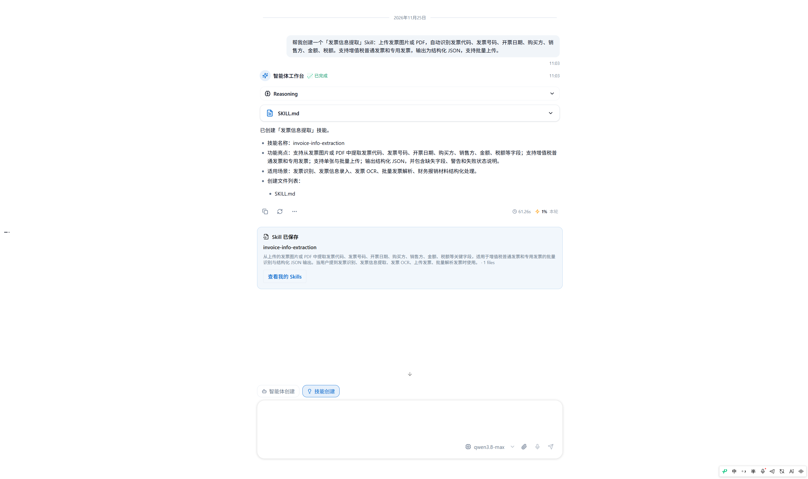

相关指南见 [首页](./home-page) 和 [智能体对话](./start-chat)。
