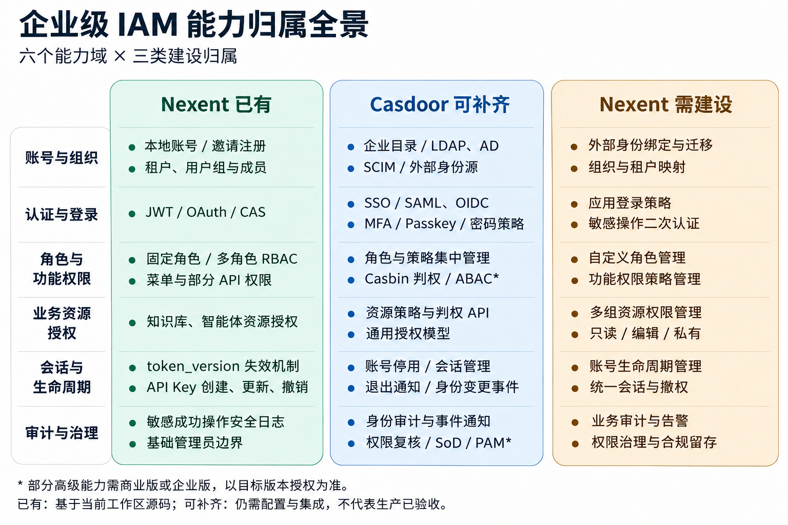
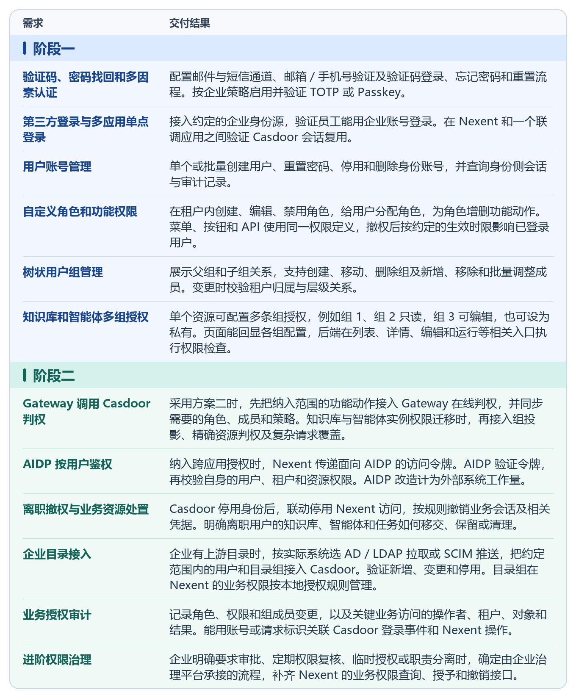
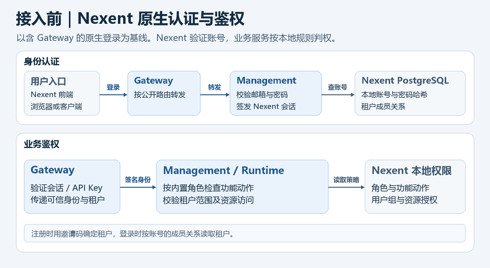
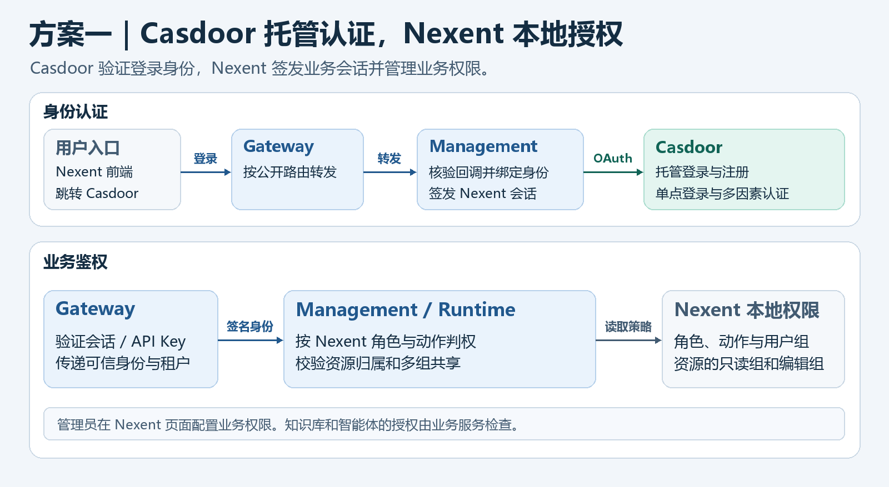
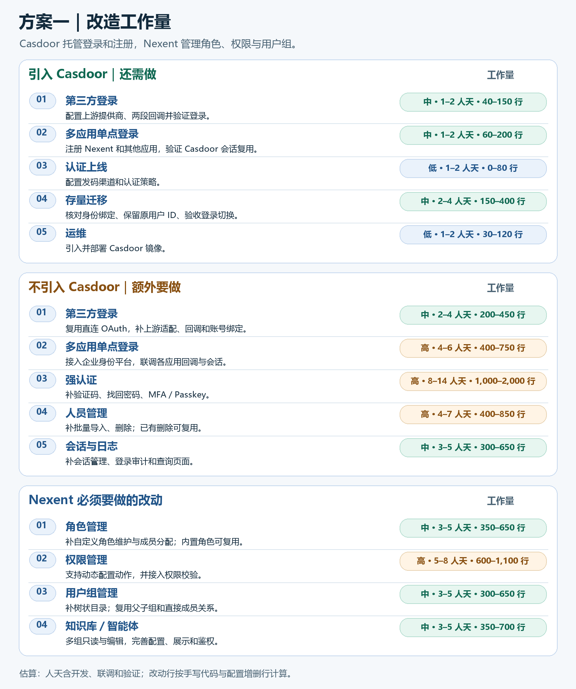
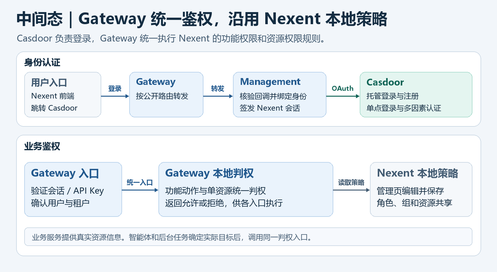
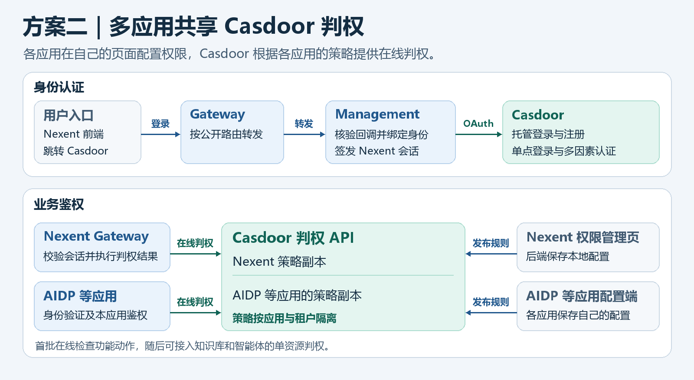
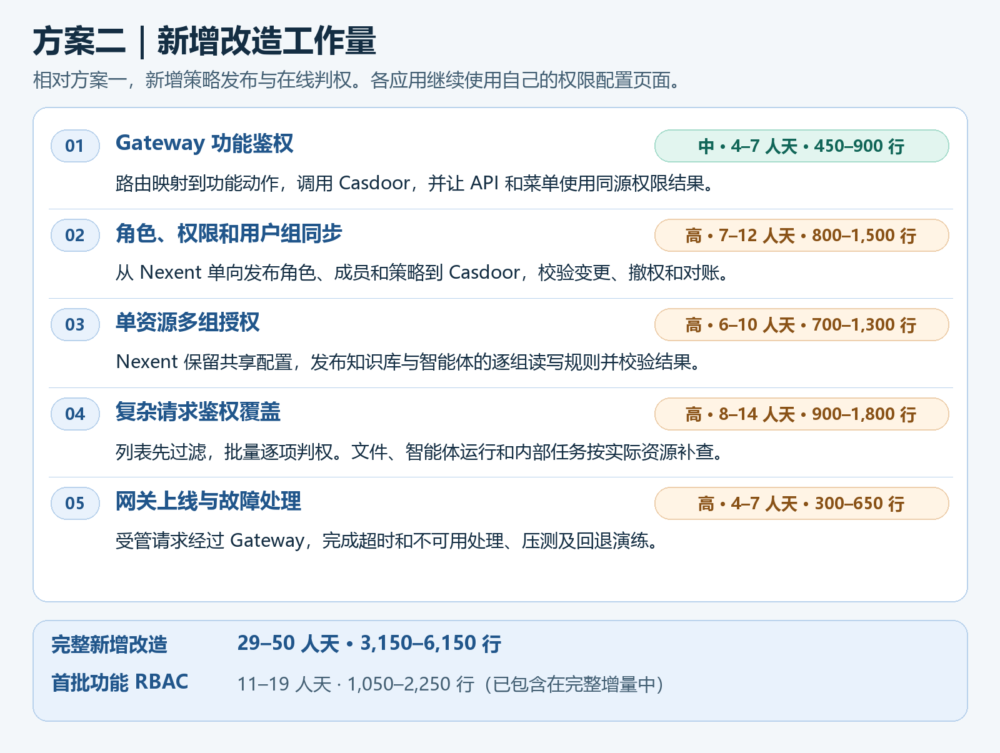
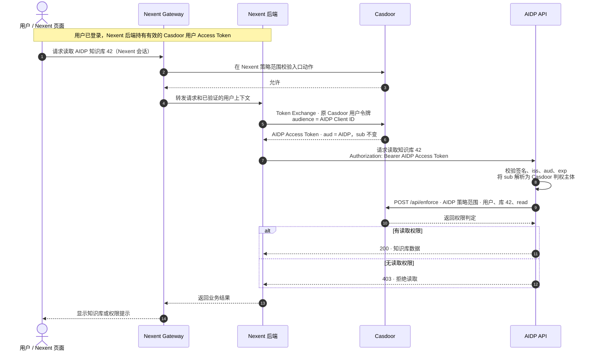

# Nexent × Casdoor 架构与工作量对比

## 背景分析：企业级 IAM 能力归属

从账号与组织、认证与登录、角色与功能权限、业务资源授权、会话与生命周期、审计与治理六个方面，梳理 Nexent 已有能力、Casdoor 可补齐的能力，以及 Nexent 需要建设的能力。下文需求清单据此展开。

图中 Casdoor 栏展示可选的产品能力。本文方案二由各应用在自己的页面配置权限，Casdoor 提供在线判权。

## 需求清单

以**方案一**为当前基线。Casdoor 托管登录、注册和身份账号，Nexent 管理业务租户、角色、功能权限、用户组及资源共享。现有账号、租户关联、内置角色和多组授权规则作为改造基础。以下列出需要配置、开发或联调后才能交付的能力。

展开文字版需求清单

| 阶段 | 需求 | 交付结果 |
| --- | --- | --- |
| 阶段一 | 验证码、密码找回和多因素认证 | 配置邮件与短信通道、邮箱／手机号验证及验证码登录、忘记密码和重置流程。按企业策略启用并验证 TOTP 或 Passkey。 |
| 阶段一 | 第三方登录与多应用单点登录 | 接入约定的企业身份源，验证员工能用企业账号登录。在 Nexent 和一个联调应用之间验证 Casdoor 会话复用。 |
| 阶段一 | 用户账号管理 | 单个或批量创建用户、重置密码、停用和删除身份账号，并查询身份侧会话与审计记录。 |
| 阶段一 | 自定义角色和功能权限 | 在租户内创建、编辑、禁用角色，给用户分配角色，为角色增删功能动作。菜单、按钮和 API 使用同一权限定义，撤权后按约定的生效时限影响已登录用户。 |
| 阶段一 | 树状用户组管理 | 展示父组和子组关系，支持创建、移动、删除组及新增、移除和批量调整成员。变更时校验租户归属与层级关系。 |
| 阶段一 | 知识库和智能体多组授权 | 单个资源可配置多条组授权，例如组 1、组 2 只读，组 3 可编辑，也可设为私有。页面能回显各组配置，后端在列表、详情、编辑和运行等相关入口执行权限检查。 |
| 阶段二 | Gateway 调用 Casdoor 判权 | 采用方案二时，先把纳入范围的功能动作接入 Gateway 在线判权，并同步需要的角色、成员和策略。知识库与智能体实例权限迁移时，再接入组投影、精确资源判权及复杂请求覆盖。 |
| 阶段二 | AIDP 按用户鉴权 | 纳入跨应用授权时，Nexent 传递面向 AIDP 的访问令牌。AIDP 验证令牌，再校验自身的用户、租户和资源权限。AIDP 改造计为外部系统工作量。 |
| 阶段二 | 离职撤权与业务资源处置 | Casdoor 停用身份后，联动停用 Nexent 访问，按规则撤销业务会话及相关凭据。明确离职用户的知识库、智能体和任务如何移交、保留或清理。 |
| 阶段二 | 企业目录接入 | 企业有上游目录时，按实际系统选 AD／LDAP 拉取或 SCIM 推送，把约定范围内的用户和目录组接入 Casdoor。验证新增、变更和停用。目录组在 Nexent 的业务权限按本地授权规则管理。 |
| 阶段二 | 业务授权审计 | 记录角色、权限和组成员变更，以及关键业务访问的操作者、租户、对象和结果。能用账号或请求标识关联 Casdoor 登录事件和 Nexent 操作。 |
| 阶段二 | 进阶权限治理 | 企业明确要求审批、定期权限复核、临时授权或职责分离时，确定由企业治理平台承接的流程，补齐 Nexent 的业务权限查询、授予和撤销接口。 |

[多租户登录与注册](#多租户登录与注册) · [方案二新增工作量](#方案二新增工作量) · [AIDP 外部系统工作量](#aidp-外部系统工作量)

后文保留原估算范围。多租户分流、企业目录联调、完整离职资源交接和进阶权限治理在确认交付范围后单独估算。三个方案共用的身份改造只计一次。

## 各方案解决的问题与实现功能

| 方案 | 解决的问题 | 实现的功能 |
| --- | --- | --- |
| [接入前 · Nexent 原生认证与鉴权](#接入前nexent-原生认证与鉴权) | 建立原生登录和本地业务授权的对照基线。 | Nexent 校验邮箱密码并签发会话，注册邀请码指定租户。Gateway 验证会话并转发可信身份，下游按本地角色和资源规则判权。 |
| [方案一 · Casdoor 托管认证，Nexent 本地授权](#方案一casdoor-托管认证nexent-本地授权) | 补齐统一登录、注册和企业认证能力，让 Nexent 继续使用自己掌握的租户、组和资源数据授权。 | Casdoor 提供登录注册、验证码、找回密码、MFA 和单点登录；Nexent 完成身份迁移与绑定，管理业务角色、动作权限、树状用户组及知识库和智能体的多组授权。Gateway 验证身份，业务服务执行本地授权。 |
| [中间态 · Gateway 统一鉴权，沿用 Nexent 本地策略](#中间态方案gateway-统一鉴权沿用-nexent-本地策略) | 解决鉴权分散在多个服务、入口标准不一致，以及同一资源从不同入口访问时容易漏检的问题。 | Gateway 统一接收功能和资源授权请求，依据 Nexent 本地数据判权。公网请求在转发前检查已知权限，运行时和后台任务在确定实际目标后调用同一入口。角色、权限和用户组仍在 Nexent 管理。 |
| [方案二 · Gateway 统一鉴权，调用 Casdoor 接口判权](#方案二gateway-统一鉴权调用-casdoor-接口判权) | 让 Nexent、AIDP 等应用复用同一套在线判权服务，减少各系统各自维护判权引擎的成本。 | 各应用在自己的页面配置权限，后端把规则发布到各自隔离的 Casdoor 策略范围。Nexent Gateway 和 AIDP 服务分别调用 Casdoor 获得允许或拒绝的结果，并在自己的接口执行结果。 |

## 接入前：Nexent 原生认证与鉴权

以已部署 Gateway 的 Nexent 原生账号路径为对照基线。Management 校验邮箱密码，按本地成员关系读取租户并签发会话。Gateway 验证后续请求携带的会话或 API Key，业务服务检查本地角色、租户及资源授权。 [原生登录时序](./casdoor-login.md#接入前nexent-本地登录与角色鉴权) · [Gateway 当前职责](../backend/gateway/README.md)

## 方案一：Casdoor 托管认证，Nexent 本地授权

Casdoor 托管登录和注册；Nexent 保留本地账号、会话、角色、权限和用户组。两边通过 OAuth 绑定身份，授权数据由 Nexent 单独维护。

### 引入与不引入 Casdoor 的工作量对比

- **引入 Casdoor**：认证上线配置发码渠道和认证策略；运维引入部署 Casdoor 镜像。
- **不引入 Casdoor**：人员管理补批量导入、删除。
- **Nexent必须要做的改动**：角色管理、权限管理、树状用户组管理，以及知识库／智能体的多组只读与编辑。多组授权按**中**等工作量估算，涵盖配置、展示和鉴权。

图中每组从 `01` 独立编号，右侧标注等级、开发人天和改动行。**1 人天按 1 名开发人员工作 1 天算**，含实现、联调和回归验证，不含审批、第三方账号开通或环境排队的等待时间。改动行按 Git 新增和删除行估算，包含手写前后端代码、配置、迁移和测试，不含生成文件、依赖锁和文档。以下是按当前代码拆分的区间，用于排期，不是实际工时或已统计的代码量。

| 工作项 | 范围 | 开发人天 | 改动行 |
| --- | --- | ---: | ---: |
| 第三方登录：配置上游提供商、两段回调并验证登录 | 引入 Casdoor | 1–2 | 40–150 |
| 多应用单点登录：注册 Nexent 和其他应用，验证 Casdoor 会话复用 | 引入 Casdoor | 1–2 | 60–200 |
| 认证上线 | 引入 Casdoor | 1–2 | 0–80 |
| 存量迁移 | 引入 Casdoor | 2–4 | 150–400 |
| 镜像部署 | 引入 Casdoor | 1–2 | 30–120 |
| **身份侧小计** | **引入 Casdoor** | **6–12** | **280–950** |
| 第三方登录：复用直连 OAuth，补上游适配、回调和账号绑定 | 不引入 Casdoor | 2–4 | 200–450 |
| 多应用单点登录：接入企业身份平台，联调各应用回调与会话 | 不引入 Casdoor | 4–6 | 400–750 |
| 强认证 | 不引入 Casdoor | 8–14 | 1,000–2,000 |
| 人员管理 | 不引入 Casdoor | 4–7 | 400–850 |
| 会话与日志 | 不引入 Casdoor | 3–5 | 300–650 |
| **身份侧小计** | **不引入 Casdoor** | **21–36** | **2,300–4,700** |
| 角色管理 | Nexent 业务授权 | 3–5 | 350–650 |
| 权限管理 | Nexent 业务授权 | 5–8 | 600–1,100 |
| 树状用户组管理 | Nexent 业务授权 | 3–5 | 300–650 |
| 知识库和智能体多组只读与编辑 | Nexent 业务授权 | 3–5 | 350–700 |
| **Nexent 业务授权小计** | **两条路径均计入** | **14–23** | **1,600–3,100** |

完整交付估算：**引入 Casdoor 为 20–35 人天、1,880–4,050 改动行；不引入为 35–59 人天、3,900–7,800 改动行**。两边都把第三方登录和多应用单点登录分开估算，拆分后总量不变。范围是一个兼容的上游身份源，以及 Nexent 和另一个应用的单点登录验证。不引入 Casdoor 的单点登录按接入已有企业身份平台估算；没有可用平台、需要从零自建时应单独估算。Link App 或 Uniportal 如需专用协议适配，也另行估算。两条身份路径不相加。

**存量迁移评为中**：只处理登录身份和绑定，保留 Nexent 原用户 ID、租户、角色、权限、组和资源。主要工作是核对待绑定账号（含超级管理员 `SU`），并验收新入口能回到原账户。账号已全部绑定、只需抽样验证时可按低估算；要求保留原密码、处理大量身份冲突或迁移多个租户时另评。

登录和注册的实施配置见 [Nexent × Casdoor 接入与权限配置指南](./casdoor-login.md)。

### 多租户登录与注册

原生登录是**先用邮箱确认账号，再查账号属于哪个租户**。采用「一个 Casdoor 组织对应一个 Nexent 租户」后，用户从租户专属入口进入，**Nexent 在跳转到 Casdoor 之前就确定目标组织**，回调时再以经过校验的身份确认租户归属。

| 场景 | Nexent 原生 | Casdoor 按组织登录（拟议） |
| --- | --- | --- |
| 未登录访问首页 | 通用首页显示邮箱密码入口。登录邮箱在 Nexent 实例内唯一，认证取得 `user_id` 后，从 `user_tenant_t` 读取有效的 `tenant_id`。 | 打开租户首页，例如 `https://nexent.example.com/t/customer-a`，Nexent 通过后端映射找到 A 租户对应的 Casdoor 组织和应用，直接跳到对应的登录页。未登录且直接打开通用首页时，先输入租户标识，再跳转。 |
| 第一次注册 | 邀请码指定目标租户，也可指定初始角色和用户组。注册时建立本地账号和租户成员关系。重复邮箱会被拒绝。 | 用户在已选组织完成 Casdoor 注册。Nexent 核验组织和准入条件后，在对应租户建号，初始为普通用户，直接进入首页。仅向受邀人员开放的租户，由 Casdoor 校验邀请码，管理员发放组织专属邀请链接。 |
| 已有账号再次登录 | 邮箱密码认证后沿用原有租户。 | OAuth 回调优先解析已有身份绑定，核对本地成员关系和目标租户一致后登录。打开了其他租户的入口时，提示使用原租户链接。 |
| 已登录访问首页 | 使用当前 Nexent 会话对应的租户。 | 通用首页进入当前会话对应的租户。访问另一个租户的专属入口时，先核对当前会话归属，再决定是否需要从目标组织重新发起登录。 |

[原生账号查询和重复邮箱校验](../backend/management/db/identity/account.py) · [邀请码注册](../backend/management/services/permission/identity/registration.py) · [本地租户成员查询](../backend/management/db/identity/membership.py) · [Casdoor 邀请注册](https://casdoor.ai/docs/invitation/overview/)

Nexent 后端维护 `租户入口标识 → tenant_id → Casdoor 组织及 OAuth 应用`。发起 OAuth 时，把预期租户、组织和应用与本次登录状态关联。回调时校验状态，使用同一应用配置换取令牌，核对 Casdoor 身份的实际组织、映射和本地成员关系后签发 Nexent 会话。未配置的租户、组织不一致和绑定冲突都应明确提示。若不同组织允许使用同一邮箱，现有 Nexent 建号仍会因邮箱重复而冲突，需要单独处理账号归并或调整本地账号模型。 [Casdoor 应用配置](https://casdoor.ai/docs/application/config/) · [Casdoor 共享应用](https://casdoor.ai/docs/application/shared-application/)

当前实现使用固定 `CASDOOR_CLIENT_ID` 发起授权，并用 `CASDOOR_SIGNUP_TENANT_ID` 给免邀请码的新账号分配默认租户。上表中的租户专属入口、组织映射、回调校验和存量账号核对是额外的身份侧工作，现有估算按单组织入口计。三个方案共用这套登录改造。采用 Gateway 统一鉴权时，后续判权使用已核验的 Nexent 会话租户。 [当前授权入口](../backend/management/services/permission/identity/casdoor.py) · [当前首次建号](../backend/management/services/permission/identity/oauth.py) · [A1 开发拆解](#a1--方案一引入-casdoor-的身份侧改造)

## 中间态方案：Gateway 统一鉴权，沿用 Nexent 本地策略

当前 Gateway 已校验 Nexent 会话和 API Key，并按公开路由清单转发请求，具体业务授权仍由下游服务处理。中间态把**需要权限校验的业务入口统一接到 Gateway**。Casdoor 继续负责登录和注册，业务请求使用 Nexent 本地策略。Nexent 仍是业务角色、功能权限、用户组、成员关系和资源共享配置的写入方。 [Gateway 当前职责](../backend/gateway/README.md)

### 功能与验收

| 改造项 | 实现内容 | 验收 |
| --- | --- | --- |
| 统一功能权限入口 | 盘点 HTTP、WebSocket、北向接口等受保护入口，登记「方法与路由 → 功能动作」及公开例外。Gateway 核验身份后，用 Nexent 本地角色和动作规则判权。菜单和按钮读取同源权限结果。 | 撤销 `model:create` 后，原会话的单个创建、批量创建和已登记别名均被拒绝；无关的模型读取权限照常生效。 |
| 统一单资源权限入口 | 业务服务提供可信的租户、资源 ID、所有者、组授权等上下文。Gateway 复用 Nexent 本地规则判定读写，覆盖私有、多组授权及租户边界。 | 同一个用户可编辑库 42、只读库 43；对其他租户的库无法访问。移出编辑组后，下一次受保护请求执行更新后的权限。 |
| 覆盖列表、批量和运行时 | 列表按授权范围过滤后再分页和计数，批量按实际目标逐项判权。智能体运行、服务间调用和后台任务从私网调用 Gateway 的同一判权入口，携带经验证的用户或服务身份。 | 列表、文件、版本、批量、检索和实际执行结果使用同一份规则。运行时选中的库、工具或子智能体在调用前完成检查。 |
| 防止绕行及保留业务约束 | 公网只暴露 Gateway。下游验证内部调用来源和授权结果，写入时仍核对实际对象、租户、版本及业务状态。公开登录回调与健康检查按路由清单放行。 | 直接访问下游受保护入口、缺失身份或无法确定目标时无法执行业务。权限拒绝与判权基础设施故障可以区分。 |
| 切换与回归 | 先比较 Gateway 和现有业务接口的判权结果，再逐批切换。标记已迁移的入口并核对调用链后，统一由 Gateway 作出授权决策。 | 普通用户、管理员、API Key 和后台任务的关键路径均有验收证据。角色变更、退组和跨租户请求在各入口表现一致。 |

### 工作量与方案二的关系

中间态可独立交付。工作量主要来自入口盘点、动作登记、本地策略接入、资源上下文、内部调用、防绕行和回归验证。**以全量入口覆盖为目标时，须先完成路由和运行时调用清单再估算**。后文方案二的数字按代表性接口和指定资源范围估算。

继续做方案二时，复用已交付的统一入口、动作映射、资源上下文和运行时回查。增量主要是接入 Casdoor 单项／批量判权、把 Nexent 本地规则单向发布和对账，以及处理远程判权超时和故障。已完成的入口改造只计一次。 [方案二新增工作量](#方案二新增工作量)

## 方案二：Gateway 统一鉴权，调用 Casdoor 接口判权

[打开方案二架构原图](./assets/casdoor/casdoor-scheme2-multi-app-auth-architecture.png)

**各应用配置自己的权限，Casdoor 为不同应用提供在线判权。** Nexent 管理员继续在 Nexent 页面维护角色、动作、用户组和资源共享。Nexent 后端保存业务配置，再把判权需要的规则和成员关系单向发布到 Casdoor。AIDP 等应用可按同样方式接入，各自维护权限来源。各应用共享判权服务，并按应用和租户隔离策略与资源。 [Casdoor 在线判权接口](https://casdoor.ai/docs/permission/exposed-casbin-apis/)

**可行性结论：功能 RBAC 适合先收口；知识库和智能体可以精确到单个 ID，但当前集成只把模块级对象传给 Casdoor。** 目前 Gateway 验证 Nexent 会话和 API Key，并把可信身份转给下游；仓库中已有的可选 Casdoor 功能权限接入由 Management 在后台生成快照，单资源权限仍在业务侧检查。方案二是拟议改造，不能通过开启现有配置直接启用。[Gateway 当前职责](../backend/gateway/README.md) · [现有 Casdoor 策略同步](../backend/management/services/permission/identity/casdoor_feature_sync.py)

| 鉴权范围 | 可行性 | 方案二怎么做 |
| --- | --- | --- |
| 功能 RBAC：创建模型、审核 Skill 等 | **高**，对动作明确的接口，改造 **中** | 在 Gateway 登记「方法与路由 → 功能动作」。Gateway 验证会话并找到绑定的 Casdoor 主体，用 Nexent 在该租户发布的策略检查 `model:create` 等动作。菜单和按钮读取同源结果，API 执行最终检查。 |
| 单资源多组权限：某个知识库或智能体可读、可编辑 | **有条件可行**，改造 **高** | 继续在 Nexent 编辑单个资源的只读组、可编辑组和私有设置。发布时以应用、租户、资源类型和稳定 ID 定位对象。编辑包含读取，私有表示没有组共享，所有者及特殊管理角色按各资源现有规则处理。 |

### Casdoor 怎么精确到单个资源 ID

当前接入传的是固定模块键，例如 `nexent:knowledge-base`。方案二接入实例判权时，把 `nexent:tenant-7:kb:42` 这样的稳定资源键放进 `enforce` / `batch-enforce` 请求的 `obj`，使用 `Custom` 资源和精确匹配的模型。`42` 取自 Nexent 的知识库 ID，Casdoor API 的 `resourceId` 查询参数另有用途。Gateway 从可信上下文确定租户、资源类型和 ID，Nexent 的发布任务按本地 `group_permissions` 生成判权规则。 [Casdoor 自定义资源](https://casdoor.ai/docs/permission/permission-configuration/#resources-and-actions) · [判权 API](https://casdoor.ai/docs/permission/exposed-casbin-apis/#enforce)

例如，为 **库 42** 给组 1、组 2 配 `read`，给组 3 配 `read + edit`。组 3 的成员能编辑库 42，不会因此获得库 43 的权限。智能体同理，例如 `nexent:tenant-7:agent:42`，与同 ID 的知识库是不同对象。正式迁移前要用目标版本验证精确匹配、租户隔离、组成员判权和撤权；无论权限存在哪边，都要保留 Nexent 已有的资源规则语义。[Nexent 多组规则](../backend/permissions/group_sharing.py) · [知识库校验](../backend/management/services/knowledge_base/permission.py) · [智能体校验](../backend/management/services/agent/authorization.py)

### 复杂请求的鉴权覆盖

这是**同一套功能或资源权限在不同调用场景中的检查范围**，不是第三类权限。改造量 **高**，主要因为入口时不一定知道全部目标。

| 场景 | 需要补的检查 |
| --- | --- |
| 资源列表 | 先按可读范围过滤，再分页和计数。 |
| 批量操作 | 对每个实际资源判权；按接口约定拒绝整批或返回逐项结果。 |
| 文件、版本和引用 | 解析所属知识库、智能体及适用版本后再判权。 |
| 智能体运行 | 入口检查能否运行智能体；运行时选出的知识库或子智能体，在实际调用前补查。 |
| 内部和定时任务 | 以明确的用户或服务身份执行；对实际操作的资源补查，不能只依赖公网入口。 |

### 架构与职责边界

- **各应用负责配置和发布权限。** Nexent 管理员在 Nexent 页面编辑本地角色、功能动作、组和资源共享。后端校验操作者的管理范围，保存业务数据，并把判权所需的数据按应用和租户发布到 Casdoor。AIDP 也通过自己的管理入口维护权限。各应用的页面读取本地配置和发布状态。
- **Casdoor 为多应用计算判权结果。** 第一阶段基于已发布规则执行功能 RBAC。验证单资源精确判权后，再发布知识库和智能体的实例规则和组成员。Casdoor 中这些数据由各应用的发布任务维护。判权请求由服务端选择应用与租户对应的模型或策略范围，资源键包含应用和租户。同一用户能登录两个应用时，两边的权限仍按各自策略计算。
- **Gateway 和各应用执行判权决定。** Nexent Gateway 识别主体、动作和目标，查可信资源上下文，调用 Casdoor。功能与实例权限都适用时，两项都通过才转发。Nexent 沿用内部签名身份，对授权结果绑定主体、动作、资源和请求，防止公网直连绕过。AIDP 自己执行 AIDP 接口的授权结果，机器凭据走独立的服务主体策略。
- **业务服务保留资源事实与事务约束**：提供租户、所有者、版本、发布状态等只读上下文，提交时确认同一个实际对象和状态。用户输入经解析后才发现的资源重新请求统一判权。逐步移除已覆盖路由中的重复业务授权决策，保留对象归属、事务一致性和业务状态校验。
- **运行边界**：把 Casdoor 判权放到请求链路会增加延迟和依赖。对超时、错误和无法解析的资源按默认拒绝处理；策略明确拒绝与判权服务不可用分别报告。先压测批量大小和延迟；若需要缓存，定义授权版本、撤销时限和失效策略。身份停用仍需联动撤销 Nexent 会话及按规则处理 API Key，不能把它等同于角色撤权。

例如，Nexent 管理员在角色页移除 `model:create`。Nexent 保存变更并发布新的策略，Gateway 接到创建模型请求时，调用 Casdoor 检查该用户的 Nexent 权限。撤权后的已登录用户再次请求时会被拒绝，AIDP 的同名动作仍按 AIDP 自己的策略决定。

### 方案二新增工作量

工作量以已有 Casdoor 登录和 Nexent 本地授权为基线，只计方案二新增的改造，估算口径同方案一。同步按存量初始化加增量变更和对账估算；单资源范围限知识库和智能体，功能 RBAC 按首批具有代表性的受管接口估算，不包含全站逐路由替换。

| 新增工作项 | 工作量 | 开发人天 | 改动行 | 需要做什么 |
| --- | --- | ---: | ---: | --- |
| Gateway 功能鉴权 | **中** | 4–7 | 450–900 | 建立路由与动作映射，接入 Casdoor 判权 API，统一菜单与后端接口的权限结果。 |
| 角色、权限和用户组同步 | **高** | 7–12 | 800–1,500 | 从 Nexent 后端单向发布角色及成员、动作策略、组层级和直接成员到 Casdoor。处理增改删、失败重试和对账，验收撤权。首阶段发布功能 RBAC 所需规则，接入实例判权时再发布组及成员。 |
| 单资源多组授权 | **高** | 6–10 | 700–1,300 | 保留 Nexent 的共享配置入口，增加精确资源标识和逐组读写规则发布，对已有授权做初始化和差异验证。第一阶段资源继续按 Nexent 本地规则判权。 |
| 复杂请求的鉴权覆盖 | **高** | 8–14 | 900–1,800 | 接入实例判权后，列表先过滤、批量逐项判权。文件、智能体运行和内部任务按实际资源补查。 |
| 网关上线与故障处理 | **高** | 4–7 | 300–650 | 确保受管请求经过 Gateway；处理 Casdoor 判权超时和不可用，并完成压测与回退演练。 |
| **合计** | | **29–50** | **3,150–6,150** | 覆盖以上五项，含实例规则发布和在线判权。 |

如果先交付**首批功能 RBAC**，工作包括功能在线判权、角色和策略发布的必要子集、上线保障，初估 **11–19 人天、1,050–2,250 改动行**，已包含在完整增量内。方案二沿用方案一本地动态权限管理和编辑页的建设工作。上表数字保留作初估，发布状态、应用间隔离及异常恢复范围在排期前复核。

建议先选「创建模型」验证功能 RBAC 在线判权，实例权限保持本地。再用两个库做影子验证，例如「库 42 可编辑、库 43 拒绝」，比较现有规则与新模型的结果；通过跨租户、只读与编辑叠加、撤权和故障验证后，再决定是否迁移。列表、智能体运行及内部调用要逐类验收后才移除重复鉴权。

登录回调和 Nexent 业务请求见[方案二交互时序图](./casdoor-login.md#方案二casdoor-登录与-gateway-在线判权)。跨应用调用见 [Nexent 代用户访问 AIDP API 时序图](#nexent-代用户访问-aidp-api-时序图)。

### AIDP 外部系统工作量

**归属 AIDP 团队，独立估算。** 以 Nexent 已使用的知识库、文件和检索接口为首批范围，假设 AIDP 已有集中认证入口、稳定的用户及资源 ID 和可复用的租户隔离。AIDP 服务端源码与部署版本由 AIDP 团队核对后确认排期。

| 外部系统工作项 | 开发人天 | 范围 |
| --- | ---: | --- |
| 用户令牌接收与验证 | 2–3 | 接入受信签发方、公钥和受众验证，联调实际上游交换令牌。 |
| 用户绑定、租户和资源标识 | 2–4 | 按 `(iss, sub)` 识别用户，关联现有账号、实际租户和知识库。 |
| Casdoor 在线判权 | 2–4 | 接入单项与批量判权，登记 AIDP 动作，稳定映射实际资源，选择 AIDP 独立的策略范围，处理拒绝和不可用。 |
| 现有知识库、文件和检索接口改造 | 3–6 | 覆盖列表与计数、读写、文件预览与下载、检索和异步任务入口。 |
| 存量授权发布与凭据切换 | 2–4 | 确认 AIDP 侧业务授权来源，按应用和租户向 Casdoor 发布初始策略并对账，处理旧 API Key 的使用边界。 |
| 安装配置、联调与回归 | 2–3 | 验证用户身份、实际资源访问、撤权、租户隔离及故障处理。 |
| **AIDP 外部系统小计** | **13–24** | 待 AIDP 团队评审确认。 |

上方方案二 **29–50 人天**为 Nexent 原方案估算。本表单独计入 AIDP 侧；跨应用扩展所需的 Nexent 令牌管理、交换和调用适配由 Nexent 团队另行估算。AIDP 独立网页登录、管理控制台及其他业务模块的需求按各自范围另评。 [AIDP 逐接口改造与验收](./casdoor-login.md#aidp-改造外部系统工作量)

#### Nexent 代用户访问 AIDP API 时序图

这是方案二的扩展设计。Nexent 渲染页面，Nexent 和 AIDP 在同一 Casdoor 组织中各有独立的应用配置。以读取 AIDP 的 42 号知识库为例，浏览器请求使用 Nexent 会话，Nexent 后端通过 Token Exchange 换取面向 AIDP 的 Access Token。令牌的用户标识 `sub` 保持不变，受众 `aud` 设为 AIDP 的 Client ID。 [Casdoor Token Exchange](https://casdoor.ai/docs/how-to-connect/oauth/#token-exchange-grant)

#### AIDP 逐接口改造与验收

这部分由 **AIDP 团队**负责。当前 Nexent 侧的知识库页面已接入 `/api/aidp-mgmt`，后端使用 `AIDP_API_KEY` 调用上游。下表按 Nexent 客户端实际调用的上游接口列出改造点，AIDP 团队需对照自身服务确认所有入口和兼容性。本次目标是 **Nexent 自己渲染页面，AIDP 承接用户身份和资源鉴权**。 [Nexent AIDP 管理接口](../backend/ext_components/aidp/apps/aidp_mgmt_app.py) · [上游 API 调用](../backend/ext_components/aidp/services/aidp_service.py)

| AIDP 改动 | 具体操作或接口 | 验收 |
| --- | --- | --- |
| 接收和验证 Casdoor 用户令牌 | 为受管 API 扩展认证中间件，从 `Authorization: Bearer` 读取 Access Token。配置可信签发方、签名公钥和 AIDP Client ID。使用实际交换出来的令牌验证签名、`iss`、`aud`、有效期和用户主体；联调签名密钥轮换及账号停用后的令牌失效策略。 | 只接受有效且面向 AIDP 的用户访问令牌。过期令牌、ID Token、面向其他应用的令牌和只代表应用的凭据均无法进入受管用户接口。 |
| 绑定用户并确定租户 | 使用可信 `(iss, sub)` 映射到已有 AIDP 用户。若业务接口需要本地用户记录，为存量绑定和符合准入条件的首次建号定义规则。管理 AIDP 租户和 Casdoor 组织或策略域的对应关系，以实际资源记录校验租户和资源归属。 | 同一用户在 Nexent 与 AIDP 能关联到同一 Casdoor 身份。改名后仍回到原 AIDP 账号，跨租户 ID 不会命中其他租户资源。 |
| 接入 Casdoor 在线判权 | AIDP 后端使用独立的服务端凭据调用 `POST /api/enforce`、`POST /api/batch-enforce`，将应用动作、资源 ID 和租户映射到专用模型。例如 `aidp:tenant-7:kb:42` 的 `read`。模型若使用 `组织/用户名`，应从已验证的组织和稳定 ID 解析主体。 | 同一个用户可读库 42、不可读库 43；只读用户调用修改接口被拒绝。权限变更后，已有 Nexent 会话的下一次在线检查使用新策略。 |
| 知识库列表、计数和详情 | 覆盖上游 `KnowledgeBases`、`KnowledgeBases/0/Count` 和 `KnowledgeBases/{kds_id}`。列表和计数先按可读范围过滤，再分页或计数；详情检查指定知识库。创建先检查租户级创建权限，更新和删除分别校验目标库对应动作。 | 列表、计数、详情一致；不给无权用户返回库名和数量；只读账号不能修改或删除。 |
| 文件和检索 | 覆盖 `KnowledgeFiles` 的列表、计数、下载、上传、删除，以及 `OcrAnnotate` 预览和 `Retrieval/FusionSearch`。先解析文件与知识库的归属；检索按实际参与的每个库校验，按既定契约过滤或拒绝。若返回签名下载链接，明确有效期内的撤权行为。 | 隐藏的库不能通过文件 ID、预览地址或检索接口读到；只读用户不能写入文件。 |
| 异步导入和重试 | 核对 `Channels`、`KnowledgeFiles/History`、`KnowledgeFiles/Retry` 和索引任务。提交及重试时按目标库鉴权，后台执行记录明确的用户或受限服务身份，按任务约定复核权限。 | 查看任务历史受读取权限制；撤销写权限后，后续发起的重试被拒绝。 |
| 存量规则发布和旧凭据切换 | 盘点现有 AIDP 库组授权、管理入口和实际资源归属，明确 AIDP 资源权限的唯一写入方。维护方把已有规则按 AIDP 应用及租户发布到 Casdoor，再分批切换用户请求的判权路径。保留给机器任务的旧 API Key 限定接口和租户。 | 发布前后授权差异可核对，Nexent 的业务策略不会授予 AIDP 资源权限。受管用户接口无法借旧 API Key 恢复已撤销权限，失败时可按租户回退到已验证的原判权路径。 |
| 联调和运维 | 约定身份无效返回 `401`、权限不足返回 `403`、判权服务不可用按双方约定返回 `503`。日志记录主体、资源、动作、决策及链路 ID。测试密钥轮换、跨租户、撤权以及 Casdoor 超时。 | 用已登录的普通用户验证「列表只见授权库 → 可读指定库 → 写入被拒绝 → 撤销读权后再次调用被拒绝」，并覆盖无权请求直接打到 AIDP 的情况。 |

## 开发拆解与验收清单

本节按上面的估算项拆分开发任务。Nexent 接口按 `/api` 路径列出。标为「现有」的路径沿用请求和返回契约，尚未注册到 Gateway 的接口单独标明；「拟新增」的路径用于评审接口设计。每项改造进入开发前，先把实际读写入口、旧别名、服务间调用和使用它的页面登记到任务中。

| 数据或职责 | 方案一 | 中间态方案 | 方案二第一阶段 · 功能 RBAC | 方案二第二阶段 · 单资源授权 |
| --- | --- | --- | --- | --- |
| 登录身份和认证因子 | Casdoor，Nexent 保存身份绑定和业务会话 | 同方案一 | 同方案一 | 同方案一 |
| 业务授权入口 | Gateway 认证，业务服务授权 | Gateway 按 Nexent 本地规则统一授权 | Gateway 对已接管的功能动作调用 Casdoor，实例使用本地规则 | Gateway 对已接管的功能和实例调用 Casdoor |
| 权限配置入口 | Nexent 管理页面 | Nexent 管理页面 | Nexent 管理页面 | Nexent 管理页面 |
| 业务角色、角色成员和功能权限策略 | Nexent | Nexent | Nexent 管理原始配置和成员，向 Casdoor 发布功能判权需要的规则 | 同第一阶段 |
| 业务组、层级和直接成员 | Nexent | Nexent | Nexent | Nexent 写入，按判权需要单向投影到 Casdoor |
| 知识库、智能体的组共享 | Nexent | Nexent | Nexent | Nexent 页面维护并保存本地配置，后端向 Casdoor 发布已接入的实例规则 |

### A1 · 方案一引入 Casdoor 的身份侧改造

| 估算项 | 操作或接口 | 具体改动和关联功能 | 验收 |
| --- | --- | --- | --- |
|  |
| 多租户登录与注册（按需另估） | 租户专属入口、通用首页租户选择、OAuth 发起与回调、首次建号 | 增加租户入口及组织与应用映射；在现有 OAuth 发起和回调链路传递并核验预期组织和租户；按映射建立成员关系，保留已有绑定及其租户。核对多个组织与存量账号的对应关系，明确重复邮箱和绑定冲突的处理。 | A、B 两个租户入口分别跳到对应组织；首次注册进入正确租户首页；已有账号回到原租户；错组织回调和跨租户入口无法串租户；重复邮箱不会自动绑定到另一租户的账号。 |
| 存量迁移 | 预检、创建或复用身份、绑定、核对、重跑 | 给现有迁移脚本增加身份专用模式。按租户和 Casdoor 组织预检账号，包含 `SU`，输出已绑定、待创建、冲突和缺失。通过受控环境生成独立临时凭据或用已确认的激活渠道；只写 Casdoor 身份和 Nexent OAuth 绑定，复用稳定身份标识和原 Nexent 用户 ID。记录逐账号结果，允许断点重跑。 | 试运行无写入；重复执行无重号或覆盖既有绑定；登录后原租户、角色、组和资源归属一致；超级管理员可进入管理界面。 |
| 镜像部署 | 安装、初始化、升级、备份和恢复 | 固定 Casdoor 镜像版本，配置数据库持久化、私网访问、外部 HTTPS、回调地址和独立密钥。安装步骤串起 DB 就绪、组织与应用初始化、身份预检以及流量切换。方案一将原有 Casdoor 角色、动作和组接管开关关闭，保留登录配置。 | 重启和换节点恢复后用户 ID、应用凭据与绑定仍可用；验证回调白名单、密钥轮换、健康检查和身份小流量回退。 |

改动入口见 [OAuth 路由](../backend/management/api/identity/oauth.py)、[原生认证接口](../backend/management/api/identity/user_management.py)、[OAuth 绑定库](../backend/management/db/identity/oauth_account.py)、[存量迁移脚本](../scripts/import_nexent_to_casdoor.py)和[上线初始化说明](./casdoor-login.md#13-上线全量切换与安装初始化)。若只托管登录，可先复用现有 Casdoor 回调，身份停用联动和纯身份迁移单独验收。

使用单组织入口时，首登和切换至少核对 `CASDOOR_SIGNUP_TENANT_ID` 和 `OAUTH_LOGIN_MODE`。业务角色、策略和组接管配置按方案一留空。若曾启用过备选方案，先盘点并转换既有托管标记、有效权限和资源引用，再切换写入方式。 [当前方案的环境配置](./casdoor-login.md#3-配置-nexent-后端)

### A2 · 不引入 Casdoor 时的对照任务

| 估算项 | 要实现的操作或接口 | 改动和关联功能 |
| --- | --- | --- |
| 第三方登录 | 接入提供商、发起授权、回调、绑定、解绑 | 复用现有 OAuth 路由和已有 Huawei 适配，给每个未适配的上游补授权、换令牌、用户信息和稳定主体字段。明确账号绑定冲突决策与恢复出口；第三方直连首登行为按产品规则另行确定。 |
| 多应用单点登录 | 应用注册、每应用回调、登录与退出 | 对接已有企业 IdP，为 Nexent 和第二个应用各自配置客户端、会话和回调。配套业务账号映射、受众校验、退出范围和管理权限。自建 IdP 的客户端管理、会话服务和密钥轮换另行估算。 |
| 强认证 | 发送／校验验证码、绑定或换绑联系方式、找回密码和重置、注册或撤销强认证因子 | 复用现有 `PUT /api/user/password` 的已登录改密能力。补邮箱／手机验证页、发码及登录验证接口、忘记密码一次性凭据和重置页。TOTP、Passkey 需要注册与挑战验证、因子管理、恢复、限流和审计。改密、重置与找回分别验收。 |
| 人员管理 | 管理员单个建号、批量预检、导入执行、查询失败项、停用和删除 | 先复用现有用户列表、编辑和 `DELETE /api/users/{user_id}`，按清理语义确定可复用范围。补建号和批量导入，逐行校验租户、重复身份、默认角色和组。删除前展示资源归属和交接影响，明确停用、删除和资源处置的接口行为。 |
| 会话与日志 | 查询会话、撤销单会话或全部会话、查询登录／管理审计 | 复用现有会话刷新、退出和凭据管理，补管理员查询与撤销接口和页面。审计登录、失败、改密、停用、批量任务；按租户和账号查询，记录操作者及结果。 |

改动入口见 [OAuth 提供商](../backend/management/utils/oauth_providers.py)、[用户管理路由](../backend/management/api/identity/user.py)和[会话服务](../backend/management/services/permission/identity/session.py)。两条身份路径共用以下 Nexent 业务授权改造。

### A3 · Nexent 角色和功能权限管理

现有用户角色分配可复用 `PUT /api/users/{user_id}`。可分配角色查询 `GET /api/users/{user_id}/assignable_roles` 已在 Management 实现，当前 Gateway 清单未登记，页面接入时需补登记和测试。角色定义、权限目录编辑和运行时校验以现有角色、动作和用户分配为初始化基线。数据层需保存租户内稳定角色、用户与角色关系、角色与动作关系；动作目录继续使用稳定动作码。存量角色回填和新旧读取兼容走版本化迁移。

| 操作 | 接口或入口 | 实现和联动 | 验收 |
| --- | --- | --- | --- |
| 查询角色列表与详情 | 拟新增 `GET /api/roles`、`GET /api/roles/{role_id}` | 按租户分页，返回稳定标识、显示名、状态、是否内置、成员数和管理限制；提供用户编辑页的角色选择数据。 | 只看到有权管理的租户；内置和自定义角色可区分。 |
| 新增、重命名、改描述 | 拟新增 `POST /api/roles`、`PATCH /api/roles/{role_id}` | 生成稳定角色 ID；验证租户、重复角色码和编辑范围。显示名变化后刷新角色列表、用户页和权限编辑页。 | 重名、跨租户修改被拒绝；改显示名后原角色成员和动作仍有效。 |
| 停用、启用和删除 | 拟复用角色更新；拟新增 `DELETE /api/roles/{role_id}` | 停用使角色停止授予动作。删除前检查成员、策略引用和依赖，首版有引用时返回冲突和数量，移除依赖后软删除。保留现有系统角色和管理边界。 | 已登录用户下一次鉴权失去该角色的授权；其他角色照常计算；受保护角色不可删。 |
| 查看、添加和移除角色成员 | 沿用现有用户角色接口；拟新增 `GET /api/roles/{role_id}/members` 供反查 | 扩展可分配角色规则，让用户列表、角色详情和用户编辑共用成员数据。限制跨租户和自我提权，保护最后一位必要管理员。保留现有单角色输入兼容和多角色语义。 | 新增、移除或替换后刷新当前用户动作；多角色按受控动作取并集；记录变更人和范围。 |
| 查看权限目录 | 拟新增 `GET /api/permissions/catalog` | 按模块返回动作码、中文名、说明和接入状态。将「菜单可见」「功能动作」「单资源访问」区分展示，目录动作随代码登记。 | 菜单和创建操作能单独检索；目录项未接入接口时在页面标明。 |
| 查看角色的权限 | 拟新增 `GET /api/roles/{role_id}/permissions` | 权限矩阵按模块加载，返回启用动作和策略版本；保留内置角色限制。 | 读、创建、修改、删除可逐项对照，角色不可编辑时前端提示。 |
| 添加、撤销和批量保存动作 | 拟新增 `PUT /api/roles/{role_id}/permissions` | 一次提交目标动作集合，校验目录和编辑者管理范围。用版本处理并发，保存变更与审计，更新运行时读取的授权版本。 | 同一提交可重试；并发使用旧版本时返回冲突；撤销动作后已登录用户下一次请求被拒绝。 |
| 后端 API 校验 | 管理服务 `permissions/depends.py`、`permissions/rbac.py` | 将各路由的功能动作接到本地角色策略。清查硬编码角色分支，保留租户隔离、资源所有者和业务状态检查。解决当前进程内 RBAC 缓存的多进程刷新，角色与动作变更在提交后可见。 | 新旧角色初始结果等价；跨实例验证新增和撤销；API 拒绝与菜单显示分别验证。 |
| 菜单和按钮 | 复用现有 `GET /api/user/current_user_info` 的权限轮廓或按需增量扩展 | 导航项、页面入口和按钮从有效动作取值。角色变更或服务返回权限错误后重新读取轮廓；页面仍以 API 的最终校验结果为准。 | 保留模型菜单、移除 `model:create` 时能进入模型页，创建按钮按权限显示，直接调用创建接口返回拒绝。 |

改动入口见 [角色分配服务](../backend/management/services/permission/identity/roles.py)、[权限表模型](../backend/management/db/identity/models.py)、[RBAC 读取](../backend/permissions/rbac.py)、[接口权限依赖](../backend/permissions/depends.py)和[前端权限提供者](../frontend/components/providers/AuthorizationProvider.tsx)。

### A4 · 树状用户组管理

| 操作 | 接口或入口 | 实现和关联功能 | 验收 |
| --- | --- | --- | --- |
| 列表、搜索、详情 | 现有 `POST /api/groups/list`、`GET /api/groups/{group_id}` | 沿用列表契约；用 `parent_group_id` 构建可展开的树。节点多时按租户受控加载子节点，搜索结果带祖先路径，当前页缺失父节点时正确补取；组详情展示父组和直接成员数。 | 两级以上能展开；按子组名搜索可定位完整路径；分页时子组不会被误显示成根组。 |
| 创建根组或子组 | 现有 `POST /api/groups` | 组页面提供新增根组和在节点下新增子组的入口，复用租户和父组校验。组写入成功后刷新资源共享的组选择器。 | 同租户可创建多级组；跨租户父组被拒绝。 |
| 编辑组名或描述 | 现有 `PUT /api/groups/{group_id}` | 只更新组资料，原 `group_id` 继续引用；刷新树、成员页和资源授权摘要。 | 改名后原成员和已有知识库／智能体授权继续有效。 |
| 调整父组 | 同一组更新接口 | 禁选自身和后代，服务端校验同租户及无环。维护并发变更约束；只移动层级，直接成员保持原样。 | 不能把组移动到自身后代；移动前后资源权限相同。 |
| 删除组 | 现有 `DELETE /api/groups/{group_id}` | 展示直接子组、默认组和资源引用影响；沿用组与成员关系的软删除，处理直接子组解除父组。补默认组引用处理；资源授权摘要隐藏失效引用并允许管理员清理。 | 删除后原组授权不命中；直接子组仍可访问；资源的其他组授权不受影响。 |
| 查看组成员与用户所在组 | 现有 `GET /api/groups/{group_id}/members`、`POST /api/users/list` | 区分直接成员和层级信息；组成员列表与用户列表读取同一份本地数据。组较大时明确分页及批量选择范围。 | 用户所在组和组内成员互相对得上；子组成员不会自动出现在父组直接成员列表。 |
| 单人入组和退组 | 现有 `POST /api/groups/{group_id}/members`、`DELETE /api/groups/{group_id}/members/{user_id}` | 校验操作者和目标用户的租户，处理重复提交；刷新组成员、用户列表和当前用户权限轮廓。 | 已登录用户加入授权组后下一次鉴权获得对应授权；退组后仅保留其他有效授权。 |
| 替换整个组的成员 | 现有 `PUT /api/groups/{group_id}/members` | 先校验全部目标用户，再按现有和目标集合计算增删。当前本地代码逐项处理并记录失败；若页面按一次保存承诺整体成功，应改为同一事务，保存后返回真实增删数量，处理并发名单更新。 | 提交含非法用户的名单不会静默留下部分变更；重复保存相同名单不产生额外关系。 |
| 把一人加入多个组 | 现有 `POST /api/groups/members/batch` | 明确它与「替换一个组的成员」的区别。按组校验租户与操作范围，并沿用已发布的批量响应结构展示失败项。 | 一个非法组不会得到授权；页面能定位并重试失败组。 |
| 查看和设置租户默认组 | 现有 `GET /api/groups/tenants/{tenant_id}/default`、`PUT /api/groups/tenants/{tenant_id}/default` | 只允许选本租户活动组；变更只影响后续采用默认组的建号入口。首次 Casdoor 建号是否加入默认组由上线规则明确；变更默认组与批量调整存量成员分别操作。 | 新用户按约定入组；旧用户组关系不被批量改写；删除当前默认组后配置不悬挂。 |

所有资源鉴权使用用户**当前的直接组关系**。组改名和换父组无需重写资源共享；入组、退组和删组影响下一次后端判权。改动入口见 [组路由](../backend/management/api/identity/group.py)、[组服务](../backend/management/services/permission/identity/groups.py)、[组数据库操作](../backend/management/db/identity/group.py)和[组管理页面](../frontend/app/%5Blocale%5D/resource-manage/components/resources/GroupList.tsx)。

### A5 · 知识库和智能体多组只读与编辑

现有 `group_permissions` 支持逐组授权。保留字段和语义：`null` 表示旧方案，空列表表示私有，有条目时按每组只读或编辑计算，同一组不可重复，可编辑包含读取。旧数据在兼容读生效后再按需回填；数据库升级需先于依赖该列的新进程。具体库以 `index_name` 解析为可信记录，智能体按实体及版本规则解析。 [已有迁移](../deploy/sql/migrations/v2.9.0_010_resource_group_permissions.sql) · [现有组授权组件](../frontend/components/permission/GroupPermissionSelect.tsx)

| 操作 | 接口或入口 | 实现和关联功能 | 验收 |
| --- | --- | --- | --- |
| 创建知识库、编辑共享、设为私有 | 现有 `POST /api/indices/{index_name}`、`PATCH /api/indices/{index_name}` | 复用只读组与可编辑组选择器，校验重复组、组是否有效及资源租户。区分请求未提交权限字段和主动清空；只有具备共享管理资格的用户可重配授权。 | 创建与编辑都能保存多条授权；清空后变私有；只改名称时不覆盖授权。 |
| 查看知识库列表、打开文件和维护库 | 现有 `GET /api/indices`、`GET /api/indices/{index_name}/files` 等 | 回显各组和权限等级；服务端按资源算有效权限。文件读取、检索与索引更新按各自读写要求执行，库编辑与共享管理分别校验。 | 只读组可以读相关内容，无法更新内容或共享；资源列表和直接访问结果一致。 |
| 新建／导入智能体、编辑共享 | 创建和编辑共用现有 `POST /api/agent/update`；导入走 `POST /api/agent/import` | 按有无既有智能体区分创建和更新，校验目标租户与活动组。编辑名称或内容时保留未提交的共享配置；复制或跨租户导入明确目标组映射。 | 两个不同组分别只读和编辑；源租户组 ID 不会随导入授权到目标租户。 |
| 查看智能体列表、配置和版本 | 现有 `GET /api/agent/list/page`、`POST /api/agent/search_info`、`GET /api/agent/{agent_id}/versions` 等 | 列表和详情显示多条规则；草稿、发布版本、编辑及回滚分别梳理权限来源。管理共享、发布、删除按既有所有者和业务规则校验。 | 普通编辑成员不能借版本操作修改自己未获管理权的共享；列表、版本和详情结果一致。 |
| 绑定资源、实际运行和回归 | 智能体绑定知识库、工作台、对话、文件下载和定时任务 | 检查资源选择器及实际调用的权限口径，处理用户跨组、删组、私有、资产管理员、旧数据和跨租户。 | 普通用户在组 1 只读、组 3 可编辑；退组 3 后只读；两组都移除后拒绝对应资源访问，其他库和智能体不受影响。 |

改动入口见 [知识库路由](../backend/management/api/knowledge_base/vectordatabase.py)、[知识库权限](../backend/management/services/knowledge_base/permission.py)、[智能体路由](../backend/management/api/agent/agent.py)和[智能体授权](../backend/management/services/agent/authorization.py)。

### B1 · 方案二 Gateway 功能鉴权

第一批用模型和 Skill 仓库覆盖两类入口：方法和路由就能确定的动作，以及需结合请求内容和资源状态才能确定的动作。按路由逐项切换。既有 Management 后台快照可用于比对，未切换项按 Nexent 本地规则执行，已切换项使用以 Nexent 发布规则为基础的 Casdoor 在线判权。 [Gateway 接口清单](../backend/gateway/exposure/registry.json) · [Gateway 请求入口](../backend/gateway/application.py) · [现有动作目录](../backend/permissions/casdoor_policy.py)

| 操作 | 现有接口或拟改位置 | 具体改动和关联功能 | 验收 |
| --- | --- | --- | --- |
| 建立路由鉴权登记 | Gateway exposure registry、代理前置流程 | 为接管路由关联功能动作和上下文解析方式；把公开、仅认证、功能校验和功能加实例校验分别声明。同一入口有别名时共用规则；发布前检查遗漏及配置冲突。 | 路由、别名及 HTTP 方法都走对应规则；登录回调和健康检查保持可访问。 |
| 找到 Casdoor 判权主体 | 沿用 Gateway 会话／API Key 校验，扩展可信身份查询 | 以已校验的本地用户、租户和 OAuth 绑定为入口，按组织映射到 Casdoor 判权主体。服务身份单独登记允许的动作；未绑定用户按租户切换范围处理。用户提交的角色、租户和 Casdoor 用户名不能用来选择身份。 | 同名跨组织用户不会共用授权；更换展示名不丢失绑定；没有有效映射时拒绝受管请求。 |
| 接入在线判权客户端 | Casdoor `POST /api/enforce`、`POST /api/batch-enforce` | 按可信的应用及租户确定组织和模型，配置连接池与超时。校验 `data` 和 `data2` 的模型、批量长度和对应关系，明确多策略聚合语义并记录判定来源。 | 单判和批判结果一致；Nexent 与 AIDP 的同名动作、同 ID 资源分别按各自策略判定；空值、范围不符或异常响应按不可判定处理。 |
| 模型读取 | `GET /api/model/list`、`GET /api/model/llm_list`、`POST /api/model/provider/list` | 登记 `model:read`，核对模型配置页、提供商和模型选择器的调用。管理端现有 `INVENTORY_READ` 等分支先明确范围与替代规则，逐项列入登记。 | 仅有读权限可看相应模型及选择器，同时无法创建。 |
| 模型创建 | `POST /api/model/create`、`POST /api/model/provider/create`、`POST /api/model/provider/batch_create` | 统一检查 `model:create`；同步核对 `/api/model/manage/create`、`/api/model/manage/batch_create` 等租户管理入口，保留目标租户和凭据的业务验证。 | 授予与撤销均在线生效；单个、批量添加和管理入口行为一致。 |
| 模型更新与删除 | `POST /api/model/update`、`/api/model/batch_update`、`/api/model/delete` | 分别映射 `model:update`、`model:delete`；盘点 `/manage/update`、`/manage/delete`、连通性检查和新版模型配置入口。修改和删除仍检查实际模型归属。 | 有编辑无删除权限时能更新且无法删；跨租户模型无法借管理别名操作。 |
| Skill 仓库浏览与安装 | `GET /api/repository/skill`、`GET /api/repository/skill/{skill_repository_id}`、`POST /api/repository/skill/{skill_repository_id}/install` | 分别映射 `skill.repository:read`、`skill.repository:install`，盘点标签、我的提交列表和计数的动作。保留条目状态、可见性和目标租户校验。 | 仅可浏览时能看列表及详情；直接安装被拒绝；草稿不会被公开。 |
| Skill 发布、撤回、审核 | `POST /api/repository/skill/{skill_id}`、`PATCH /api/repository/skill/{skill_repository_id}/status` | 新建提交映射 `skill.repository:publish`。状态接口先解析可信当前状态、操作者、目标状态，再区分提交／撤回和审核的 `skill.repository:review`；允许的状态迁移在提交事务再次确认。 | 作者可处理自己的提交但不能审核；审核员仅能执行已授权审核操作；并发状态变化会重新校验。 |
| 功能菜单和按钮 | 复用 `GET /api/user/current_user_info` 的前端入口；拟由同一判权模块批量生成必要动作 | 用 `menu:models` 独立控制导航。页面进入或操作提示权限变化后刷新轮廓；菜单读权限和创建／修改／删除独立显示。 | 移除菜单动作即时通过接口核对，刷新后隐藏菜单；直接访问 API 仍按所需功能动作检查。 |
| 向业务服务传递授权结果 | 扩展现有内部身份签名与下游校验 | 将决策绑定主体、租户、服务受众、方法、路由及实际目标。下游校验授权结果后保留对象归属和业务状态约束；无法在 Gateway 解析的目标交给受信服务补查。 | 真实请求能转发；请求携带的同名身份头或授权头会被清除；跨服务复用决策无效。 |

改动入口见 [模型路由](../backend/management/api/model/model_managment.py)、[Skill 仓库路由](../backend/management/api/skill/skill_repository.py)、[下游身份校验](../backend/gateway/downstream/middleware.py)和 [Casdoor 判权 API](https://casdoor.ai/docs/permission/exposed-casbin-apis/)。

### B2 · 角色、权限和用户组同步

Nexent 的角色、成员、功能权限和组始终由 Nexent 页面及其后端维护。本地保存配置时同时记录待发布的目标版本，后台按稳定标识把生效判权所需的数据单向发布到 Casdoor。第一阶段发布角色成员和功能策略，第二阶段增加组成员和实例规则。页面读取本地配置，展示待发布、已生效或失败状态。现有从 Casdoor 向 Nexent 写入角色或组的备选同步路径，在切换该方案时按管理范围停用。 [现有角色同步](../backend/management/services/permission/identity/casdoor_roles.py) · [现有组同步](../backend/management/services/permission/identity/casdoor_groups.py)

为应用、租户、用户、角色、组和资源定义稳定映射。每个应用只发布自己管理的规则，Casdoor 通过独立模型或策略范围区分各应用和租户。用于发布及判权的服务端凭据分别核对作用域。同一组织下的多个应用要验证写入边界，必要时用独立组织隔离管理权限。 [Casdoor 应用凭据的组织权限](https://casdoor.ai/docs/basic/public-api/#authenticate-with-a-client-id-and-client-secret)

| 操作 | 写入和同步方式 | 关联功能及验收 |
| --- | --- | --- |
| 存量初始化 | 从 Nexent 读取已绑定用户、租户与组织映射、角色成员及动作策略。按稳定 ID 生成 Casdoor 目标配置，预检差异后发布。第二阶段增加组层级、直接成员和资源规则。 | 重复运行不会建重。未知映射列为待处理；同名角色和动作只能影响所属应用及租户。 |
| 新增、改名、停用或删除角色 | 从 Nexent 角色管理页维护，后端发布对应角色及受影响的成员和策略。改名按稳定标识关联，停用或删除时移除相关策略授予。 | Nexent 页面显示本地最新配置和发布状态。停用角色后，依赖该角色的动作被拒绝，其他授权来源继续生效。 |
| 添加、移除或替换角色成员 | 在 Nexent 用户或角色页面操作，保存本地成员关系，并发布 Casdoor 判权所需的成员变更。若启用角色继承，先验证目标模型的继承语义。 | 移除最后一条动作授权后，旧会话仍能收到拒绝；其他角色授予的动作继续生效。 |
| 新增、编辑、停用或删除权限 | 在 Nexent 编辑角色的功能动作，后端生成对应的 Casdoor 策略。动作目录与 Gateway 路由关联；发布后回读并调用判权 API 验证受影响动作。 | 移除 `model:create` 后，现有会话的创建请求被拒绝，`model:read` 和其他应用的动作保持各自的授权结果。 |
| 新增根组或子组 | 沿用 Nexent `POST /api/groups`。组和待投影变更一起提交；处理父组映射后再投影子组，目标组使用稳定映射。 | 两级以上组可定位；重复投影不会建重；组尚未就绪时可辨识同步状态。 |
| 改组名、描述或父组 | 沿用 Nexent `PUT /api/groups/{group_id}`，生成新版本同步目标字段。稳定组键保持不变，层级和授权成员分开维护。 | 改名和移动组后，原直接成员与授权等价；晚到的旧版本无法覆盖新版本。 |
| 单人入组或退组 | 沿用 Nexent 成员新增、删除接口，将组的目标成员状态投影给 Casdoor。先验证用户绑定，记录未能投影的成员；成功后回读目标关系并更新判权状态。 | 入组可读或可编辑，退组只失去该组授予的权限；另一个组授予的权限仍可用。 |
| 替换组成员、把一人加入多组 | 复用方案一两条批量接口。目标状态以受影响组为单位记录，分组重试；状态页展示完成、等待和失败数量。 | 部分远端写入成功后重跑能收敛；旧任务不能将已退组成员加回。 |
| 删除组或解绑用户 | 在 Nexent 先阻止相关旧授权继续使用，提交删除或解绑事件。移除远端直接成员和该组的策略引用，回读验证后标记完成。用户绑定变化后按新的已验证映射重算。 | 删除本组不影响其他组、资源或租户；同步中断时撤权仍遵守上线约定。 |
| 重试、对账和人工补偿 | 持久化记录应用、租户、对象、版本和错误原因。重试按本地最新目标状态执行。对账发现 Casdoor 中的受管规则被手工修改时，记录差异并按 Nexent 配置重新发布。 | 可定位失败原因并重试；重启后续跑；晚到的旧任务不会覆盖新权限，其他应用和租户的配置不受影响。 |

#### Casdoor 策略发布、查询和判权接口

下表用于核对 Nexent 后端策略发布和 Gateway 判权的接口闭环。部署时以固定镜像的 Swagger 和实测为准，验证字段、分页、模型结果和应用凭据的权限范围。发布、对账与在线判权按用途配置服务端权限。写后回读确认目标状态，对未完成的对象保留待处理记录。

| 用途 | Casdoor 接口 | 接入和验收 |
| --- | --- | --- |
| 核验判权模型 | `GET /api/get-model?id={org}/{model}`；需要枚举时调用 `GET /api/get-models?owner={org}` | 上线预检验证功能模型和实例模型的归属、请求参数及匹配规则。若安装任务负责创建或升级模型，再接 `POST /api/add-model`、`POST /api/update-model`。常规授权变更走权限策略接口。 [模型控制器](https://github.com/casdoor/casdoor/blob/master/controllers/model.go) |
| 角色和成员 | `GET /api/get-roles`、`GET /api/get-role`；`POST /api/add-role`、`POST /api/update-role`、`POST /api/delete-role` | 成员变化更新对应角色的成员字段。按稳定映射识别角色，优先用显示名满足重命名需求，依赖对象键变化时应补映射迁移。 [角色控制器](https://github.com/casdoor/casdoor/blob/master/controllers/role.go) |
| 功能和实例策略 | `GET /api/get-permissions`、`GET /api/get-permission`；`POST /api/add-permission`、`POST /api/update-permission`、`POST /api/delete-permission` | 按组织和模型核对角色或组、资源、动作、启用状态和到期时间。动作是 Permission 的 `actions` 字段，增删动作使用更新权限接口。批量迁移可在确认目标版本支持后复用 `POST /api/update-permissions`，仍需逐项回读。 [权限控制器](https://github.com/casdoor/casdoor/blob/master/controllers/permission.go) |
| 按角色反查关联策略 | 目标版本支持时使用 `GET /api/get-permissions-by-role?id={org}/{role}`，也可按组织读取策略后按角色关联过滤 | 用于核验已发布的角色关联、检查远端删除影响和变更对账。通过包含角色、用户或组获得的权限用实际判权接口验证。 [权限控制器](https://github.com/casdoor/casdoor/blob/master/controllers/permission.go) |
| 群组 | `GET /api/get-groups`、`GET /api/get-group`；`POST /api/add-group`、`POST /api/update-group`、`POST /api/delete-group` | 按映射确定目标组，先写父组再写子组；新增或调整父组后回读树关系。 [群组控制器](https://github.com/casdoor/casdoor/blob/master/controllers/group.go) |
| 校验用户与绑定 | `GET /api/get-user?id={org}/{name}`；组织级存量对账可分页使用 `GET /api/get-users?owner={org}` | 核对组织、绑定的稳定用户 ID 和停用状态，再取得当前的 `组织/用户名` 作为判权主体。支持 `owner` 和 `userId` 查询的目标版本可用于处理用户名变更。旧用户名被新用户使用、缺失绑定和身份冲突均需验收。 [用户控制器](https://github.com/casdoor/casdoor/blob/master/controllers/user.go) · [现有绑定校验](../backend/management/services/permission/identity/casdoor_roles.py) |
| 用户的直接群组关系 | `GET /api/get-user`；`POST /api/update-user` 更新 `groups` | 以目标用户串行更新并核对组集合，避免多个组的任务相互覆盖。只增删 Nexent 投影管理的组，保留其他 Casdoor 应用使用的组。 [现有成员写入参考](../backend/management/services/permission/identity/casdoor_groups.py) |
| 单项判权 | `POST /api/enforce` | Gateway 使用服务端应用凭据发送 `[sub, obj, act]`。功能与实例请求分别选目标 `modelId`，定位单条策略时用 `permissionId`。范围由后端按应用与租户映射固定，模型缺失时应报配置异常。 [Enforce](https://casdoor.ai/docs/permission/exposed-casbin-apis/#enforce) |
| 批量判权 | `POST /api/batch-enforce` | 用于权限轮廓、资源列表和逐项操作。同一批使用同一模型范围；按输入顺序校验各判定数组，明确多个策略的归并规则。逐项核对允许、拒绝、无匹配策略和响应异常。 [Batch enforce](https://casdoor.ai/docs/permission/exposed-casbin-apis/#batch-enforce) |
| 查询用户有效角色、动作或对象 | 可选诊断 `GET /api/get-all-roles`、`GET /api/get-all-actions`、`GET /api/get-all-objects` | 限管理员或后台排障，明确传入目标用户。对象和动作分开返回，缺少具体对象与动作的对应关系。菜单、列表和 API 以明确的主体、对象和动作调用在线判权。 [Casbin 查询接口](https://casdoor.ai/docs/permission/exposed-casbin-apis/#get-all-objects) |

**策略语义验收**。首版使用独立模型及明确的允许规则，缺少授权按拒绝处理。Casdoor 的 `Effect` 字段用于控制应用登录，Casbin API 的允许与拒绝由模型控制。若以后引入显式拒绝，需先确定模型与跨策略合并规则并验证允许和拒绝同时命中的结果。Casdoor 对一条配置中的资源和动作组合展开规则，资源间授权不同的场景需拆成各自的策略。到期时间也要单测，官方文档说明原生过期清理最多可能延迟约一分钟。若业务要求到期立即撤权，应在接入时把时间条件或本地撤权门槛纳入设计。 [Casdoor 权限配置](https://casdoor.ai/docs/permission/permission-configuration/#resources-and-actions)

#### Nexent 侧入口和变更验证

| 操作 | Nexent 接口或调用点 | 鉴权和联动 |
| --- | --- | --- |
| 获取在线判权主体 | 扩展 Gateway 当前 PostgreSQL 只读身份查询。现有私网 `POST /api/internal/identity/resolve` 仅用于兼容调用 | 从已验证的本地用户和租户读取活动 OAuth 绑定与映射。兼容调用若需一起支持，返回同样语义的最小字段；内部接口保留服务签名和私网访问约束。 [Gateway 身份查询](../backend/gateway/README.md#authentication-and-source-boundary) · [内部兼容接口](../backend/management/api/identity/gateway_identity.py) |
| 刷新当前用户和管理页 | 现有 `GET /api/user/current_user_info`、`POST /api/users/list`；群组使用 `POST /api/groups/list`、`GET /api/groups/{group_id}` 和 `GET /api/groups/{group_id}/members` | 当前用户有效权限用同一模型范围批量判定。用户、角色、组管理页读取 Nexent 本地配置与发布状态，按租户和操作者权限过滤。 |
| 编辑角色、成员和动作 | 沿用 A3 的角色管理、用户分配和动作编辑入口 | 保存本地目标配置并登记发布记录；页面区分已保存和已生效。发布成功后重新读取有效权限，撤销结果通过真实请求验证。 |
| 绑定变更与账号撤权 | 现有 OAuth 回调、`DELETE /api/user/oauth/accounts/{provider}`、`DELETE /api/users/{user_id}` 的授权生命周期；Casdoor 停用或删除需接入通知或对账 | 失效绑定后清掉旧判权主体和已确认状态，按账户停用规则撤销 Nexent 会话及关联 API Key。沿用仅通过 Casdoor 登录的账号必须保留 Casdoor 绑定的规则。验收已登录会话、API Key 和同名账号重建。 [OAuth 路由](../backend/management/api/identity/oauth.py) · [本地用户管理](../backend/management/api/identity/user.py) |
| 新增、编辑或删除组 | 现有 `POST /api/groups`、`PUT /api/groups/{group_id}`、`DELETE /api/groups/{group_id}` | 校验执行人的本租户组管理权限，写组与同步事件；删组时同步成员撤权、父子关系与资源引用。默认组设置仍走 A4 的本地接口，实际入组产生的成员变更进入投影流程。 |
| 添加、移除和批量修改成员 | 现有 `POST /api/groups/{group_id}/members`、`DELETE /api/groups/{group_id}/members/{user_id}`、`PUT /api/groups/{group_id}/members`、`POST /api/groups/members/batch` | 校验操作者有权管理目标组和目标用户；逐组确定新增及撤销范围。保留批量接口的业务语义，发布前测试退组、整体替换和单用户加入多组。 |
| 确认同步结果、对账和重试 | 同步工作进程及受控运维入口。若需要管理页，拟新增 `GET /api/authorization/sync_jobs`、`POST /api/authorization/sync_jobs/{job_id}/retry` | 比较本地目标版本和远端数据，再按受影响的主体、对象和动作做在线验收。状态区分待处理、已回读和判权已验证；重试按当前版本重新取目标状态，只限授权管理员或内部任务。 |

组管理和授权管理接口本身也需要校验执行人。现有组服务有本地 `SU`／`ADMIN` 检查，用户角色更新还有角色分配边界。若这些管理路由进入 Casdoor 接管范围，应在 B1 登记查看组、创建／修改／删除组、查看／修改成员等独立动作，保留租户、系统角色和目标对象范围检查。用真实接口验证撤销管理动作后，即使角色展示投影还没刷新，用户也无法再修改组和成员。 [组服务](../backend/management/services/permission/identity/groups.py) · [角色分配约束](../backend/permissions/role_assignment.py)

**撤权门槛**。Nexent 保存撤销角色、动作、组成员或资源共享时，一并登记待发布范围。要求立即撤权时，Gateway 在远端确认前拒绝受影响的主体、动作和资源，其他范围照常按线上规则处理。新增授权在发布并核验后生效。同步 API 返回和判权验证都应记录，尤其要验收多副本、重试和缓存中的撤销行为。

联调时按「管理操作 → 读取策略或成员 → `enforce`／`batch-enforce` 验证 → 保持用户登录并调用原业务接口」检查。首期覆盖移除角色成员、修改角色关联策略、增删动作、停用及过期；二期追加退组、权限降级、私有、跨租户、同 ID 跨类型与远端失败。 [现有 Casdoor 功能权限用例](../test-e2e/cases/AUTH-CASDOOR-POLICY-D2-001/case.yaml) · [现有群组同步用例](../test-e2e/cases/AUTH-CASDOOR-GROUP-SYNC-D2-001/case.yaml)

### B3 · 单资源多组策略

本阶段先用两个知识库、两个智能体验证目标 Casdoor 版本。使用独立的精确匹配模型，以「租户、资源类型、稳定 ID」生成对象键。知识库路径的 `index_name` 先查可信记录并转换为稳定标识；若索引键已满足不可变和不复用，也可以直接编码进对象键。智能体不同版本经业务服务解析到稳定实体；版本状态和归属继续由 Nexent 判断。普通共享规则只存允许，`EDIT` 生成 `read` 和 `edit`，资源私有清空组授权。所有者和特殊管理角色按方案一验收语义处理。 [Casdoor 自定义资源](https://casdoor.ai/docs/permission/permission-configuration/#resources-and-actions)

| 操作 | Nexent 入口 | 具体改动和关联功能 | 验收 |
| --- | --- | --- | --- |
| 解析资源上下文 | 拟新增私网的单个／批量资源上下文接口 | Management 返回规范资源标识、租户、所有者、版本状态及可用于判权的关系。Gateway 按接口声明从路径、已验证请求体、绑定关系或任务对象定位目标；对无权请求避免暴露资源存在信息。 | 两个租户或不同类型存在相同显示名／ID 时返回各自正确对象；缺失目标无法放行。 |
| 新建和设置初始授权 | 现有知识库创建及智能体新建／导入入口 | 资源实体提交后保证策略请求可持久重试。未确认实例策略前按私有或未就绪处理；未配置组共享的资源保留现有所有者访问规则。 | 新建失败后无悬挂可用策略；重试后同一资源只有一份有效授权。 |
| 查询共享和回显配置 | 现有知识库、智能体详情与共享管理 UI，按需扩展查询接口 | 回显 Nexent 已保存的各组权限等级和 Casdoor 发布状态。只有具备共享管理资格的操作者可读取完整授权配置。 | 能区分已保存和已生效的配置；生效后回显与判权一致，普通用户只能查看有权管理的配置。 |
| 新增、改级或清空组授权 | 现有知识库 `PATCH /api/indices/{index_name}` 与智能体 `POST /api/agent/update` 或专用内部写入操作 | 校验操作者、组归属、映射及资源版本，保存本地共享配置，再向 Casdoor 发布目标规则。处理只读与编辑互换、设为私有及远端部分成功。 | 组 1／2 只读，组 3 可编辑。组 3 降级后下一次编辑请求被拒绝，其他资源和读权限照常。 |
| 删除资源、导入副本或版本变更 | 现有知识库删除、智能体删除／导入／发布／回滚 | 删除先阻止实例继续判权，再清理远端对象策略。副本使用新对象键，用户确认目标组后重新授权。版本切换保持同一实例策略，业务同时检查目标版本状态。 | 已删除资源的旧请求无法获得权限；副本和同 ID 的不同类型资源不会继承无关策略。 |
| 发布原有共享 | 安装或独立发布任务 | 枚举 Nexent 已有资源，将旧字段与显式规则规范化，区分 `null` 和空列表。按应用和租户预览发布结果，比对本地规则与 Casdoor 判定，通过后逐类型切换判权。 | 多组冲突、私有、无组、删除组、旧配置和特殊角色覆盖完整；缺少映射的资源保持待处理。 |

### B4 · 复杂请求逐接口覆盖

任何需要多个对象的入口，都要定义「候选从哪来、用什么身份查、所需动作、部分失败如何返回」。查询及流式接口保留现有响应契约。服务发现新目标后走同一判权决策入口，当前请求的入口授权只覆盖已核验的目标。

| 操作 | 现有接口或调用点 | 具体改动和关联功能 | 验收 |
| --- | --- | --- | --- |
| 知识库列表 | `GET /api/indices` | 先取租户限定的候选，再按实例读取权批量过滤，最后分页和计数。选择器和搜索共享可见集，避免逐对象远程请求。 | 分页总数以及搜索结果只包含可读资源；翻页无漏项或重复。 |
| 智能体列表 | `GET /api/agent/list`、`GET /api/agent/list/page`、`GET /api/agent/published_list` | 对每个列表确认草稿、发布、系统和官方资产候选范围；先批判 `read` 再分页，列表返回的编辑标记按授权求值。 | 对比工作台、对话选择器和管理列表；在列表中不可见的实例也不能通过详情读取。 |
| 批量读取、导出、修改或删除 | 各模块的批处理入口，例如智能体 `POST /api/agent/export`；先核对接口允许的目标数量 | 展开真实目标 ID 并按读／写批判。对整体提交的写入在副作用前拒绝任何无权目标；支持部分成功的接口按原契约逐项返回结果。 | 同一请求混有允许、拒绝和不存在目标时，返回与实际写入相符；被拒绝对象无副作用。 |
| 文件列表和下载 | `GET /api/indices/{index_name}/files`；北向下载 `GET /api/nb/v1/knowledge/file/download/{object_name:path}` | 盘点前端实际下载入口。先核对文件、对象存储键和实际库的关系，再要求该库的读权限。现有下载令牌或签名链接按其有效期和撤销契约处理。 | 用户替换同名文件、库名或存储键时，无法下载未授权库的内容。 |
| 文件上传入库和删除 | `POST /api/indices/{index_name}/documents`、`DELETE /api/indices/{index_name}/documents` | 校验目标库的 `edit`，并核对文件归属。异步索引入队时记录主体和库，执行时按约定复核。区分暂存文件与实际写入知识库。 | 只读用户无法入库或删除文件；被撤权后的异步执行按已定义的口径处理。 |
| 文档分块读取和编辑 | `POST /api/indices/{index_name}/chunks` 查询；`POST /api/indices/{index_name}/chunk` 新增；`PUT /api/indices/{index_name}/chunk/{chunk_id}`、`DELETE /api/indices/{index_name}/chunk/{chunk_id}` 更新和删除 | 按语义区分 `read` 和 `edit`，并核对文档、分块与目标库的关系。 | 只读用户可查询已获授权的内容，修改或删除被拒绝；跨库分块 ID 不生效。 |
| 搜索、库引用及绑定 | `POST /api/indices/search/hybrid`、`GET /api/indices/{index_name}/bound_agents`、智能体绑定和运行配置读取 | 在检索前校验实际库集合。读取「库关联智能体」时按相应智能体的可见性过滤；绑定要求对智能体的编辑权限和目标库所需权限。 | 直接传未授权库、通过引用读取未授权智能体都被拒绝或按现有契约过滤。 |
| 智能体详情和版本读取 | `POST /api/agent/search_info`、`GET /api/agent/{agent_id}/versions`、`GET /api/agent/{agent_id}/versions/{version_no}`、`POST /api/agent/{agent_id}/versions/compare` | 解析版本与实体归属，比较涉及的每个版本都检查；盘点详情别名和当前版本查询。 | 可以查看已授权版本；比较接口不返回无权限版本的内容。 |
| 发布、更新和回滚智能体版本 | `POST /api/agent/{agent_id}/publish`、`PUT /api/agent/{agent_id}/versions/{version_no}`、`POST /api/agent/{agent_id}/versions/{version_no}/rollback` | 核对实际版本，逐项绑定编辑、发布或回滚所需的权限，保留所有者、发布状态和事务条件。版本状态更新和删除入口按相同规则验收。 | 只有读取权的用户无法发布、编辑或回滚；跨实体版本号无法用于绕过。 |
| 智能体运行和流式输出 | `POST /api/agent/run`、`POST /api/agent/nl2agent/run`，以及实际 Runtime 内部入口 | 在送出流式响应前校验入口智能体与运行资格。运行时动态选出的子智能体和知识库在调用前补查；将主体和租户沿可信内部调用传递。 | 能运行入口智能体的用户无法经子智能体或知识工具读取未授权资源；运行中的撤权在下一次依赖资源调用时按约定处理。 |
| 定时执行与内部任务 | `POST /api/agent/automations/{task_id}/run`、调度器和后台执行器 | 执行时以明确的用户委托或受限服务主体重新鉴权，核对任务目标及动态依赖。取消、停止和查询运行记录按任务所有权及动作处理。 | 任务创建后撤销权限，后续实际执行被拒绝；调度器服务身份不恢复已撤销的用户授权。 |
| API Key、北向和旧入口 | Gateway 已登记的各接口别名及服务调用 | 用路由清单盘点别名及机器凭据范围，统一评估对应功能和实例权限。按服务边界保留私网调用、身份验证及资源校验。 | 同一业务动作换 URL 或凭据类型时不能获得超出该主体范围的授权。 |

改动入口见 [知识库路由](../backend/management/api/knowledge_base/vectordatabase.py)、[智能体配置路由](../backend/management/api/agent/agent.py)、[Runtime 执行路由](../backend/runtime/api/agent/execution.py)和[自动化入口](../backend/management/api/automation/agent_automation.py)。

### B5 · 网关上线、故障和回退

| 操作 | 实现和验收 |
| --- | --- |
| 确认所有接管入口 | 列出 Gateway、负载均衡、服务直连和私网调用。接管路由仅接受可信的网关决策或定义好的内部身份；检查下游网络和中间件同时生效。 |
| 区分拒绝和不可用 | 无有效会话按现有认证契约处理，明确无权返回 `403`；Casdoor 不可用或答复无法解析时，对接管路由按失败关闭，按接口契约返回服务不可用类型错误。覆盖超时、拒绝、无映射和远端故障。 |
| 做批量和高并发压测 | 按列表、文件、写接口和 Runtime 压测远程调用量、批量大小、超时和延迟。初次上线直接判权；如启用缓存，绑定租户、主体、动作、资源和策略版本，明确失效机制与撤销时限。 |
| 补审计与告警 | 记录路由、租户、动作、允许或拒绝原因、链路 ID、判权耗时和同步版本；日志不写密钥、令牌或完整凭据。对超时、投影积压、策略差异和错误率配置告警。 |
| 影子比对、分批切换 | 先输出旧规则与新规则的判定差异，由旧规则实际执行。差异解释和验收通过后，按租户和路由切换；先功能 RBAC，单资源随后。逐一确认 API、页面、内部调用和撤权行为后关闭接管项的旧路径。 |
| 回退演练 | 本地配置持续由 Nexent 更新。回退判权路径前，核对本地规则已经包含切换期间新增和撤销的权限。Casdoor 故障按不可用处理，回退到本地判权由运维明确操作。 |

### 开发顺序与交付核对

| 批次 | 按顺序交付 | 进入下一批的条件 |
| --- | --- | --- |
| 方案一身份 | A1 的登录与首登 → 纯身份迁移 → 统一入口、部署及停用联动。无 Casdoor 路径由 A2 对照替换 | 存量含 `SU` 可登录，租户和所有权保留；新用户进入首页；停用与会话撤销通过。 |
| 方案一本地授权 | A3 先铺角色和动作目录，再接后台和菜单；A4 先固化直接成员，再做树和操作联动；A5 回归资源配置及真实访问 | 已登录用户可验证角色撤权、退组降级及资源隔离；普通用户无法越权调用后端。 |
| 中间态统一鉴权 | 登记所有受保护入口 → Gateway 接入本地功能和资源授权 → 运行时及后台接入同一判权入口 → 比对后分批切换 | 入口清单逐项核对，测试菜单与 API 一致、跨租户、已登录用户撤权、运行时动态对象和下游直连。线上业务判权使用 Nexent 策略。 |
| 方案二首期 | B1 的模型、Skill 仓库入口 → B2 接入 Nexent 角色成员和动作的策略发布 → B5 小流量切换 | 通过 Nexent 修改授权后，验证新增、撤销、跨应用与跨租户隔离、Casdoor 超时和回退。实例权限仍按 Nexent 本地规则计算。 |
| 方案二二期 | B2 的组投影 → B3 两类实例影子验证 → B4 按入口补覆盖 → B5 切换与演练 | 同一主体在不同资源上的读写结果正确；列表、批量、文件、执行和后台均查到实际对象；撤权后没有旧策略放行。 |

开发任务记录每条操作的前端入口、路由与动作、数据写入方、读取端和失败响应。验证分开记录单元测试、服务与协议集成测试和真实入口验收。以「管理操作 → 保持目标用户会话 → 重新调用实际接口」作为撤权验证主线，同时记录页面刷新后的展示结果。以上拆解对应前面的估算，交叉任务按实际归属计一次。
