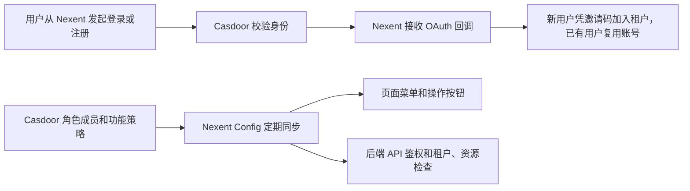
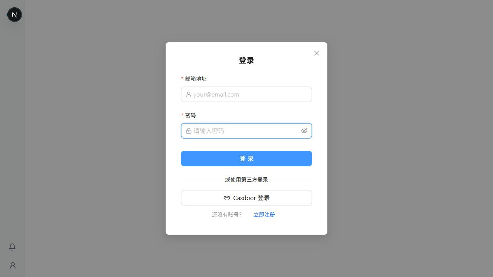
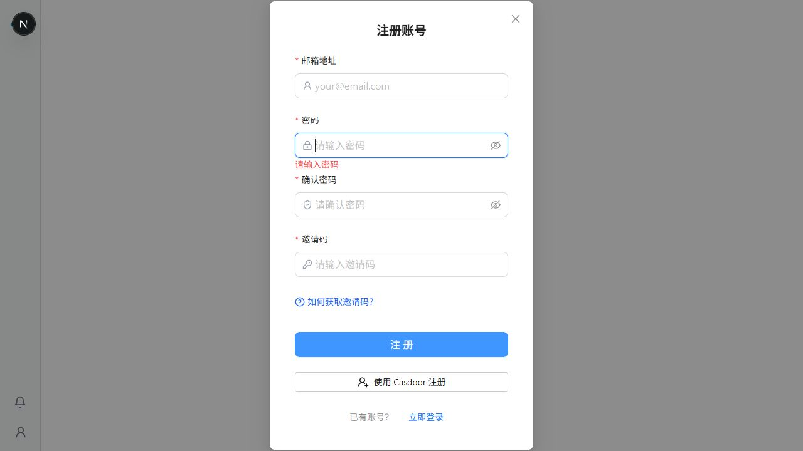
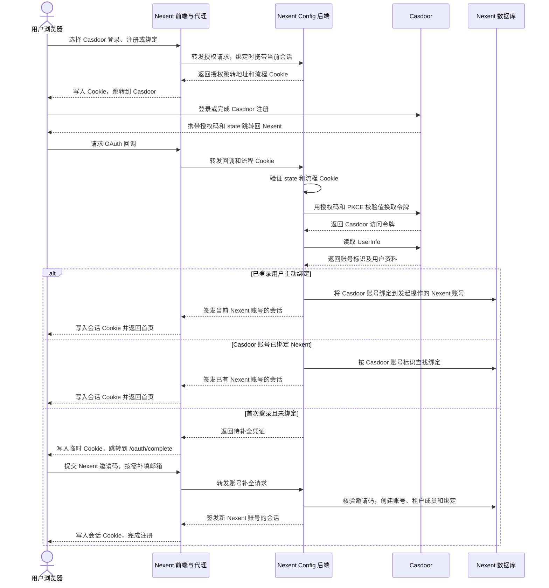
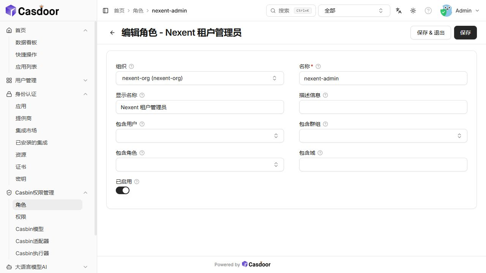
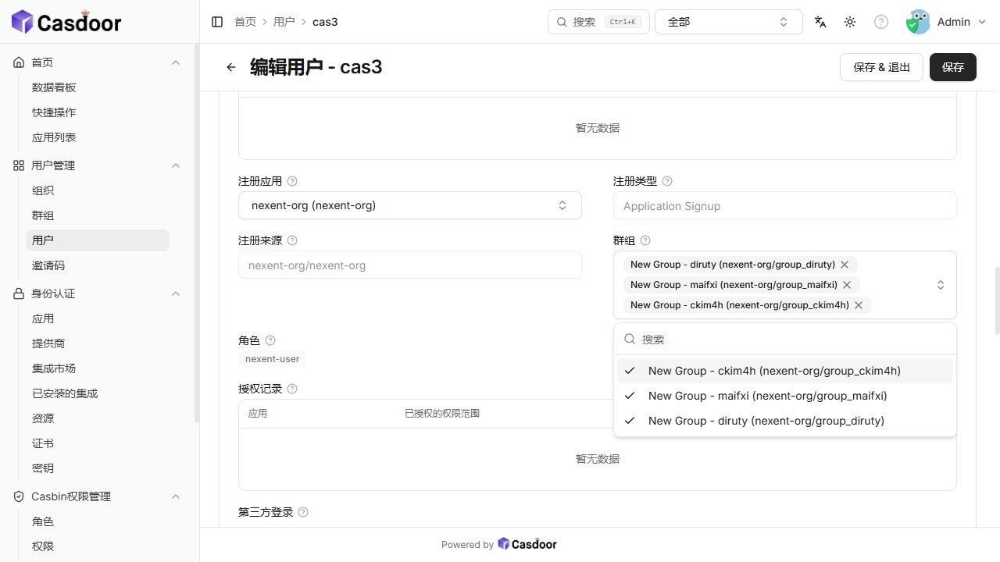
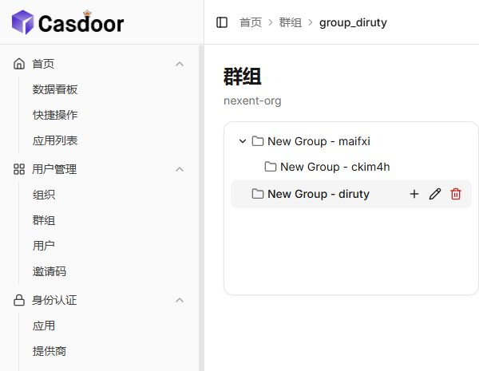
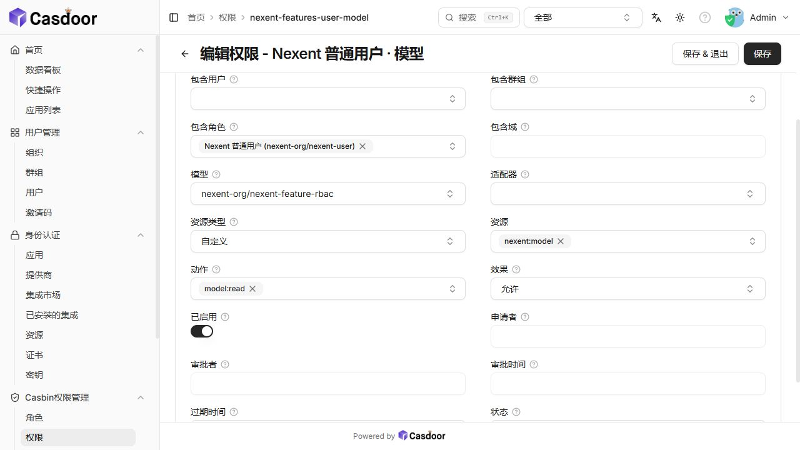
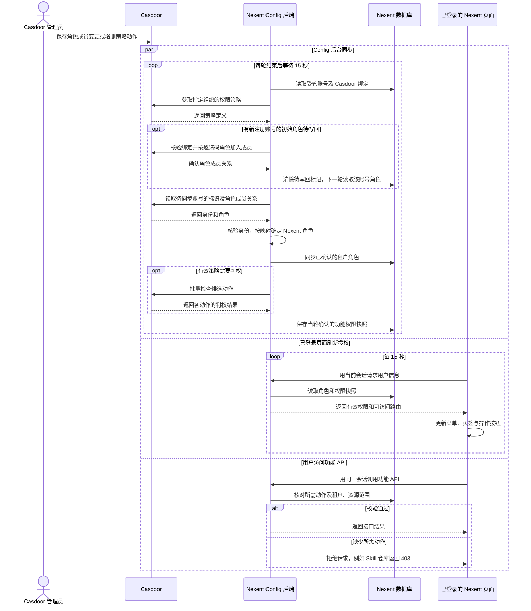

# Nexent × Casdoor 接入与权限配置指南

本文对应当前 Nexent 工作区的 Casdoor 接入。Casdoor 管理业务应用、用户凭证、角色成员和功能策略。Nexent 建立自己的登录会话，通过邀请码分配租户，并在页面和 API 上执行功能权限及资源归属检查。

## 1. 接入后可以实现什么

| 场景                   | 在哪里配置                                | 用户看到的结果                                                                         |
| -------------------- | ------------------------------------ | ------------------------------------------------------------------------------- |
| 使用 Casdoor 登录 Nexent | Casdoor 的业务组织和应用，Nexent 的 OAuth 环境配置 | 从 Nexent 发起登录，完成 Casdoor 认证后回到 Nexent。后续复用同一绑定和账号                               |
| 新用户注册                | Casdoor 的应用注册设置，Nexent 的租户邀请码        | 在 Casdoor 设置密码，回到 Nexent 时填邀请码，缺少邮箱时补填邮箱。此类账号日后通过 Casdoor 登录，Nexent 不为它保存本地登录密码 |
| 给已有 Nexent 账号增加登录方式  | Nexent「个人设置 → 第三方账号」                 | 先用原方式登录并主动绑定 Casdoor，之后两种入口都可使用。相同邮箱不会自动合并账号                                    |
| 修改用户的租户角色            | Casdoor「Casbin权限管理 → 角色」             | 已受管的用户会同步为普通用户、开发者或租户管理员，用户列表及已登录会话随之更新                                         |
| 给角色加减具体权限            | Casdoor「Casbin权限管理 → 权限」             | 可以按动作单独授权或撤销，已登录会话随轮询更新，页面和后端接口一起执行                                             |
| <br />               | <br />                               | <br />                                                                          |

**现有本机接入已启用。** Casdoor 地址为 `http://localhost:18000`，Nexent 前端为 `http://localhost:3000`，Config 后端为 `http://localhost:5010`。业务应用与组织的名称均为 `nexent-org`，功能权限模型为 `nexent-feature-rbac`。应用配置与角色配置分开，修改角色或权限时可以直接从第 5、6 节开始。



## 2. 配置 Casdoor 应用

### 启动或复用 Casdoor

已有可用的 Casdoor 实例时直接使用。新建本机演示实例可运行以下命令。宿主机的 `18000` 映射到容器的 `8000`，可避开 Nexent 环境可能已占用的宿主机 `8000`。

```powershell
docker run -d --name casdoor-demo-18000 -p 127.0.0.1:18000:8000 casbin/casdoor-all-in-one
```

打开 [本机 Casdoor](http://localhost:18000/)。新数据库按当前镜像的欢迎页初始化，管理账号是 `built-in` 组织里的 `admin`。若直接看到登录页，先核对访问端口和容器，并使用该实例已设置的管理员密码。演示镜像的数据库随容器保存，生产部署应使用持久化数据库、固定镜像版本及 HTTPS。[Casdoor Docker 指南](https://casdoor.ai/docs/basic/try-with-docker/)

### 创建组织和应用

1. 在管理页「用户管理 → 组织」创建业务组织 `nexent-org`。在「身份认证 → 应用」创建业务应用，应用名称也用 `nexent-org`，组织选择刚创建的业务组织。
2. 打开应用的「OIDC/OAuth」，确认授权类型包含 `Authorization Code`，添加下面的「重定向 URLs」。Nexent 请求 `openid profile email`，并使用 `S256` PKCE。
3. 保存应用，把该应用的客户端 ID 和客户端密钥填入 Nexent 的后端环境文件。需要预建账号时，到「用户管理 → 用户」选择业务组织，创建普通用户并设置密码。

```text
http://localhost:3000/api/user/oauth/callback?provider=casdoor
```

回调使用用户访问的 Nexent **前端**地址。协议、域名、端口、路径、部署前缀以及 `provider=casdoor` 都要一致。使用部署端口 `30000` 时，也要同步修改 Casdoor 回调和 Nexent 的 `OAUTH_CALLBACK_BASE_URL`。[Casdoor 应用配置](https://casdoor.ai/docs/application/config/) · [OAuth 2.0](https://casdoor.ai/docs/how-to-connect/oauth/)


*图 1 · 本机 Casdoor 应用的 OIDC/OAuth 配置。Nexent 使用图中 3000 端口的回调。*

### 配置登录方式和注册项

在业务应用的「界面定制 → 登录方式」配置用户可以使用的登录方式。使用 Casdoor 用户名和密码登录时，保留「密码」这一行。登录页的表单字段和注册链接在同一页的「登录项」中配置。


*图 2 · 在 Casdoor 应用的「界面定制」中配置登录方式。*

需要自助注册时，在业务应用的「身份验证」中打开「启用注册」，并关闭「禁止自助注册」。在「界面定制 → 注册项」中分别配置邮箱和手机号的「是否可见」「必须」和「规则」。当前本机的两项规则均为「不校验」（`No verification`），电子邮箱可见且必填，手机号隐藏。Casdoor 注册页的验证码规则和 Nexent 的租户邀请码各自独立。[Casdoor 注册项说明](https://casdoor.ai/docs/application/signup-items-table/)


*图 3 · 在「注册项」的「规则」列设置邮箱和手机号是否需要验证码。*

## 3. 配置 Nexent 后端

修改实际运行的后端所加载的环境文件。当前本机是源码运行，配置写在仓库根目录的 `.env`。仓库自带的 Docker Compose 配置从 `deploy/env/.env` 读取。[`.env.example`](../deploy/env/.env.example) 是模板，只有实际加载的环境文件或进程环境会生效。已有进程环境变量优先于 dotenv 文件。

```dotenv
CASDOOR_ENDPOINT=http://localhost:18000
CASDOOR_BACKEND_ENDPOINT=http://127.0.0.1:18000
CASDOOR_CLIENT_ID=<业务应用客户端ID>
CASDOOR_CLIENT_SECRET=<业务应用客户端密钥>
OAUTH_CALLBACK_BASE_URL=http://localhost:3000
OAUTH_LOGIN_MODE=button
```

- `CASDOOR_ENDPOINT` 是浏览器能访问的 Casdoor 地址，也参与外部账号绑定标识。接入后若要变更，应一并规划现有绑定的迁移。
- `CASDOOR_BACKEND_ENDPOINT` 是 Config 后端访问 Casdoor 的地址，留空时使用公开地址。后端在容器中时，应填容器可访问的地址，例如同一 Docker 网络下的 `http://casdoor-demo-18000:8000`。Docker Desktop 上也可以使用经验证可达的 `http://host.docker.internal:18000`。
- 沿用 Nexent 部署已有的 `JWT_SECRET`。客户端密钥只放在后端，避免写入前端公开变量、提交到仓库或出现在截图中。
- `OAUTH_LOGIN_MODE=button` 展示入口，`force` 在仅有一个可用提供方时自动跳转，`disabled` 隐藏入口。

保存后重启 Config。若从旧版镜像升级，应先构建或替换为包含这次修改的前后端镜像，再重建服务。访问 [Nexent OAuth 配置接口](http://localhost:3000/api/user/oauth/config)，确认响应的 `data.providers` 中有 `name: casdoor` 且 `enabled: true`。本机也可从 `http://localhost:5010/user/oauth/config` 直接核对 Config 服务的响应。

## 4. 注册、登录和绑定

1. **新用户自助注册**。在 Nexent 打开「注册账户」，点「使用 Casdoor 注册」。Casdoor 页处理账号与密码，回到 Nexent 的 `/oauth/complete` 后填 Nexent 邀请码。如果 Casdoor 已提供邮箱，Nexent 会预填邮箱。补全页不要求再设密码。
2. **Casdoor 中已有账号**。在 Nexent 登录弹窗点「Casdoor 登录」，使用业务组织账号。第一次进入 Nexent 时仍要用邀请码完成租户接入。
3. **Nexent 中已有账号**。先使用原登录方式进入 Nexent，在「个人设置 → 第三方账号」绑定 Casdoor。如果补全时提示邮箱已存在，应从已有账号发起绑定。已有本地账号保留原来的登录方式，历史双密码账号需要单独处理。
4. **退出与重登**。退出 Nexent 会关闭本地会话。Casdoor 会话可能仍有效，下次点 Casdoor 登录时可能直接返回。

首次 Casdoor 注册的 Nexent 账号依赖原始 Casdoor 绑定，不能改用 Nexent 邮箱密码登录，也不能解绑唯一的登录方式或关联其他登录提供方。



*图 4 · 本机 Nexent 登录入口。*


*图 5 · 点击「Casdoor 登录」后，在 Casdoor 业务登录页输入业务账号和密码。*



*图 6 · 本机 Nexent 注册入口。图中的密码栏属于本地注册表单，选择「使用 Casdoor 注册」直接跳转，无需填写该表单。*


*图 7 · Casdoor 业务注册页。当前邮箱为必填项，表单无需填写邮箱验证码。Casdoor 注册完成后，回到 Nexent 填写租户邀请码。*

### 登录、绑定与首次注册时序



## 5. 让 Casdoor 管理 Nexent 角色

在 Casdoor 的「Casbin权限管理 → 角色」中，为 `nexent-org` 创建并启用角色。环境变量的键用角色的「名称」，显示名称可自定义。下表是当前本机映射。

| Casdoor 角色名称       | Nexent 角色        |
| ------------------ | ---------------- |
| `nexent-user`      | 普通用户 `USER`      |
| `nexent-developer` | 开发者 `DEV`        |
| `角色1`              | 开发者 `DEV`，兼容已有角色 |
| `nexent-admin`     | 租户管理员 `ADMIN`    |

将以下配置加入实际加载的后端环境文件，再重启 Config。其他部署如未创建 `角色1`，可以从 JSON 中去掉该映射。

```dotenv
CASDOOR_ROLE_SYNC_ORGANIZATION=nexent-org
CASDOOR_ROLE_MAP_JSON='{"nexent-user":"USER","nexent-developer":"DEV","nexent-admin":"ADMIN","角色1":"DEV"}'
```

**修改用户角色**时，打开目标角色，在「包含用户」中添加账号并保存。从旧角色移除同一账号可以完成换岗。比如从租户管理员降为开发者，需要从 `nexent-admin` 移除并加入 `nexent-developer`，因为同时命中多个映射时按 `ADMIN`、`DEV`、`USER` 取最高角色。启用功能权限时，用户在多个有效策略里获得的动作仍会合并。[Casdoor 角色管理](https://casdoor.ai/docs/user/roles/)



*图 8 · 本机租户管理员角色。通过「包含用户」维护成员名单。*

- 新用户填写普通租户邀请码后，Nexent 先按邀请码建账号和租户成员，再把初始角色写到 Casdoor 对应角色。确认后，后续角色变更从 Casdoor 同步回 Nexent。
- 角色同步面向通过 Casdoor 注册且绑定核验通过的普通租户账号。已有本地账号主动绑定 Casdoor，角色仍在 Nexent 管理。租户管理员额度继续由 Nexent 校验。
- 移除全部映射角色后，已核验的受管账号在 Nexent 会回到 `USER`。需要普通用户策略时应给账号分配 `nexent-user`。租户归属由 Nexent 管理，资产管理员转为普通租户角色前需要先指定业务租户。

### 管理 Casdoor 群组

**新增群组。** 在「用户管理 → 群组」点击「添加」。组织选择 `nexent-org`，填写名称和显示名称，再选择类型。要创建顶级群组，将「上级组」设为 `nexent-org`。要创建子群组，在同一字段选择已有群组。填完点击「保存」。[打开本机群组列表](http://localhost:18000/groups)


*图 9 · 新建群组表单示例。图中填写了内部名称和显示名称。*

**给用户配置群组。** 在「用户管理 → 用户」打开 `nexent-org` 下的目标用户。在编辑页的「群组」下拉框中选中目标群组，核对组织和群组名称，再点「保存」或「保存 & 退出」。[打开本机用户列表](http://localhost:18000/users)



*图 10 · 在用户编辑页的「群组」下拉框选择成员所属的群组。*

**查看群组树。** 在「用户管理 → 组织」找到 `nexent-org`，点击该行的「群组」。展开左侧节点可查看父子关系，点击群组可查看该组成员。[打开本机群组树](http://localhost:18000/trees/nexent-org) · [Casdoor 群组文档](https://casdoor.ai/docs/organization/organization-tree/)



*图 11 · `nexent-org` 组织的群组树。缩进节点是上一层群组的子组。*

Nexent 的资源组权限使用 Nexent 自己的用户组。当前接入未同步 Casdoor 群组成员，若要给用户配置知识库等资源的组内权限，请在 Nexent 的「资源管理 → 用户组」维护成员，再到具体资源设置「组内权限」。

同一资源需要给不同用户组配置不同权限时，参见[第 9 节的拟议方案](#9-知识库和智能体的多组授权拟议方案)。
群组成员同步的后端、数据库和页面改造见[第 10 节](#10-nexent-代码接入点与待改造清单)。

## 6. 在 Casdoor 编辑角色的功能权限

### 创建模型和策略

在「Casbin权限管理 → Casbin模型」创建组织为 `nexent-org`、名称为 `nexent-feature-rbac` 的模型。

```ini
[request_definition]
r = sub, obj, act

[policy_definition]
p = sub, obj, act

[role_definition]
g = _, _

[policy_effect]
e = some(where (p.eft == allow))

[matchers]
m = g(r.sub, p.sub) && r.obj == p.obj && r.act == p.act
```

在「Casbin权限管理 → 权限」为要管理的角色创建策略。组织选 `nexent-org`，模型选 `nexent-org/nexent-feature-rbac`，资源类型选「自定义」（`Custom`），资源按下表填写，例如 `nexent:model`。在「包含角色」选中对应角色，在「动作」填写该资源支持的权限键。效果选「允许」，打开「已启用」，状态设为「已批准」。本机使用 Casdoor 自带的权限存储，适配器可留空。[Casdoor 权限配置](https://casdoor.ai/docs/permission/permission-configuration/)

| 本机策略 | 对应角色 | 迁移时保留的授权 |
| --- | --- | --- |
| `nexent-features-user-model` | `nexent-user` | 模型读取 |
| `nexent-features-developer-model` | `nexent-developer`、`角色1` | 模型读取 |
| `nexent-features-admin-*` | `nexent-admin` | 下表 5 类资源、14 个动作 |



*图 12 · 普通用户的模型策略。模型类动作放在 `nexent:model`，Skill 仓库动作使用单独的资源策略。*

先确认已为受管角色配置需要保留的权限，再设置模型短名称并重启 Config。当前本机已完成此步骤。

```dotenv
CASDOOR_PERMISSION_MODEL=nexent-feature-rbac
```

启用后，受管账号的下列功能由 Casdoor 策略决定。Config 每轮结束后等待 15 秒再同步，打开的 Nexent 页面也每 15 秒刷新授权信息，小规模组织通常在约 30 秒内生效。有效的允许策略取并集，撤销动作时要从仍授予该动作的每条策略中移除。Nexent 仍检查租户、资源归属和操作状态。Casdoor 暂时不可用时，角色保留上次核验结果，功能权限快照超过 60 秒未刷新时按拒绝处理。

### 角色与功能权限同步时序



### 已接入的权限点

现有策略如何进入 Nexent 鉴权，以及新增受管动作需要修改哪些代码，见[第 10 节](#10-nexent-代码接入点与待改造清单)。

| Casdoor 资源 | 动作 | 控制范围 |
| --- | --- | --- |
| `nexent:skill-repository` | `skill.repository:read` | 浏览 Skill 仓库和已上架条目 |
| `nexent:skill-repository` | `skill.repository:install` | 安装已上架的 Skill。从仓库页面发起安装时，同时需要浏览权限 |
| `nexent:skill-repository` | `skill.repository:publish` | 提交、撤回和下架符合归属要求的 Skill |
| `nexent:skill-repository` | `skill.repository:review` | 查看待审核条目，通过或驳回同租户的申请 |
| `nexent:model` | `model:read`、`model:create`、`model:update`、`model:delete` | 读取、新增、修改、删除模型 |
| `nexent:model` | `menu:models` | 显示模型菜单，同时需要 `model:read` |
| `nexent:knowledge-base` | `kb.capacity:read`、`kb.capacity:manage` | 查看和管理已接入的知识库容量接口 |
| `nexent:tag-library` | `tag_library:manage` | 管理标签库 |
| `nexent:dreaming` | `dreaming:view_tenant`、`dreaming:edit_tenant` | 查看和编辑同租户其他用户的 Dreaming 配置 |

表中动作由 `nexent-feature-rbac` 判权。统一资源 `nexent` 的旧策略仍可兼容，迁移后的本机旧策略已停用，避免重复授权。Nexent 用 Casdoor 的权限记录和 Casbin 批量判权结果同步受管动作。[Casdoor Casbin API](https://casdoor.ai/docs/permission/exposed-casbin-apis/)

### 查看全部已登记权限

在 Casdoor「权限」页可查阅模型 `nexent-permission-catalog` 下标记为「仅目录」的策略。这些策略按资源类别和 Nexent 原有角色分组，保留完整动作键。它们关联已映射的 Casdoor 租户角色，平台角色 `SU`、`ASSET_OWNER`、`SPEED` 在目录中按原名标注。目录策略处于禁用状态，Nexent 对这些动作继续执行本地规则。

本机此次导入覆盖 Nexent 已登记的 79 个权限点，以及已有的 4 个 Skill 仓库动作。其中 14 个动作由 7 条分类生效策略管理，其余 69 个动作分在 31 条目录策略中。

### 示例 · 让普通用户只浏览 Skill 仓库

1. 在 [Casdoor 权限页](http://localhost:18000/permissions) 创建普通用户的 Skill 仓库策略。模型选 `nexent-feature-rbac`，资源填 `nexent:skill-repository`，角色选 `nexent-user`，动作填 `skill.repository:read`，启用并批准后保存。
2. 用已分配 `nexent-user` 的账号保持登录，等待同步。仓库入口出现并可浏览，安装按钮仍需单独授予 `skill.repository:install` 才会显示。
3. 从所有生效策略移除 `skill.repository:read` 并保存。同步后，仓库浏览入口消失，原会话直接访问仓库列表接口会得到 `403`。同时拥有提交或审核权限的用户仍可访问对应页签。

## 7. 核对与排查

| 现象                    | 检查                                                                                 |
| --------------------- | ---------------------------------------------------------------------------------- |
| 访问 8000 看到 Kong 或其他页面 | 检查 Docker 的宿主机端口映射，当前本机 Casdoor 使用 18000                                           |
| 登录或注册页没有 Casdoor 按钮   | 查看 `/api/user/oauth/config`，核对运行中的 Config 加载了正确的环境文件，且登录模式未设为 `disabled`           |
| Casdoor 报回调地址不匹配      | 对比授权请求的 `redirect_uri` 和应用重定向配置，包含前端端口与 `?provider=casdoor`                        |
| 登录后又回到补全页             | 新账号需要 Nexent 邀请码。若邮箱已存在，用已有账号登录后主动绑定                                               |
| 角色没同步                 | 核对组织、角色名称、角色是否启用、目标账号是否在「包含用户」中，以及账号是否是 Casdoor 注册来源。账号改名后可通过 Casdoor 登录一次来刷新绑定名称  |
| 已加动作，但权限没生效           | 确认后端启用了专用模型，策略已启用并批准，动作与第 6 节的资源键对应，账号属于策略中的角色，应用凭证能读取权限和角色并执行判权              |
| 已删动作，页面还有入口           | 等待后台与页面轮询，检查其他有效策略是否也授予该动作。Skill 页面可能因提交、审核或既有的「我的 Skill」访问能力继续存在，可单独检查「仓库」页签与 API |

## 8. 当前修改与验证

| 修改位置                | 内容                                                                                                                                                    |
| ------------------- | ----------------------------------------------------------------------------------------------------------------------------------------------------- |
| Config 后端的 OAuth 流程 | 增加 Casdoor 授权码、PKCE、注册回调、已有账号绑定和新账号无本地密码补全                                                                                                            |
| 身份与授权同步             | 新注册角色按邀请码写回 Casdoor。Config 轮询验证绑定和组织后更新角色与功能权限快照，复用现有账号元数据                                                                                            |
| Nexent 页面与 API      | 增加 Casdoor 登录和注册入口、第三方账号绑定入口及授权刷新。Skill 仓库按动作控制列表、安装、提交与审核，接口直接执行鉴权                                                                                   |
| 本机配置                | 已启用专用模型及第 6 节所列的分类策略，重载 Config 后核实三名受管用户收到权限快照。普通用户策略当前只有模型读取                                                                                                 |
| 验证证据                | 隔离 Casdoor 实测策略动作修改、角色成员移除和恢复、策略禁用。Nexent API 与 PostgreSQL 的 [D2 用例](../test-e2e/cases/AUTH-CASDOOR-POLICY-D2-001/case.yaml) 验证同一会话授权和撤销。本文截图用于定位操作入口 |

代码入口可从 [Casdoor 认证服务](../backend/management/services/permission/identity/casdoor.py)、[角色同步](../backend/management/services/permission/identity/casdoor_roles.py) 和 [功能权限定义](../backend/permissions/casdoor_policy.py) 查看。将 Markdown 与同目录下的 `assets/casdoor` 一起复制，可以保留配图。

## 9. 知识库和智能体的多组授权（拟议方案）

当前知识库和智能体保存一组 `group_ids` 和一个 `ingroup_permission`，选中的组共用同一档权限。拟议方案把权限拆成「一个资源 × 一个用户组 × 一条权限」，由 **Casdoor 管理群组成员，Nexent 管理具体资源授权**。本节描述后续设计，相关界面和同步能力尚未实现。[知识库模型](../backend/management/db/knowledge_base/models.py) · [智能体模型](../backend/management/db/agent/models.py)

### 在 Nexent 配置每个组的权限

在知识库和智能体的编辑页增加「访问权限」表格。每行选择一个用户组和一档权限。下面是「产品知识库」的配置示例。

| 用户组 | 权限 | 访问效果 |
| --- | --- | --- |
| 研发组 | 可编辑 `EDIT` | 可以读取和编辑内容 |
| 运营组 | 只读 `READ_ONLY` | 可以读取内容 |
| 外包组 | 禁止访问 `DENY` | 拒绝通过组规则访问，即使同时属于其他获授权的组 |
| 其他组 | 未配置 | 该组不提供授权 |

保留资源级「私有」设置，用于取消整个资源的组共享。组级「禁止访问」用于明确排除某一组。对于有多重组成员身份的用户，组规则按 `DENY > EDIT > READ_ONLY` 判定。若希望外包组成员仍可凭研发组身份访问，可以省略外包组的规则。配置页可预览选定用户的最终权限及命中的组规则。

### 后端鉴权和旧数据迁移

- **资源和组的关联。** 新增资源组权限表，用 `tenant_id`、`resource_type`、`resource_id`、`group_id` 和 `access_level` 记录规则。知识库使用稳定的 `knowledge_id`，智能体使用跨版本的 `agent_id`。同一租户、资源和用户组只允许一条有效规则，保存时校验组和资源属于同一租户，并在同一事务内更新规则。
- **统一判权。** 列表、详情、编辑接口和智能体运行入口使用同一套判定。租户、角色和资源自身的访问限制先于组规则。创建者和管理角色按现有边界处理，发布、删除和管理授权分别校验对应权限。当前普通用户 `USER` 无法访问他人创建的知识库。第一版保留该限制，用同租户的非创建者 `DEV` 验证共享知识库授权。[知识库鉴权](../backend/permissions/dac.py) · [智能体草稿鉴权](../backend/management/services/agent/authorization.py)
- **兼容旧权限。** 旧资源继续按原规则判权。首次保存新版授权时，将原来每个已选组转换为一条同档规则。区分「仍用旧规则」和「已使用新版规则且列表为空」两种状态。新版规则清空表示取消组共享，旧客户端的单一权限字段不能覆盖已保存的多组规则。

### Casdoor 群组和 Nexent 资源授权的配合

1. **在 Casdoor 维护成员。** 在 `nexent-org` 下创建研发、运营和外包等群组，打开用户编辑页分配成员。人员需要同时加入多个协作组时可使用虚拟组。[Casdoor 群组文档](https://casdoor.ai/docs/organization/organization-tree/)
2. **在 Nexent 绑定群组。** 拟在「资源管理 → 用户组」提供绑定入口，使用 Casdoor 实例、组织和群组标识关联本地组。显示名称用于展示。已绑定组的成员以 Casdoor 为准，本地组继续由 Nexent 管理。第一版按直接成员同步，父子群组关系用于组织展示。[Casdoor 群组标识格式](https://casdoor.ai/docs/application/terminology/)
3. **在 Nexent 配置具体资源。** 打开目标知识库或智能体的「访问权限」，为已绑定的本地组配置可编辑、只读或禁止访问。日常调组在 Casdoor 操作，修改资源权限在 Nexent 操作。
4. **同步与撤销。** 复用 Config 定期同步和原始账号绑定校验。在 Casdoor 确认移出群组后，更新现有会话的有效权限。群组成员快照过期时，应拒绝依赖这份快照的组授权，避免沿用已失效的允许规则，也避免因为丢失禁止组信息而意外放行。[现有 Casdoor 账号校验](../backend/management/services/permission/identity/casdoor_roles.py)

如果需要在 Casdoor 的「权限」页直接配置每个知识库和智能体的读写，还需要单独接入实例级策略。Casdoor 资源键应包含租户和具体资源 ID，例如 `tenant:test:kb:42`。策略以群组为主体，按读取和编辑动作判权，模型需要明确定义允许与拒绝的优先级。Nexent 后端仍校验租户和资源归属。现有的 `nexent:knowledge-base` 策略覆盖知识库容量权限，具体知识库的访问授权属于本节的后续设计。[Casdoor 权限配置](https://casdoor.ai/docs/permission/permission-configuration/) · [Casbin 判权 API](https://casdoor.ai/docs/permission/exposed-casbin-apis/)

## 10. Nexent 代码接入点与待改造清单

### 已实现 · 角色成员和功能权限的同步

Casdoor 中「谁属于哪个角色」和「角色拥有哪些功能权限」由两条链路处理。已接入的角色和动作可以在 Casdoor 保存后自动生效。Nexent 的本地角色权限表继续为本地账号和未接入 Casdoor 的动作提供规则。

| Casdoor 上的改动 | Nexent 处理路径 | 写入或读取的数据 |
| --- | --- | --- |
| 在「角色」里增删成员 | Config 启动时挂载 `periodic_role_sync()`。每轮调用 `get-user`，核验 Casdoor 组织和已绑定的用户 ID，再用 `CASDOOR_ROLE_MAP_JSON` 将启用的角色映射成 `USER`、`DEV` 或 `ADMIN`。 | 更新该用户现有的 Nexent 租户角色，保留租户归属和管理员额度校验。[Config 启动入口](../backend/management/api/application.py) · [同步服务](../backend/management/services/permission/identity/casdoor_roles.py) · [角色和快照写入](../backend/management/db/identity/casdoor_roles.py) |
| 在「权限」里修改「包含角色」、资源或动作 | `read_policies()` 读取指定组织和模型下已启用、已批准且有效的允许策略。`evaluate_permissions()` 按策略调用 `batch-enforce`，用真实用户标识和资源、动作判权，由 Casdoor 计算角色与策略关系。 | 合并该用户命中的允许动作，保存到账号元数据的 `casdoor_feature_grants`，记录范围、角色及观测时间。[策略同步](../backend/management/services/permission/identity/casdoor_feature_sync.py) · [Casbin 批量判权](https://casdoor.ai/docs/permission/exposed-casbin-apis/) |
| 已登录用户再次访问页面或调用接口 | 通用 API 依赖 `permissions.depends.require()` 先读当前有效的 Casdoor 判定，Skill 仓库也在服务层使用同一快照。用户信息接口返回有效权限和路由，前端轮询后更新菜单和按钮。 | 受管动作缺少有效授权时返回拒绝，保留接口原有的租户、资源归属和业务状态检查。[API 权限依赖](../backend/permissions/depends.py) · [Skill 仓库服务](../backend/services/skill_repository_service.py) · [用户信息服务](../backend/management/services/permission/identity/authentication.py) · [前端轮询](../frontend/hooks/auth/useAuthorization.ts) |

比如在 Casdoor 给 `nexent-developer` 增加 `nexent:model` 下的 `model:read`，下一轮同步后，命中该策略的受管用户会拿到模型读取权限，Nexent 角色仍为 `DEV`。撤销时要从所有授予该动作的有效策略中移除。若是把用户从开发者改为租户管理员，则在 Casdoor 调整角色成员关系。

### 新增受 Casdoor 管理的功能动作

1. **定义可同步的动作。** 在 [`casdoor_policy.py`](../backend/permissions/casdoor_policy.py) 的 `FEATURE_RESOURCE_ACTIONS` 中登记资源键和动作键。已有目录项可复用原动作键。Casdoor 的目录记录只供查阅，改为生效前需要确认后端接入了该动作。
2. **接入实际操作。** 通用接口复用 `Depends(require("资源:动作"))`，有复杂业务限制的服务在实际读写前调用 `permission_override()`。其中 `None` 表示继续执行原有本地规则，`False` 表示拒绝受管动作。逐一核对能执行同一操作的入口，避免列表受控但详情或直接调用仍可绕过。
3. **统一页面展示。** 用户信息接口沿用快照覆盖本地动作。新增受管菜单时，同时检查 `overlay_user_permissions()` 的路由生成和前端按钮、页签所用的权限键，保证与后端判权一致。
4. **配置并验证。** 在生效模型下给目标角色配置该资源和动作。使用同一个已登录账号验证添加动作后可以调用接口，删除后接口返回 `403`。同时验证目录策略、错误资源键或其他租户的授权不会放行。

### 待实现 · Casdoor 用户组同步与资源鉴权

第一版复用 Config 的轮询和身份校验，按本地已绑定的组同步 Casdoor **直接成员**。资源继续引用 Nexent 的 `group_id`。这样在 Casdoor 调整人员时，只需更新成员关系，已配置的知识库和智能体授权会随成员关系生效。

| 需要修改的层 | 建议改法 |
| --- | --- |
| 配置和持久化 | 增加独立的组同步开关，默认关闭，新配置统一放入 [环境配置模块](../backend/contracts/constants/environment.py) 和 [部署模板](../deploy/env/.env.example)。在 [身份数据库模型](../backend/management/db/identity/models.py) 增加组绑定数据，记录 Nexent 租户和本地 `group_id`、Casdoor 实例、组织和外部群组键 `owner/name`。通过 [版本化 SQL 迁移](../deploy/sql/migrations) 增加绑定和成员同步状态，记录最近成功同步时间，并复用已有组及成员表。本地组 ID 保持稳定，显示名称可更新，外部群组键发生变化时由管理员重新绑定。 |
| Config 同步服务 | 把 `casdoor_roles.py` 中的 `_read_bound_user()` 提取成角色和群组共用的身份读取逻辑。沿用 `GET /api/get-user?id=组织/用户名` 的组织、账号和原绑定 ID 校验，读取同一响应中的 `roles`、`groups`，角色和组分别解析、提交。绑定时可用 `GET /api/get-groups?owner=组织` 提供候选项。部署前核对本机版本对 `groups` 的空值表示和应用凭证的可读范围。[Casdoor 用户对象](https://github.com/casdoor/casdoor/blob/master/object/user.go) · [Casdoor 群组 API](https://github.com/casdoor/casdoor/blob/master/controllers/group.go) |
| 成员对账 | 在 [群组数据库模块](../backend/management/db/identity/group.py) 增加按用户、租户和绑定范围的差量更新。只处理已核验且属于该租户的账号，将本地受管组与 Casdoor 直接成员关系比对，在同一事务内增删关系、更新成功时间。提交前重新核对账号、租户和组绑定，避免旧一轮数据覆盖新绑定或较新的结果。绑定组时显式交接已有成员的管理权，未绑定的本地组和默认组的既有行为照常执行。 |
| 授权读取 | 在 [知识库权限服务](../backend/management/services/knowledge_base/permission.py)、[知识库列表服务](../backend/management/services/knowledge_base/management.py) 和 [智能体鉴权](../backend/management/services/agent/authorization.py) 等路径统一使用带租户和同步状态的组查询，列表、详情、编辑和运行入口应用相同规则。[用户信息服务](../backend/management/services/permission/identity/authentication.py) 也读取有效的组数据。现有受管会话可复用授权轮询，并在组权限变化时重新获取受影响的资源列表。 |
| 管理 API 和页面 | 在 [群组 API](../backend/management/api/identity/group.py)、[群组服务](../backend/management/services/permission/identity/groups.py) 和 [资源管理页面](../frontend/app/%5Blocale%5D/resource-manage/components/UserManageComp.tsx) 增加绑定、来源标记和同步状态。受管组的成员编辑入口设为只读，后端同样限制手工成员变更，包括批量操作。按第 9 节增加资源组授权规则，并接入知识库和智能体的授权编辑界面。 |

同步服务必须区分「已确认没有成员关系」和「本轮无法核验」。例如有效响应确认 `cas1` 已从研发组移除，就删除该关系。超时、字段缺失、身份不符或读取结果不完整时，保留上次同步数据和时间，等待下一轮重试。完整同步结果超过有效期后，拒绝依赖它的资源组授权。如果某个资源存在可能影响判定的 Casdoor 组级 `DENY`，也应拒绝通过其他组规则放行，直到恢复核验。确认群组已删除时，撤销该绑定的成员授权，保留资源规则供管理员检查和重新绑定。

验收时可让同租户的非资源创建者保持登录。在 Casdoor 把账号从「运营组」移到「研发组」，验证同一资源从只读变为可编辑。随后移出研发组，确认原会话的直接 API 请求也失去编辑权限。再验证兼属禁止组、接口超时与恢复、跨租户同名组、旧版单档共享资源四种情况。
