# Nexent × Casdoor 接入与权限配置指南

**当前采用：Casdoor 托管登录和注册，Nexent 管理角色、权限和用户组。** Nexent 在 OAuth 回调中绑定外部身份，首次登录时创建本地业务账号并分配目标租户。角色、功能权限、用户组和成员关系只在 Nexent 管理，不在两边同步。

- **首次接入**先[创建 Casdoor 应用](#2-配置-casdoor-应用)，再[配置 Nexent 后端](#3-配置-nexent-后端)，最后用无会话浏览器[验证登录和注册回跳](#4-注册登录和绑定)。
- **日常管理**在 Nexent 维护租户角色、用户组和[知识库与智能体的多组授权](#9-知识库和智能体的多组授权)。自定义角色、动作策略管理和树状群组页面的增量工作见[能力对比图](#企业身份与权限能力明细)。
- **备选方案**：第 5、6 节和[同步设计](#同步设计用户角色功能权限与用户组)保留了 Casdoor 托管授权的实现说明，不作为当前方案的启用步骤。
- **上线全量切换**可按[安装初始化与幂等迁移方案](#13-上线全量切换与安装初始化)准备凭证迁移、旧入口关闭、安装顺序和回退。

## 1. 接入后可以实现什么

| 场景 | 配置位置 | 生效范围 |
| --- | --- | --- |
| 登录或注册 | Casdoor 业务应用、Nexent OAuth 配置及新用户目标租户 | 从 Nexent 打开 Casdoor，认证后直接回到 Nexent；首次登录无需填写邀请码 |
| 给已有账号增加 Casdoor 登录 | 管理员存量导入，或由原账号发起经认证的 OAuth 绑定 | 建立绑定后复用原 Nexent 用户 ID、资源和租户 |
| 调整租户角色 | Nexent 用户管理 | 使用 Nexent 内置租户角色；自定义角色管理在 Nexent 扩展 |
| 授予或撤销功能动作 | Nexent 本地规则 | 由 Nexent 校验菜单和 API；可编辑动作策略在 Nexent 扩展 |
| 管理用户组和成员 | Nexent「资源管理 → 用户组」 | 本地维护群组、成员和父组；可展开的树状管理在 Nexent 扩展 |
| 设置具体资源的共享范围 | Nexent 知识库或智能体的权限设置 | 同一资源可分别给多个组授予只读或编辑权限 |

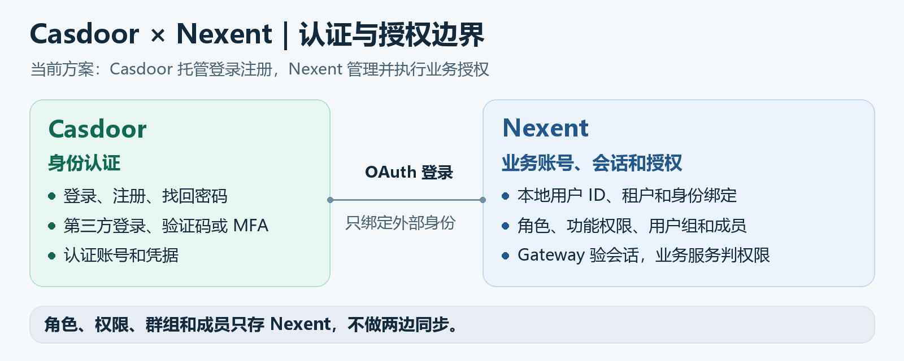

两端只通过 OAuth 建立身份关系：Casdoor 返回的外部身份绑定到 Nexent 本地 `user_id`。Gateway 在部署启用时验证 Nexent 会话，业务服务检查角色、租户和资源权限。**不做授权数据同步，仍需要保留账号绑定；停用 Casdoor 后撤销 Nexent 会话也是单独的联动能力。**

## 2. 配置 Casdoor 应用

### 启动或复用 Casdoor

已有可用的 Casdoor 实例时直接使用。新建本机演示实例可运行以下命令。宿主机的 `18000` 映射到容器的 `8000`，可避开 Nexent 环境可能已占用的宿主机 `8000`。

```powershell
docker run -d --name casdoor-demo-18000 -p 127.0.0.1:18000:8000 casbin/casdoor-all-in-one
```

打开 [Casdoor 管理员登录页](http://localhost:18000/login/built-in)，选择 `built-in` 组织，用户名为 `admin`。首次启动按镜像提示初始化，已有实例使用该实例的管理员密码。Nexent 业务账号从 Nexent 首页发起登录。演示镜像的数据随容器保存，生产部署使用持久化数据库、固定镜像版本及 HTTPS。[Casdoor Docker 指南](https://casdoor.ai/docs/basic/try-with-docker/)

### 创建组织和应用

1. 在管理页「用户管理 → 组织」创建业务组织 `nexent-org`。在「身份认证 → 应用」创建业务应用，应用名称也用 `nexent-org`，组织选择刚创建的业务组织。
2. 打开应用的「OIDC/OAuth」，确认授权类型包含 `Authorization Code`，添加下面的「重定向 URLs」。Nexent 请求 `openid profile email`，并使用 `S256` PKCE。
3. 保存应用，把该应用的客户端 ID 和客户端密钥填入 Nexent 的后端环境文件。需要预建账号时，到「用户管理 → 用户」选择业务组织，创建普通用户并设置密码。

```text
http://localhost:3000/api/user/oauth/callback?provider=casdoor
```

回调使用用户访问的 Nexent **前端**地址。协议、域名、端口、路径、部署前缀以及 `provider=casdoor` 都要一致。使用部署端口 `30000` 时，也要同步修改 Casdoor 回调和 Nexent 的 `OAUTH_CALLBACK_BASE_URL`。[Casdoor 应用配置](https://casdoor.ai/docs/application/config/) · [OAuth 2.0](https://casdoor.ai/docs/how-to-connect/oauth/)

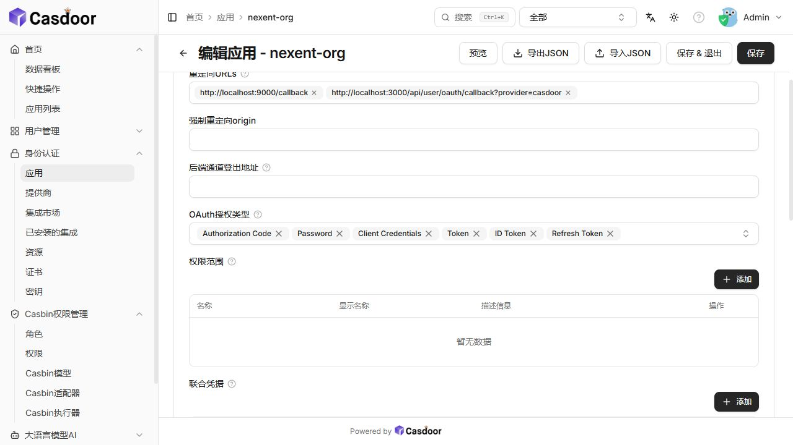

*图 1 · 本机 Casdoor 应用的 OIDC/OAuth 配置。Nexent 使用图中 3000 端口的回调。*

### 配置登录方式和注册项

在业务应用的「界面定制 → 登录方式」配置用户可以使用的登录方式。使用 Casdoor 用户名和密码登录时，保留「密码」这一行。登录页的表单字段和注册链接在同一页的「登录项」中配置。

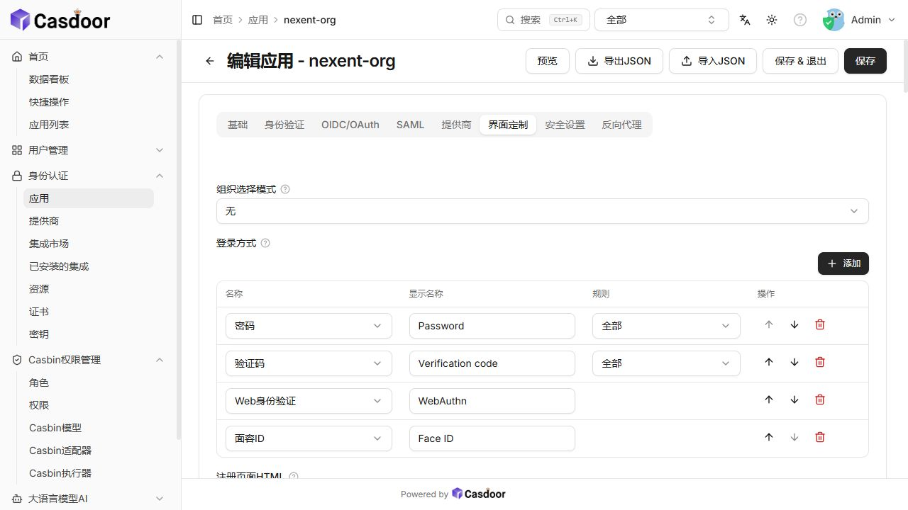

*图 2 · 在 Casdoor 应用的「界面定制」中配置登录方式。*

需要自助注册时，在业务应用的「身份验证」中打开「启用注册」，并关闭「禁止自助注册」。在「界面定制 → 注册项」中配置邮箱、手机号的可见性、必填和验证规则。Nexent 自动建号需要 Casdoor 返回有效邮箱，因此建议将邮箱设为必填；使用第三方登录时，可将邮箱设为登录后缺失时补填，让用户在 Casdoor 内补齐。面向公网时建议启用邮箱验证码。[Casdoor 注册项说明](https://casdoor.ai/docs/application/signup-items-table/)

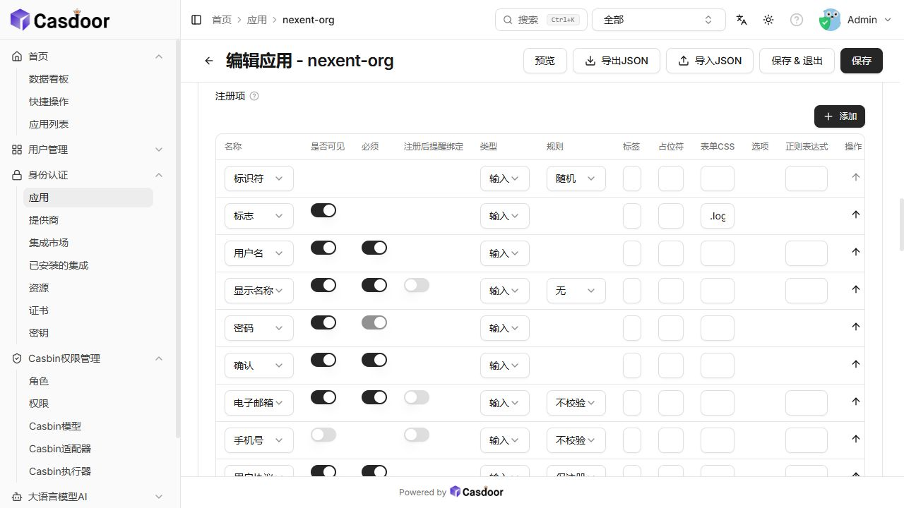

*图 3 · 在「注册项」的「规则」列设置邮箱和手机号是否需要验证码。*

### 通过 Casdoor 接入 QQ、微信和 GitHub 登录

把第三方平台作为 Casdoor 的 OAuth 提供商，挂到 Nexent 使用的 Casdoor 应用 `nexent-org`。用户从 Nexent 进入 Casdoor，在 Casdoor 选择第三方平台，授权后回到 Casdoor，再由 Casdoor 回跳 Nexent。Nexent 继续使用同一套 Casdoor 客户端凭证和回调。[Casdoor OAuth 提供商](https://casdoor.ai/docs/provider/oauth/overview/)

| 登录方式 | 平台凭证及配置 |
| --- | --- |
| GitHub | 创建 GitHub App，取得 Client ID 和 Client Secret。在 GitHub App 中配置 Casdoor 的 Callback URL。[GitHub 接入指南](https://casdoor.ai/docs/provider/oauth/github/) |
| QQ | 在 QQ 互联创建「网站应用」，按要求完成审核，取得 App ID 和 App Key。设置 Casdoor 的网站回调地址。[QQ 互联](https://connect.qq.com/) |
| 微信 | 电脑扫码使用微信开放平台已审核的「网站应用」，取得 AppID 和 AppSecret。微信内置浏览器登录另需公众号凭证和授权域名。[微信接入指南](https://casdoor.ai/zh/docs/provider/oauth/Wechat/) |

两段回调分别填写。第三方平台的回调地址指向 Casdoor，一般为 `https://<Casdoor 域名>/callback`。Casdoor 应用的 Redirect URLs 填 Nexent 回调地址，本机示例为 `http://localhost:3000/api/user/oauth/callback?provider=casdoor`。QQ 和微信按各自的要求配置授权域名。已有环境如需更换 `CASDOOR_ENDPOINT`，一并规划第 3 节的账号绑定迁移。[回调配置说明](https://casdoor.ai/docs/application/config/#redirect-url-and-callback-url)

1. 在 Casdoor「身份管理 → 提供商」新增提供商，类别选 `OAuth`，类型分别选 `QQ`、`WeChat` 或 `GitHub`，填入平台凭证。
2. 在「应用 → `nexent-org` → 提供商」添加该提供商，允许登录。需要开放新用户注册时，再允许注册。微信电脑扫码选 `Web` 子类型，并在「界面定制 → 登录方式」加入「微信」。[添加和启用提供商](https://casdoor.ai/docs/provider/oauth/overview/#add-the-provider-to-an-application)
3. 从 Nexent 发起登录，验证 Casdoor 上的第三方入口及回跳。已有 Nexent 用户先确认绑定指向原 Casdoor 账号，再在 Casdoor 中把第三方身份关联到该账号。新用户缺少邮箱时在 Casdoor 补齐；同邮箱不会自动合并成一个 Nexent 账号。[Casdoor 账号关联](https://casdoor.ai/docs/provider/oauth/overview/#how-casdoor-links-accounts) · [Nexent 注册与绑定](#4-注册登录和绑定)

本机 `nexent-org` 的「界面定制 → 登录项」已添加自定义展示项 `Text Nexent social sign-in preview`。密码表单下方用「或」分隔，横向展示 Casdoor 官方 CDN 上的 QQ、微信和 GitHub 图标，下方标记「第三方登录待配置」。这些入口只展示，现有密码登录照常使用。正式启用某个提供商后，从自定义项里移除对应的占位入口，页面使用 Casdoor 原生登录入口。[Casdoor 演示登录页](https://door.casdoor.com/login) · [登录项与自定义 HTML](https://casdoor.ai/docs/application/terminology/#custom-html-and-scripts)

QQ、微信和 GitHub 占位入口见[当前登录页](#4-注册登录和绑定)。

#### 示例 · 从 Nexent 使用 GitHub 登录

假设测试环境的 Nexent 地址为 `https://nexent.example.com`，Casdoor 地址为 `https://auth.example.com`。实际操作时用部署的地址替换。

| 配置位置 | 字段 | 示例值 |
| --- | --- | --- |
| GitHub App | Callback URL | `https://auth.example.com/callback` |
| Casdoor 应用 `nexent-org` | Redirect URLs | `https://nexent.example.com/api/user/oauth/callback?provider=casdoor` |
| Nexent Config | `CASDOOR_ENDPOINT` | `https://auth.example.com` |
| Nexent Config | `OAUTH_CALLBACK_BASE_URL` | `https://nexent.example.com` |

1. 在 GitHub 的开发者设置创建 GitHub App，填写上表的 Callback URL。生成 Client Secret，和 GitHub App 的 Client ID 一起填入 Casdoor「身份管理 → 提供商」，创建类型为 `OAuth / GitHub` 的提供商，例如 `nexent-github`。[GitHub 提供商配置](https://casdoor.ai/docs/provider/oauth/github/)
2. 在 Casdoor「应用 → `nexent-org` → 提供商」添加 `nexent-github`，允许登录。验证新用户注册时，同时允许通过该提供商注册，并配置 Nexent 目标租户。应用的 Nexent 回调按上表设置。[添加提供商](https://casdoor.ai/docs/provider/oauth/overview/#add-the-provider-to-an-application)
3. 用无会话浏览器打开 Nexent，进入 Casdoor 后点击可用的 GitHub 图标并完成授权。按顺序核对浏览器经 GitHub 返回 Casdoor 的 `/callback`，再由 Casdoor 回到 Nexent 的 OAuth 回调。
4. 用已关联原 Casdoor 身份的账号测试一次，回到 Nexent 后核对原用户 ID 和租户。再用新测试账号验证从 Casdoor 直接进入 Nexent，核对其租户和角色。两条路径都通过后，从 `Text Nexent social sign-in preview` 中移除 GitHub 占位图标。[Nexent 注册与绑定](#4-注册登录和绑定)

#### 示例 · 将同一流程用于 QQ 和微信

| 测试入口 | Casdoor 配置 | 验证结果 |
| --- | --- | --- |
| QQ 网站登录 | 使用审核通过的网站应用凭证，创建 `OAuth / QQ` 提供商并添加到 `nexent-org`。在 QQ 互联配置 Casdoor 的回调，按平台要求填写网站回调域 | 从 Nexent 打开 Casdoor，点击 QQ，完成授权和 Casdoor 必填资料后进入 Nexent |
| 微信电脑扫码 | 使用审核通过的微信开放平台网站应用凭证，创建 `OAuth / WeChat`，子类型选 `Web`。添加到 `nexent-org`，在「登录方式」加入「微信」，核对微信开放平台登记的授权回调域与 Casdoor 域名一致 | 从电脑浏览器打开 Nexent，在 Casdoor 的微信入口看到二维码。使用微信扫码并确认授权，电脑浏览器回到 Nexent |

QQ 和微信继续使用上表的 Nexent 回调地址。各自验证通过后，再移除对应的待配置图标。微信内置浏览器登录使用公众号凭证及对应的授权域名，可与电脑扫码分开验证。[QQ 互联](https://connect.qq.com/) · [Casdoor 微信接入指南](https://casdoor.ai/zh/docs/provider/oauth/Wechat/)

## 3. 配置 Nexent 后端

修改实际运行的后端所加载的环境文件。当前本机是源码运行，配置写在仓库根目录的 `.env`。仓库自带的 Docker Compose 配置从 `deploy/env/.env` 读取。[`.env.example`](../deploy/env/.env.example) 是模板，只有实际加载的环境文件或进程环境会生效。已有进程环境变量优先于 dotenv 文件。

```dotenv
CASDOOR_ENDPOINT=http://localhost:18000
CASDOOR_BACKEND_ENDPOINT=http://127.0.0.1:18000
CASDOOR_CLIENT_ID=<业务应用客户端ID>
CASDOOR_CLIENT_SECRET=<业务应用客户端密钥>
CASDOOR_SIGNUP_TENANT_ID=<已有业务租户的 ID>
OAUTH_CALLBACK_BASE_URL=http://localhost:3000
OAUTH_LOGIN_MODE=force
```

- `CASDOOR_ENDPOINT` 是浏览器能访问的 Casdoor 地址，也参与外部账号绑定标识。接入后若要变更，应一并规划现有绑定的迁移。
- `CASDOOR_BACKEND_ENDPOINT` 是 Config 后端访问 Casdoor 的地址，留空时使用公开地址。后端在容器中时，应填容器可访问的地址，例如同一 Docker 网络下的 `http://casdoor-demo-18000:8000`。Docker Desktop 上也可以使用经验证可达的 `http://host.docker.internal:18000`。
- `CASDOOR_SIGNUP_TENANT_ID` 只用于首次建号，使用有现存成员的业务租户 ID。留空时使用 `CASDOOR_GROUP_SYNC_TENANT_ID`。两项都留空或租户无效时，已有绑定仍能登录，新账号提示联系管理员。用户不能自行选择目标租户。
- 沿用 Nexent 部署已有的 `JWT_SECRET`。客户端密钥只放在后端，避免写入前端公开变量、提交到仓库或出现在截图中。
- `OAUTH_LOGIN_MODE=force` 在仅有一个可用 OAuth 提供方时自动跳转，本机采用此模式。`button` 在 Nexent 弹窗显示 Casdoor 入口，`disabled` 隐藏入口。部署切换到 `force` 前，可以先完成已有账号的 Casdoor 绑定或存量迁移。

保存后重启 Config。若从旧版镜像升级，使用包含 Casdoor 功能的前后端镜像重建服务。先检查 [Config 就绪状态](http://localhost:5010/health/ready)，再访问 [Nexent OAuth 配置接口](http://localhost:3000/api/user/oauth/config)，确认 `data.providers` 中包含启用的 `casdoor`。使用 `force` 模式时，`data.auto_login_provider` 应为 `casdoor`。

按当前方案，显式填写 `CASDOOR_SIGNUP_TENANT_ID`，不启用角色映射、功能权限模型和群组同步（`CASDOOR_ROLE_MAP_JSON`、`CASDOOR_PERMISSION_MODEL`、`CASDOOR_GROUP_SYNC_TENANT_ID` 留空）。若从曾启用群组同步的部署切换，先核对已被标记为 Casdoor 管理的组、成员和资源引用，再转为本地维护；仅关闭轮询不会解除组的托管标记。登录页正式启用 QQ、微信或 GitHub 后，浏览器和 Casdoor 还会与对应平台交互。

## 4. 注册、登录和绑定

1. **新用户自助注册**。从 Nexent 首页进入 Casdoor，在登录页点击「立即注册」。在 Casdoor 填好账号信息并完成认证，Nexent 回调自动创建无本地密码的账号、租户成员和稳定身份绑定，随后进入首页。无需在 Nexent 补填资料或输入邀请码。
2. **Casdoor 中已有账号**。使用 `nexent-org` 的业务账号从 Nexent 发起登录。已绑定用户复用原 Nexent 账号；首次登录的用户加入预设租户，初始为普通用户（`USER`）。需要调整角色时，在 Nexent 用户管理中操作。
3. **Nexent 中已有账号**。同邮箱不会自动关联。当前个人信息页不展示绑定操作，通常由管理员通过[存量导入](#将已有-nexent-用户和业务组导入-casdoor)建立绑定。需要绑定已经存在的 Casdoor 账号时，可在确认双方账号归属后，通过原 Nexent 账号的有效会话发起后端 OAuth 绑定流程。
4. **退出与重登**。退出 Nexent 会关闭本地会话。如果 Casdoor 会话仍有效，再次发起登录时可能直接通过单点登录返回 Nexent。

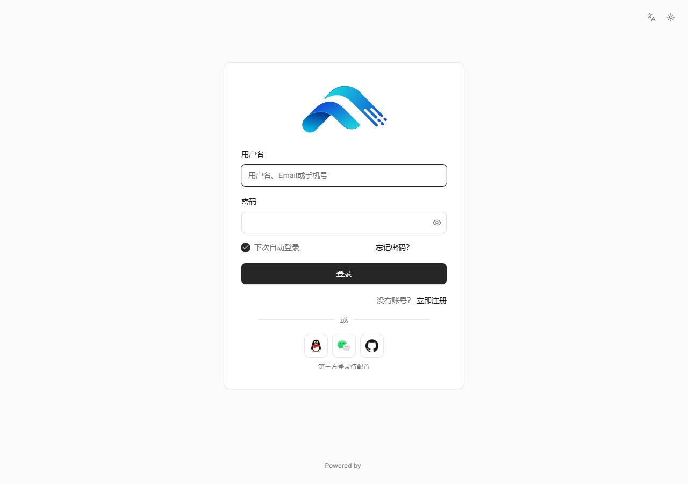

*当前密码登录页。QQ、微信和 GitHub 图标仍是配置占位。*

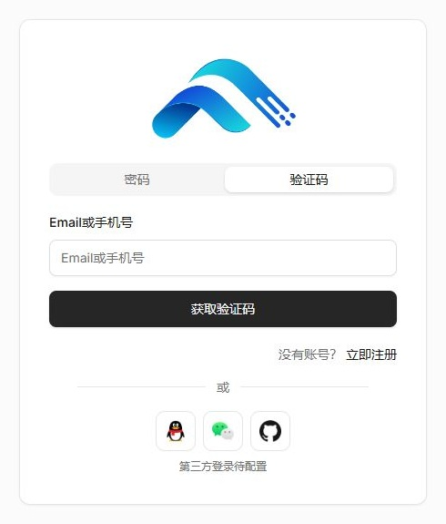

*验证码登录页可输入邮箱或手机号。是否能收到验证码取决于应用的提供商配置；仅出现页签不代表发送链路已验证。*

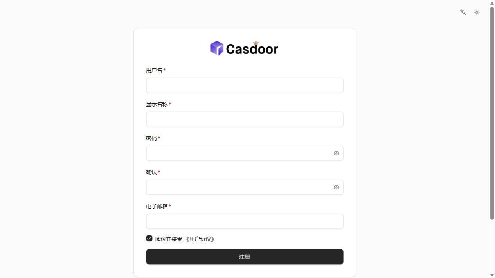

*图 7 · Casdoor 业务注册页。邮箱字段应保留，验证码要求取决于应用的注册配置。*

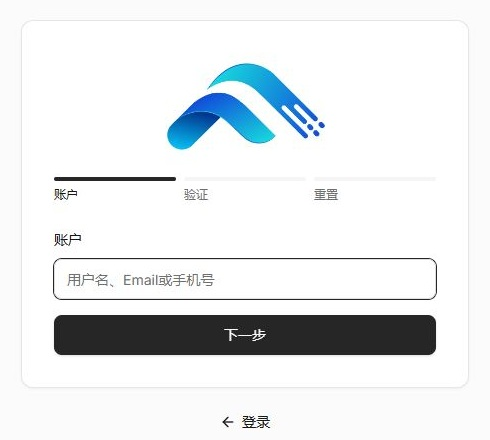

*图 8 · Casdoor 登录页点击「忘记密码？」。先填写账号，再通过邮件或短信验证，最后设置新密码。对应提供商规则须允许 `Forget Password` 或 `All`。[找回密码配置](https://casdoor.ai/docs/application/signin-items-table/#forgot-password-flow)*


## 5. 让 Casdoor 管理 Nexent 角色

> 备选方案：仅在决定由 Casdoor 托管角色或群组时使用。当前方案的角色和用户组在 Nexent 维护。

在 Casdoor 的「Casbin 权限管理 → 角色」中，为 `nexent-org` 创建并启用角色。在「包含用户」中加入目标账号。Config 会同步已绑定用户的启用角色，用户可以在 Nexent「个人信息 → Casdoor 角色」看到它们的显示名称。新增、修改显示名称、停用或移除角色都通过原有同步任务生效，无需修改环境变量、重启服务或重新登录。

下面的映射用于决定 Nexent 的租户角色。配置键使用 Casdoor 角色的内部「名称」。自定义角色可以直接关联 Casdoor 权限策略，例如给 `qa-reviewer` 授予 Skill 仓库的已接入动作。只有匹配的租户角色映射才能授予 Nexent 开发者或租户管理员身份。

| Casdoor 角色名称       | Nexent 角色        |
| ------------------ | ---------------- |
| `nexent-user`      | 普通用户 `USER`      |
| `nexent-developer` | 开发者 `DEV`        |
|  |
| `nexent-admin`     | 租户管理员 `ADMIN`    |

Nexent 用户列表里的「管理员」也是租户管理员 `ADMIN`，在 Casdoor 对应「Nexent 租户管理员」。平台级超级管理员 `SU` 和资产管理员 `ASSET_OWNER` 继续由 Nexent 管理。

将以下配置加入实际加载的后端环境文件，再重启 Config。其他部署如未创建 `角色1`，可以从 JSON 中去掉该映射。

```dotenv
CASDOOR_ROLE_SYNC_ORGANIZATION=nexent-org
CASDOOR_ROLE_MAP_JSON='{"nexent-user":"USER","nexent-developer":"DEV","nexent-admin":"ADMIN"}'
```

**修改用户角色**时，打开目标角色，在「包含用户」中添加账号并保存。从旧角色移除同一账号可以完成换岗。比如从租户管理员降为开发者，需要从 `nexent-admin` 移除并加入 `nexent-developer`，因为同时命中多个映射时按 `ADMIN`、`DEV`、`USER` 取最高角色。启用功能权限时，用户在多个有效策略里获得的动作仍会合并。[Casdoor 角色管理](https://casdoor.ai/docs/user/roles/)


*图 10 · 本机租户管理员角色。通过「包含用户」维护成员名单。*

- 新用户由 Nexent 自动建号为 `USER`，不向 Casdoor 写入默认角色。已在 Casdoor 分配的映射角色随后台同步生效；未分配映射角色时仍为 `USER`。
- 如果普通用户也需要 Casdoor 接管的动作，在 Casdoor 应用设置默认群组，并在对应权限策略中授权给该群组或其角色。Nexent 中的 `USER` 标签本身不会自动授予 Casdoor 策略动作。
- 通过核验的 Casdoor 绑定提供角色名称。通过 Casdoor 注册的普通租户账号按映射同步 Nexent 租户角色。已有本地账号绑定 Casdoor 后，Nexent 租户角色由 Nexent 管理。租户管理员额度继续由 Nexent 校验。
- 移除全部映射角色后，已核验的受管账号在 Nexent 会回到 `USER`。需要普通用户策略时应给账号分配 `nexent-user`。租户归属由 Nexent 管理，资产管理员转为普通租户角色前需要先指定业务租户。

### 管理 Casdoor 群组

**新增群组。** 在「用户管理 → 群组」点击「添加」。组织选择 `nexent-org`，填写名称和显示名称，再选择类型。要创建顶级群组，将「上级组」设为 `nexent-org`。要创建子群组，在同一字段选择已有群组。填完点击「保存」。[打开本机群组列表](http://localhost:18000/groups)

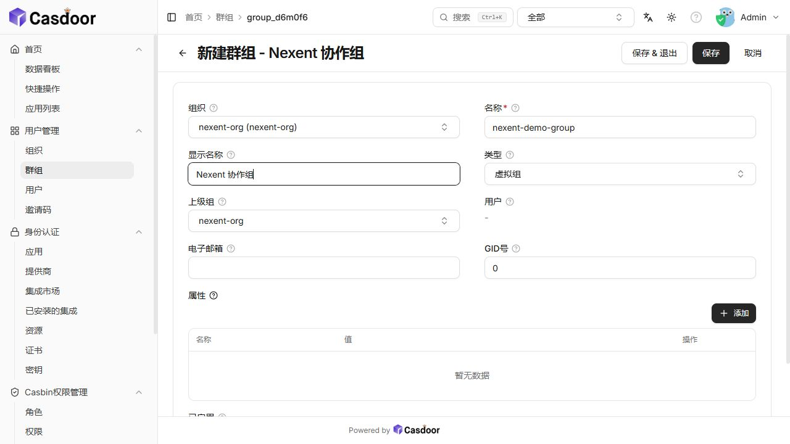

*图 11 · 新建群组表单示例。图中填写了内部名称和显示名称。*

**给用户配置群组。** 在「用户管理 → 用户」打开 `nexent-org` 下的目标用户。在编辑页的「群组」下拉框中选中目标群组，核对组织和群组名称，再点「保存」或「保存 & 退出」。[打开本机用户列表](http://localhost:18000/users)


*图 12 · 在用户编辑页的「群组」下拉框选择成员所属的群组。*

**查看群组树。** 在「用户管理 → 组织」找到 `nexent-org`，点击该行的「群组」。展开左侧节点可查看父子关系，点击群组可查看该组成员。[打开本机群组树](http://localhost:18000/trees/nexent-org) · [Casdoor 群组文档](https://casdoor.ai/docs/organization/organization-tree/)


*图 13 · `nexent-org` 组织的群组树。缩进节点是上一层群组的子组。*

Nexent 列表的「父组」列显示直接父组，创建和编辑时可选择父组或设为顶级组。要让两边使用同一批业务组，先完成下方的同步配置。

同一资源需要给不同用户组配置不同权限时，参见[第 9 节](#9-知识库和智能体的多组授权)。

### 群组和成员双向同步

1. 使用包含本次代码的 Config 和前端，部署时应用 [群组迁移](../deploy/sql/migrations/v2.9.0_009_casdoor_group_hierarchy.sql)。
2. 在 Config 的实际环境文件中配置 Casdoor 应用、`CASDOOR_ROLE_SYNC_ORGANIZATION` 和 `CASDOOR_GROUP_SYNC_TENANT_ID`。后者填写 Nexent 租户 ID，留空时关闭群组同步。一个 Casdoor 组织对应一个 Nexent 业务租户。
3. 在 Nexent「资源管理 → 用户组」创建群组时选择父组。保存后 Casdoor 出现对应虚拟组。在 Nexent 编辑群组，可修改显示名称、描述、父组和已绑定的成员。同步组的删除在 Casdoor 管理。
4. 在 Casdoor 新建或修改群组、调整用户的直接群组后，Config 通常在下一轮约 15 秒内读取变更。Nexent 用户组页面也会定期刷新。

```dotenv
CASDOOR_ROLE_SYNC_ORGANIZATION=nexent-org
CASDOOR_GROUP_SYNC_TENANT_ID=<Nexent 租户 ID>
```

Casdoor 保存同步组的目录数据。Nexent 用本地 `group_id` 供现有资源授权引用，以 Casdoor 实例、组织、内部组名和创建时间识别同一组。修改 Casdoor 的**显示名称**保留本地组 ID。修改内部名称会按新组导入，已有资源授权需要检查。需要同步已有本地业务组时，使用下方的存量导入流程。

成员按已绑定的 Casdoor 用户 ID 和 Nexent 租户匹配。同名或同邮箱无法建立成员关联。仅同步直接成员。父子关系用于展示和管理，不会让子组成员自动获得父组的资源访问权限。Casdoor 请求失败时，Nexent 保留最近一次确认的目录并重试。Nexent 发起的写入要经过 Casdoor 确认后才会返回成功。[同步服务](../backend/management/services/permission/identity/casdoor_groups.py) · [本地目录写入](../backend/management/db/identity/casdoor_groups.py) · [Casdoor 群组 API](https://github.com/casdoor/casdoor/blob/master/controllers/group.go)

### 将已有 Nexent 用户和业务组导入 Casdoor

使用 [导入脚本](../scripts/import_nexent_to_casdoor.py) 执行存量迁移。每批处理一个 Nexent 业务租户和对应的 Casdoor 组织，同时纳入 Nexent 已有的平台超级管理员 `SU`。已绑定账号和已同步业务组直接复用。新建的 Casdoor 身份绑定原 Nexent 用户 ID，因而保留原角色、租户和业务资源。脚本导入原有业务组、父子关系和直接成员，在原组记录上建立映射，保留知识库和智能体的授权引用。系统默认组由 Nexent 管理。

超级管理员以普通账号创建在目标 Casdoor 业务组织，使用独立临时密码并在首次登录时改密。Nexent 从已有绑定中识别原 `SU`，权限由 Nexent 的原账号确定。即使超级管理员原来属于平台租户，脚本也使用其原租户记录。导入后，在切换到强制 Casdoor 登录前，用迁移后的身份验证原超级管理员能进入 Nexent。

1. 在可访问实际 PostgreSQL 和 Casdoor 服务的 Linux 主机上，使用包含本脚本和群组同步代码的仓库版本，以及 Nexent 后端 Python 3.11 环境。确认已应用群组迁移。备份两边的数据，并在维护窗口暂停 Nexent Config 群组轮询及两边的账号、组和角色编辑，直到导入和核查完成。
2. 准备运行 Config 使用的环境配置，确认 PostgreSQL 地址和数据库、Casdoor 应用凭证、两个 Casdoor 地址、`CASDOOR_ROLE_SYNC_ORGANIZATION`、`CASDOOR_GROUP_SYNC_TENANT_ID` 和 `CASDOOR_ROLE_MAP_JSON` 均指向目标环境。已有进程环境变量优先于配置文件。使用可调用该组织用户、角色和群组管理 API 的 Casdoor 应用凭证。Casdoor 的 Nexent 映射角色应事先启用，默认使用 `nexent-user`、`nexent-developer`、`nexent-admin`，分别映射 `USER`、`DEV`、`ADMIN`。
3. 在仓库根目录先预览，核对组织、租户、新增账号、租户管理员、超级管理员和业务组数量。脚本遇到远端同邮箱账号、同名组、无法验证的绑定或不能迁移的组成员会停止。确认冲突归属后处理。同邮箱账号须走已有账号的主动绑定流程。

```bash
backend/.venv/bin/python scripts/import_nexent_to_casdoor.py \
  --env-file /path/to/nexent-config.env \
  --tenant '<Nexent 租户 ID>' --organization '<Casdoor 组织名>'
```

4. 确认预览后，在同一命令加上 `--apply --credentials-file /path/to/private/casdoor-import.json`。凭据文件所在目录应仅管理员可访问。脚本在执行远端写入前创建权限为 `0600` 的文件，生成每人独立的临时密码，并在 Casdoor 要求首次改密。Nexent 的现有密码不会被传到 Casdoor。迁移完成后，在 Nexent 和 Casdoor 核对账号及群组，再恢复 Config 和群组同步。逐人私下发放各自的账号和临时密码，发放完成后按组织的凭据留存规定处理文件。

脚本遇到错误会退出并回滚本次 Nexent 数据库事务。Casdoor 已成功处理的写入可能保留，恢复时用相同目标、参数和凭据文件重新执行。脚本会校验已生成的身份和业务组后续跑。遇到数据冲突时，保留原凭据文件并核对 Casdoor 记录，避免另起一个批次重复创建账号。

如果上一批已经完成，用一个新的凭据文件路径执行本批。脚本会复用已验证的绑定，已成功导入的普通用户无需重复迁移。

## 6. 在 Casdoor 编辑角色的功能权限

> 备选方案：当前 Nexent 的业务权限由 Nexent 保存和判定，不启用 Casdoor 功能权限同步。

### 创建模型和策略

在「Casbin权限管理 → Casbin模型」创建组织为 `nexent-org`、名称为 `nexent-feature-rbac` 的模型。

```ini
[request_definition]
r = sub, obj, act

[policy_definition]
p = sub, obj, act

[role_definition]
g = _, _

[policy_effect]
e = some(where (p.eft == allow))

[matchers]
m = g(r.sub, p.sub) && r.obj == p.obj && r.act == p.act
```

`sub` 是用户，`obj` 是资源，`act` 是动作。Casbin 检查用户是否匹配策略里的角色，以及资源、动作是否完全一致。至少有一条匹配的允许策略时，该动作通过。

在「Casbin权限管理 → 权限」为要管理的角色创建策略。组织选 `nexent-org`，模型选 `nexent-org/nexent-feature-rbac`，资源类型选「自定义」（`Custom`），资源按下表填写，例如 `nexent:model`。在「包含角色」选中对应角色，在「动作」填写该资源支持的权限键。效果选「允许」，打开「已启用」，状态设为「已批准」。本机使用 Casdoor 自带的权限存储，适配器可留空。[Casdoor 权限配置](https://casdoor.ai/docs/permission/permission-configuration/)

| 本机策略 | 对应角色 | 迁移时保留的授权 |
| --- | --- | --- |
| `nexent-features-user-model` | `nexent-user` | 模型读取 |
| `nexent-features-developer-model` | `nexent-developer`、`角色1` | 模型读取 |
| `nexent-features-admin-*` | `nexent-admin` | 按模型、Skill 仓库、知识库容量、标签库和 Dreaming 配置。当前模型策略保留菜单、查看、修改、删除 |


*图 14 · 普通用户的模型策略。模型类动作放在 `nexent:model`，Skill 仓库动作使用单独的资源策略。*

先确认已为受管角色配置需要保留的权限，再设置模型短名称并重启 Config。当前本机已完成此步骤。

```dotenv
CASDOOR_PERMISSION_MODEL=nexent-feature-rbac
```

启用后，通过 Casdoor 注册或已有有效 Casdoor 绑定的租户账号，其下列功能由 Casdoor 策略决定。已有 Nexent 账号的角色、登录和解绑规则沿用本地配置。解除绑定后，该账号恢复本地功能权限。Config 每轮结束后等待 15 秒再同步，打开的 Nexent 页面也每 15 秒刷新授权信息，小规模组织通常在约 30 秒内生效。有效的允许策略取并集，撤销动作时要从仍授予该动作的每条策略中移除。Nexent 仍检查租户、资源归属和操作状态。Casdoor 暂时不可用时，角色保留上次核验结果，功能权限快照超过 60 秒未刷新时按拒绝处理。

### 角色与功能权限同步时序

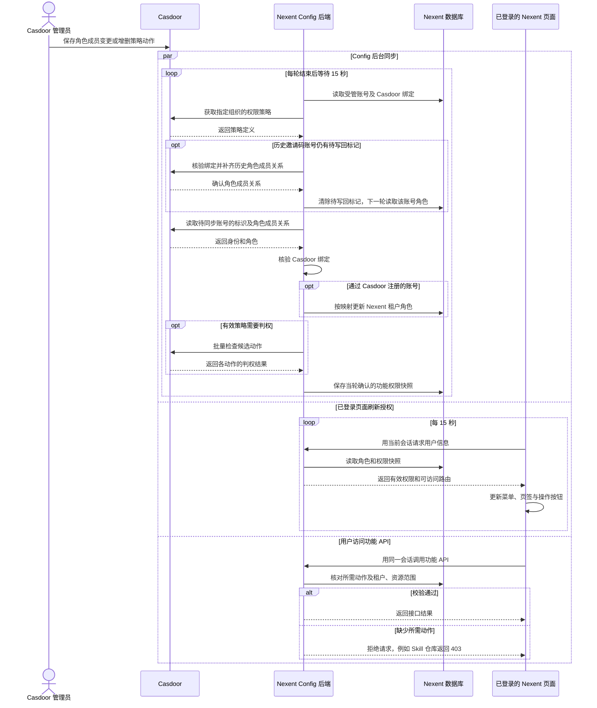

### 已接入的权限点

现有策略如何进入 Nexent 鉴权，以及新增受管动作需要修改哪些代码，见[第 10 节](#10-nexent-代码接入点与待改造清单)。

| Casdoor 资源 | 动作 | 控制范围 |
| --- | --- | --- |
| `nexent:skill-repository` | `skill.repository:read` | 浏览 Skill 仓库和已上架条目 |
| `nexent:skill-repository` | `skill.repository:install` | 安装已上架的 Skill。从仓库页面发起安装时，同时需要浏览权限 |
| `nexent:skill-repository` | `skill.repository:publish` | 提交、撤回和下架符合归属要求的 Skill |
| `nexent:skill-repository` | `skill.repository:review` | 查看待审核条目，通过或驳回同租户的申请 |
| `nexent:model` | `model:read`、`model:create`、`model:update`、`model:delete` | 读取、新增、修改、删除模型 |
| `nexent:model` | `menu:models` | 显示模型菜单，同时需要 `model:read` |
| `nexent:knowledge-base` | `kb.capacity:read`、`kb.capacity:manage` | 查看和管理已接入的知识库容量接口 |
| `nexent:tag-library` | `tag_library:manage` | 管理标签库 |
| `nexent:dreaming` | `dreaming:view_tenant`、`dreaming:edit_tenant` | 查看和编辑同租户其他用户的 Dreaming 配置 |

表中动作由 `nexent-feature-rbac` 判权。Nexent 仍兼容使用统一资源 `nexent` 的旧策略。本机已备份并删除 3 条停用的旧策略，日常编辑使用按资源分类的策略。Nexent 用 Casdoor 的权限记录和 Casbin 批量判权结果同步受管动作。[Casdoor Casbin API](https://casdoor.ai/docs/permission/exposed-casbin-apis/)

### 查找动作或给策略设置中文名称

日常编辑使用 `nexent-feature-rbac` 下的分类策略。可以给整条策略设置中文显示名称，例如「模型管理 · 删除模型」，动作仍填 `model:delete`。Casdoor 原生动作选择器使用动作键。若要在下拉框里按中文名称选择，需要扩展 Casdoor 的权限编辑页，保存时继续提交动作键。

`nexent-permission-catalog` 是早期用于查询动作与原始角色分配的目录模型。本机已备份并删除它的 31 条禁用目录策略。新增动作先按[代码接入步骤](#新增受-casdoor-管理的功能动作)挂到实际操作，再配置到生效模型。

### 分批切换原生知识库操作

这一批覆盖原生知识库的 `kb:create`（创建）、`kb:update`（修改基本信息、共享设置、自动摘要频率和嵌入模型）及 `kb:delete`（删除）。原有租户、资源访问和业务限制继续执行。文档、分块、外部知识库以及其他目录动作按各自的接口另行接入。

1. 在 Casdoor「权限」页创建或修改 `nexent-feature-rbac` 模型下的策略。资源类型选 `Custom`，资源填 `nexent:knowledge-base`，关联需要授权的角色，并添加对应动作。将策略启用并设为已批准。可以参考目录策略的角色分配；先核对每个角色应该保留哪些操作。
2. 在 Config 实际加载的环境文件中设置下列配置，再用包含本次代码的后端重启 Config。可以只选择本次准备切换的动作。配置留空时，新增动作继续走原有 Nexent 规则。

   ```dotenv
   CASDOOR_ADDITIONAL_MANAGED_ACTIONS=kb:create,kb:update,kb:delete
   ```

3. 保持受管账号登录，在 Casdoor 保存角色关联或动作列表的修改。等待 Config 和页面轮询后，用同一会话检查页面入口及对应 API。撤销后直接调用 API 会返回 `403`；配置了多条允许策略时，需要移除所有重叠授权。

本机 Casdoor 已预置 `nexent-knowledge-base-lifecycle` 策略。当前 Config 的 `CASDOOR_ADDITIONAL_MANAGED_ACTIONS` 为空，知识库创建、修改和删除继续按本地规则执行。需要切换某项操作时，先核对 Casdoor 策略，再把动作加入 Config 配置。

撤销某个角色的授权时，在 Casdoor 删除该动作。如果它是策略中的唯一动作，停用整条策略，并检查是否还有其他策略授予同一动作。要让某个分批接管的动作恢复本地鉴权，从 `CASDOOR_ADDITIONAL_MANAGED_ACTIONS` 移除该动作并重启 Config。

### 示例 · 让普通用户只浏览 Skill 仓库

1. 在 [Casdoor 权限页](http://localhost:18000/permissions) 创建普通用户的 Skill 仓库策略。模型选 `nexent-feature-rbac`，资源填 `nexent:skill-repository`，角色选 `nexent-user`，动作填 `skill.repository:read`，启用并批准后保存。
2. 用已分配 `nexent-user` 的账号保持登录，等待同步。仓库入口出现并可浏览，安装按钮仍需单独授予 `skill.repository:install` 才会显示。
3. 从所有生效策略移除 `skill.repository:read` 并保存。同步后，仓库浏览入口消失，原会话直接访问仓库列表接口会得到 `403`。同时拥有提交或审核权限的用户仍可访问对应页签。

### 示例 · 可以查看模型，添加模型时提示缺少权限

1. 在 Casdoor「权限」页打开 `nexent-feature-rbac` 模型下的「Nexent 租户管理员 · 模型」策略。资源为 `nexent:model`，关联角色为 `nexent-admin`。
2. 保留 `menu:models` 和 `model:read`，从该角色命中的所有生效策略中移除 `model:create`。等待授权同步后，用已纳入 Casdoor 功能权限接管的管理员账号打开 Nexent「模型配置」。
3. 在页面中发起新增模型相关操作。创建接口返回 `403`，页面提示 `Missing required permission: model:create`。需要恢复新增能力时，在生效策略中重新添加 `model:create`。

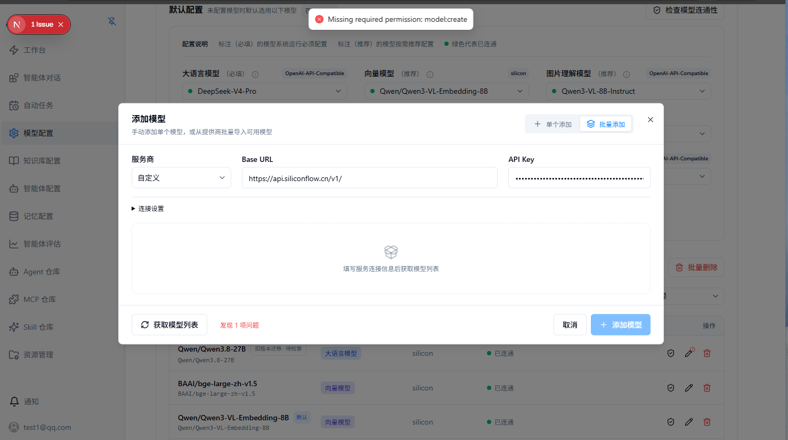

*图 15 · 模型菜单和模型读取已授权，新增模型操作缺少 `model:create`。*

## 7. 核对与排查

| 现象 | 先检查什么 |
| --- | --- |
| 访问 `8000` 显示 Kong 或其他服务 | 核对宿主机到容器的端口映射。本机 Casdoor 使用 `18000` |
| 管理员登录时报 `nexent-org/admin` 不存在 | 打开 [Casdoor 管理员登录页](http://localhost:18000/login/built-in)，在 `built-in` 组织登录 |
| Nexent 没有跳转到 Casdoor | 查看 `/api/user/oauth/config` 的 `login_mode` 和 `auto_login_provider`。如果是 `button`，从 Nexent 弹窗点击「Casdoor 登录」 |
| Casdoor 报回调地址不匹配 | 对比授权请求的 `redirect_uri` 和 Casdoor 应用的 Redirect URLs，核对协议、前端地址、端口和 `?provider=casdoor`。接入上游第三方时也要核对该平台登记的 Casdoor `/callback` |
| Casdoor 用户回到旧的资料补全页 | 核对 Config 是否更新到支持自动建号的版本，从 Nexent 重新发起登录。已有同邮箱账号要先完成显式绑定 |
| 登录页停留较久后报错 | Nexent 登录和注册的授权请求有效期为 30 分钟；超时后使用提示下的 Casdoor 登录按钮重新发起。简单刷新旧的 Casdoor URL 不会生成新的授权请求。若错误留在 Casdoor 页，检查 Casdoor 自身的验证码、会话或提供商错误 |
| 新用户提示邮箱或目标租户不可用 | 在 Casdoor 补齐有效邮箱，核对 `CASDOOR_SIGNUP_TENANT_ID` 或群组同步租户的 ID 与租户状态 |
| 在 Casdoor 换了角色，Nexent 角色没变 | 核对组织、角色映射、角色成员和账号来源。角色同步覆盖通过 Casdoor 注册的账号，已有 Nexent 账号绑定后仍在 Nexent 管理租户角色 |
| 删除动作后仍能操作 | 等待同步，核对账号是否已纳入 Casdoor 功能权限接管、其他生效策略是否仍授权。分别验证页面和直接 API 调用 |
| 能打开「模型配置」，添加时报 `model:create` 缺失 | 查看 `nexent:model` 的模型创建动作。菜单和读取分别由 `menu:models`、`model:read` 控制 |
| 群组或成员没同步 | 查看运行中的 `CASDOOR_GROUP_SYNC_TENANT_ID`、组织和群组迁移，确认目标成员绑定了该组织的 Casdoor 账号 |
| 后端提示 `group_permissions` 列不存在 | 核对 Config 实际连接的 PostgreSQL 和迁移记录，补跑 [`010` 多组授权迁移](../deploy/sql/migrations/v2.9.0_010_resource_group_permissions.sql)。群组层级字段由 [`009` 群组迁移](../deploy/sql/migrations/v2.9.0_009_casdoor_group_hierarchy.sql) 提供 |

**源码运行的版本核对。** 访问 Nexent 的 `/api/user/oauth/authorize?provider=casdoor&signup=true`，检查跳转响应中流程 Cookie 的 `Max-Age`（不要复制 Cookie 值）。本分支新版本为 `1800`；本机若仍为 `600`，表示请求还由旧 Config 处理。合并新版 `develop` 后，若数据库缺少 `nexent.sys_configuration_t`、账号的 `user_roles` 或邀请码的 `roles`，先备份并按[版本化迁移流程](#sql-迁移和-casdoor-api-各自执行什么)升级本机 Nexent 数据库，再切换到新版 Config。服务就绪后从 Nexent 首页重新发起授权，别继续使用升级前已打开的资料补全页。

## 8. 当前修改与验证

| 要验证的能力 | 验证方法 |
| --- | --- |
| OAuth 登录、注册和绑定 | 用无会话浏览器测试新账号直接进入首页、默认 `USER`、重复登录复用账号，以及旧授权提示重新登录。[认证流程代码](../backend/management/services/permission/identity/casdoor.py) |
| 角色和功能权限 | 保持原会话，修改 Casdoor 角色成员或策略动作，分别检查 Nexent 角色、菜单和 API。已有绑定账号也应检查，相同动作还可能由另一条生效策略授予。[功能权限 D2 用例](../test-e2e/cases/AUTH-CASDOOR-POLICY-D2-001/case.yaml) |
| 群组层级和直接成员 | 从 Casdoor 改一处群组关系，再从 Nexent 改一处成员关系，核对两边结果及原 Nexent 组 ID。[群组同步 D2 用例](../test-e2e/cases/AUTH-CASDOOR-GROUP-SYNC-D2-001/case.yaml) |
| 具体资源的多组共享 | 用仅属于只读组和可编辑组的两个账号，访问同一知识库或智能体，验证各自的读写能力。[资源授权 D2 用例](../test-e2e/cases/AUTH-RESOURCE-GROUP-PERMISSIONS-D2-001/case.yaml) |

本次验证（2026-11-19）：合并中的 `test_casdoor` 工作区通过 121 项后端定向测试和 6 项前端代理测试。现有无密码 D2 脚本的 3 项断言在一次性 PostgreSQL 容器通过，覆盖直接建号、重复登录、过期恢复和邮箱冲突；使用模拟 Casdoor 结果，测试库和容器已清理。真实 Casdoor 到 Nexent 的完整浏览器注册和登录未作为本次测试执行。

复制指南时，将 Markdown 和同目录下的 `assets/casdoor` 一起复制以保留配图。

### Casdoor 操作截图索引

| 操作 | 截图或步骤 |
| --- | --- |
| 注册、登录、重置密码 | [注册页](./assets/casdoor/casdoor-signup-page.jpg)、[登录页](./assets/casdoor/casdoor-login-page.jpg)、[找回密码页](./assets/casdoor/casdoor-password-reset.jpg) |
| 配置角色和权限 | [角色成员](./assets/casdoor/casdoor-role-members.jpg)、[权限资源和动作](./assets/casdoor/casdoor-permission.jpg) |
| 配置群组、关联用户与群组 | [新增群组](./assets/casdoor/casdoor-group-create.jpg)、[用户编辑页的群组字段](./assets/casdoor/casdoor-user-groups.jpg)、[群组树](./assets/casdoor/casdoor-group-tree.jpg) |
| 批量创建、删除用户 | 见下方用户列表实拍 |

**批量创建用户。** 在「用户管理 → 用户」点击「下载模板」，按原表头填写目标组织、用户名、邮箱等字段，再点击「上传 (.xlsx)」。先用小批测试，检查导入结果和是否更新了同名账号；角色仍在角色页分配。若发放临时密码，启用首次登录改密，并私下发放。[批量导入规则](https://casdoor.ai/docs/user/overview/#importing-users-from-xlsx)


**删除用户。** 进入目标组织的用户列表，核对账号后点击该行「删除」。下图仅打开确认框后取消，没有删除用户。Casdoor 禁用或删除后会终止该用户的 Casdoor 会话；Nexent 的会话和账号数据有独立生命周期。需要立即撤销 Nexent 访问时，也要按 Nexent 的账户停用和会话撤销流程处理。[Casdoor 禁用与删除](https://casdoor.ai/docs/user/overview/#forbid-or-delete-a-user)


## 9. 知识库和智能体的多组授权

在原生知识库的创建或编辑页、智能体的权限设置中，分别在「只读组」和「可编辑组」选择一个或多个同租户用户组。例如，组 1 和组 2 放入「只读组」，组 3 放入「可编辑组」。知识库列表按权限展示各自的组名，智能体的权限设置会分别显示两档配置。

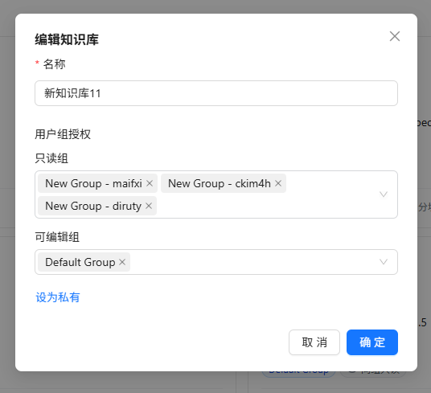

*图 16 · 编辑同一个知识库时，将三个业务组设为只读，将 `Default Group` 设为可编辑。若要取消组共享，点击「设为私有」后保存。*

用户同时属于多个获授权组时，按其中较高的权限判定。清空两档配置即取消组共享。资源创建者或有管理权限的用户可以修改共享规则。原有租户、资源归属、账号角色和数据源限制继续适用。Casdoor 同步组可像本地组一样选用。Casdoor 负责同步直接成员关系，具体资源的只读和编辑授权在 Nexent 配置。

已有的单档共享配置会显示在对应的权限行，修改共享配置后按组保存。智能体的最新共享配置适用于草稿和已发布版本。升级时需要应用[多组权限迁移](../deploy/sql/migrations/v2.9.0_010_resource_group_permissions.sql)，并使用更新后的前端和后端。

## 10. Nexent 代码接入点与待改造清单

### 在 Nexent 页面管理 Casdoor 用户和权限

Casdoor 管理台本身使用 HTTP API，可在[本机 Swagger](http://localhost:18000/swagger/)查当前版本的路由与请求格式。Nexent 已调用部分接口做角色、功能权限和群组同步；完整的 Casdoor 用户和策略管理界面需要新增 Nexent 后端接口及页面。[Casdoor REST API 与认证](https://casdoor.ai/docs/basic/public-api/)

| 管理能力 | Casdoor API 或操作方式 | Nexent 接入建议 |
| --- | --- | --- |
| 用户查询、创建、更新、停用、删除 | `get-users`、`get-user`、`add-user`、`update-user`、`delete-user`；批量导入请求以本机 Swagger 为准 | 第一阶段做同组织查询、建号、停用和批量预检；删除前处理 Nexent 会话、资源归属和审计 |
| 角色及成员 | `get-roles`、`get-role`、`add-role`、`update-role`。通过角色的成员列表更新关系 | 限定组织与允许管理的角色，防止自行提权或移除最后一个管理员；不把角色写进 `update-user` |
| 功能权限 | `get-permissions`、`add-permission`、`update-permission`、`delete-permission`；`batch-enforce` 验证判权 | 只开放 Nexent 已接入的动作、资源和业务模型；保存后显示同步结果 |
| 群组和成员 | `get-groups`、`add-group`、`update-group`，以及当前版本支持的成员接口；本项目目前通过用户群组字段更新成员 | 复用现有群组同步服务，保留父组约束、租户范围和 Nexent 原组 ID |

建议链路：**Nexent 管理页面 → Nexent Gateway → Management 管理接口 → Casdoor REST API**。Management 先验证操作者的管理权限和目标租户，再用服务端组织级凭证调用 Casdoor。密钥留在后端；禁止由页面直连 Casdoor 管理接口或提交任意组织名。批量任务用预检、逐条结果、重试和审计，避免重复建号；策略与角色由 Casdoor 管理，知识库和智能体的具体资源授权仍在 Nexent 保存和校验。[角色接口](https://casdoor.ai/docs/user/roles/) · [用户更新规则](https://casdoor.ai/docs/user/overview/#roles-and-permissions-extended-fields) · [Casbin 判权接口](https://casdoor.ai/docs/permission/exposed-casbin-apis/)

### 网关经过哪些 Casdoor 相关请求

| 请求 | 是否经过 Nexent Gateway |
| --- | --- |
| 浏览器打开 Casdoor 登录、注册、找回密码和管理台 | **不经过。** 浏览器访问 `CASDOOR_ENDPOINT` |
| 浏览器访问 Nexent OAuth `authorize`、`callback` | **接入网关时经过。** 网关按公开路由转发到 Management；用户还没有 Nexent 会话，回调仍由 Management 验证 state、PKCE 和授权码 |
| Management 用授权码换 Casdoor Token、读取用户信息，或定时同步角色、策略、群组 | **不经过。** Management 直接访问 `CASDOOR_BACKEND_ENDPOINT` |
| 登录后访问 Nexent 功能 API | **接入网关时经过。** Gateway 验证 Nexent 会话并将可信身份传给下游；Management 再做功能权限、租户和具体资源权限检查 |

Docker Compose 默认让前端的 `HTTP_BACKEND` 指向 `nexent-gateway:5013`；源码开发若指向 Config 的 `5010`，则直接访问 Config。Casdoor 回调仍登记浏览器可访问的 **Nexent 前端 URL**。Gateway 校验的是 Nexent 下发的会话，并不会在每个请求中重新调用 Casdoor。两种部署路径分别可参考[前端代理](../frontend/server.js)、[网关公开路由表](../backend/gateway/exposure/registry.json)和 [Compose](../deploy/docker/compose/docker-compose.yml)。

前三张时序图以已部署 Gateway 为前提，使用「创建模型」对比登录与鉴权。前两张的功能授权在 Management 执行，第三张展示方案二由 Gateway 在线调用 Casdoor 判权。方案一沿用第二张图的登录段和本地角色鉴权分支。第四张展示方案二如何扩展到 Nexent 代用户调用 AIDP API。 [方案一职责边界](#1-接入后可以实现什么)

#### 接入前：Nexent 本地登录与角色鉴权

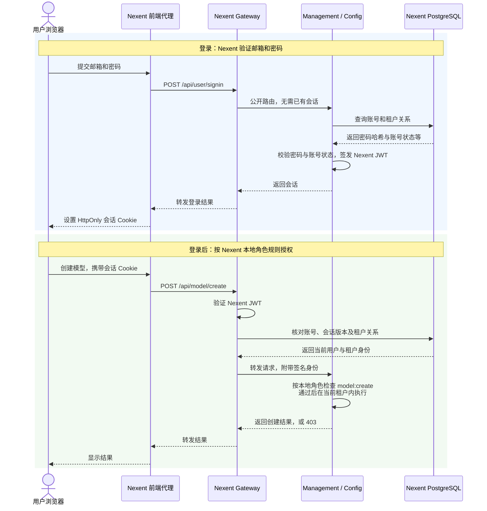

#### 接入后：Casdoor 登录与功能权限同步（备选方案）

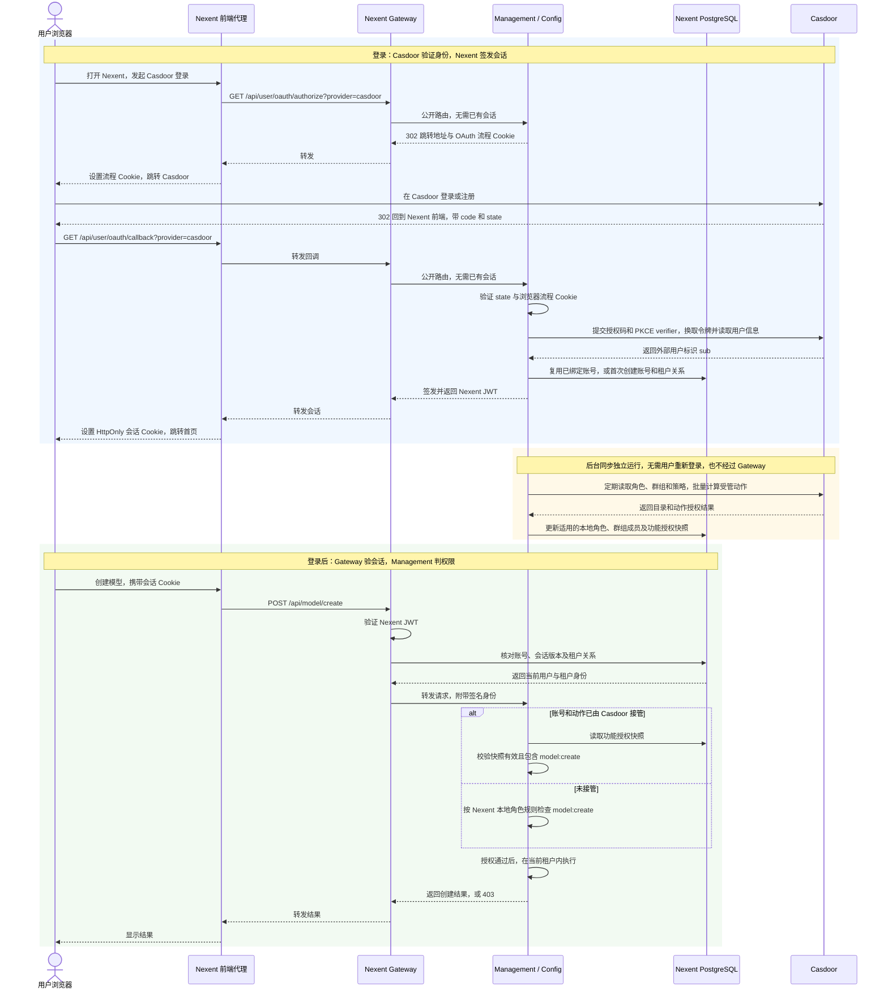

在备选的授权同步方案里，Casdoor 撤销 `model:create` 后，Management 会在下次成功同步并读取新快照时拒绝创建。当前方案一在 Nexent 调整授权。

#### 方案二：Casdoor 登录与 Gateway 在线判权

这是[方案二改造完成后](./casdoor-architecture-and-effort.md#方案二gateway-统一鉴权调用-casdoor-接口判权)的请求时序。登录仍由 Management 处理回调并签发 Nexent 会话；变化发生在登录后的业务请求：Gateway 在转发前在线查询 Casdoor。首批只接管已登记的功能动作，知识库和智能体的具体资源授权继续在 Nexent 执行。

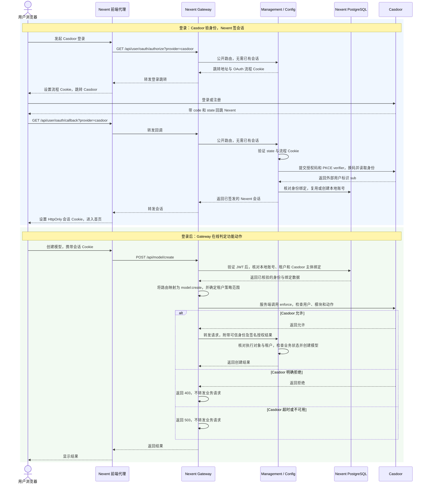

对于**单个知识库或智能体**，若已迁移实例权限，Gateway 还要从可信数据解析租户、资源类型和 ID，再检查例如 `nexent:tenant-7:kb:42` 的 `read` 或 `edit`。需要同时检查功能和实例权限时，两项都通过才允许。若实际对象是在智能体运行时才确定，由执行点调用统一鉴权入口补查；未迁移的实例继续按 Nexent 本地多组规则执行。[方案二的资源鉴权范围](./casdoor-architecture-and-effort.md#复杂请求的鉴权覆盖)

原有 GitHub、微信等若仍直连 Nexent，由 Config 与上游 OAuth 提供商交换授权码；迁至 Casdoor 后，改由 Casdoor 对接第三方。两条路径最后均由 Nexent 签发会话，登录后的 Gateway 链路相同。迁移操作见[第三方登录配置](#通过-casdoor-接入-qq微信和-github-登录)。

#### Nexent 代用户访问 AIDP API

这是方案二的扩展设计。Nexent 渲染页面，Nexent 和 AIDP 在同一 Casdoor 组织中各有独立的应用配置。以读取 AIDP 的 42 号知识库为例，浏览器请求使用 Nexent 会话，Nexent 后端通过 Token Exchange 换取面向 AIDP 的 Access Token。令牌的用户标识 `sub` 保持不变，受众 `aud` 设为 AIDP 的 Client ID。 [Casdoor Token Exchange](https://casdoor.ai/docs/how-to-connect/oauth/#token-exchange-grant)

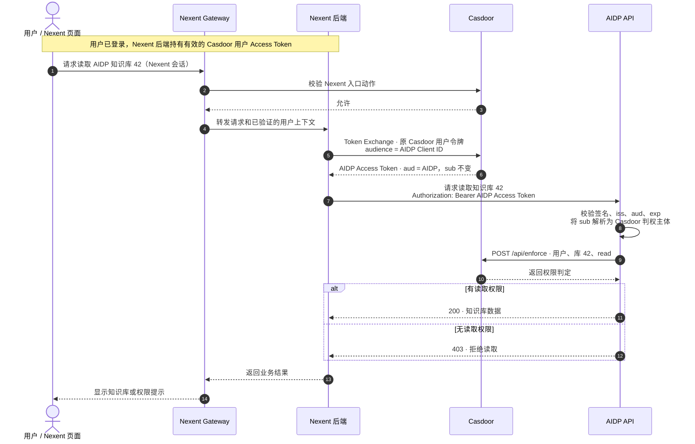

落地时，Nexent 需补服务端用户令牌管理和交换，AIDP 需补令牌验证和资源级在线判权。Gateway 的入口授权通过后，AIDP 仍按实际租户、知识库 ID 和操作判权。 [现有 Nexent 登录回调](../backend/management/services/permission/identity/casdoor.py) · [Casdoor 判权接口](https://casdoor.ai/docs/permission/exposed-casbin-apis/)

##### AIDP 改造（外部系统工作量）

这部分由 **AIDP 团队**负责。当前 Nexent 侧的知识库页面已接入 `/api/aidp-mgmt`，后端使用 `AIDP_API_KEY` 调用上游。下表按 Nexent 客户端实际调用的上游接口列出改造点，AIDP 团队需对照自身服务确认所有入口和兼容性。本次目标是 **Nexent 自己渲染页面，AIDP 承接用户身份和资源鉴权**。 [Nexent AIDP 管理接口](../backend/ext_components/aidp/apps/aidp_mgmt_app.py) · [上游 API 调用](../backend/ext_components/aidp/services/aidp_service.py)

| AIDP 改动 | 具体操作或接口 | 验收 |
| --- | --- | --- |
| 接收和验证 Casdoor 用户令牌 | 为受管 API 扩展认证中间件，从 `Authorization: Bearer` 读取 Access Token。配置可信签发方、签名公钥和 AIDP Client ID。使用实际交换出来的令牌验证签名、`iss`、`aud`、有效期和用户主体；联调签名密钥轮换及账号停用后的令牌失效策略。 | 只接受有效且面向 AIDP 的用户访问令牌。过期令牌、ID Token、面向其他应用的令牌和只代表应用的凭据均无法进入受管用户接口。 |
| 绑定用户并确定租户 | 使用可信 `(iss, sub)` 映射到已有 AIDP 用户。若业务接口需要本地用户记录，为存量绑定和符合准入条件的首次建号定义规则。管理 AIDP 租户和 Casdoor 组织或策略域的对应关系，以实际资源记录校验租户和资源归属。 | 同一用户在 Nexent 与 AIDP 能关联到同一 Casdoor 身份。改名后仍回到原 AIDP 账号，跨租户 ID 不会命中其他租户资源。 |
| 接入 Casdoor 在线判权 | AIDP 后端使用独立的服务端凭据调用 `POST /api/enforce`、`POST /api/batch-enforce`，将应用动作、资源 ID 和租户映射到专用模型。例如 `aidp:tenant-7:kb:42` 的 `read`。模型若使用 `组织/用户名`，应从已验证的组织和稳定 ID 解析主体。 | 同一个用户可读库 42、不可读库 43；只读用户调用修改接口被拒绝。权限变更后，已有 Nexent 会话的下一次在线检查使用新策略。 |
| 知识库列表、计数和详情 | 覆盖上游 `KnowledgeBases`、`KnowledgeBases/0/Count` 和 `KnowledgeBases/{kds_id}`。列表和计数先按可读范围过滤，再分页或计数；详情检查指定知识库。创建先检查租户级创建权限，更新和删除分别校验目标库对应动作。 | 列表、计数、详情一致；不给无权用户返回库名和数量；只读账号不能修改或删除。 |
| 文件和检索 | 覆盖 `KnowledgeFiles` 的列表、计数、下载、上传、删除，以及 `OcrAnnotate` 预览和 `Retrieval/FusionSearch`。先解析文件与知识库的归属；检索按实际参与的每个库校验，按既定契约过滤或拒绝。若返回签名下载链接，明确有效期内的撤权行为。 | 隐藏的库不能通过文件 ID、预览地址或检索接口读到；只读用户不能写入文件。 |
| 异步导入和重试 | 核对 `Channels`、`KnowledgeFiles/History`、`KnowledgeFiles/Retry` 和索引任务。提交及重试时按目标库鉴权，后台执行记录明确的用户或受限服务身份，按任务约定复核权限。 | 查看任务历史受读取权限制；撤销写权限后，后续发起的重试被拒绝。 |
| 存量权限迁移和旧凭据切换 | 盘点当前由 Nexent 保存的 AIDP 库组授权、AIDP 现有规则和实际资源归属，确认 Casdoor 接管的动作及唯一策略写入方。按租户导入并比对存量结果；分批切换用户入口。若保留旧 API Key 给机器任务，限制这些凭据能调用的接口和租户。 | 迁移前后授权差异可核对；受管用户接口不能通过旧 API Key 恢复已撤销的权限；切换失败可按租户恢复已验证的授权来源。 |
| 联调和运维 | 约定身份无效返回 `401`、权限不足返回 `403`、判权服务不可用按双方约定返回 `503`。日志记录主体、资源、动作、决策及链路 ID。测试密钥轮换、跨租户、撤权以及 Casdoor 超时。 | 用已登录的普通用户验证「列表只见授权库 → 可读指定库 → 写入被拒绝 → 撤销读权后再次调用被拒绝」，并覆盖无权请求直接打到 AIDP 的情况。 |

以上改造及联调单列为 [AIDP 外部系统工作量](./casdoor-architecture-and-effort.md#aidp-外部系统工作量)。Nexent 侧的用户令牌管理、交换和上游调用适配由 Nexent 团队负责。

### 同步设计：用户、角色、功能权限与用户组

> 本节记录备选的授权同步方案；只有 OAuth 建号与绑定部分也适用于当前方案。当前方案不启用角色、功能权限、群组及成员同步。

在授权同步方案中，Casdoor 管登录身份、角色成员、功能策略及同步组目录；Nexent 管本地用户 ID、租户、会话和具体资源的共享规则。两边各用自己的数据库。Config 通过 OAuth 回调、后台轮询或写入后回读更新本地数据。同步请求直接访问 Casdoor，部署 Gateway 时，用户登录后的业务请求经过 Gateway 并由下游服务鉴权。

| 对象 | 数据来源 | 同步方向和触发方式 |
| --- | --- | --- |
| 登录账号与绑定 | Casdoor 管认证；Nexent 管本地账号及租户 | Casdoor → Nexent：用户首次 OAuth 回调建号。Nexent → Casdoor：存量用户由管理员显式执行导入，平时没有双向账号同步任务。 |
| 角色和角色成员 | Casdoor 管自定义角色及其成员；Nexent 保留内置租户角色 | Casdoor → Nexent：Config 周期性更新已分配角色；只有符合条件的 Casdoor 注册账号会改写 Nexent 租户角色。 |
| 功能权限 | Casdoor 管已接入的动作；其他动作沿用 Nexent 本地规则 | Casdoor → Nexent：周期性判权并生成每用户的授权快照，前端和后端读取同一类结果。 |
| 群组、父子关系和直接成员 | 同步组以 Casdoor 目录为准；Nexent 保留本地组 ID | 从 Casdoor 修改靠轮询读回；从 Nexent 修改由 Config 先写 Casdoor，再读回更新本地。同步组只能在 Casdoor 删除。 |
| 具体资源的权限 | Nexent | 知识库和智能体保存「资源 → 本地组 ID → 只读/编辑」，结合最新已同步的直接成员鉴权。资源共享规则不会写到 Casdoor。 |

#### 用户：首次登录建号，停用和删除分别处理

| 操作 | 当前同步行为 |
| --- | --- |
| 在 Casdoor 注册、单独创建或批量创建用户 | 只创建 Casdoor 身份。用户通过 Nexent 首次完成 OAuth 回调时，才创建 Nexent 无密码账号、目标租户成员关系和 Casdoor 绑定，初始角色是 `USER`。账号已存在但尚未绑定时，不会因邮箱相同而自动合并。 |
| 在 Nexent 已有或新建本地账号 | 不自动创建 Casdoor 用户。存量导入脚本可创建或复用经核验的身份，并绑定到原 Nexent `user_id`，保留租户、角色和资源。脚本不复制本地密码。 |
| 在 Casdoor 修改密码、手机号、邮箱或用户名 | 修改密码和手机号不会写回 Nexent；Nexent 账号邮箱也不会随 Casdoor 邮箱变化自动修改。已绑定用户再次 OAuth 登录时，回调会刷新绑定记录中的用户名。若改了内部用户名，角色和功能轮询可能在此之前无法按旧名称读取该用户；群组匹配使用稳定身份标识。 |
| 在 Casdoor 停用或删除用户 | 不会级联删除 Nexent 账号或立刻撤销已签发的 Nexent 会话、API Key。角色任务对禁用或找不到的身份停止刷新；受管动作的旧快照到期后拒绝。远端已删除的成员在下一次成功目录对账后退出本地同步组；仅停用账号时，当前群组投影没有按禁用状态自动清退成员。 |
| 在 Nexent 删除或解绑用户 | 删除账号走本地清理：移除租户和本地组关系，软删除 OAuth 绑定，撤销本地 API Key，并禁用账号，使旧会话失效。不会代替管理员删除 Casdoor 用户。仅解绑则只处理绑定，Casdoor 注册的账号不能解绑其唯一登录方式。 |

身份绑定使用 `CASDOOR_ENDPOINT` 和 Casdoor `sub` 计算稳定键。登录后通过该键找回原用户；域名更换或删号重建使标识变化时，要先核对绑定并迁移，不能靠同名、同邮箱继承权限。[OAuth 建号与绑定](../backend/management/services/permission/identity/oauth.py) · [身份键](../backend/management/services/permission/identity/casdoor.py) · [Nexent 账号清理](../backend/management/services/permission/identity/users.py)

#### 角色：同步成员和角色名称，按需映射内置角色

| 操作 | 当前同步行为 |
| --- | --- |
| 在 Casdoor 创建角色 | 创建一个空角色不会改变现有用户。启用后把用户加入角色，Config 才会在该用户的角色快照中记录内部名称和显示名称。自定义角色可以关联已接入的功能策略，无须为每个角色改配置；要让它映射成 Nexent `DEV` 或 `ADMIN`，须配置 `CASDOOR_ROLE_MAP_JSON`。 |
| 修改角色显示名称或成员 | 显示名称更新到用户资料。角色映射使用内部名称；增加或移除成员后，适用用户按 `ADMIN` → `DEV` → `USER` 的顺序重新选择当前最高映射角色。同一用户仍在 `nexent-admin` 时，只加 `nexent-developer` 不会降权。 |
| 停用、删除角色或移除成员 | 在下一次成功读取的新角色列表中移除对应角色；仍有其他映射时取最高角色，无映射时目标为 `USER`。若会移除租户最后一位管理员，Nexent 会拦截；提升管理员也受租户额度限制。删除角色后还要核对该用户是否通过其他角色或策略保有动作。 |
| 在 Nexent 修改角色 | 修改的是 Nexent 的本地角色，不会反写 Casdoor 角色成员。通过 Casdoor 注册且受角色同步管理的账号，其 `USER`、`DEV`、`ADMIN` 映射结果可能在下一轮覆盖本地改动。迁移或后绑定的账号保留本地角色，但符合条件时仍可使用 Casdoor 的功能策略。 |

后台通过 `get-user` 核对组织、用户名与稳定 ID，并只处理具备有效绑定和单一有效租户关系、主角色为 `USER`、`DEV` 或 `ADMIN` 的记录。`SU` 和 `ASSET_OWNER` 继续由 Nexent 管理。普通首次登录只建本地 `USER`；存量导入和历史邀请码待回写是单独的角色写入路径。[角色同步](../backend/management/services/permission/identity/casdoor_roles.py) · [同步范围和本地角色写入](../backend/management/db/identity/casdoor_roles.py)

#### 功能权限：重新计算动作快照，撤权也要同步

| 操作 | 当前同步行为 |
| --- | --- |
| 新增功能权限策略 | 在 `CASDOOR_PERMISSION_MODEL` 指定的模型中，启用并批准 `Allow` 策略，配置正确的资源键、动作键和主体。Config 只计算 Nexent 已接入的动作；仅在目录里增加动作不会让新接口受到控制。 |
| 修改角色关联、资源或动作列表 | 下一轮从最新策略与成员关系重新判权。Config 对候选「用户、资源、动作」调用 Casdoor 的 [`batch-enforce`](https://casdoor.ai/docs/permission/exposed-casbin-apis/#batch-enforce)，把各项允许结果合并到当前用户的 `casdoor_feature_grants`。例如保留 `model:read`、删除 `model:create`，用户可以读模型，但创建接口会返回 `403`；模型菜单还需要 `menu:models`。 |
| 删除、停用或使策略过期 | 成功判权后，用当轮结果替换旧快照；即使没有任何允许动作，也会写入空集合。若另一条有效策略仍授予同一动作，权限仍在。当前同步仅接纳有效 `Allow` 策略，不靠新增 `Deny` 策略撤销其他策略的允许结果。 |
| 在 Nexent 调整资源共享或本地权限 | 只影响 Nexent 自己的规则。受管动作按当前 Casdoor 快照判断，同时保留接口原有的租户、资源归属和业务状态检查。 |

快照记录模型范围、绑定标识、角色和观测时间，校验不匹配、缺失或超过 60 秒时拒绝受管动作，不回退到本地角色放行。Casdoor 查询失败时不会把失败当成「没有策略」写入空快照；未过期的旧结果可能短暂继续使用。[策略读取与判权](../backend/management/services/permission/identity/casdoor_feature_sync.py) · [快照校验](../backend/permissions/casdoor_policy.py) · [API 权限依赖](../backend/permissions/depends.py)

#### 用户组：Casdoor 保存目录，Nexent 保留组 ID

| 操作 | 当前同步行为 |
| --- | --- |
| 在 Casdoor 新建组，或在 Nexent 为同步租户新建组 | Casdoor 新组在下轮对账时创建本地映射；Nexent 新建先调用 Casdoor `add-group`，回读确认后才保存并返回本地组 ID。原有本地业务组应通过导入脚本建立映射，以保留已有共享引用。系统默认组仍留在 Nexent。 |
| 修改组显示名称、描述或父组 | Casdoor 变更在下轮投影；Nexent 变更先更新远端再回读。显示名称变化保留本地组 ID。父组必须来自同一组织，并通过层级校验，不能成环；不因父子关系自动继承资源权限。 |
| 添加、移除或替换成员 | Casdoor 从用户的直接 `groups` 读取；在 Nexent 修改时，Config 更新 Casdoor 对应用户的直接群组字段，再回读核对本地成员结果。只映射到同一 Nexent 租户内有有效绑定的用户；替换成员不会移除该用户在 Casdoor 的其他群组。 |
| 禁用、删除或重建组 | 禁用组仍保留目录记录，但成功对账后不再投影其成员。同步组在 Casdoor 删除；校验通过的目录中缺少该组时，Nexent 软删除本地组及成员关系，并按远端结果更新层级。删除和同名重建会产生新的映射，旧资源授权不会自动转到新组。删除前先检查知识库和智能体的共享引用，并处理子组。 |

群组由 Casdoor 实例地址、组织、内部组名及创建时间共同识别；成员通过稳定身份绑定匹配。每次应用完整目录前会检查返回结构和父子关系，并使用 Nexent 租户组锁协调本地写入。这个锁不会锁住 Casdoor 管理台。远端已写入但回读失败时，本地会保留上次确认的目录并重试；批量改成员可能只完成一部分，重试前应先刷新两边状态。[群组与成员读写](../backend/management/services/permission/identity/casdoor_groups.py) · [本地群组投影](../backend/management/db/identity/casdoor_groups.py) · [资源组授权](../backend/permissions/group_sharing.py)

#### 生效时间和验证方法

- **登录建号**：OAuth 回调成功时完成；角色、权限和组成员分别在各自下一轮成功同步后更新。
- **角色、功能和群组**：后台任务每轮结束后等待约 15 秒，已登录页面的授权信息另有约 15 秒刷新。实际延迟包括本轮耗时和页面刷新；功能快照的 60 秒有效期不适用于会话、角色显示或组成员。
- **变更验收**：用同一个已登录账号，依次添加、移除角色成员和 `model:create`，观察 Nexent 用户信息与真实创建接口；再把用户加入知识库只读组、切到可编辑组并移出两组，分别实测读取与编辑。对账号停用单独验证新登录、旧会话和 API Key，不能用界面变更代替会话撤销验证。

若上线要求用户停用后立即在 Nexent 失效，需要另建账号生命周期同步，验证远端事件并用周期对账兜底，再按原 `user_id` 执行本地停用和会话撤销。设计和回退要求见[统一登录策略和全量范围](#统一登录策略和全量范围)。

### 新增受 Casdoor 管理的功能动作

1. **定义可同步的动作。** 在 [`casdoor_policy.py`](../backend/permissions/casdoor_policy.py) 的 `STAGED_ACTION_RESOURCES` 中登记待分批启用的资源键和动作键。已有目录项可复用原动作键。通过 `CASDOOR_ADDITIONAL_MANAGED_ACTIONS` 启用已接入的动作。
2. **接入实际操作。** 通用接口复用 `Depends(require("资源:动作"))`，有复杂业务限制的服务在实际读写前调用 `permission_override()`。其中 `None` 表示继续执行原有本地规则，`False` 表示拒绝受管动作。逐一核对能执行同一操作的入口，避免列表受控但详情或直接调用仍可绕过。
3. **统一页面展示。** 用户信息接口沿用快照覆盖本地动作。新增受管菜单时，同时检查 `overlay_user_permissions()` 的路由生成和前端按钮、页签所用的权限键，保证与后端判权一致。
4. **配置并验证。** 在生效模型下给目标角色配置该资源和动作。使用同一个已登录账号验证添加动作后可以调用接口，删除后接口返回 `403`。同时验证目录策略、错误资源键或其他租户的授权不会放行。

## 11. Casdoor 的大语言模型 AI

Casdoor 的「大语言模型 AI」菜单用于管理 AI 智能体的身份、MCP 工具访问及调用记录。当前菜单包含「智能体」「MCP 服务器」「MCP 商店」「条目」「站点」和「规则」。智能体有自己的身份，MCP 网关可以核验用户和客户端，并决定要不要把工具调用转发到上游 MCP 服务。「条目」也可以接收 OpenClaw 通过 OpenTelemetry 上报的记录。「站点」和「规则」用于管理反向代理及流量规则。[Casdoor 功能概览](https://casdoor.ai/docs/overview/) · [OpenClaw 接入](https://casdoor.ai/docs/llm/openclaw/) · [站点配置](https://casdoor.ai/docs/site/overview/)

在当前集成中，Nexent 负责调用配置好的大模型，Casdoor 通过 OAuth 和 Casbin 提供用户登录及页面、接口功能授权。MCP 网关是可选接入项。客户端把工具请求发给网关后，才会应用这里配置的工具访问规则。[Casdoor MCP 网关](https://casdoor.ai/docs/how-to-connect/mcp/gateway/)

### 示例 · 让智能体只读查询知识库

假设已有一个 Casdoor 能访问的 Streamable HTTP MCP 服务，提供 `search_kb`（查询知识库）和 `delete_document`（删除文档）。用独立的示例组织 `mcp-demo` 和一个普通成员账号验证。

1. 在示例组织启用「使用组织签发者」和动态客户端注册。创建应用 `app-kb-tools`，在 Casdoor「权限」页为它配置资源类型 `Application`、动作 `Read` 和效果 `Allow`，关联允许访问该服务的组或角色。[组织和应用配置](https://casdoor.ai/docs/how-to-connect/mcp/gateway/#step-1-prepare-the-organization)
2. 在「大语言模型 AI → MCP 服务器」新增 `kb-tools`，填写上游 MCP 服务地址，关联 `app-kb-tools`。保存并同步工具列表，允许 `search_kb`，禁用 `delete_document` 后再次保存。[注册 MCP 服务器](https://casdoor.ai/docs/how-to-connect/mcp/gateway/#step-3-register-the-mcp-server)
3. 复制页面显示的网关 Base URL，例如 `https://auth.example.com/api/server/mcp-demo/kb-tools`。将这个地址配置到支持该 OAuth 流程的 MCP 客户端，再用有权限的账号登录。[连接 MCP 客户端](https://casdoor.ai/docs/how-to-connect/mcp/gateway/#step-5-connect-the-clients)
4. 对智能体说「查一下最新的报销制度」，确认它能调用 `search_kb` 并返回搜索结果。再用测试客户端尝试调用 `delete_document`，确认网关返回工具调用错误，并且上游没有收到这次删除请求。[网关访问检查](https://casdoor.ai/docs/how-to-connect/mcp/gateway/)

本示例演示工具级授权。如果要按用户组限制某个具体知识库可读、可编辑，还应由上游服务执行对应的资源权限检查。Nexent 的配置见[知识库和智能体的多组授权](#9-知识库和智能体的多组授权)。

## 12. 三种身份管理方案对比

**当前选型是 Casdoor 托管认证、Nexent 本地授权。** 下表保留早期三个方案的逐项估算，其中 B、C 的授权部分属于历史备选。当前选型的工作量以[下方对比图](#企业身份与权限能力明细)为准。

**A. Nexent 原生**：只使用 Nexent 的账号、认证和授权。**B. Casdoor 托管**：使用 Casdoor 的登录页和管理台。**C. Casdoor + Nexent 自建管理页**：登录、注册和找回密码仍使用 Casdoor 托管页；管理员在 Nexent 页面操作，由 Nexent 后端调用 Casdoor API。

工作量按**当前分支已有能力到目标能力的增量**估算，三列用同一标准。**✓ 无需改动**表示直接复用该方案已有的代码或页面；如果仍要开通部署配置，会单列。**低**为配置或小范围改动和验证；**中**为新增或修改一项页面、接口或工作流及配套测试；**高**为跨页面、服务或数据的实现，需要联调、迁移、安全测试或恢复演练。等级用于方案比较，不等同于工期承诺。

| 工作项与差异点 | A. Nexent 原生 | B. Casdoor 托管 | C. Casdoor + Nexent 自建管理页 |
| --- | --- | --- | --- |
| 基础注册、邮箱密码登录、Nexent 会话 | **✓ 无需改动**：复用现有邮箱密码、邀请码注册及 Nexent 会话。 | **低**：配置 Casdoor 应用、回调、目标租户和登录入口；复用现有 OAuth 及无邀请码建号流程。 | **低**：同 B，配置后直接使用 Casdoor 登录、注册页；Nexent 管理页不收集登录凭据。 |
| 邮箱和手机号验证、验证码登录 | **高**：补手机号绑定和唯一性校验，接邮件及短信通道，实现验证码签发、限流、重发、过期与一次性消费，改造注册及登录页。 | **低**：配置 Email、SMS 提供商、模板和应用验证规则，联调注册及验证码登录。 | **低**：同 B，用户继续在托管页收发与提交验证码，无须新增 Nexent 验证码接口。 |
| 接入 QQ、微信、GitHub 等第三方登录 | **中**：复用已有 GitHub、微信直连能力；新增未接入的提供商，例如 QQ，需要适配授权、回调、身份绑定及测试，并分别维护应用凭证。 | **低**：在第三方平台登记 Casdoor 回调，配置已支持的提供商及应用入口，逐家验收。 | **低**：同 B，在 Casdoor 配置第三方提供商，Nexent 登录链路复用已有回调。 |
| 用户已登录时修改密码 | **✓ 无需改动**：当前分支保留个人信息里的本地改密页面和接口，仅适用于启用了 Nexent 本地密码的账号，且必须知道旧密码。 | **✓ 无需改动**：使用 Casdoor 自带改密功能；Casdoor 专用账号不设 Nexent 密码。 | **✓ 无需改动**：复用 Casdoor 改密入口，Nexent 管理页不处理用户密码。 |
| 用户忘记密码后自助找回 | **高**：在发送通道之上新增找回页面、身份核验、一次性重置凭据、重设密码及旧会话撤销。 | **低**：启用 Casdoor 找回入口和对应发送规则，验证邮件或短信通道及重设流程。 | **低**：同 B，配置并复用 Casdoor 找回页。 |
| 管理员批量创建用户 | **高**：新增导入页面和批量接口，补模板、预检、重复检测、租户和角色校验、初始凭据交付及部分失败处理。 | **✓ 无需改动**：使用 Casdoor 管理台的 XLSX 导入；这些用户在首次登录后进入 Nexent。 | **高**：自建导入页面和后台批任务，在 Casdoor API 之上实现预检、逐条结果、重试和审计。 |
| 管理员重置用户密码 | **中**：新增管理员重置入口和后端接口，校验目标租户、记录审计，并处理临时凭据和旧会话。 | **✓ 无需改动**：使用 Casdoor 用户管理操作；Nexent 会话联动单列。 | **中**：新增管理入口和后端 API 封装，校验操作者与目标用户，记录审计并处理重置结果。 |
| 管理员删除用户 | **✓ 无需改动**：复用 Nexent 的用户删除、绑定清理和业务数据处理。 | **✓ 无需改动**：Casdoor 身份在其管理台处理，Nexent 业务账号在 Nexent 处理；跨系统联动单列。 | **中**：在 Nexent 增加 Casdoor 账号删除入口，封装远端调用、目标确认及审计；跨系统联动单列。 |
| 跨系统停用、删除与撤销旧会话 | **✓ 无需改动**：只有 Nexent 一套账号和会话，复用本地账号禁用及会话失效机制。 | **高**：补账号状态同步或事件加对账，联动 Nexent 停用、会话撤销和 API Key 处理；验证故障和恢复。 | **高**：同 B；自建页还要显示两侧状态、部分失败结果及重试入口。 |
| 修改用户角色和角色成员 | **✓ 无需改动**：复用 Nexent 内置租户角色的分配。 | **低**：配置 Nexent 角色映射和同步，使用 Casdoor 角色页更新成员；存量绑定账号的本地角色仍按现有边界管理。 | **中**：新增角色和成员管理界面及后端接口，校验租户、可授角色和管理员限制；底层复用角色同步。 |
| 自定义角色下的功能动作，可新增或撤销 | **高**：新增可编辑的角色、动作目录和策略存储，提供管理页面及接口，接入菜单和后端判权，验收撤权效果。 | **低**：在 Casdoor 配置角色、策略和已接入的动作，复用 Nexent 快照鉴权。未接入的动作若纳入范围，仍需逐项改 Nexent 接口。 | **高**：在 B 的基础上自建策略编辑页、动作选择、授权边界校验、审计和生效反馈；可复用 Casdoor 判权和已有动作接入。 |
| 父子组、直接成员与可展开的组织树 | **中**：现有组、父组字段及成员管理可复用；补可展开树、按组查用户及换父组后的交互。 | **低**：使用 Casdoor [组织树](https://casdoor.ai/docs/organization/organization-tree/)；配置组织与 Nexent 租户映射、验证现有群组及成员同步。 | **中**：复用现有 Nexent 组和成员编辑能力，补树形浏览、成员查询及同步错误反馈。 |
| 同一知识库或智能体为不同组配置只读、编辑或私有 | **✓ 无需改动**：复用现有多组授权，私有表示取消组共享。 | **✓ 无需改动**：复用 Nexent 多组授权，直接选择已同步的组；具体资源规则仍在 Nexent。 | **✓ 无需改动**：保留现有资源权限页面和鉴权；组目录改由自建管理页维护，不重做资源权限。 |
| 存量账号切换、部署和运维 | **✓ 无需改动**：继续使用现有 Nexent 账号、组 ID 和部署，无跨系统迁移。 | **高**：部署并备份 Casdoor，迁移账号（含 `SU`）和组，验证历史资源访问、会话及旧入口关闭，监控同步并演练回退。 | **高**：同 B，还需维护 Nexent 管理页、后端凭证和 Casdoor API 版本兼容，并覆盖管理操作回归。 |

### 企业身份与权限能力明细

对比以同等企业能力为目标。图的上半部分对比身份侧的增量工作，下半部分列出两种方案都留在 Nexent 的业务管理工作。工作量从现有功能估算，可复用的能力不重复计入。

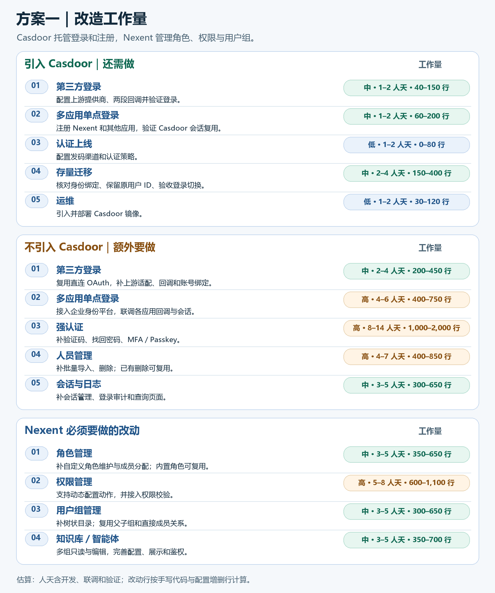

当前方案的完整交付中，知识库／智能体的多组只读与编辑按**中**等工作量估算，涵盖配置、展示和鉴权。上表的「无需改动」仅表示可沿用已有的多组授权规则。

| 功能点 | 引入 Casdoor 后还需做 | 不引入 Casdoor 的额外工作 |
| --- | --- | --- |
| 多应用单点登录 | 在 Casdoor 注册各应用，联调回调和会话。 | **高**：对接已有企业 IdP；没有 IdP 时，需补统一身份服务、客户端和密钥管理。 |
| 企业第三方登录（Link App、Uniportal） | 在 Casdoor 配置提供商和上游回调，核验接口兼容性。 | **中**：逐个适配未接入的身份源、回调和身份字段；已支持的直连可复用。 |
| 邮箱、手机号验证与验证码登录 | 配置发送渠道和验证规则。 | **高**：补绑定验证、发码和登录页面、验证码失效和限流。 |
| 忘记密码、自助找回 | 配置验证渠道，联调托管页与恢复流程。 | **高**：补找回页、一次性恢复凭据和重置后的会话处理。 |
| TOTP、Passkey 等强认证 | 在 Casdoor 启用并验证注册、登录和恢复。 | **高**：补注册、挑战验证、凭据管理和恢复。 |
| 入职建号、批量导入、用户删除 | 身份在 Casdoor 管理；Nexent 首次登录建号，存量需绑定。离职时仍要处理 Nexent 会话与资源。 | **高**：批量建号仍需补预检、去重和失败重试；已有本地删除可复用。 |
| 会话管理和登录日志 | 使用 Casdoor 身份侧记录；Nexent 保留业务会话，补停用后的本地撤销。 | **中**：按需新增会话与登录日志查询页面，补缺失记录。 |
| 角色、权限、树状用户组 | **Nexent 自建**：补角色管理页、权限管理页和树状用户组管理；动态动作仍需接入后端鉴权。 | **同左**：复用现有内置角色、父组字段、成员管理和资源多组授权。 |

**当前方案的取舍**：复用 Casdoor 的登录、验证码、找回密码和身份管理；Nexent 继续扩展业务授权。无需为角色、功能权限和用户组建立双向同步，但仍要完成存量身份绑定、旧登录入口收口和离职撤权联动。

能力与改造边界可对照[同步设计](#同步设计用户角色功能权限与用户组)、[上线全量切换](#13-上线全量切换与安装初始化)、[Casdoor 登录方式](https://casdoor.ai/docs/application/signin-methods/)、[用户管理与 XLSX 导入](https://casdoor.ai/docs/user/overview/#importing-users-from-xlsx)和[管理 API](https://casdoor.ai/docs/basic/public-api/)。

## 13. 上线全量切换与安装初始化

> 当前方案只迁移登录身份及绑定，保留原 Nexent 用户 ID、租户、角色、组 ID 和资源授权。下文的 Casdoor 角色、策略、群组导入与同步步骤仅供备选模式参考；现有包含业务组的导入脚本不能直接作为纯身份迁移步骤。

### 当前实现与上线目标

全量切换要同时完成身份迁移、登录入口切换和后端登录策略切换。推荐让安装程序统一调用 PostgreSQL 迁移和 Casdoor 管理 API，在切流量前完成数据核验和权限预热。SQL 承担 Nexent 内部结构和迁移进度，Casdoor 对象通过其初始化文件或管理 API 创建。

本节给出安装自动化的设计方案。现有 [导入脚本](../scripts/import_nexent_to_casdoor.py) 可以迁移单租户的部分存量账号和业务组。仓库尚需补充一体化安装任务、全量账号覆盖、旧登录入口的统一后端限制，以及切换前的权限预热与完成判定。

| 当前代码行为 | 上线时要补齐的能力 |
| --- | --- |
| `OAUTH_LOGIN_MODE=force` 自动跳转到 Casdoor | 为本地密码登录、注册、密码修改和找回、其他直连提供方及解绑入口执行统一后端规则 |
| 导入脚本生成独立临时密码，要求首次改密 | 按密码格式选择迁移方案，明确哪些用户能继续用原密码，哪些要激活账号 |
| 角色和功能权限同步覆盖 `USER`、`DEV`、`ADMIN`，并要求单一有效租户关系 | 为已有 `SU` 导入 Casdoor 登录身份并校验原角色。资产管理员、多租户用户、历史第三方账号和机器账号按各自路径迁移 |
| 群组同步配置指定一个组织和一个租户 | 全租户部署需要可遍历的租户与组织映射，以及按映射运行的同步任务 |
| 生效模型只接管已经接入的动作 | 核对上线需要保留的每个菜单和 API，标明仍由 Nexent 判断的功能 |
| 通用就绪检查反映进程和工作线程状态 | 安装程序另行核对用户、绑定、组、策略和有效权限，全部满足后才宣布切换完成 |

本节依据当前 [账号导入](../scripts/import_nexent_to_casdoor.py)、[功能权限判定](../backend/permissions/casdoor_policy.py)、[角色及账号筛选](../backend/management/db/identity/casdoor_roles.py)、[登录接口](../backend/management/api/identity/user_management.py)和[就绪检查](../backend/management/utils/health.py)整理。

### 除账号、群组、角色和权限外还要初始化什么

| 对象或规则 | 初始化内容 | 完成判定 |
| --- | --- | --- |
| Casdoor 服务和数据 | 固定经过验证的镜像版本，配置持久化数据库、备份与恢复，确定正式访问域名、HTTPS 和反向代理 | 重建容器后账号、应用和用户 ID 保持一致，浏览器与 Config 都可访问 |
| 管理入口与安装凭证 | 配置 `built-in` 管理账号，安装任务使用能够管理目标组织的凭证；凭证写入部署的秘密配置 | 安装任务能读取和核对目标对象，普通业务用户按业务角色授权 |
| 组织和业务应用 | 初始化正式组织、应用、签名证书配置、Authorization Code、Nexent Redirect URLs、注册字段、登录方式和品牌 | 授权请求中的 Client ID、回调、PKCE 和最终 UserInfo 可用于真实登录 |
| Nexent 环境 | 渲染 Casdoor 两端地址、应用凭证、回调、角色映射、模型及群组映射，沿用现有会话签名配置 | 各副本读取相同目标配置，Config 的公开 OAuth 响应与预期一致 |
| 本地数据库版本 | 先完成历史账号迁移，再运行应用 SQL，确认账号绑定、群组层级及资源多组授权字段 | 迁移记录和实际列一致，Config 列表查询成功 |
| 凭证与身份合并 | 迁移兼容的密码哈希，或安排激活；保留用户名与不可变身份映射，解决同邮箱、同名及已删除绑定冲突 | 用户通过 Casdoor 登录后进入原 Nexent 用户及原租户 |
| 账号生命周期 | 同步禁用、删除、改名等状态，明确 Casdoor 停用用户时 Nexent 会话和访问凭据何时撤销 | 已停用用户在约定时限内无法继续访问受保护业务 |
| 注册和恢复 | 配置 Casdoor 自助注册策略、Nexent 新用户目标租户、管理员额度、找回密码和首次激活渠道 | 新注册不要求 Nexent 邀请码，找回密码可用，权限与租户归属正确 |
| 会话与退出 | 配置 Cookie、反向代理地址和 TLS，确定退出 Nexent 是否连带退出 Casdoor | 登录回跳正常；单点登录、退出、会话过期行为符合部署要求 |
| 第三方入口 | 在 Casdoor 配置真实的 QQ、微信、GitHub 提供商及凭证；成功验证后移除占位入口 | 三方授权回到同一 Casdoor 身份，再返回原 Nexent 账号 |
| 同步与运行 | 开启角色、功能权限和群组同步，记录失败、重试和快照新鲜度 | 角色、动作及成员变动可在约定时间内收敛 |

正式的 `CASDOOR_ENDPOINT` 应在迁移前确定。当前绑定键由 `SHA256(CASDOOR_ENDPOINT + NUL + Casdoor 用户 ID)` 生成，群组映射范围也包含该地址。域名变化、重新创建 Casdoor 用户或更换数据库都要验证并迁移原映射。已有 Nexent 用户 ID、租户 ID、组 ID 和资源归属继续作为迁移锚点。[身份绑定代码](../backend/management/services/permission/identity/casdoor.py) · [群组映射代码](../backend/management/services/permission/identity/casdoor_groups.py)

### 用户无感迁移的前提

安装程序可以免去用户逐个手动绑定，但原密码能否继续使用取决于哈希兼容性。Nexent 新密码使用带参数、盐和摘要的 `scrypt` 编码，历史导入可能保留 `bcrypt`。先按实际数据分类，再验证目标 Casdoor 版本能否导入并正确校验。Casdoor 官方给出了携带 `passwordType=bcrypt` 导入已加密密码的方式。Nexent 的自定义 scrypt 编码需要单独验证和适配，同名算法之间也要核对参数及编码格式。[Nexent 密码实现](../backend/infrastructure/security/passwords.py) · [Casdoor 密码哈希导入](https://casdoor.ai/docs/user/overview/#bypassing-password-encryption-on-import)

| 凭证类型 | 可采用的路径 | 用户体验 |
| --- | --- | --- |
| 已验证兼容的密码哈希 | 一次性通过 Casdoor API 导入哈希和对应密码类型，保留用户原用户名或邮箱 | 用户在 Casdoor 用原密码登录 |
| 当前 Casdoor 无法直接识别的哈希 | 为目标版本增加兼容校验并验证，或实现过渡期凭证校验及迁移；也可选择激活或重设密码 | 兼容校验方案可继续使用原密码；激活方案会有一次用户操作 |
| 历史 QQ、微信、GitHub 等身份 | 核对原平台应用及稳定身份，将同一第三方身份映射到 Casdoor 用户，必要时重新授权 | 用户通过原第三方身份登录，具体授权步骤由平台会话决定 |
| 原有 Nexent 会话 | 保留签名密钥、发行者及用户标识，切换前确定现有会话能否自然到期 | 可以保留已登录状态；要求统一重新认证时，用户会经历一次登录 |

密码哈希无法还原成原密码。既有脚本的临时密码方案会触发首次改密，因此安装自动化应明确选择凭证策略。迁移后首次浏览器登录仍会经过 Casdoor，能否免输入取决于用户是否已有 Casdoor 或上游平台会话。

自动关联以已核验的 `Nexent user_id ↔ Casdoor 用户 ID` 为依据。远端已有同邮箱账号时，安装任务记录冲突并核对来源后处理，防止把原用户的资源绑定到另一身份。未完成身份映射的存量账号应纳入迁移待办，避免在首次登录时被创建为新用户。

### SQL 迁移和 Casdoor API 各自执行什么

| 工作 | 建议执行方式 | 幂等依据 |
| --- | --- | --- |
| Nexent 账号、绑定、群组和共享字段升级 | 新增版本化 SQL，交给现有迁移执行器 | 版本、校验和及数据库锁，配合幂等 DDL |
| 历史 Supabase 凭证迁入 Nexent | 先调用现有历史账号迁移程序，再运行账号 SQL | 复用该迁移程序的事务和完成判定 |
| Casdoor 组织、应用、角色、模型和首次策略 | Casdoor 初始化数据文件，后续由安装任务按 API 核对 | 组织及内部名称、种子版本和字段归属 |
| Casdoor 用户、群组及成员关系 | 调用 Casdoor 管理 API，成功后回读稳定身份和实际值 | 持久化的源对象与目标对象映射 |
| Nexent OAuth 绑定和组 ID 关联 | 远端身份确认后，在 Nexent 事务内写入 | 对现有记录先比对，再插入或恢复正确记录 |
| 初始化状态、分批进度、失败原因 | 新增 Nexent 内部进度表或持久化任务状态 | 目标实例、租户、任务版本和源对象键 |
| 环境配置和最终切流量 | 安装器渲染部署秘密配置并重载服务 | 有效配置摘要、验收结果和切换状态 |

PostgreSQL 事务覆盖 Nexent 数据，Casdoor API 请求还会触发其对象校验、密码处理及关联更新。将远端请求放进 SQL 迁移会把网络故障、凭证和另一个服务的版本耦合进数据库升级。跨服务初始化交给可重试的安装任务，SQL 提供本地结构和进度记录。

现有 SQL 启动入口为 [`start-backend.sh`](../deploy/common/start-backend.sh)，执行器为 [`run-sql-migrations.sh`](../deploy/common/run-sql-migrations.sh)。它们支持 `NEXENT_SQL_STARTUP_MODE=migrate` 和 `wait`，使用 `nexent.schema_migrations` 记录迁移并以 PostgreSQL advisory lock 串行执行。新增修改使用新的版本化文件。直接源码启动 Config 时，安装器也要明确调用迁移步骤。

历史账号仍在 Supabase 的环境，需要按现有[历史账号迁移指南](../deploy/sql/tools/supabase_to_postgres/README.md)先把凭证迁入 Nexent。提前单独运行账号建表 SQL 可能触发旧迁移的完成判定，导致凭证导入被跳过。群组层级和多组共享分别由 [`009`](../deploy/sql/migrations/v2.9.0_009_casdoor_group_hierarchy.sql) 和 [`010`](../deploy/sql/migrations/v2.9.0_010_resource_group_permissions.sql) 提供。

Casdoor 新实例可以挂载固定版本的 `init_data.json` 创建组织、应用、角色和模型，选择 `initDataNewOnly=true` 保留已存在对象。后续对象升级按任务版本通过 API 比对。官方当前还提供 `initDataMerge`，使用前需核对所固定镜像是否支持及其覆盖语义。应用密钥和初始化密码按部署秘密管理，普通重启继续复用已有值。[Casdoor 数据初始化](https://casdoor.ai/docs/deployment/data-initialization/)

`initDataNewOnly` 会重新创建文件中仍声明但数据库已删除的对象。日常需要人工编辑或删除的权限种子，应由一次性任务执行并记录版本，或在首轮完成后从后续启动加载的种子清单移交给运行配置。安装器先用部署 Secret 提供首轮管理凭证，创建业务应用后再持久化其客户端凭证，运行时使用已确认的业务配置。

### 安装时的自动执行顺序

下图是后台同步权限快照的安装流程。Gateway 在线判权的业务请求见[方案二时序图](#方案二casdoor-登录与-gateway-在线判权)。

首次安装先创建本地初始租户、默认组和必要管理身份，再初始化 Casdoor。已有部署按下列顺序处理存量数据。建议增加独立的一次性初始化任务，Docker 部署由安装脚本运行，Kubernetes 部署使用 Job；成功后启动业务服务并切换入口。已有环境在控制写入的窗口完成最终增量，防止同时修改角色、组成员和密码。

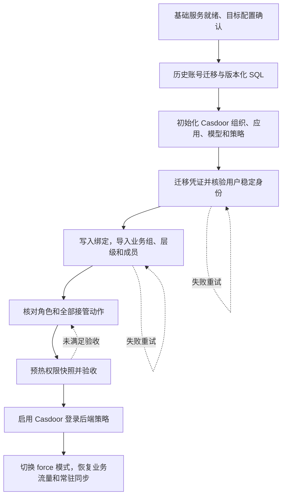

1. **预检并固定目标。** 确认正式域名、数据库、镜像版本、租户映射、凭证策略和范围。读取两边对象，生成新增、复用、冲突及待处理清单。
2. **执行本地迁移。** 按正确顺序迁入历史凭证，再执行版本化 SQL。新增 Casdoor 初始化记录与 SQL 执行记录分别保存。
3. **创建远端基础对象。** 固定组织、应用和角色内部名称，生成并保存一次客户端密钥。按部署版本生成受管动作及资源清单，并与原 Nexent 角色的有效权限逐项对照，形成首次策略。先配置有效策略和角色成员规则，再让功能权限接管运行。
4. **迁移用户并建立绑定。** 先确认远端用户创建成功及身份一致，再写 Nexent 绑定。已存在的有效绑定复用，冲突进入待办，保留原用户和租户。既有绑定也要核对角色成员及可用凭证；现有导入脚本会跳过已绑定用户，安装任务需补上这一步对账。
5. **导入群组及成员。** 父组先于子组，回写原 Nexent 组 ID 的映射，保留资源引用。Casdoor 成员关系回读确认后，才允许后台目录同步成为这些业务组的权威来源。
6. **预热与验证。** 检查每个接管用户的实际权限和用户状态。使用正式实例地址、模型和动作集合生成有效快照，再验证账号回跳、允许操作和拒绝操作。
7. **切换登录策略和流量。** 验证全部目标账号具备可用凭证后，发布统一后端登录规则并开启 `force`。恢复常驻轮询，安装状态记录为完成。

目前启用功能模型后，已绑定账号立即进入该模型的权限范围，缺失或过期快照按拒绝处理。现有代码可以在维护窗口内保持业务流量关闭，启动最终配置完成快照预热后再开放。如果需要后台无停机迁移，应新增按租户或批次的待迁移、已核验、已切换状态，鉴权和入口都依据同一状态判定，逐批切换。

Docker 安装顺序可由宿主安装脚本明确执行并检查退出码，兼容项目要求的 Engine 18.09。Kubernetes Job 完成后再发布应用。各业务副本读取初始化完成记录；发生迁移失败时，安装器应保留原可用部署，给出重试入口。

现有功能快照有效期为 60 秒，轮询在每轮结束后等待 15 秒。用户量较大时应核对整轮执行时间和每个账号的快照新鲜度，使用有界并发和分批刷新，确保开放流量时已有的快照持续更新。用户量和上游延迟需要通过目标规模测试确认。

### 如何保证幂等、断点续跑和权限保留

初始化任务应有持久化检查点。建议按「目标 Casdoor 实例标识、Nexent 租户、任务版本」记录任务，按源 `user_id` 或 `group_id` 记录对象步骤。数据库设计沿用技术主键和审计字段，业务键在数据库锁下校验，状态至少区分待处理、远端已确认、本地已确认、失败及完成。

可新增任务与对象明细两类记录，以下字段为待实现设计。

| 记录 | 建议字段 | 更新规则 |
| --- | --- | --- |
| 任务 | 部署目标标识、租户、Casdoor 组织、任务版本、配置摘要、阶段、统计和最后成功时间 | 初始化前获取任务锁，确认同一范围只有一个执行者；明细核验通过后推进阶段 |
| 对象明细 | 任务 ID、源类型和 ID、目标内部名称、目标稳定 ID、源版本摘要、状态、尝试次数和错误类别 | 远端写入前保存预定身份，远端回读确认后保存结果，本地事务提交后标记已确认 |
| 敏感凭证引用 | Secret 或受限交接文件的引用和版本 | 凭证和哈希保存在受控的秘密存储，进度表与安装日志只保存引用 |

任务和明细分别使用技术主键，带创建人、创建时间、更新人、更新时间和软删除字段。在事务锁下校验业务键的唯一性，为按任务和未完成状态查询配置索引。数据库锁在进程退出时释放，明细为后续执行者保留恢复位置。

跨多个小事务的任务锁应由专用数据库连接持有，运行结束释放。对象写入再复用账号及群组对应的事务锁。只在首个事务获取事务级锁，不能覆盖后续所有批次；连接断开后也应停止远端写入，由下次执行接管检查点。

| 操作 | 首次执行 | 重跑或异常恢复 |
| --- | --- | --- |
| 创建应用、角色或模型 | 查不到对象时按稳定内部名称创建，记录目标键和种子摘要 | 查到相同对象时比对身份和归属，继续未完成步骤 |
| 创建用户和密码 | 创建前持久化随机目标身份及凭证迁移结果或交接文件引用 | 请求超时后按既定身份回查，复用原用户 ID 和凭证 |
| 写 OAuth 绑定 | 在账号写入锁下确认源账号、租户、远端身份及既有绑定 | 同一绑定直接复用；软删除绑定和身份冲突按明确恢复规则处理 |
| 写角色或组成员 | 读取实际集合，按本步骤需要做成员增量，保存并回读 | 已存在成员直接通过；只撤销当前任务拥有且明确要求撤销的成员 |
| 写组映射和共享 | 更新原 Nexent 组的映射字段，保留 `group_id` 和共享记录 | 按远端组名及创建时间核验身份，删除重建导致的变化进入冲突处理 |
| 初始化权限策略 | 按清单创建首次策略，保存初始化版本和受管字段摘要 | 同版本重启跳过种子写入；管理员已删动作、停用策略或改角色时保留该决定 |
| 策略版本升级 | 对比旧种子、新种子和实际配置，生成差异 | 管理员修改过的字段按字段归属处理；存在争议时记录并停止该项升级 |
| 标记完成 | 回读远端对象、检查本地事务和实际授权后记录成功 | 完成记录与目标版本、配置摘要一致时跳过；普通重启继续使用运营配置 |

对管理员主动删除的种子策略，需要记录删除意图或配置归属。仅用「查不到就创建」会在重启时把该策略重新加回。初始化完成标记也要校验明细，避免上一次只完成一半却被当作全量成功。

Casdoor 和 Nexent 之间没有共享事务。远端成功、本地提交失败时，应先核验并复用远端结果，再重试本地步骤。数据库锁只协调遵守相同锁协议的任务；对 Casdoor 的人工编辑仍需维护窗口或单写入者。大量账号使用小批次事务和有界重试，避免在一个数据库事务里跨网络处理全部用户。

现有导入脚本已具备预览、事务、稳定重试文件及回读确认，但它以单批次恢复文件为依据，会在输入数据变更时停止。安装自动化应扩展为逐对象检查点，并将恢复文件保存到持久化的受限目录，后续重跑复用同一批次。正常重启继续保留运营人员已经调整的 Casdoor 配置。

### 统一登录策略和全量范围

`force` 控制浏览器入口。彻底切换还需要为 Nexent 的本地密码登录和注册、找回及设置密码、其他直连 OAuth/CAS、解绑等入口实施统一后端校验。已有账号的 `password_login_enabled` 可以在全量核验通过后用于禁用本地密码，但还需保证其他账号更新路径不会重新开放旧入口。通过 Casdoor 注册的来源标记 `auth_provider` 同时参与当前角色同步和解绑规则，批量切换时应增加独立的登录策略状态。

全量账号的迁移清单应包含以下处理。

- 普通租户的 `USER`、`DEV` 和 `ADMIN` 可以沿用当前身份和功能权限链路。迁入账号仍保留原租户角色。若还要求以后由 Casdoor 修改这些存量账号的租户角色，应单独扩展角色同步资格。
- `SU`、`ASSET_OWNER`、多租户及 API 专用账号需要明确覆盖策略。后台权限按原有角色语义核验；机器账号继续按自己的 API 认证方式处理。宣布所有交互式用户都已切换前，要为特殊角色准备完成的身份和登录路径。
- 当前群组同步采用单一组织与租户映射。多租户部署扩展映射后，各组、角色和策略都应按租户域检查，避免同一角色的成员意外跨租户获得另一组策略。
- 当前导入保留 Nexent 的 `Default Group`。若上线目标也包含默认组同步，需要先适配默认入组、邀请码分组和本地账号成员管理的所有写入路径，再将它纳入统一目录。

用户在 Casdoor 被禁用或删除后，当前权限同步停止刷新该身份，功能快照会过期。Nexent 自有会话、其他本地动作和 API 凭据仍需统一撤销机制，才能满足整站停用要求。可以设计经过身份核验的生命周期同步，或验证来源的 Webhook 加周期对账，再通过已有会话版本机制撤销指定用户会话。

### 切换验收与回退

安装成功至少要证明以下结果。

1. 原用户从 Casdoor 登录后仍进入相同的 Nexent 用户、租户和资源，存量用户清单逐条有结果，已排除项有明确原因。
2. 各账号类型按选定凭证路径完成登录，新注册、首次激活、密码恢复和第三方回跳可用。
3. 群组层级、直接成员及资源只读、编辑权限符合原规则。管理员删除的功能动作在重启后继续生效。
4. 当前角色和快照范围匹配，快照有效期内已同步，缺少动作时后端明确拒绝。进程 `/health/ready` 正常之外，还要核验业务权限。
5. 本地密码及其他旧登录接口按最终规则拒绝新会话，账号停用、解绑和退出按既定策略执行。
6. 重复安装、任务中断后重跑、Casdoor 短暂不可达、多个安装任务并发时，都能保留原身份和运营配置，并可确认恢复结果。

回退应恢复上一版部署配置、登录策略与对应版本的数据判定，保留可核验的身份和组映射。已经改过密码或新建的 Casdoor 用户可能只有 Casdoor 凭证，因此回退也要为这部分用户保留可用的登录路径。数据库回退按备份和兼容版本设计，原用户、组及资源继续按稳定 ID 核对。

安装验收通过后再按凭据策略处理临时交接文件及旧密码材料。把部署版本、任务版本、目标配置摘要和验收结果保存在安装报告中，便于后续扩容、升级和重试核对。
