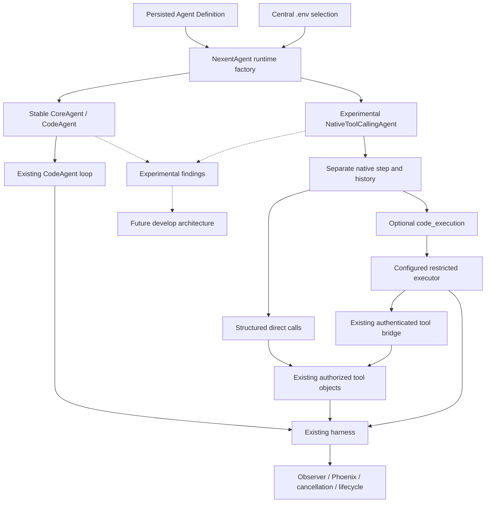

# Experimental runtime design

## Boundary and selection

NEXENT_AGENT_RUNTIME is read in backend/consts/const.py, defaults to codeagent, and rejects other values except toolcalling. The ordinary AgentRunInfo builder passes the process selection to the SDK; ephemeral NL2Agent/NL2Skill authoring helpers explicitly retain CodeAgent because their platform-owned business protocols require it. AgentRunInfo, run_agent.py, NexentAgent and independent subagent invocations carry it without modifying stored definitions. runtime_factory.py dispatches the unchanged legacy constructor or NativeToolCallingAgent.

## Separate native loop

native_runtime.py subclasses smolagents ToolCallingAgent but implements native step/history handling explicitly. NativeModel delegates configured client construction, provider reasoning translation and capacity dispatch to Nexent's existing OpenAIModel. It assembles indexed streamed tool-call fragments into actual provider calls, retains provider continuation metadata, and passes correlated individual tool results. Assistant content is never parsed as an action. Empty/duplicate IDs fail before execution. Tool argument/execution errors return correlated observations; cancellation uses RunTerminated to bypass repair. Maximum steps fails without an unbudgeted final model call.

## Shared and adapted components

| Component | Treatment | Reason |
|---|---|---|
| CodeAgent loop/parser/repairs | Not Applicable to native | Preserve stable path, avoid textual actions |
| Authorized tool construction | Shared | Existing definition-specific registry and implementations |
| Tool argument execution | Adapted | ToolCallingAgent validated direct execution, same objects sent to executor |
| Python executor/bridge/workspace | Shared/Adapted | Existing configured executor and send_tools; no new RPC implementation |
| Prompt | Reimplemented | Dedicated native prompt; user instructions retained |
| Streaming model adapter | Adapted | Nexent client/reasoning/dispatch reused, native fragments separately assembled |
| History | Reimplemented | Installed upstream memory textualizes calls |
| Context manager | Adapted | Static authorized items assembled through existing manager; current native exchange retained atomically as request tail |
| Observer/lifecycle wrapper | Adapted | Accept both concrete runtime types and preserve external final-answer contract |
| Planning and verification/guardrails | Adapted | Existing plan state callbacks and verification controller; native schema actions stay separate from Python prechecks |

## Decisions

Retain smolagents 1.23.0 for initial experiment. Published 1.26.0 still textualizes call history (release memory.py inspected); upgrade alone does not fix wire protocol. No dependency change; future upgrade requires stable CodeAgent/executor regression proof.

Direct tools and code_execution share authorized tool objects and monitoring wrappers. code_execution serializes access to the stateful existing executor. A missing configured executor uses the same restricted LocalPythonExecutor family as the legacy default. This is restricted execution, not proof of Docker isolation; Both restricted local and strict Docker paths have real-model evidence.

Context manager receives native exchange groups in request tails so compaction cannot split calls from results. Over-budget context fails explicitly; native current-run history compaction remains a design limitation. Provider-specific native reasoning fields remain separate from visible content and are retained for continuation. Evidence stores field presence only, not reasoning bodies.

Initial VM development used verified SSH/rsync because the Multipass launcher was unavailable in the agent process. The user then stopped the VM and selected the host for final deployment. The host stack and Phoenix are task-owned; VM data remains untouched. No second VM or snapshot restoration was used.

## Review outcomes

Provider retries retain the existing retry budget/classification and observer begin/rollback/commit boundaries. Cancellation closes registered provider streams and releases concurrency permits. Guardrail decisions use the existing verification event channel when enabled. Planning and clarification reuse business schemas; their dedicated native prompts replace only platform-owned execution conventions.

Two live failures refined the adapter: upstream executor re-registration must be bypassed, and Python must execute inside the existing bridge execution context. The final executor path calls that helper and uses the same authorized tools as direct execution. The host deployment also aligns the sandbox's workspace backing path with the application bind mount; otherwise a plausible final arithmetic answer could hide a failed sandbox. Acceptance explicitly asserts a successful execution observation.

The implementation deliberately fails on an over-budget native transcript rather than splitting call/result groups. It preserves authored instructions verbatim, so authored prompts that insist on CodeAgent tags may remain incompatible. NL2Agent/NL2Skill retain CodeAgent because their closed platform prompts carry authoring/save protocols. These are documented experimental boundaries, not a full parity claim.

Final source/image, formal and browser evidence is indexed in runtime-validation.md. The five deliverables distinguish live proof, unit proof and remaining gaps.

## Implemented data flow

The shared layer here is the existing authorized tool objects/factories and monitoring/guardrail wrappers, not a newly invented execution service. Direct invocation uses native JSON arguments and smolagents dispatch; Python uses prebound functions and the existing executor/bridge. Both retain tool permission scope and callback context, while Python can carry interpreter values that are not representable in native JSON. A future execution contract should make those representation differences explicit.
