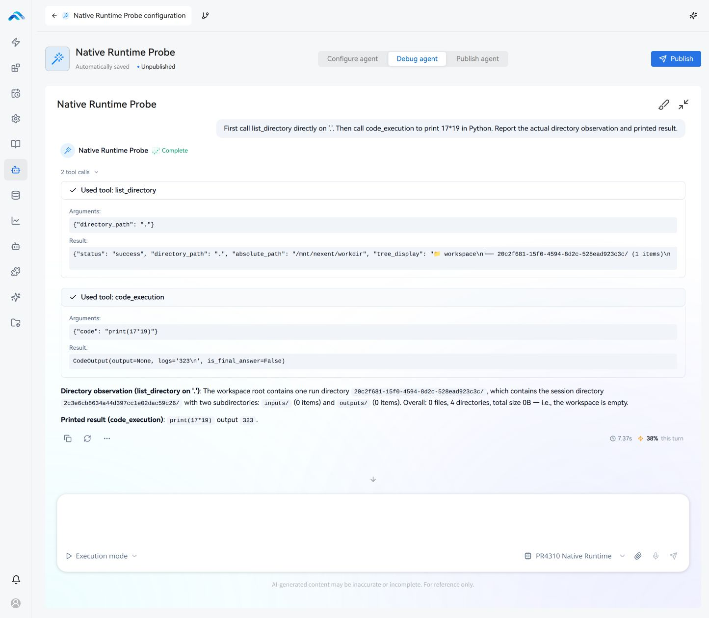

# Runtime validation and experimental findings

## Scope and identity

Source base: remote tag v2.8.4, `c43d2d995b15c9005c0d736cd60200a22305de74`. Feature branch: `feature/v284-native-toolcalling`, draft PR #4310 targeting main. Product hashes and immutable main/web/sandbox/MCP image IDs are in [source-images.json](evidence/source-images.json). Images were built with the repository image builder; final application containers have no backend/SDK source overlay. The tagged application constant reports v2.8.3 internally; that pre-existing version label was not changed.

The user explicitly selected the host for final deployment and stopped Nexent-Test. The VM remains stopped; no snapshot restore occurred. Host task state, dependencies, caches, logs and deployment data stay within the PR4310 worktree. The existing registry container was preserved. Final application: http://localhost:3000; host Phoenix: http://localhost:6006. Required tenant `Test Tanent` and its administrator/developer/user accounts were created only when missing; the existing super-admin password was retained. Credentials are not retained in this report or evidence.

## Traditional unit verification

**979 relevant unit cases passed**, with modules isolated in separate processes following `test/run_all_test.py`'s established pattern. New runtime/configuration tests account for 64 cases. Existing CoreAgent (179), NexentAgent (247), run_agent (51), context/factory/sandbox/MCP parameter suites, backend Agent construction (259) and authoring helper suites (83) passed. An additional 38 subagent resource/span cases also passed. Detailed module counts: [unit-results.json](evidence/unit-results.json).

The two new runtime modules have **99% statement coverage** (441/445 statements) and **95% branch coverage** (186/196 branches). This is a scoped unit metric, not whole-repository coverage and not combined with formal functional results. New source Ruff checks and copyright checks pass; `git diff --check` passes. Existing files contain pre-existing import-order findings; no broad formatting changes were made.

Commands used the task-local Python 3.11 environment, `pytest -p no:cacheprovider --basetemp=<task-local>`, and separate module invocations. Focused coverage used `--cov=sdk/nexent/core/agents --cov-config=.runtime/native-coverage.ini` with report inclusion restricted to native_runtime.py/runtime_factory.py.

## Formal functional verification

| Case | Boundary | Result |
|---|---|---|
| NATIVE-RUNTIME-D2 | Actual authenticated HTTP/SSE plain and Python runs; unchanged full definition hash; unauthenticated denial | 3 passed |
| NATIVE-RUNTIME-D3 | Actual provider/tool/executor/bridge/MCP/delegation/lifecycle integration | 17 passed |
| NATIVE-RUNTIME-D4 | Codex built-in-browser existing-definition hybrid debug and reload | Manual browser pass; not an automated runner result |
| NATIVE-RUNTIME-D5 | Running branch image IDs, installed runtime hash, no source overlay, app/auth health and sandbox identity | 1 passed |

The authoritative Feature/case/execution/change YAML is under `test-e2e/`. Generated registry/Excel validation passed with `validate_test_assets.py --phase implementation --generate`, explicit current-change acceptance/preparation/UT checks. Targeted executions used `run_cases.py` through the task-local verifier with physically worktree-contained state and logically separate `/task` and `/verification` mounts. No new D1 duplicates existing unit proof.

D3 covers direct existing-tool invocation, restricted arithmetic, Python calling existing authorized tools, and hybrid continuation on **both local and strict Docker backends**. Docker variants cannot pass by falling back to local. Additional scenarios cover discovered Qwen/DeepSeek/GLM/MiniMax models, native child-Agent delegation into Python, actual MCP stdio protocol through Nexent's managed session/tool factory, tool failure/recovery, one-step execution limits and cancellation after a real provider chunk. Cancellation closed the provider resource with no pending closers or second inference.

Normal-path assertions require actual tool observations as well as final answers. A model's fallback arithmetic after a sandbox failure is not accepted. Negative/error tests are separate from normal-path no-error traces. Semantic review checked each current obligation against its collected test and concrete assertions; binding hashes alone were not treated as acceptance proof.

Evidence: [host-sdk-matrix.json](evidence/host-sdk-matrix.json), [phoenix-sdk-audit.json](evidence/phoenix-sdk-audit.json), deployed-case evidence retained beside this report. Task-local run logs also retain exploratory failures and prerequisite mistakes; those are not relabeled as passes.

## Phoenix inspection

Phoenix MCP `getSpans` inspected all 17 final SDK traces, including prompts/context structure, model invocation settings, schemas, native call/result IDs, intermediate tool spans, expected failures and final outputs. Native continuation IDs match; final trace inputs are untruncated. Trace capture was increased to 100000 characters/100 items because the default 4000-character limit truncated one hybrid request. Retained audits contain structural metadata and field-presence observations, never private reasoning bodies.

The Docker programmatic trace shows the existing ListDirectoryTool span nested beneath code_execution, confirming authenticated callback context/parentage. MCP and managed-child traces show actual native invocations and model continuation, not mocked generations. Browser/application inspection is in [phoenix-browser-audit.json](evidence/phoenix-browser-audit.json); its actual code_execution span contains 323 and no error spans.

Historical VM development trace `35580ffbad09157ce417940ef296969a` is separately described in [initial-native-trace.json](evidence/initial-native-trace.json). It belongs to the stopped VM's Phoenix service and an earlier source snapshot; it is not used as final-host acceptance.

## Browser and persisted definitions

The built-in browser loaded the existing test Agent, selected Debug, ran direct list_directory followed by code_execution, and displayed the actual directory result plus `CodeOutput(... logs='323\n' ...)` and final answer. Reload retained the prompt/model/tool definition. A semantic definition digest before/after the browser journey matches: [browser-definition.json](evidence/browser-definition.json). Debug-conversation persistence across reload is not asserted.

## Runtime comparison and rollback

The **same persisted Agent** completed plain-answer and workspace-listing/Python workloads under CodeAgent and ToolCallingAgent in the final reviewed image. Full definition hashes before/after selection/restarts match. The final selection is toolcalling. [runtime-comparison.json](evidence/runtime-comparison.json) records immutable image IDs, start times, events and observed latencies. These are single observations, not a benchmark or speed claim.

Both runtimes deny unauthenticated execution with the same existing HTTP 500 response. The initial anticipated 401/403 assertion failed; baseline comparison confirms an unchanged HTTP status defect. It remains an explicitly reported limitation, not an authentication success claim.

## Provider reasoning findings

Native tools and native reasoning are independent. Qwen and GLM produced reasoning fields with configured existing catalog controls. DeepSeek and MiniMax also produced fields in some runs, but observations varied across the configured gateway. An effort value or accepted request does not guarantee a reasoning field. Missing fields are recorded as unverified reasoning, never inferred as success from native tool support.

DeepSeek's explicit thinking object follows its [official thinking-mode documentation](https://api-docs.deepseek.com/guides/thinking_mode/). The native adapter preserves reasoning/reasoning_content for continuation without streaming those bodies to the user. Other provider-specific/encrypted continuation fields remain unverified.

## Limits and acceptance interpretation

The architecture spike establishes the native/direct/code/programmatic/hybrid core and representative existing-definition integration. **It does not establish full harness or production parity.** Current-run native history compaction is unsupported; over-budget requests fail explicitly. Initial multimodal memory projection is incomplete and should not be used for multimodal workloads. Dynamic MCP container journeys, concurrent child lifetimes, live planning/verifier/clarification round trips and real multi-call state-continuation workloads remain unverified. Planning, guardrails, verification, clarification and variable persistence have focused unit proof only where marked in the [compatibility matrix](runtime-compatibility-matrix.md).

Authored CodeAgent formatting instructions are retained, so some definitions may remain incompatible. Only platform-owned execution policies are replaced. NL2Agent/NL2Skill intentionally retain CodeAgent for their closed authoring protocols. No database migration, destructive definition rewrite or frontend runtime selector was added. The develop roadmap identifies the remaining engineering work rather than presenting these limitations as completed parity.

The initial CI unit tests, amd64/arm64 image builds and copyright checks passed. Codecov reported 82.86334% patch coverage, so meaningful boundary/error/cancellation/masking/context/termination tests were added. Product source and image inputs are unchanged. Updated remote CI/Codecov results are reported in the PR conversation; local verification is not represented as remote completion.

## Standalone branch follow-up — 2026-11-09

This v2.8.4 branch is a standalone hotfix-like experiment and is not intended for merge into main/develop. The feature-introduction branch is feature/native-toolcalling-runtime (PR4315), based on develop and its model service. Historical evidence above refers to earlier source snapshots.

The follow-up implements validated finish reasons: normal nonempty content-only stop or standalone final_answer can terminate; content accompanying ordinary tool calls is intermediate. Length/filter/refusal/missing/inconsistent completion cannot authorize tool execution or successful completion. Public content now bypasses the legacy thinking parser, is retained around tools, rolls back per attempt, and persists/reloads without duplicating the accepted final step. No progress tool is added. Current sanitized verification is retained separately from historical evidence.

## Standalone completion follow-up — 2026-11-09

This v2.8.4 branch is retained as a standalone feature and will not merge into main/develop. The user approved content-only normal stop or standalone final_answer as completion candidates. Mixed content/tool responses stay intermediate; invalid/missing terminal reasons, refusal, truncation, cancellation and failed streams cannot authorize successful completion or tool effects.

Relevant local Python suites: **729 passed**, no failures/skips. Frontend: **5 Node projection tests and 17 Vitest adapter/regression tests passed**, TypeScript passed. Formal host checks: **3 API**, **17 actual-model SDK**, **10 controlled HTTP/SSE fault/normal cases**, **1 deployed identity/health** passed. Browser public messages, actual direct/Python results and reopened saved-history order were manually verified. These are follow-up results, separate from historical experiment evidence.

See [acceptance record](evidence/completion-acceptance.json), [API evidence](evidence/completion-api-results.json), [Phoenix structural audit](evidence/completion-phoenix-sdk-audit.json), [installed source/image identity](evidence/completion-image-identity.json), and [browser capture](evidence/interleaved-browser.png). The main/web images were built from this branch; all four changed backend/SDK product files match installed image hashes. Shared host data was retained when switching to the isolated develop deployment. VM remains stopped; the develop host deployment is the final active application.

The historical experimental limitations above remain. The new implementation lives on PR4315 and uses develop's model service; this old branch deliberately keeps the v2.8.4 integration. No new pull request is required for this standalone branch.

Provider reasoning follow-up: standalone native collector now streams provider reasoning through the typed observer path, including alias deduplication. Length/refusal completion failures have clearer diagnostics while strict no-effect/final rules remain. Affected Python 87 PASS; frontend adapter/cancellation 20 PASS; controlled formal HTTP/SSE 10 PASS; the rebuilt standalone image separately passed all 10 fixed controlled runtime scenarios using installed /opt/sdk sources and matching source hashes. Current develop deployment remains active; no switch to the old database/application occurred. See evidence/reasoning-acceptance.json and reasoning-image-identity.json.
